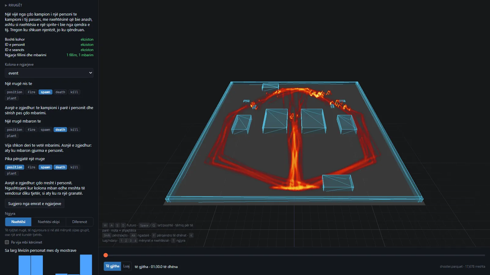

# Nxehtësi vijash

Nxehtësia tregon ku qëndronin njerëzit. Vijat tregojnë rrugët që ata ecën.

**Vijat** (tasti 4) është nxehtësi vijash: një vijë nga çdo mostër e një [personi](glossary.md) deri te mostra e tij e radhës, e shpërndarë me të njëjtën rënie si një [sprite](glossary.md) - përgjatë vijës në vend që rreth një pike. Tregon ku njerëzit *shkuan*, jo ku qëndruan: një korridor i kaluar një herë është po aq i dukshëm sa një dhomë ku u fshehën, dhe mostrat e rralla të një lojtari të shpejtë bashkohen në një rrugë të vazhdueshme në vend të një gjurme me pika. Kërkon një kolonë personi dhe një kolonë kohe.

## Si përdoret {#how-to-use-it}

1. Shtypni `4` (ose zgjidhni **Vijat** te shiriti i mënyrave).
2. Hapni **Rrugët** dhe kontrolloni listën e gjelbër: kohëvizata dhe ID e personit duhet të jenë të pranishme.
3. Shtypni **Sugjero nga emrat e ngjarjeve** për të plotësuar aty ku nisin dhe mbarojnë rrugët.
4. Lexoni rreshtin e statistikave: "N rrugë, M prej tyre që arrijnë një fund".
5. Nëse vijat kërcejnë përtej hartës, rregulloni **Hapin më të gjatë** (shih [Kufiri i kërcimit](#the-jump-limit)).

Një vijë ka kuptim vetëm midis një fillimi dhe një fundi, kështu që paneli **Rrugët** thotë çfarë kufizon një rrugë. Gjithçka nga [Rregullat e një rruge](#the-rules-of-a-route) e tutje është detaj që mund ta kapërceni.

## Paneli Rrugët {#the-routes-panel}

Shfaqet mbi panelet e nxehtësisë në mënyrën Vija.

### Çfarë ka të dhënat {#what-the-data-has}

Një listë kontrolli, e gjelbër kur është e pranishme, portokalli kur nuk është:

| Rreshti | Gjendjet |
|---|---|
| **Kohëvizata** | *e pranishme* / *mungon - e nevojshme* |
| **ID e personit** | *e pranishme* / *mungon - e nevojshme* |
| **ID e seancës** | *e pranishme* / *asnjë - të gjitha rreshtat janë një seancë* |
| **Ngjarje fillimi dhe mbarimi** | *N fillime, M mbarime* / *asnjë nuk u zgjodh - gjurmë të plota* (e gjelbër vetëm me një kolonë ngjarjesh dhe të paktën një fillim dhe një mbarim) |

### Kontrollet {#controls}

| Kontrolli | Kuptimi |
|---|---|
| **Kolona e ngjarjeve** | Një kolonë kategorie ku vlerat janë ngjarje (lindje, vdekje, pozicion, ...). *Asnjë - gjurmë të plota*: gjurma e çdo personi në çdo seancë është një rrugë, e prerë aty ku gjurma ka një boshllëk. Ofrohen vetëm kolonat e mbajtura për filtrim gjatë ngarkimit. |
| **Një rrugë nis te** | Vlerat e ngjarjeve që nisin një rrugë (lindje, ringjallje, vendosje). Asnjë i zgjedhur: një rrugë nis te mostra e parë e personit, dhe prapë pas çdo mbarimi. |
| **Një rrugë mbaron te** | Vlerat e ngjarjeve që mbarojnë një rrugë (vdekje, evakuim, teleportim). Vija shkon deri te vetë rreshti i mbarimit. Asnjë i zgjedhur: një rrugë mbaron aty ku mbaron gjurma e personit. |
| **Pika përgjatë një rruge** | Vlerat e ngjarjeve, rreshtat e të cilave shtrihen përgjatë rrugës. Asnjë i zgjedhur: çdo rresht i personit. Ngushtojeni kur kolona mban edhe rreshta të vendosur diku tjetër, si aty ku ra një granatë. |
| **Sugjero nga emrat e ngjarjeve** | Plotëson tri listat me emrat e vlerave (më poshtë). |
| **Ngjyra** | *Nxehtësi*, *Nxehtësia e ekipeve* ose *Diferencë*. Të njëjtat rrugë me ngjyrosjen e asaj mënyre: çdo grup me nuancën e vet, ose një palë kundër tjetrës, me listën e grupeve, ndarjen dhe shkallët që funksionojnë si në ato mënyra. Parazgjedhja *Nxehtësi*. Nxehtësia e ekipeve dhe diferenca kërkojnë një kolonë grupi. |
| **Pa vija mbi kërcimet** / **Hapi më i gjatë** | Mostra e radhës e një personi më larg se kjo është ringjallje, teleportim ose rënie, jo një vend ku ka shkuar; kështu asnjë vijë nuk i lidh të dyja. Plotësohet në ngarkim kur të dhënat tregojnë një boshllëk të qartë (më poshtë), dhe fiket kur nuk e tregojnë. Funksionon me ose pa kolonë ngjarjesh. |
| Rreshti i statistikave | `N rrugë, M prej tyre që arrijnë një fund, K segmente`, i përditësuar disa herë në sekondë. |

Çdo listë është një rresht çipash me ndërrim, një për vlerë, më të shpeshtat e para; kalimi i miut mbi një çip tregon numrin e rreshtave të tij. Ofrohen të shumtën 120 vlera (*N vlera të tjera nuk shfaqen*).

Zgjedhja e një kolone tjetër ngjarjesh aplikon sugjerimin kur sugjerimi zgjedh pikërisht atë kolonë, dhe nis me lista bosh përndryshe.

### Sugjerimi {#the-suggestion}

Në çdo ngarkim, dhe kur shtypet **Sugjero nga emrat e ngjarjeve** ([`suggestLineSettings`](https://github.com/Holdi601/3DHeat/blob/main/src/data/lines.ts)):

- **Kolona e ngjarjeve:** kolona e parë e kategorisë e mbajtur me emër `event`, `eventname` ose `eventtype`; përndryshe `kind`, `type` ose `action`; përndryshe çdo kolonë që përmban *event*, *kind*, *action* ose *type*.
- **Fillimet:** vlera që përmbajnë *spawn, deploy, join, enter, start, begin, respawn, revive, land/landed/landing, drop* - përveç nëse përputhen edhe me një fjalë mbarimi.
- **Mbarimet:** vlera që përmbajnë *death, died, dead, kill/killed, eliminat…, extract, evac, teleport, leave, left, disconnect, quit, exit, end, finish, downed* - përveç vlerave `kill` dhe `kills` (një vrasje është diçka që bën vrasësi, jo fundi i rrugës së tij).
- **Pikat:** vlera që janë saktësisht *position, location, player location, move, movement, tick, sample* ose *pos*; kur gjendet ndonjë, fillimet dhe mbarimet shtohen edhe te pikat. Kur nuk gjendet asnjë, pikat mbeten bosh (çdo rresht).

### Kufiri i kërcimit {#the-jump-limit}

Aty ku njerëzit kërcejnë, gjatësitë e hapave bien në dy grupe pa asgjë mes tyre: çfarë mbulon një person midis dy mostrave, dhe gjerësia e hartës. Në ngarkim ([`suggestMaxJump`](https://github.com/Holdi601/3DHeat/blob/main/src/data/lines.ts)) hapat numërohen për çdo dyfishim të katrorit të gjatësisë së tyre, deri në 16 milionë; kufiri vendoset në mes të diapazonit të parë mbi medianën që është të paktën një dyfishim gjatësie i gjerë, mban nën 0.02% të hapave për çdo kosh, dhe ka hapa përtej tij. Pa një diapazon të tillë nuk preket asgjë, sepse s'do të dallohej një kërcim nga një makinë e shpejtë; kur kufiri ndizet me dorë, nisët nga një e dhjeta e diagonales së të dhënave.

Grafiku mbi kufirin tregon sa të gjata janë me të vërtetë hapat, me një vijë te kufiri: shiritat në të djathtë të tij nuk vizatohen. Të dy boshtet janë logaritmike, sepse kërcimet mund të jenë një e qindta e hapave dhe një mijë herë më të gjata. Kalimi i miut mbi një shirit tregon diapazonin dhe pjesën e tij; klikimi në grafik e vendos kufirin atje. Nën të, pjesa e hapave mbi kufirin.

## Rregullat e një rruge {#the-rules-of-a-route}

Rreshtat ecin sipas kohës, për çdo person ([`buildLines`](https://github.com/Holdi601/3DHeat/blob/main/src/data/lines.ts)):

1. Rreshtat e një [emri të përbashkët](sessions-persons-groups.md#names-worn-by-several-things-at-once) anashkalohen plotësisht.
2. Kur janë zgjedhur pika, një rresht që nuk është as fillim, as mbarim, as pikë anashkalohet.
3. Rreshtat ndiqen për çdo person dhe seancë, kështu që një person, seancat e të cilit ndërthuren sipas kohës ka nga një rrugë në secilën. Një rrugë mbyllet kur rreshti i mëparshëm nuk kishte pasardhës ([jetëgjatësia](sessions-persons-groups.md#person) e tij është "asnjë") - një rrugë nuk kalon kurrë kufirin e një seance apo një boshllëk që ngarkimi vendosi se nuk ka mostër të radhës. Cilës rrugë i përket një rresht llogaritet një herë dhe ruhet, 4 bajt për rresht, kështu që ndryshimi i hapit më të gjatë nuk e përsërit atë pjesë.
4. Një rresht **fillimi** mbyll çdo rrugë të hapur dhe hap një të re aty.
5. Kur janë zgjedhur fillimet, një rresht jashtë një rruge injorohet. Pa fillime, çdo rresh jo-mbarim jashtë një rruge hap një.
6. Çdo rresht tjetër brenda një rruge shton një **segment** nga rreshti i mëparshëm i rrugës deri te ky.
7. Një rresht **mbarimi** që e zgjat një rrugë e mbyll pas segmentit të vet; ajo rrugë numërohet si *që arrin një fund*.
8. Një hap më i gjatë se **Hapi më i gjatë** e mbyll rrugën aty ku ishte, dhe një rrugë e re nis te skaji i largët, përveç nëse ai rresht është mbarim. Nuk vizatohet asnjë vijë përtej tij, dhe rreshti i statistikave e numëron.

Çdo segment ruhet te rreshti i *mbarimit* të vet, kështu që segmentet mbeten në rend kohor, dhe [kohëvizata](timeline.md), dritarja e mostruesit, [filtrat](filters.md), dukshmëria e grupeve dhe shenja e diferencës punojnë mbi ta si mbi pikat. Një filtër zbatohet kështu mbi rreshtin ku mbaron një segment.

## Riluajtja {#playback}

Në mënyrën **Të gjitha** çdo rrugë vizatohet e plotë. Në mënyrën **Luaj** çdo person është një pikë që lëviz midis mostrave të veta, duke vizatuar rrugën e vet pas tij:

- një segment që nis pas kokës së riluajtjes nuk vizatohet;
- segmenti ku personi është në mes vizatohet deri te pozicioni i tij i interpoluar, me një kapak fundi te koka;
- nxehtësia zbehet mbi **bishtin**: me historinë *Kumulative* bishti është i pakufizuar dhe e tërë rruga deri tani mbetet; me *Dritare* zbehet në asgjë gjatë *Hapësirës* (parazgjedhja 30 s). Me *Jetëgjatësi* bishti është gjithashtu *Hapësira*, dhe në mënyrën Vija kohëvizata shfaq kutinë *Hapësira* edhe për atë histori (në vend të *Jetës rezervë* dhe *Zbehjes*, që nxehtësia e vijave nuk i përdor).

Gjatë luajtjes çdo kornizë vizatohet e tërë, jo e grumbulluar, sepse kokat lëvizin çdo kornizë dhe një mesatare në lëvizje do t'i shtrembëronte në një vijë.

## Për zhvilluesit {#for-developers}

### Memoria {#memory}

Rrugët ndërtohen në fijen kryesore kur hyhet në mënyrën Vija (ose kur ndryshojnë cilësimet e rrugës) dhe lirohen kur del prej saj: 5 bajt për rresht në memorie dhe 8 bajt për rresht në GPU (pozicioni fillestar i çdo segmenti, i kuantizuar në 16 bit për bosht brenda kutisë kufizuese të të dhënave, dhe flamujt e tij).

### Si vizatohet një vijë {#how-a-line-is-drawn}

Të dy motorët vizatojnë çdo segment nga rreshti i tij i fundit si **18 kulmime** ([`lineHeatVs`](https://github.com/Holdi601/3DHeat/blob/main/src/render/webgl2/shaders.ts) dhe binjaku i tij WGSL):

- Gjysmëgjerësia në çdo skaj është [rrezja e pikës](sprite-shape.md#sprite-radius) në distancën e atij skaji, me kufijtë e pikselëve të zbatuar. Një vijë më e hollë se 2.5 px vizatohet 2.5 px e gjerë me nxehtësinë e saj të zvogëluar përkatësisht, kështu që vijat e holla as nuk zhduken as nuk ndriten.
- Nxehtësia bie **përgjatë** vijës me të njëjtën shkallë si një sprite - rënia ose kurba, intensiteti i qendrës dhe i skajit.
- Kapakët e rrumbullakët vizatohen **vetëm** aty ku një rrugë nis ose mbaron, që kyçet midis segmenteve të njëpasnjëshëm të mos bëhen një varg margaritarësh.
- Gjeometria ndërtohet në hapësirën e ekranit dhe interpolohet linearisht atje, kështu që rënia mbetet e qendëruar në vijë sado që të hyjë në thellësi. Një segment që kalon planin e afërt pritet aty në vend që të hiqet.

Nxehtësia e pikave dhe nxehtësia e vijave e vendosin shumë nxehtësi të ndryshme për rresht, prandaj ngopja matet përsëri kur kaloni midis tyre ([Ngjyra dhe ekspozimi](colour-and-exposure.md#auto-exposure)).
