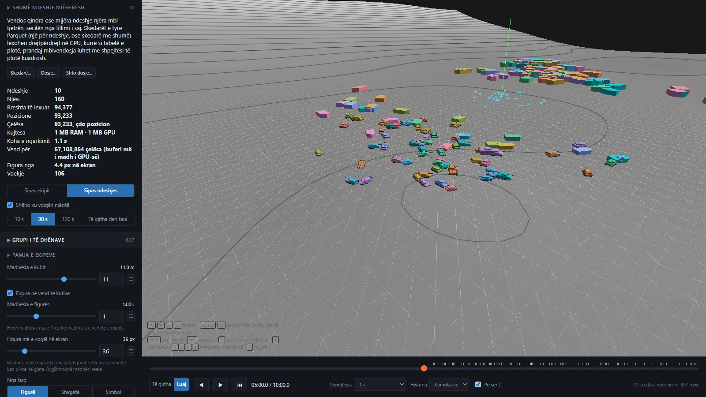

# Shumë ndeshje njëherësh

**Shumë ndeshje njëherësh** luan shumë ndeshje njëra mbi tjetrën, kështu që shikon ku shkojnë zakonisht lojtarët e çdo ndeshjeje. Përdore për të krahasuar qindra ose mijëra ndeshje në një figurë të vetme.

Çdo ndeshje fillon nga fillimi i vet dhe njësitë e saj lëvizin si figura. Skedarët shkojnë drejt e në kartën grafike dhe nuk ndërtohet asnjë tabelë e plotë, kështu që luhet rrjedhshëm aty ku një ngarkim normal do të mbaronte memorien.

## Si ta përdorësh {#how-to-use-it}

1. Hap **Shumë ndeshje njëherësh** në shiritin anësor të Harta e nxehtësisë.
2. Shtyp **Skedarë…** (zgjidh shumë skedarë), **Dosje…** (një dosje dhe nëndosjet e saj) ose **Shto dosje…** (shto në atë që është ngarkuar).
3. Shikuesi kalon te mbivendosja e figurave dhe fillon nga fillimi. Shtyp **Luaj**.

Çdo skedar është një ndeshje (ose mban disa). Punojnë skedarët Parquet dhe kontejnerët [`.3dheat`](container.md). Një skedar ka nevojë për një kolonë pozicioni, kohe dhe njësie; kolonat e emrit, tipit dhe anës mbahen. Skedarët e tjerë, dhe skedarët anësorë të konvertuesve (fluturimi, mesazhet, ngjarjet, bisedat, objektivat), anashkalohen. Për një tabelë normale, shih [Si të futni të dhënat](getting-data-in.md).

## Cilësimet {#settings}

| Cilësimi | Çfarë bën |
|---|---|
| **Sipas ekipit** / **Sipas ndeshjes** | Ngjyros sipas anës, ose një ngjyrë për ndeshje. |
| **Shëno ku vdiqën njësitë** | Një shenjë aty ku vdiq secila njësi, për 10 s, 30 s, 120 s, ose të gjitha deri tani. |

Paneli tregon sa ndeshje, njësi, rreshta dhe pozicione u lexuan, kujtesën e përdorur dhe kohën e ngarkimit. *Vend për* është sa pozicione të tjera mund të mbajë ende karta grafike. *Figurat nga* është madhësia në ekran nën të cilën një njësi vizatohet si një shigjetë e vogël në vend të figurës së vet.

Pamja e figurave përdor të njëjtat kontrolle si te [riluajtja e ndeshjes](match-replay.md#figures): **Madhësia e figurës**, **Figura më e vogël në ekran** dhe **Nga larg**.

## Këshilla {#tips}

- Kur gjithçka nuk do të përshtatej në memorie, pozicionet holohen (mbahet vetëm një pozicion në çdo disa metra) dhe paneli e thotë këtë.
- Modalitetet e nxehtësisë punojnë edhe mbi të dhënat e mbivendosjes.
- Për statistika mbi mijëra ndeshje pa i vizatuar, shih [Analiza masive](mass-analysis.md).
