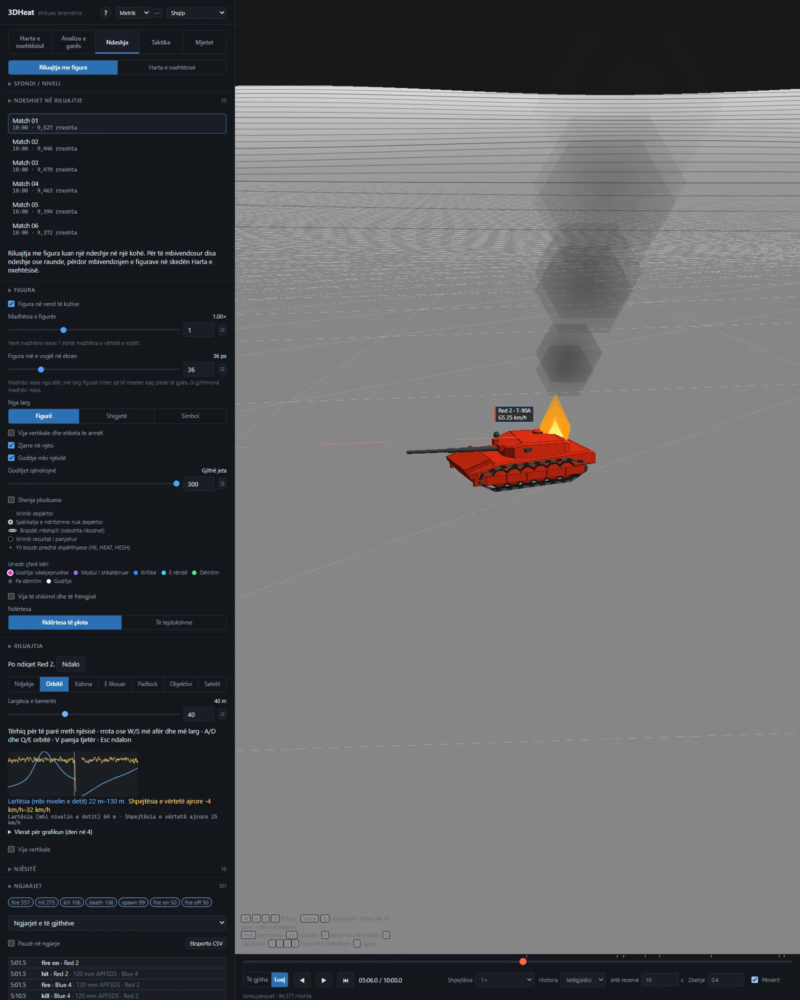
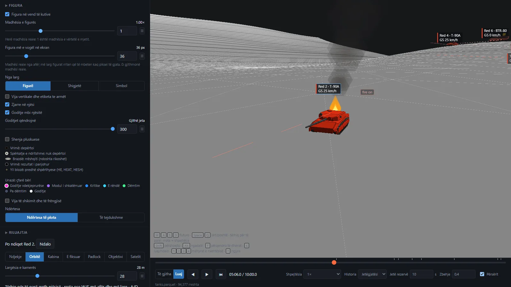
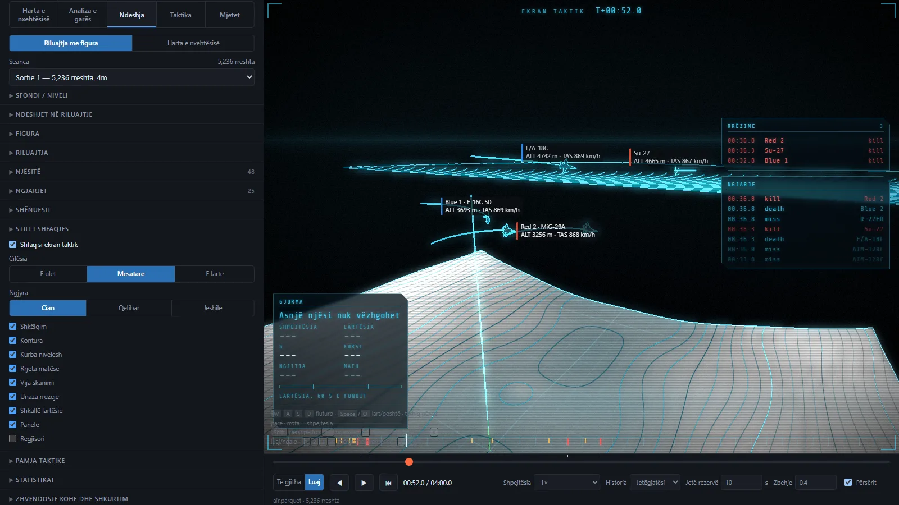
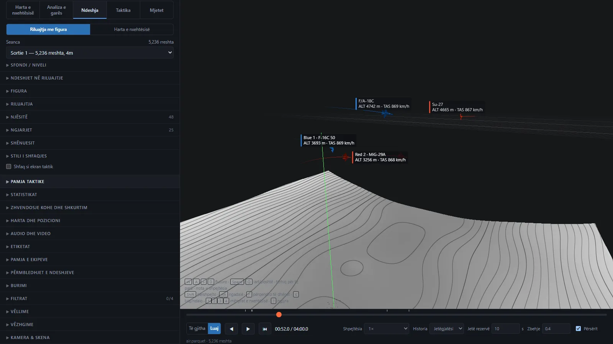

# Riluajtja e ndeshjes

Riluajtja është një film i ndeshjes ku çdo lojtar vizatohet si gjëja që drejtonte. Përdore për të parë përsëri një përleshje, për të ndjekur një njësi dhe për të parë kush goditi kë.

Të shtënat, goditjet, zjarret dhe rrënojat vizatohen mbi njësitë dhe objektivat e nivelit. Kamerat, etiketat dhe një pamje taktike të ndihmojnë të lexosh përleshjen. A e njeh Tacview-n? [Barazia me Tacview](tacview-parity.md) tregon ku ndodhet secili prej mjeteve të tij.

## Nisja e një riluajtjeje {#start-a-replay}

1. Ngarko një regjistrim me **Burimi → Skedarë…** ose duke e lënë mbi panelin Burimi (çdo tabelë me një kolonë **person** dhe një kolonë **time**, një skedar Tacview, një riluajtje e konvertuar, një ndeshje [`.3dheat`](container.md)). Shih [Si të futni të dhënat](getting-data-in.md).
2. Hap skedën **Ndeshja** dhe zgjidh **Riluajtja me figura**, ose zgjidh **Mbivendosje figurash** te shiriti i modaliteteve të skedës Heatmap.
3. Te **Ndeshjet në riluajtje** zgjidh një ndeshje, të gjitha njëherësh, ose disa.
4. Shtyp **Luaj** te vija kohore (ose `K`). Tërhiq vijën kohore për të kërcyer.

Figurat zëvendësojnë kutitë për çdo njësi kur njihet emri ose lloji i saj (shih [Figurat](figures.md)). Të dhënat pa kolonë emri ose lloji vizatohen si ushtarë.

## Figurat {#figures}

| Cilësimi (seksioni **Figurat**) | Parazgjedhja | Çfarë bën |
|---|---|---|
| **Figura në vend të kutive** | i ndezur | I fikur vizaton kuti të thjeshta. |
| **Madhësia e figurës** (herë madhësia reale) | 1 | 1 është madhësia reale; 0,25 deri në 20 herë (shkallë logaritmike). Më e madhe ndihmon nga larg. |
| **Figura më e vogël në ekran** | 36 px | Figurat e largëta rriten për të mbetur këtë të madhe, 0 deri në 200 px; 0 mban madhësinë reale. |
| **Nga larg**: Figurë, Shigjetë, Simbol | Figurë | Çfarë bëhet një njësi e largët. |
| **Simbolet** | NATO (APP-6) | NATO (APP-6), shenjat taktike ruse, ikonat e **Hartës së lojës**, ose **Vetëm forma (për daltonikët)**. |
| **Madhësia e simbolit**, **Pala ime**, **Armik / Neutrale**, **Vija drejtimi** | 28 px (12 deri 64), automatike, armik, i ndezur | Si duken simbolet dhe cila palë është miqësore. |
| **Vija vertikale** | i ndezur | Një vijë nga çdo njësi drejt e poshtë në tokë, që lartësitë të lexohen në 3D. |
| **Vija vertikale dhe etiketa te armët** | i fikur | Vija deri në tokë dhe etiketa te raketat dhe bombat. |
| **Zjarre në njësi** | i ndezur | Flakë nga momenti kur një njësi merr zjarr deri kur shuhet. |
| **Goditje mbi njësitë** | i ndezur | Shenja ku goditën të shtënat (më poshtë). **Goditjet qëndrojnë**: 1 deri 300 sekonda, ose **Gjithë jeta**. **Shenja pluskuese**: shenja të vizatuara mbi sipërfaqe. |
| **Vija të shikimit dhe të frëngjisë** | i fikur | Me viza: nga ku shikon lojtari; e plotë: nga ku shikon topi. |
| **Ndërtesa** | e ngurtë | Ndërtesa të ngurta ose transparente, kur niveli i vizaton. |

### Simbolet nga larg {#symbols-at-a-distance}

Kur një njësi do të ishte më e vogël se **Figura më e vogël në ekran**, mund të bëhet një simbol që mbetet i lexueshëm. Forma tregon llojin (për shembull një kuti e rrumbullakosur me një shenjë shiri për blindat); ngjyra tregon palën. Hap menynë **Simbolet** për të ndryshuar stilin.

### Shenjat e goditjeve, rrënojat dhe zjarret {#hit-marks-wrecks-and-fires}

- **Shenjat e goditjeve** qëndrojnë mbi sipërfaqen ku ra e shtëna, në përmasën e figurës. Pamja e tyre tregon çfarë ndodhi: një vrimë (kaloi), një shpërthim i ndritshëm (nuk kaloi), një gërvishtje (u shmang), një yll i zi nga tymi (predhë shpërthyese). Një unazë me ngjyrë tregon çfarë bëri: goditja vrasëse, moduli u shkatërrua, kritike, e rëndë, dëm, pa dëm, goditje. Kalo mbi një shenjë për emrin e predhës.
- Një njësi e shkatërruar vizatohet **e djegur** si rrënojë nga vdekja e saj deri kur ringjallet ose hiqet; simboli i saj është i kryqëzuar.
- **Zjarret** digjen mbi një njësi nga momenti kur merr zjarr deri kur shuhet.
- **Kullat** rrotullohen kah ku thotë të dhënat se shenjon topi (ose, pa ato, kah ku shikon lojtari).

### Armët, karrocat dhe gjurmët {#weapons-decoys-and-tracers}

Me **Armë, të shtëna dhe goditje** të ndezur (seksioni Shikuesi i ekipit): raketat, rakietat, bombat dhe siluruesit fluturojnë si figura të veta me një gjurmë tymi; plumbat dhe predhat janë gjurmë të ndritshme; goditjet dhe shpërthimet ndriçojnë. Një gjurmë e vizatuar **me viza** u nxor nga një goditje, sepse të dhënat nuk kishin të shtënë. Fishekzjarrët dhe reflektorët vizatohen si karroca; fshihen nga lista e njësive, përveç nëse është i zgjedhur *Karroca dhe predhat*.

## Kamerat {#cameras}

Kliko një njësi ose etiketën e saj për ta **ndjekur**. Seksioni **Riluajtja** ofron **Ndjekje**, **Orbitë**, **Kabina** (me një ekran në pamjen përpara, `H`), **E fiksuar**, **Padlock**, **Objektivi** dhe **Satelit**. `V` i kalon njëri pas tjetrit, dhe **Largësia e kamerës** cakton sa larg është. Esc ndalon.

- **Pamja me dy njësi**: zgjidh një **Objektiv** (ose kliko një njësi me Ctrl/Alt) për ta parë nga ajo që ndjek. **Këmbe** i shkëmben ato.
- **Matja**: kliko me Shift mbi dy njësi për drejtimin, distancën dhe ndryshimin e lartësisë midis tyre.
- **Harta 2D** (`M`): pamje në qoshe ose e plotë, me gjurmë dhe emra.
- **Shënuesit** (`B`): ruan momentin dhe kamerën; listohen edhe vrasjet, vdekjet dhe shenjat e vetë regjistrimit.
- **Ngjarje**: çdo ngjarje sipas kohës; një klik kërcen atje. `Page Up` / `Page Down` kërcejnë midis ngjarjeve; **Pauzë në ngjarje** ndalon te çdo ngjarje.

## Pamja taktike {#tactical-display}

Seksioni **Pamja taktike** vizaton, për asnjë njësi, të zgjedhurat, të gjitha, ose një lloj (avionë, tokë, anije, armë): vektorët e shpejtësisë dhe rrugën përpara, vijat e hundës dhe të ngritjes, konet e radarit, kyçjet, lidhjet e të dhënave, zonat dhe vijat e angazhimit, vijat e shikimit, ku shikojnë lojtarët (konet e shikimit), shenjimin e kullës dhe kamerën e regjistruar.

### Stili i ekranit {#display-style}

`T` (ose ndërrimi **Shfaq si ekran taktik**) e kalon pamjen në një stil ekrani radari: shkëlqim, konturat, vijat e nivelit, një rrjet matjeje, vija skanimi, unaza distance, shkallë lartësie, paneli me vrasjet dhe ngjarjet, dhe një **Regjisor** që e lëviz kamerën te ngjarjet vetë.

## Objektivat {#objectives}

Kur një ndeshje vjen me objektivat e saj, seksioni **Objektivat** i vizaton mbi nivel: zonat e kapjes (me pronarin dhe progresin e kapjes), spawn-et, aeroportet, zonat dhe objektivat e bombardimit. Të gjitha mund të shfaqen ose fshihen veç e veç, me etiketa. Shihen edhe nëpër tokë. Kur janë ngarkuar disa mënyra loje, **Modaliteti** i filtron ndeshjet sipas mënyrës. Objektivat vijnë nga skedari i ndeshjes i një konvertuesi, që ndodhet pranë regjistrimit ose brenda një kontejneri [`.3dheat`](container.md).

## Etiketat dhe statistikat {#labels-and-statistics}

- **Etiketat**: rregulla për çdo lloj (**Të zgjedhura**, **Avionë**, **Toka**, **Anije**, **Armë**, **IA**): shfaqen ose jo, cilat vlera, dhe një **Përparësi** për kë merr hapësirën kur etiketat mbivendosen. **Mbaji etiketat larg njëra-tjetrës** e vendos një etiketë pranë njësisë së vet kur do të mbulonte një tjetër, dhe e heq aty ku nuk ka vend. **Madhësia e etiketave** është 60 deri 250%. **Kthehu te emri, mjeti, lartësia dhe shpejtësia** i rivendos rregullat.
  - Njësitë e tokës fillojnë me emrin, mjetin dhe shpejtësinë.
  - Avionët fillojnë me emrin, mjetin, lartësinë dhe shpejtësinë.
  - Anijet fillojnë me emrin, mjetin, shpejtësinë dhe drejtimin.
  - Kalo mbi një njësi për të parë çdo vlerë që ka.
- **Statistikat**: për ekip dhe njësi: vrasje, vdekje, të shtëna, goditje, raporti i goditjeve, ngritje, ulje, koha në ajër, shpejtësia më e lartë, lartësia dhe G, distanca. Eksport CSV.
- **Grafikët**: vlerat e një njësie gjatë kohës, dy njësi të krahasuara, ose një vlerë kundrejt një tjetre.

## Shumë ndeshje njëherësh {#many-matches-at-once}

Për të vendosur qindra ose mijëra ndeshje mbi njëra-tjetrën, shih [Shumë ndeshje njëherësh](many-matches.md). Detajet e figurave (tymi, zjarri, efekte të tjera me kohë): [Figurat në mbivendosje figurash](figure-replay.md). Lista e veçorive të Tacview: [Barazia me Tacview](tacview-parity.md), një faqe e fëmijës e kësaj.
