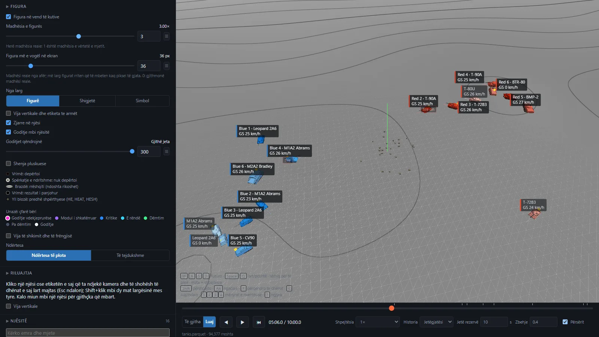
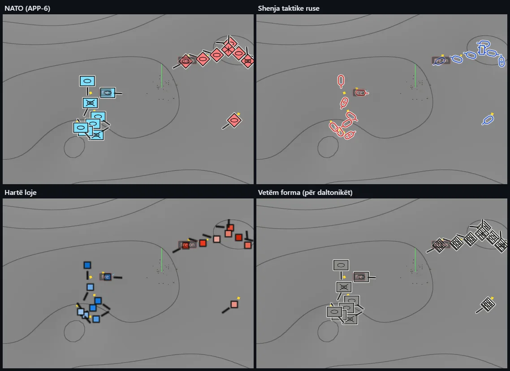

# Riluajtja e ndeshjes

Riluajtja është një film i ndeshjes me çdo lojtar të vizatuar si ajo që drejtoi. Përdore për të parë përsëri një përleshje, për të ndjekur një njësi dhe për të parë kush goditi kë.

Të shtënat, goditjet, zjarret dhe mbetjet vizatohen mbi njësitë dhe objektivat në nivel. Kamerat, etiketat dhe një ekran taktik të ndihmojnë të lexosh luftimin. E njeh Tacview? [Barazia me Tacview](tacview-parity.md) tregon ku ndodh çdo mjet i tij.

## Nis një riluajtje {#start-a-replay}

1. Ngarko një regjistrim me **Burimi → Skedarë…** ose duke e lëshuar në panelin Burimi (çdo tabelë me një kolonë **personi** dhe një **kohe**, një skedar Tacview, një riluajtje e konvertuar, një ndeshje [`.3dheat`](container.md)). Shih [Si të futni të dhënat](getting-data-in.md).
2. Hap skedën **Ndeshja** dhe zgjidh **Riluajtja me figura**, ose zgjidh **Mbivendosje figurash** në shiritin e modeve të skedës Harta e nxehtësisë.
3. Te **Ndeshjet në riluajtje** zgjidh një ndeshje, të gjitha njëherësh, ose disa.
4. Shtyp **Luaj** në kronologji (ose `K`). Tërhiq kronologjinë për të kërcyer.

Figurat zëvendësojnë kutitë për çdo njësi emri ose tipi i së cilës është i njohur (shih [Figurat](figures.md)). Të dhënat pa kolonë emri ose tipi vizatohen si ushtarë.

## Figurat {#figures}

| Cilësimi (seksioni **Figurat**) | Parazgjedhja | Çfarë bën |
|---|---|---|
| **Figura në vend të kutive** | po | Joaktiv vizaton kuti të thjeshta. |
| **Madhësia e figurës** (herë madhësia reale) | 1 | 1 është madhësia reale; 0.25 deri 20 herë (shkallë logaritmike). Më e madhe ndihmon nga larg. |
| **Figura më e vogël në ekran** | 36 px | Figurat e largëta rriten për të mbetur kaq të mëdha, 0 deri 200 px; 0 e mban madhësinë reale. |
| **Nga larg**: Figurë, Shigjetë, Simbol | Figurë | Çfarë bëhet një njësi e largët. |
| **Simbolet** | NATO (APP-6) | NATO (APP-6), shenja taktike ruse, ikona **Hartë loje**, ose **Vetëm forma (për daltonikët)**. |
| **Madhësia e simbolit**, **Pala ime**, **Armiqësore / Neutrale**, **Vija drejtimi** | 28 px (12 deri 64), automatike, armik, po | Si duken simbolet dhe cila anë është miqësore. |
| **Vija vertikale** | po | Një vijë nga çdo njësi drejt e poshtë në tokë, që lartësitë të lexohen në 3D. |
| **Vija vertikale dhe etiketa te armët** | jashtë | Vija deri në tokë dhe etiketa te raketat dhe bombat. |
| **Zjarre në njësi** | po | Flakë nga çasti kur një njësi merr zjarr deri kur shuhet. |
| **Goditje mbi njësitë** | po | Shenja ku goditën të shtënat (më poshtë). **Goditjet qëndrojnë**: 1 deri 300 sekonda, ose **Gjithë jeta**. **Shenja pluskuese**: shenja të vizatuara mbi sipërfaqe. |
| **Vija të shikimit dhe të frëngjisë** | jashtë | Me vija: ku shikon lojtari; të plota: ku drejtohet topi. |
| **Ndërtesa** | e ngurtë | Ndërtesa të ngurta ose transparente, kur niveli i vizaton. |

### Simbolet nga larg {#symbols-at-a-distance}

Kur një njësi do të ishte më e vogël se **Figura më e vogël në ekran**, mund të bëhet një simbol që mbetet i lexueshëm. Forma tregon llojin (për shembull një kuti e rrumbullakosur me shenjë shinash për blindat); ngjyra tregon anën. Hap menunë **Simbolet** për të ndryshuar stilin.

### Shenjat e goditjeve, mbetjet dhe zjarret {#hit-marks-wrecks-and-fires}

- **Shenjat e goditjeve** qëndrojnë mbi sipërfaqen që takoi e shtëna, në përmasën e figurës. Pamja e tyre tregon çfarë ndodhi: një vrimë (kaloi), një shpërthim i ndritshëm (nuk kaloi), një gërvishtje (u shmang), një yll i zi nga tymi (predhë shpërthyese). Një unazë me ngjyrë thotë çfarë bëri: të shtënë vdekjeprurëse, modul i shkatërruar, kritik, i rëndë, dëmtim, pa dëmtim, goditje. Kalo mbi një shenjë për emrin e raundit.
- Një njësi e shkatërruar vizatohet **e djegur** si mbetje nga vdekja e saj deri kur ringjallet ose hiqet; simboli i saj është i kryqëzuar.
- **Zjarret** digjen mbi një njësi nga çasti kur merr zjarr deri kur shuhet.
- **Kullat** kthehen aty ku të dhënat thonë se drejtohet topi (ose, pa to, aty ku shikon lojtari).

### Armët, karficat dhe gjurmët {#weapons-decoys-and-tracers}

Me **Armë, të shtëna dhe goditje** të ndezur (seksioni Pamja e ekipeve): raketat, roketat, bombat dhe siluruesit fluturojnë si figura të veta me një gjurmë tymi; plumbat dhe predhat janë gjurmë (tracerë); goditjet dhe shpërthimet ndriçojnë. Një tracer i vizatuar **me pika** u llogarit nga një goditje, sepse të dhënat nuk kishin të shtënë. Flare dhe chaff vizatohen si karfica; fshihen nga lista e njësive përveç nëse është e shënuar *Karremë dhe predha*.

## Kamerat {#cameras}

Kliko një njësi ose etiketën e saj për ta **ndjekur**; seksioni **Riluajtja** ofron **Ndjekje**, **Orbitë**, **Kabina** (me ekran kryesor, `H`), **E fiksuar**, **Padlock**, **Objektivi** dhe **Satelit**. `V` i kalon ato, **Largësia e kamerës** cakton sa larg. Esc ndalon.

- **Pamja me dy njësi**: zgjidh një **Objektiv** (ose kliko një njësi me Ctrl/Alt) për ta parë nga ajo që ndiqet; **Këmbe** i shkëmben ato.
- **Matja**: kliko me Shift dy njësi për drejtimin, distancën dhe ndryshimin e lartësisë mes tyre.
- **Harta 2D** (`M`): pamje në cep ose të plotë, me gjurmë dhe emra.
- **Shënuesit** (`B`): ruan momentin dhe kamerën; vrasjet, vdekjet dhe shenjat e vetë regjistrimit listohen edhe ato.
- **Ngjarjet**: çdo ngjarje me radhë kohore; një klikim kërcen atje. `Page Up` / `Page Down` kërcejnë mes ngjarjeve; **Pauzë në ngjarje** ndalon te çdo njëra.

## Pamja taktike {#tactical-display}

Seksioni **Pamja taktike** vizaton, për asnjë njësi, për të zgjedhurat, për të gjitha, ose për një lloj (avionë, tokë, anije, armë): vektorët e shpejtësisë dhe shtegun e përpara, vijat e hundës dhe të ngritjes, konet e radarit, kyçjet, lidhjet e të dhënave, zonat dhe vijat e angazhimit, vijat e shikimit, ku shikojnë lojtarët (konet e shikimit), drejtimi i kullës, dhe kamera e regjistruar.

### Stili i ekranit {#display-style}

`T` (ose çelësi **Shfaq si ekran taktik**) e ndryshon pamjen në një stil ekrani radari: shkëlqim, kontura, vija nivelimi, rrjetë matjeje, vija skanimi, unaza distancash, shkallë lartësie, panele me vrasje dhe ngjarje, dhe një **Regjisor** që e lëviz kamerën te ngjarjet vetë.

## Objektivat {#objectives}

Kur një ndeshje vjen me objektivat e vet, seksioni **Objektivat** i vizaton në nivel: zonat e kapjes (me pronarin dhe progresin e kapjes), spawn-et, aeroportet, zonat dhe objektivat e bombardimit, çdo shtresë e ndërrueshme, me etiketa. Shihen nëpër tokë. Me disa mënyra loje të ngarkuara, **Modaliteti** i filtron ndeshjet sipas modalitetit. Objektivat vijnë nga skedari i ndeshjes së një konvertuesi pranë regjistrimit ose brenda një kontejneri [`.3dheat`](container.md).

## Etiketat dhe statistikat {#labels-and-statistics}

- **Etiketat**: rregulla për llojin (**Të zgjedhura**, **Avionë**, **Toka**, **Anije**, **Armë**, **IA**): shfaqen ose jo, cilat vlera, dhe një **Përparësia** për kë merr vend kur etiketat mbivendosen. **Mbaji etiketat larg njëra-tjetrës** e zhvendos një etiketë pranë njësisë së vet kur do të mbulonte një tjetër, dhe e heq aty ku nuk ka vend. **Madhësia e etiketave** është 60 deri 250%. **Kthehu te emri, mjeti, lartësia dhe shpejtësia** i rivendos rregullat.
  - Njësitë e tokës fillojnë me emrin, mjetin dhe shpejtësinë.
  - Avionët fillojnë me emrin, mjetin, lartësinë dhe shpejtësinë.
  - Anijet fillojnë me emrin, mjetin, shpejtësinë dhe drejtimin.
  - Kalo mbi një njësi për të parë çdo vlerë që ka.
- **Statistikat**: për ekip dhe njësi: vrasje, vdekje, të shtëna, goditje, raport goditjesh, ngritje, ulje, koha në ajër, shpejtësia maksimale, lartësia dhe G, distanca. Eksportim CSV.
- **Grafikët**: vlerat e një njësie kohë pas kohe, dy njësi të krahasuara, ose një vlerë kundrejt tjetrës.

## Shumë ndeshje njëherësh {#many-matches-at-once}

Për të vendosur qindra ose mijëra ndeshje njëra mbi tjetrën, shih [Shumë ndeshje njëherësh](many-matches.md). Detajet e figurave (tym, zjarr, efekte të tjera me kohë): [Figurat në mbivendosje figurash](figure-replay.md). Lista e veçorive të Tacview: [Barazia me Tacview](tacview-parity.md), një faqe fëmijë e kësaj.
