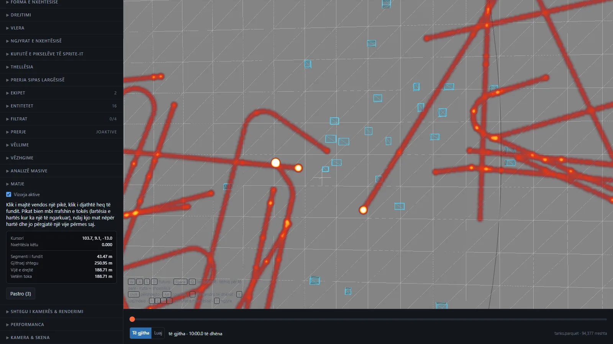

# Matja

**Matja** e kthen miun në një vizore dhe të thotë sa e zënë është vendi nën kursor. Përdore për të gjetur sa larg janë dy vende nga njëri-tjetri, ose sa trafik ka një vend.

## Provoje {#try-it}

1. Hap **Matja** në shiritin anësor dhe shëno **Vizorja aktive**.
2. Kliko majtas në tre vende të hartës. Çdo klikim vendos një pikë.
3. Lexo **Gjithsej shtegu** (gjatësia e të gjithë shtegut) dhe **Segmenti i fundit** (etapa e fundit).
4. Kliko djathtas për të hequr pikën e fundit, ose shtyp **Pastro (3)** për t'i hequr të gjitha.

| Veprimi | Efekti |
|---|---|
| Kliko majtas | Vendos një pikë aty ku kursori takon planin e tokës. Një klikim që ka lëvizur më shumë se 4 piksele midis shtypjes dhe lëshimit është tërheqje kamere, jo pikë. |
| Kliko djathtas | Heq pikën e fundit. |
| Lëviz | Pozicioni i kursorit dhe nxehtësia nën të përditësohen drejtpërdrejt. |

Kamera vazhdon të punojë ndërsa vizorja është e ndezur: tërheqja ende shikon përreth, tastet ende fluturojnë. Ndërsa vizorja është e ndezur ajo merr çdo klikim, kështu që [zgjedhja me klikim](camera.md#click-to-pick) pret derisa të fiket.

**Plani i tokës** është lartësia e [imazhit të hartës](map-images.md) kur është ngarkuar një imazh harte; përndryshe Y-ja më e ulët e grupit të të dhënave (0 pa të). Pikat bien mbi të, kështu që vizorja mat përgjatë hartës, jo përgjatë një vije që kalon nëpër të. Me një nivel 3D plani është ende Y-ja më e ulët e grupit, jo sipërfaqja e nivelit - për një pikë në sipërfaqen reale, fik vizoren dhe kliko atë ([zgjedhja me klikim](camera.md#click-to-pick)), që i lexon koordinatat nga trekëndëshat e vetë nivelit.

## Leximet {#readouts}

| Rreshti | Kuptimi |
|---|---|
| **Kursori** | X, Y, Z botërore e pikës nën kursor, në plan. |
| **Nxehtësia këtu** | Sa nxehtësi ka te piksel i kursorit. Një numër më i madh do të thotë më shumë trafik në atë vend. Është vlera që i jepet shkallës së ngjyrave përpara se pika e ngopjes ta pjesëtojë, kështu që mund ta krahasosh me [Pikën e ngopjes](colour-and-exposure.md#saturation-point). |
| **Segmenti i fundit** | Distanca nga pika e fundit te kursori (ose midis dy pikave të fundit). |
| **Gjithsej shtegu** | Gjatësia e vijës së thyer që kalon nëpër çdo pikë dhe kursorin. |
| **Vijë e drejtë** | Distanca 3D nga pika e parë te kursori (ose pika e fundit). |
| **Vetëm toka** | E njëjta, vetëm në X dhe Z. |
| **Pastro (N)** | Heq të gjitha pikat. |

Distancat shfaqen në centimetra nën 1 njësi, metra nën 1.000, kilometra mbi të - duke supozuar se një njësi botërore është një metër ([Boshtet, njësitë dhe koha](axes-units-and-time.md#unit-scale)). Koordinatat janë koordinata botërore, edhe kur një bosht është [i përmbysur për shfaqje](camera.md#invert-world-axis).

Pikat dhe vija midis tyre vizatohen si mbivendosje në pamje, me madhësi sipas hapësirës së rrjetit. Pikat e vizores nuk ruhen në pamje; qëndrojnë kur ngarkon të dhëna të tjera.

## Për zhvilluesit {#for-developers}

**Nxehtësia këtu** lexohet nga GPU më së shumti çdo 120 ms, sepse një lexim i një pikseli të vetëm ngec tubacionin. Përdor të njëjtën rrugë si `engine.readHeatProbe()`: pjesëtohet me fitimin me të cilin u shkrua kornizë, kështu që në rrugën e grumbullimit me gjysmë-pikë lundruese (`?heat=f16`) është në të njëjtat njësi si në një objektiv 32-bit ([Grumbullimi me gjysmë-pikë lundruese](half-float-accumulation.md)).
