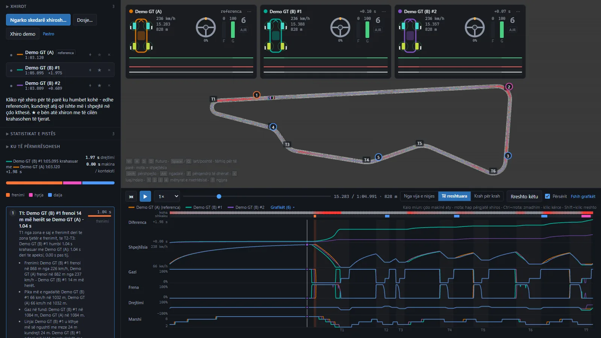

# Analiza e garës

E ke drejtuar të njëjtën pistë dy herë. Skeda **Analiza e garës** i luan të dy drejtimet bashkë në 3D, tregon ku u humb koha në një xhiro më të ngadaltë dhe të thotë pse. Nuk ka ende xhiro? Shtyp **Xhiro demo**.

Skeda krahason dy ose më shumë xhiro të një pisteje. Ajo ndan me Harta e nxehtësisë vizën, kamerën dhe modelin e ngarkuar të pistës (**Sfondi / niveli**); gjithçka tjetër është e vetja: shiriti i vet anësor dhe shiriti i vet nën pamje. Fjalët si *xhiro*, *referencë* dhe *kulmi i kthesës* janë në [fjalor](glossary.md).

Kjo faqe është harta e skedës. Çdo pjesë ka faqen e vet:

| Faqja | Çfarë mbulon |
|---|---|
| [Ngarkimi i xhirove](race-loading-laps.md) | çdo format skedari, dosjet dhe pistat, emrat e makinave, xhirot demo, lista e xhirove, referenca dhe fokusi |
| [Riluajtja dhe skena 3D](race-replay-and-scene.md) | shiriti i transportit, tre modalitetet e riluajtjes, radhitja e makinave, kamera ndjekëse, vijat, hartat, makinat, etiketat, botët e pasqyruara |
| [Grafikët dhe HUD](race-charts-and-hud.md) | grafikët e distancës, zgjedhësi i grafikëve, kalimi i miut dhe zoom, kartat e makinave, tabela e kanaleve |
| [Ngjarjet e kontrollit të makinës](race-control-events.md) | bllokime, rrotullim i rrotave, nënkthim, rrotullime, nëntimon, goditje, përplasje, ABS/TC, frena dore, ajri - si zbulohet secila, me çdo prag |
| [Analiza kthesë për kthesë](race-corner-analysis.md) | rreshtimi sipas distancës, kthesat dhe segmentet, llogaria kohore e një kthese, çdo shkak dhe radha në të cilën provohen, forma e linjës dhe këshilla |
| [Profilet e makinave dhe krahasimi](race-car-profiles.md) | çfarë mund të bëjë secila makinë, e matur nga xhirot e saj; *Makinat e krahasuara*; çfarë vendos makina në çdo kthesë |
| [Statistikat e pistës](race-course-statistics.md) | shumë xhiro të një pisteje: gabimet për kthesë dhe sipas llojit, harta e gabimeve, eksportimi i nxehtësisë, kufijtë e performancës |
| [Analitika e garës: metoda](race-analytics.md) | kërkimi pas rregullave, me burimet |
| [Lojëra të tjera garash](other-games.md) | çfarë bën shikuesi me xhiro nga çdo lojë: rrëshqitja dhe drifti të llogaritura aty ku loja nuk i dërgon, botët e pasqyruara, kanalet shtesë |

## Ekrani {#the-screen}

**Shiriti anësor**, nga lart poshtë (seksionet mund të palosen):

1. **Xhirot** - ngarkim, listë, shfaq/fshih, referencë, fokus, ndjekje.
   Shih [Ngarkimi i xhirove](race-loading-laps.md).
2. **Statistikat e pistës** - vetëm nga tre xhiro të ngarkuara e tutje.
   Shih [Statistikat e pistës](race-course-statistics.md).
3. **Ku të përmirësohesh** - gjetjet e xhiros së fokusuar, kthesë pas kthese.
   Shih [Analiza kthesë për kthesë](race-corner-analysis.md).
4. **Kthesë pas kthese** (ose *Kthesë pas kthese - klasa X* me disa klasa) - xhiro më e shpejtë nëpër çdo kthesë dhe linja e saj. Shfaqet me dy ose më shumë xhiro.
5. **Kontrolli i makinës** - bllokimet, rrëshqitjet, shtytjet dhe goditjet e xhirosë së fokusuar.
   Shih [Ngjarjet e kontrollit të makinës](race-control-events.md).
6. **Makinat e krahasuara** (ose **Makina** me një makinë) - shih
   [Profilet e makinave dhe krahasimi](race-car-profiles.md).
7. **Pamja** - cila hartë vizatohet mbi pistë dhe çfarë vizatohet.
   Shih [Riluajtja dhe skena 3D](race-replay-and-scene.md).
8. Panelet e përbashkëta **Niveli** dhe **Kamera & skena** (modeli i pistës, përmbysja e boshteve, kamera) - dokumentuar me Harta e nxehtësisë dhe [Kamera](camera.md).

**Pamja** tregon pistën, linjat e përshkuara, hartën, makinat, etiketat e fiksuara në pistë, dhe deri në gjashtë karta makinash lart majtas (shih [Grafikët dhe HUD](race-charts-and-hud.md)). Pa xhiro të ngarkuar shkruan "Asnjë xhiro e ngarkuar - Lësho këtu dy ose më shumë skedarë xhiroje, ose ngarko xhirot demo nga shiriti anësor."

**Shiriti nën pamje** mban transportin e riluajtjes dhe, nëse nuk është fshehur, grafikët e distancës.

## Nisja e shpejtë {#quick-start}

1. Hap skedën **Analiza e garës** (pranë **Harta e nxehtësisë** në krye të shiritit anësor).
2. Fut xhiro. Shtyp **Xhiro demo** për të parë çfarë bën skeda me tre xhiro të shpikur. Për xhirot e tua, regjistroji së pari ([formatet e skedarëve dhe regjistruesit](race-loading-laps.md#file-formats)), pastaj shtyp **Ngarko skedarë xhirosh…** ose **Dosje…**, ose lësho skedarë ose dosje mbi pamjen.
3. Xhiro më e shpejtë e plotë bëhet referenca; xhiro tjetër më e ngadaltë fokusohet. Kliko çdo xhiro në listë për ta fokusuar; ★ e bën një xhiro referencë.
4. Lexo **Ku të përmirësohesh**. Kliko një gjetje: makinat rreshtohen 40 m përpara saj, kamera e kornizon, riluajtja kalon nëpër të, dhe matjet hapen.
5. Kalo miun mbi grafikët për të zhvendosur çdo makinë në atë metër; Shift+klikim për t'i rreshtuar atje.

## Tastet {#keyboard}

Ndërsa skeda Analiza e garës është e hapur:

| Tasti | Bën |
|---|---|
| **K** | luan / pauzon riluajtjen |
| **Home** | kthehu te fillimi i riluajtjes |
| tastet numerike | asgjë (te harta e nxehtësisë ndërrojnë modalitetet) |

Tastet e shkruara në një fushë teksti ose menu zgjedhjeje injorohen. Tastet e kamerës punojnë si te harta e nxehtësisë (**W A S D**, **Space** lart, **Q** poshtë, **Shift** më shpejt, **Alt** më ngadalë, miu për të shikuar; të gjitha te [Kamera](camera.md)); **F** kornizon xhirot e ngarkuara (si bën ngarkimi i xhirove).

## Shumë xhiro {#many-laps}

- Të gjitha xhirot e ngarkuara analizohen dhe numërohen; dhjetëra zgjasin një a dy sekonda.
- Mbi **8** xhiro (`SHOW_ALL_UP_TO`), xhirot e shtuara vizatohen vetëm kur janë referenca, xhiroja e fokusuar, ose xhiroja më e mirë e klasës së xhirosë së fokusuar. *Shfaq të gjitha* / *Vetëm ato të shikuara* e ndërrojnë.
- Mbi **10** makina të dukshme (`PLAIN_PAST`), xhirot që nuk shikohen (jo fokusi, makina e ndjekur ose referenca) vizatohen me linja të holluara në një pikë çdo 6 m në vend të 1.5 m, dhe makina të thjeshta.
- Grafikët vizatojnë deri në **8** xhiro; HUD tregon deri në **6** karta.
- Statistikat e pistës shfaqen nga **3** xhiro.

Detajet: [Statistikat e pistës](race-course-statistics.md#performance-with-many-laps).

## Cilësimet e parazgjedhura të pamjes {#default-view-settings}

| Cilësimi | Parazgjedhja |
|---|---|
| Harta | Harta e kohës |
| Linjat e përshkuara, Makinat, Gomat dhe pezullimi, Etiketat, Pista nga xhirot | po |
| Të gjitha vlerat në kartat | jashtë |
| Madhësia e makinës | 1× |
| Grafikët | të shfaqur |
| Modaliteti i riluajtjes | Nga vija e nisjes |
| Shpejtësia e riluajtjes | 1× |
| Përsërit | po |

Asnjëra nuk ruhet; rifreskimi rinis nga parazgjedhjet. Ajo që kujtohet në shfletues: gjuha, dhe emrat e makinave të mësuara nga skedarët e xhirove (shih [Ngarkimi i xhirove](race-loading-laps.md#car-names)).

## Për zhvilluesit {#for-developers}

### Çfarë ndodh kur ngarkohen xhirot {#what-happens-when-laps-are-loaded}

Çdo herë që ndryshon bashkësia e xhirove, referenca ose gjuha, e gjithë analiza bëhet përsëri (`analyse` në [`src/race/analysis.ts`](https://github.com/Holdi601/3DHeat/blob/main/src/race/analysis.ts)):

1. Kanale të nxjerra shtohen te çdo xhiro aty ku loja nuk i dërgon: këndi i driftit, rrëshqitja e rrotave nga shpejtësitë e rrotave, në ajër, toka e lirshme, shpejtësia e rrotullimit ([`derive.ts`](https://github.com/Holdi601/3DHeat/blob/main/src/race/derive.ts)).
2. Referenca zgjidhet dhe çdo xhiro projektohet mbi shtegun e saj dhe rinxirohet çdo 2 m ([`align.ts`](https://github.com/Holdi601/3DHeat/blob/main/src/race/align.ts)).
3. Nga xhirot llogaritet nëse bota e lojës është e pasqyruar ([`handedness.ts`](https://github.com/Holdi601/3DHeat/blob/main/src/race/handedness.ts)).
4. Kthesat gjenden te referenca, dhe grupohen në segmente nga një zonë frenimi deri te tjetra ([`segments.ts`](https://github.com/Holdi601/3DHeat/blob/main/src/race/segments.ts)).
5. Për çdo makinë: zarfi i saj (aderenca, frenimi, tërheqja sipas shpejtësisë), profili, kurbat e gomave ([`envelope.ts`](https://github.com/Holdi601/3DHeat/blob/main/src/race/envelope.ts), [`profile.ts`](https://github.com/Holdi601/3DHeat/blob/main/src/race/profile.ts), [`control.ts`](https://github.com/Holdi601/3DHeat/blob/main/src/race/control.ts)).
6. Për çdo xhiro dhe segment: çfarë bëri (pika e frenimit, pika më e ngadaltë, gaz i plotë, ...) dhe linja që ndoqi ([`line.ts`](https://github.com/Holdi601/3DHeat/blob/main/src/race/line.ts)).
7. Për çdo xhiro: ngjarjet e kontrollit të makinës, secila vendosur kundrejt xhiros me të cilën krahasohet aty.
8. Për çdo xhiro dhe segment: llogaria kohore kundrejt xhiros së krahasimit dhe gjetja me fjalë.
9. Harta e kohës dhe harta e shkaqeve për çdo xhiro.

Tekstet prodhohen në gjuhën aktuale; ndërrimi i gjuhës e rinis analizën (dhe riemërton xhirot demo). Një dështim i analizës shfaqet nën butonat **Xhirot** si gabim, dhe xhirot mbeten të ngarkuar.

### Skedarët burimorë {#source-files}

| Skedari | Roli |
|---|---|
| `src/race/adapters.ts`, `ibt.ts` | leximi i skedarëve të xhirove |
| `src/race/lap.ts`, `carNames.ts`, `synthetic.ts` | lloji i xhiros, emërtimi, xhirot demo |
| `src/race/derive.ts`, `handedness.ts` | kanalet e nxjerra, botët e pasqyruara |
| `src/race/align.ts`, `segments.ts`, `line.ts` | boshti i distancës, kthesat, linjat |
| `src/race/analysis.ts` | kthesat e krahasuara, shkaqet, gjetjet |
| `src/race/envelope.ts`, `profile.ts` | çfarë mund të bëjë një makinë |
| `src/race/control.ts`, `impacts.ts` | kontrolli i makinës, goditjet dhe përplasjet |
| `src/race/stats.ts` | shumë xhiro |
| `src/race/replay.ts`, `scene.ts`, `glyph.ts`, `geometry.ts` | riluajtja dhe vizatimi |
| `src/race/schema.ts`, `graphs.ts` | tabela e kanaleve, rreshtat e grafikëve |
| `src/ui/race/*` | shiriti anësor, grafikët, HUD, etiketat |
| `src/state/raceStore.ts` | gjendja e skedës dhe ora e riluajtjes |
