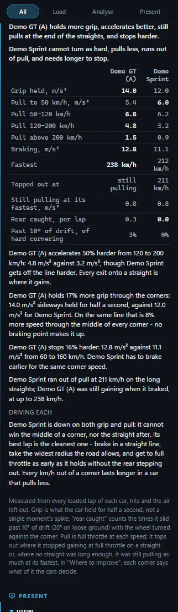

# Profilet e makinave dhe krahasimi

Një makinë mund të frenojë, të kthehet dhe të përshpejtojë vetëm aq fort. Shikuesi e mat sa fort nga xhirot tuaja, kështu që kurrë nuk ju thotë të bëni diçka që makina juaj nuk mund ta bëjë. Kjo shpjegon gjithashtu sa nga një sekondë e humbur ishte faji i makinës dhe jo i juaji.

Analiza i thotë një xhiroje të frenojë më fort, të mbajë më shumë shpejtësi ose të përshpejtojë më herët vetëm aty ku makina e saj e ka treguar se mund, dhe heq nga një humbje atë që vetë makinat e shpjegojnë. Prandaj kufijtë e secilës makinë (zarfi i saj, më poshtë) dhe karakteri (profili i saj) maten nga çdo xhiro e ngarkuar e saj. Kjo faqe mbulon zarfin, profilin, seksionin **Makinat e krahasuara**, dhe çfarë vendosin makinat në çdo kthesë.

**Një makinë** = xhirot me të njëjtin numër makine (ose emër, pa numër) dhe të njëjtin indeks performance: një rregullim tjetër është një makinë tjetër.

## Zarfi: çfarë mund të bëjë makina në çdo shpejtësi {#the-envelope-what-the-car-can-do-at-each-speed}

Për çdo makinë, mbi çdo xhiro të ngarkuar të saj, në **brezat e shpejtësisë 5 m/s** (24 bregje, deri 120 m/s). Mostrat në ajër, qetësimi për 0,3 s pas uljes, dhe nga 0,1 s para çdo goditjeje deri 1 s pas saj lihen jashtë, dhe nxitimet prej 80 m/s² ose më shumë injorohen (mbi atë që mban çdo makinë me forcë poshtë).

| Zarfi | Mostrat | Vlera për bregun | Nevojat |
|---|---|---|---|
| **aderenca anësore** | nxitimi anësor **i mbajtur për gjysmë sekonde** (mesatarja e vlerës së tij absolute mbi një dritare të qendërzuar 0,5 s), vetëm aty ku makina po kthehej: të paktën një të tretën e përqindjes së 99-të të gjithës kësaj | përqindja e 95-të | 6 mostra |
| **frenimi** | fren > 0,3; nxitimi gjatësor si mesorja e secilës mostër dhe dy fqinjëve të saj | përqindja e 95-të e ngadalësimit | 4 mostra |
| **tërheqja me gaz të plotë** | gazi > 0,95, fren nën 0,05; e njëjta mesore e tre | përqindja e 90-të | 4 mostra |

Pse mbahet për gjysmë sekonde: një buzë, një rrëshqitje që kthehet, një makinë e kapur, të gjitha ngrenë nxitimin anësor për një çast, dhe një makinë që e bën këtë shpesh dukej më e fortë sesa është. Pse mesorja e tre: me distancë pesë metra, një mostër është një rrugë e gjatë, dhe një majë e vetme mostre është një buzë, një gropë ose një mur.

Leximi i zarfit në një shpejtësi interpolon midis qendrave të brezave, dhe merr brezin më të afërt me të dhëna aty ku brezi është bosh.

**Mbi dy lloje toke.** Kur xhirot e një makine kanë shkuar të paktën një të pestën e mostrave të tyre mbi asfalt dhe mbi tokë të shkrifët, mbahet një zarf i veçantë për secilën, dhe çdo kthesë gjykohet me tokën nën makinë në pikën e saj më të ngadaltë.

**Kalimi.** Shpejtësia nga e cila tërheqja zbritet si `1/v` (e kufizuar nga fuqia) në vend që të mbahet e sheshtë (e kufizuar nga tërheqja): brezi i parë ku `a·v` është brenda 15% të `a·v` më të lartë të parë.

## Profili: çfarë lloj makine është {#the-profile-what-kind-of-car-it-is}

`profile`, nga të njëjtat xhiro (mostra në tokë, jo të goditura, më shpejt se 8 m/s):

| Masa | Si |
|---|---|
| **aderenca e mbajtur** (m/s²) | përqindja e 95-të e nxitimit anësor të mbajtur për gjysmë sekonde |
| **tërheqja** deri 50 km/h, 50-120, 120-200, mbi 200 (m/s²) | mesatarja e tërheqjes me gaz të plotë të zarfit mbi 3-14, 14-33, 33-56 dhe 56-90 m/s, në shpejtësitë që arriti makina (deri te më e shpejta + 2 m/s), nga të paktën tre hapa 1 m/s; dhe më e madhja që shfaqi, dhe ku |
| **frenimi** (m/s²) | frenimi i zarfit i mesatarizuar nga 60 deri 160 km/h (16,7-44,4 m/s), brezi që emërton krahasimi |
| **më e shpejta** | shpejtësia më e lartë që arriti |
| **arriti kulmin te** | ku pushoi së fituari me gaz të plotë në një drejtëz (më poshtë) |
| **ende tërheq në më të shpejtën** | tërheqja e zarfit në shpejtësinë e saj më të lartë: sa ende kishte për të shkuar |
| **pasi u kap prapa, për xhiro** | sa herë në një xhiro rrëshqiti dhe duhej kapur (më poshtë) |
| **pjesa me gaz** | nga ato, pjesa që filloi me gaz > 0,5 dhe pa fren |
| **e lëshon në** | mediana e nxitimit anësor të mbajtur 0,15 s para çdo rrëshqitjeje, si pjesë e aderencës |
| **mbi 10° drift, nga kthesa e fortë** | nga mostrat që kthehen me 60% ose më shumë të aderencës, pjesa që rrëshqet (10° në asfalt, 20° në tokë të shkrifët); duhen 30 mostra |
| **drifti mesatar** | mbi të njëjtat mostra |
| **ekuilibri** | këndi i rrëshqitjes përpara minus pas (shumëfish i maksimumit nominal) kur kthehet fort dhe nuk rrëshqet, mesatarja e të paktën 30 mostrave: + shtyn jashtë |
| **sipërfaqja** | mbi 80% mostra të shkrifëta: e shkrifët; nën 20%: asfalt; përndryshe e përzier |

**Arritja e kulmit.** Një mostër numërohet kur sekonda përreth saj (±0,5 s, të paktën 0,9 s të dhënash) ishte e tëra me gaz të plotë (> 0,95, pa fren), në tokë, e drejtuar **drejt** (|anësore| nën më të madhin ndërmjet 4 m/s² dhe një të katërtës së aderencës së saj), duke fituar nën **0,35 m/s²**, më shpejt se 25 m/s dhe brenda 90% të më të shpejtës së xhiros - gazi i plotë lart një kodre ose përmes një kthese të gjatë ndalon gjithashtu së fituari, shumë më poshtë shpejtësisë maksimale të makinës. Me të paktën **një sekondë** të tillë platoje mbi të gjitha xhirot, mediana e atyre shpejtësive është ku arrin kulmin. Ndryshe nuk ka shpejtësi maksimale: ku asnjë drejtëz nuk ishte mjaft e gjatë, *ende tërheq në më të shpejtën* thotë sa larg ishte. Asnjë hamendësim përtej asaj që tregojnë xhirot - marshet dhe kufizuesi i motorit i japin fund tërheqjes së një makine shumë përpara se ta bëjë tërheqja e ajrit.

**Humbja e pasmes.** Numërohet aty ku shoferi duhej ta kapte: kthehet me 60% ose më shumë të aderencës, rrëshqet (drift mbi 10° në asfalt, 20° në tokë të shkrifët), me timonin (mbi 0,06) të kthyer **kundër** kthesës. Cila shenjë e timonit përputhet me cilën shenjë të forcës anësore të kthesës matet për çdo xhiro (mostra që kthehen pa rrëshqitur). Një rrëshqitje numërohet një herë derisa makina të ndalojë së rrëshqituri. Një makinë e drejtuar pak anash qëllimisht nuk humbet asgjë; një që ka nevojë për timon të kundërt, po. Numërohet njësoj për çdo makinë, që dy makina të krahasohen. Kërkon timon dhe kënd drifti.

## Makinat e krahasuara {#cars-compared}

Seksioni i shiritit anësor është **Makina** me një makinë, **Makinat e krahasuara** me disa.

**Tabela**: një kolonë për makinë, një rresht për çdo masë që ka vlerë për çfarëdo makine: Aderenca e mbajtur; Tërheqja deri 50 km/h, 50-120, 120-200, mbi 200; Frenimi; Më e shpejta; Arriti kulmin te ("ende tërheq" kur kurrë nuk e arriti); Ende tërheq në më të shpejtën; Pasi u kap prapa, për xhiro; Mbi 10° drift, nga kthesa e fortë. Kur makinat ndryshojnë me më shumë se 3%, vlera më e mirë shënohet (më e lartë për aderencën, tërheqjen, frenimin, shpejtësitë; më e ulët për rrëshqitjet e pasmes).

**Një makinë vetëm**: fjali për atë që tregojnë xhirot se është - aderenca që mban (m/s² dhe g), tërheqja e saj në çdo brez, ku pushoi së fituari në drejtëzat e gjata (ose që nuk arriti kurrë kulmin, dhe sa ende tërhiqte në më të shpejtën), sa shpesh i duhej kapja e pasmes ("pothuajse kurrë" nën një herë në xhiro, "kryesisht me gaz" kur 60% ose më shumë filluan aty).

**Dy makina**: për çdo çift, nga një fjali për çfarë është makina kundrejt tjetrës ("X përshpejton më mirë, por nuk mund të kthehet aq fort, i duhet më shumë distancë për të ndalur dhe e humb pasmen më lehtë"), tabela, çdo ndryshim i qartë më i madhi i pari, pastaj **Drejtimi i secilës**. Me më shumë se **3** çifte, shfaqet një çift: makina e xhiros së fokusuar kundrejt një makine të zgjedhur nga një listë me rënie (si parazgjedhje makina e xhiros më të shpejtë të klasës së saj, përndryshe e referencës, përndryshe e para tjetër).

Një ndryshim thuhet vetëm kur xhirot e tregojnë qartë:

| Ndryshimi | Thuhet nga | Fjalia |
|---|---|---|
| aderenca | **4%** | "X mban N% më shumë aderencë nëpër kthesa … kjo është M% më shumë shpejtësi nëpër mesin e çdo kthese" (shpejtësia = √ e raportit të aderencës) |
| tërheqja | **5%**, në brezin e parë që kanë të dyja makinat nga 120-200, 50-120, mbi 200 km/h | "X përshpejton N% më fort nga 120 në 200 km/h"; edhe nga pika e nisjes, ose "edhe pse Y del nga vija më fort", kur nisja ndryshon me 8% |
| shpejtësia maksimale | **4 km/h** | "X arrin kulm më lart: pushoi së fituari në …" |
| shpejtësia maksimale, vetëm njëra | njëra makinë arriti kulmin, tjetra jo | "Y mbaroi tërheqjen në …; X ende po fitonte kur frenoi" |
| shpejtësia maksimale, asnjëra | asnjëra nuk arriti kulmin | çfarë po fitonte secila në shpejtësinë më të lartë |
| frenimi | **5%** | "X ndalon N% më fort … Y duhet të frenojë më herët" |
| humbja e pasmes | të paktën një herë më shumë në xhiro **dhe** gjysmë herë më shpesh | "X e humb pasmen më lehtë: rrëshqiti aq larg sa t'i duhet timon i kundërt N herë në xhiro kundrejt M …" - kryesisht me gaz (60%+) ose kryesisht duke hyrë në kthesë dhe me lëshim (30% ose më pak), nga rreth P% e aderencës së saj; në tokë të shkrifët "pjesa e kësaj është si kthehet makina; kapja nuk është" |
| anash | **12 pikë përqindjeje** kthesë e fortë mbi pragun e driftit | "X shkon më anash në kufi" |
| ekuilibri i përparmë | **0,3** i maksimumit nominal | "X shtyn më shumë në të përparmen … Duhet ngadalësuar dhe kthyer para pikës së kthesës" |

Tiparet në përmbledhje: *mban më shumë aderencë* / *nuk mund të kthehet aq fort*, *përshpejton më mirë* / *tërheq më pak*, *arrin kulm më lart* / *arrin kulm më ulët*, *ende tërheq në fund të drejtëzave* / *mbaron tërheqjen*, *ndalon më fort* / *i duhet më shumë distancë për të ndalur*, *është më e qëndrueshme* / *e humb pasmen më lehtë* (*është shumë më rrëshqitëse …* kur ndodh dy herë më shpesh plus një; *duhet kapur më shpesh* në tokë të shkrifët), *shtyn në të përparmen*. "Pak për ta dalluar nga Y në këto xhiro" kur nuk ka asnjë.

**Drejtimi i secilës:**

- një makinë kap më shumë aderencë dhe tjetra tërheq më shumë: mbaj shpejtësi nëpër mes në një vijë të gjerë e të rrumbullakët (forma "U") te ajo me aderencë; fren drejt, rrotullo në një mes të shkurtër e të ngushtë dhe drejtoje daljen (forma "V") te ajo e fortë;
- një makinë është e ulët në të dyja: xhiroja e saj më e mirë është ajo më e pastra - fren drejt, rreze më e gjerë, gaz i plotë sa herët të mbahet;
- një makinë që e humb pasmen më lehtë: jep gazin vetëm kur timoni zhbëhet dhe ndërro marsh shkurt (rrëshqitjet me gaz), ose lësho frenin butësisht dhe mbaj një gaz të qëndrueshëm nëpër mes (rrëshqitjet në hyrje).

Shënimi nën seksion përsërit si matet secila.

## Çfarë vendosin makinat në një kthesë {#what-the-cars-decide-in-a-corner}

Kur xhirot janë në makina të ndryshme, gjetja për çdo kthesë të humbur mbaron me **Makinat:** - çfarë e vendosin makinat nga ajo, dhe si ta përfitoni sa më shumë këtë (`carNote`):

- **Nëpër mes**, kur kjo makinë mban nën 96% të aderencës së tjetrës, tjetra ishte më shpejt për më shumë se 0,5 m/s në pikën më të ngadaltë, dhe kjo xhiro nuk ishte larg më poshtë asaj që shpjegon aderenca e saj (mbi 70% të saj): në vijën e makinës tjetër aderenca e kësaj makine lejon `v_tjetër · √(aderenca_ime / aderenca_tjetër)`. Nëse xhiro e mbajti atë (brenda 1 m/s) boshllëku është makina, dhe asnjë pikë frenimi nuk e ndryshon; nëse më pak, sa mbetet ende për t'u fituar. Pastaj ku mund të fitohet koha në vend të kësaj: mbi një drejtëz, mes dy të tillave, ose në një makinë që tërheq 5% më fort - pas pikës së kthesës (fren drejt, kthehu më vonë, drejto nga dalja herët); përndryshe rrezja më e gjerë që lejon rruga.
- **Një pasme që la të shkojë këtu** (një rrëshqitje ose rrotullim i pandarë, ose një drift mbi pragun e rrëshqitjes në hyrje), në një makinë që e humb atë të paktën një herë në xhiro më shumë dhe gjysmë herë më shpesh: çfarë të bëni me këtë makinë - gazi i futur ndërsa timoni zhbëhet (rrëshqitjet e saj fillojnë me fuqi 60% ose më shumë të kohës) ose freni i lëshuar butësisht pa lëshim.
- **Drejtëza pas**: kur tërheqja e makinave shpjegonte 0,03 s ose më shumë, tërheqja më e fortë e makinës tjetër nga e njëjta shpejtësi, me tërheqjen e të dyja makinave nga 120 deri 200 km/h.
- **Shpejtësia maksimale**: kur kjo xhiro arriti 98% të vendit ku makina e saj arrin kulmin në një drejtëz mbi 150 m të gjatë, dhe tjetra shkoi 1,5 m/s më shpejt: kjo është shpejtësia maksimale e makinës, dhe çdo km/h më shumë nga kthesa ndihmon akoma derisa ta arrijë atë.
- **Frenimi**: kur makina tjetër frenon 5% më fort dhe kjo xhiro frenoi më shumë se 5 m më herët, që pjesa e frenimit më të hershëm është e makinës.

Pjesa e makinës hiqet edhe nga vetë koha - shih [pjesa e makinës](race-corner-analysis.md#the-cars-share) - dhe një kthesë ku makina shpjegon 60% ose më shumë i atribuohet makinës.

## Për zhvilluesit {#for-developers}

Kodi: [`src/race/envelope.ts`](https://github.com/Holdi601/3DHeat/blob/main/src/race/envelope.ts),
[`src/race/profile.ts`](https://github.com/Holdi601/3DHeat/blob/main/src/race/profile.ts),
`carNote` te [`src/race/analysis.ts`](https://github.com/Holdi601/3DHeat/blob/main/src/race/analysis.ts),
`CarsSection` te [`src/ui/race/RacePanel.tsx`](https://github.com/Holdi601/3DHeat/blob/main/src/ui/race/RacePanel.tsx).
