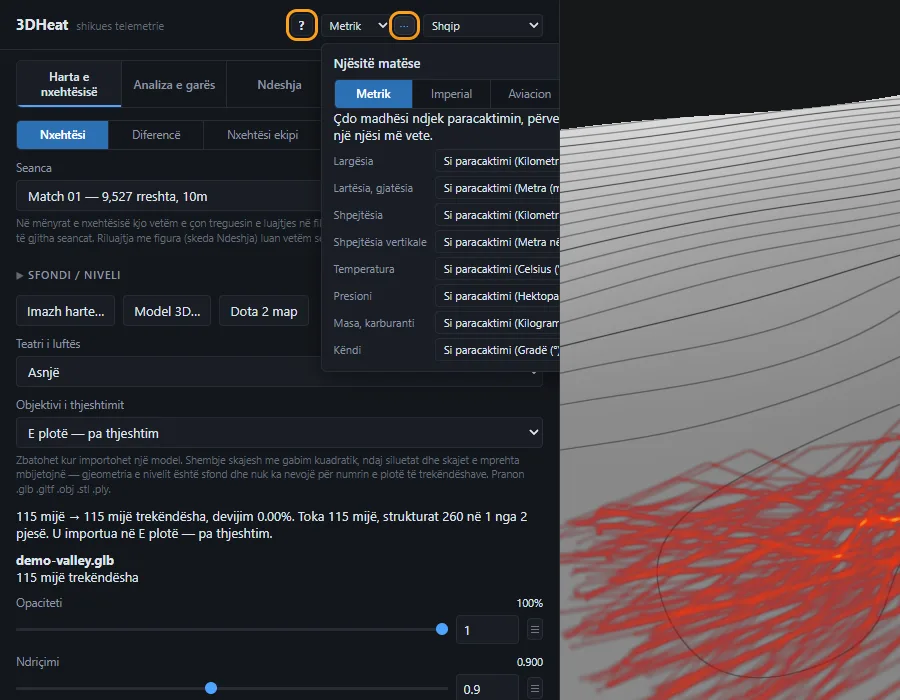
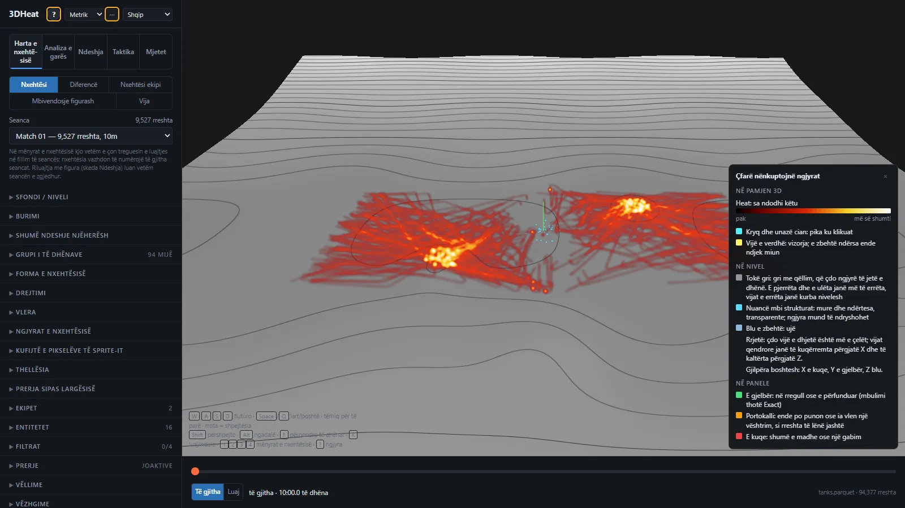
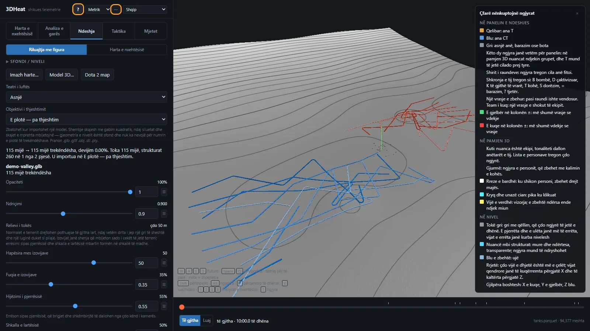

# Cilësimet, njësitë dhe tastet

Kontrollet e vogla në krye të shiritit anësor ndryshojnë mënyrën si flet shikuesi me ty: gjuhën, njësitë (metra ose këmbë, km/h ose nyje) dhe një modalitet ndihme që shpjegon ngjyrat. Zgjedhjet e tua kujtohen në shfletues.

## Kreu {#the-header}

Në krye të shiritit anësor:

| Kontrolli | Çfarë bën |
|---|---|
| **?** | Modaliteti i ndihmës: çfarë do të thotë çdo ngjyrë (gjithashtu `?` ose `F1`) |
| Menuja **Njësitë** | Metrik, Imperial, Aviacion ose Detar |
| Butoni **...** pranë **Njësitë** | Hap "Zgjidh një njësi për çdo madhësi": një listë zgjedhjeje për çdo sasi |
| Menuja **Gjuha** | Gjuha e shikuesit: [40 gjuhë](languages.md), ose ajo e shfletuesit |

Numrat që shkruan në një kuti mund të kenë pikë ose presje (`0.35` ose `0,35`). Shikuesi i lexon të dyja dhe i shfaq numrat ashtu si i shkruan gjuha e shikuesit.

## Njësitë {#units}

1. Zgjidh një paracaktim në menunë **Njësitë**. Të gjitha sasitë ndërrohen bashkë.
2. Për të ndryshuar vetëm një sasi, kliko butonin **...** pranë saj dhe zgjidh një njësi për atë sasi. Menuja shfaq pastaj një `*` pas paracaktimit.
3. Një sasi që nuk e ke vendosur ndjek paracaktimin. Zgjidh "Si paracaktim" për t'u kthyer.

| Sasia | Metrike (parazgjedhja) | Imperiale | Aviacion | Detare |
|---|---|---|---|---|
| Distanca | km | mi | NM | NM |
| Lartësia, gjatësia | m | ft | ft | m |
| Shpejtësia | km/h | mph | kt | kt |
| Shpejtësia vertikale | m/s | ft/min | ft/min | m/s |
| Temperatura | °C | °F | °C | °C |
| Presioni | hPa | inHg | hPa | hPa |
| Masa, karburanti | kg, l | lb, gal | lb, gal | t, m³ |
| Këndi | gradë | gradë | gradë | gradë |

Njësi të tjera që mund të zgjedhësh për një sasi: distanca km, mi, NM; shpejtësia km/h, m/s, kt, mph; shpejtësia vertikale m/s, ft/min, m/min; temperatura °C, °F, K; presioni hPa, inHg, mmHg, psi; masa kg, lb, t; këndi gradë ose mils NATO (6400 në rreth). Njësitë janë të njëjta kudo në shikues: etiketa, kartela, grafikë, statistika.

## Modaliteti i ndihmës {#help-mode}

Shtyp `?` ose `F1`, ose kliko butonin **?**. Ai shfaq *Çfarë do të thonë ngjyrat*: legjendat për pamjen 3D, shkallët e nxehtësisë, ngjyrat e ekipeve, ngjyrat e nivelit, ngjyrat e gjendjes së paneleve, panelin e ndeshjes dhe pamjen e garës. Mbetet i ndezur derisa ta fikësh. Në skedën Match shpjegon edhe ngjyrat e panelit të ndeshjes.

## Çfarë kujton shfletuesi {#what-the-browser-remembers}

Këto cilësime ruhen në shfletuesin tënd mes vizitave (asgjë nuk dërgohet askund):

- gjuha, njësitë dhe modaliteti i ndihmës;
- cilësimet e figurës, simbolit, etiketës, kamerës dhe ekranit taktik të riprodhimit;
- shpejtësia e luajtjes dhe pasqyrimi;
- shenjat e faqeshënuesit për çdo regjistrim, volumet për çdo grup të dhënash, shtresat e objektivave;
- cilësimet e jashtme të AI (çelësi vetëm nëse e shenjon *Mbaj mend*).

Cilësimet e nxehtësisë, filtrat dhe modaliteti nisin nga e para me çdo ngarkim. Lista e plotë, e gjeneruar: [Cilësimet e ruajtura](ref-settings-storage.md).

## Tastet që shikuesi i mban nga shfletuesi {#keys-the-viewer-keeps-from-the-browser}

Një seancë me të dhëna të mëdha kërkon kohë për t'u ngarkuar, prandaj shikuesi e ndalon shfletuesin të mos e hedhë jashtë pa dashje:

- `Ctrl`/`Cmd` + shkronja që do të printonin, ruanin, hapnin, rifreskonin, mbyllnin ose hapnin dritare të reja nuk bëjnë asgjë jashtë kutive të tekstit; `F1`, `F3`, `F5`, `F6` dhe `F7` nuk bëjnë asgjë.
- Mbyllja ose rifreskimi i skedës me të dhëna ose nivel të ngarkuar pyet më parë.
- Në ekran të plotë shikuesi kyç tastet që përdor (W, T, N, S, R, P, Q, Esc), kështu që shfletuesi nuk i merr ato.

Lista e saktë: [Tastet e shfletuesit](ref-browser-keys.md). Të gjitha tastet e vetë shikuesit: [Referenca e tastierës dhe miut](keyboard-reference.md).
