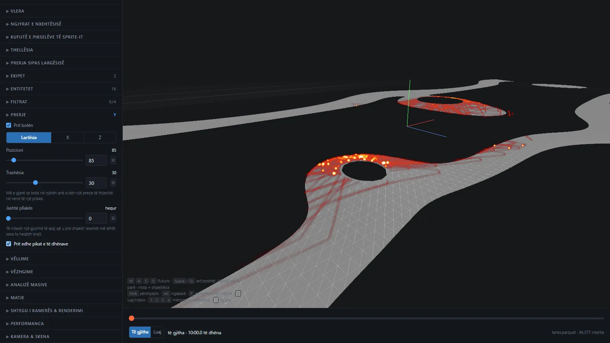

# Prerja

**Prerja** e pret botën si një copë tortë, që të shohësh brenda ndërtesave. Përdore kur muret fshehin nxehtësinë me interes, për shembull për të parë një kat të një ndërtese.

## Provoje {#try-it}

1. Ngarko një nivel dhe disa të dhëna, dhe hap **Prerjen**.
2. Shëno **Prit botën**. Boshti është **Lartësia**.
3. Tërhiq **Pozicionin** lart e poshtë: pllaka lëviz nëpër nivel.
4. Bëje **Trashësinë** të hollë për plan kati, ose të gjerë për "gjithçka këtu poshtë".
5. Mbaje **Jashtë pllakës** në 0 për të hequr pjesën tjetër, ose ngrite për të mbajtur një gjurmë të zbehtë.



Pllaka pret **gjeometrinë e nivelit dhe pikat e të dhënave së bashku** - prerja vetëm e nivelit do të linte nxehtësinë të lundronte aty ku ishte ndërtesa e saj. Është pjesa tjetër e [heqjes së thellësisë](depth-and-culling.md): sapo niveli fsheh saktë atë që është pas tij, brendësia e një ndërtese fshihet edhe ajo. Paneli shfaqet kur ka çfarë të presë (një grup të dhënash ose një nivel 3D); titulli i tij tregon boshtin kur është i ndezur, *off* përndryshe.

```
side view         Position = where the slab is
 ----------       Thickness = how tall the slab is
 | floor 3 |
 |=========|  <--- slab (kept)
 | floor 2 |  <--- outside: removed (or faint)
 | floor 1 |
 ----------
```

## Kontrollet {#controls}

| Kontrolli | Parazgjedhja | Kuptimi |
|---|---|---|
| **Prit botën** | off | Ndez pllakën. Ndërsa pozicioni është ende në 0 fillestar dhe trashësia në 500 fillestar, ndezja i zhvendos ato në mes të boshtit dhe 15% të shtrirjes së tij. |
| Boshti | **Lartësia** | *Lartësia* (Y), *X* ose *Z*. Ndërrimi i boshtit e zhvendos pllakën në mes të boshtit të ri. |
| **Pozicioni** | mesi | Qendra e pllakës, në njësi botërore, përgjatë shtrirjes së boshtit (500 hapa). |
| **Trashësia** | 15% e shtrirjes | Nga 1/500 e shtrirjes deri në dyfishin e shtrirjes, me hapa logaritmikë. Lexohet *përtej botës* kur bëhet aq e gjerë sa shtrirja: njëra anë arrin atëherë përtej botës dhe është një prerje e thjeshtë, jo pllakë. |
| **Jashtë pllakës** | 0, *hequr* | Sa nga ajo që është jashtë mbetet e dukshme, 0-100%. Një gjurmë e zbehtë e asaj që u pre shpesh është më e lehtë për t'u lexuar sesa ta heqësh plotësisht. |
| **Prit edhe pikat e të dhënave** | aktive | Joaktive e lë nxehtësinë të plotë, kështu që shfaqet përmes prerjes - e dobishme për të parë çfarë është mbi dhe nën pllakë. |

Shtrirja e një boshti është ajo e nivelit 3D kur është i ngarkuar, përndryshe ajo e grupit të të dhënave.

Prerja është e pavarur nga [prerja sipas distancës](depth-and-culling.md#distance-culling), e cila pret sipas drejtimit të shikimit e jo sipas një boshti botëror; të dyjat kombinohen. Një ndryshim në çdo cilësim të prerjes rinis grumbullimin e nxehtësisë.

## Për zhvilluesit {#for-developers}

Pllaka testohet për pozicionin botëror të çdo rreshti në hijuesin e kulmeve: një rresht jashtë saj ka kontributin e vet të shumëzuar me vlerën *Jashtë*, kështu që me 0 hidhet poshtë përpara se të vizatohet ndonjë fragment. Hijuesit e nivelit aplikojnë të njëjtin test për çdo fragment të tokës, strukturave dhe ujit.
