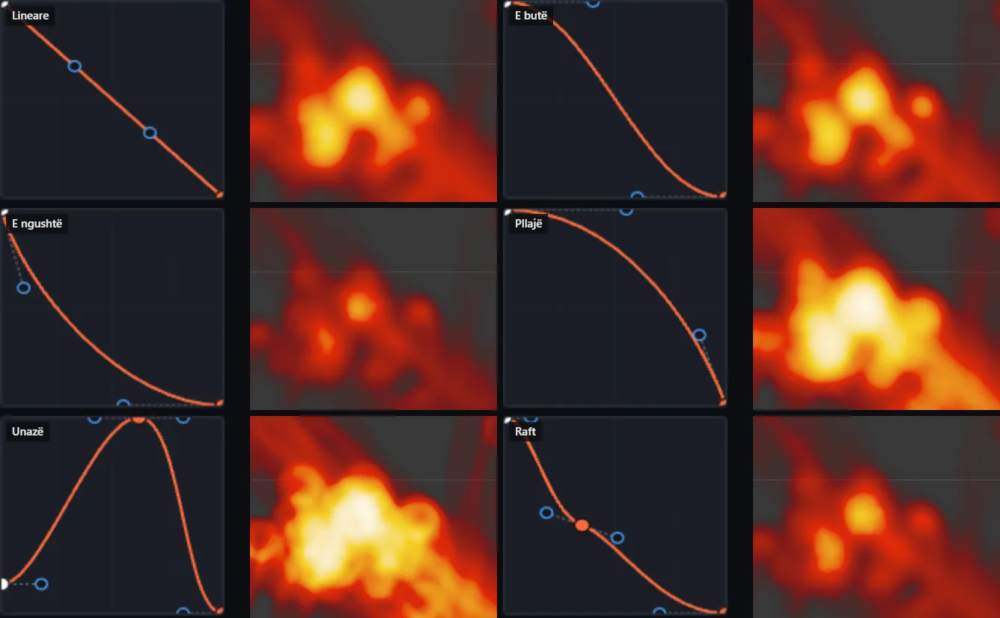

# Forma e sprite-it

Çdo rresht vizatohet si një sprite i rrumbullakët që gjithmonë përballet me kamerën. Madhësia e tij dhe profili nga qendra deri te buza — **shkalla** — vendosin nëse një pikë e nxehtë lexohet si pikë e ngushtë, re e butë, disk ose unazë. Këto kontrolle janë te seksionet **Forma e nxehtësisë** dhe **Kufijtë e pikselëve të sprite-it** të anështyllës, dhe zbatohen te [Nxehtësia](heat.md), [Diferenca](difference.md), [Nxehtësia e ekipit](team-heat.md) dhe, si gjysmë-gjerësia e një vije, te [Nxehtësia me vija](line-heat.md).

Ndryshimi i ndonjërit prej tyre e rinis grumbullimin (fusha duhet të vizatohet përsëri me formën e re).

Mendoje çdo pikë si një njollë të butë drite. Një njollë e vogël tregon pika të vetme; një njollë e madhe bashkon fqinjët në një re. Forma vendos sa e butë është buza.



## Rrezja e sprite-it {#sprite-radius}

Rrezja e sprite-it në **njësi botërore** (të etiketuara si metra). Parazgjedhja është 6, dhe në çdo ngarkim gjatë gjithë të dhënave shtrirja horizontale / 120, aq e madhe sa fqinjët përgjatë një rruge të bashkohen në brez e jo të lexohen si një fije. Rrëshqitësi logaritmik 0,05-2000, doreza deri në 50 000.


Gjërat e largëta duken më të vogla, prandaj një sprite zvogëlohet në ekran me largësinë. Në projeksionin paralel është i njëjtë kudo, dhe kjo është një arsye pse pamja paralele është e duhura për krahasimin e pikave të nxehta ([Kamera](camera.md#projection)).

## Kufijtë e pikselëve {#pixel-clamps}

**Kufijtë e pikselëve të sprite-it** (i mbyllur si parazgjedhje) kufizojnë rrezen në ekran pasi bëhet konvertimi më sipër.

| Kontrolli | Parazgjedhja | Diapazoni (rrëshqitja) | Pse |
|---|---|---|---|
| **Rrezja min. në piksele** | 1 px | 0-16 (512) | Mban të dhënat e largëta nga zhdukja nën një piksel. |
| **Rrezja maks. në piksele** | 96 px | 2-1024, logaritmik (8192) | Mbrojtja nga mbivendosja. Një sprite që mbulon N piksele kushton N operacione përzierjeje, prandaj një rreze pa kufi afër kamerës e kthen një kuadër të shpejtë në një kuadër të ngadaltë. Mbi lartësinë e ekranit, nuk kufizon më asgjë. |

**E njëjta dendësi në çdo zmadhim** (te seksioni Forma e nxehtësisë, i ndezur si parazgjedhje) punon me kufijtë. Një sprite që një kufi e bën më të madh (larg) ose më të vogël (afër) e mban nxehtësinë që do t'i shtonte madhësia e vet reale, kështu që një ngjyrë do të thotë të njëjtin numër rreshtash për njësi sipërfaqeje toke në çdo zmadhim. Kur është e fikur, një sprite i kufizuar shton peshën e plotë me madhësinë e kufizuar, dhe pamja ndryshon kur fluturon brenda.

## Intensiteti në qendër dhe në buzë {#centre-and-edge-intensity}

Nxehtësia që shton një sprite në qendrën e vet të saktë (**Intensiteti në qendër**, parazgjedhur 1, 0-10, rrëshqitja 1000) dhe në buzë (**Intensiteti në buzë**, parazgjedhur 0, -2-10, rrëshqitja 1000). Vlera e shkallës *t* (1 në qendër, 0 në buzë, e formuar nga rënia ose kurba më poshtë) bën përzierjen midis tyre (formula është te [Për zhvilluesit](#for-developers)).

Një **intensitet negativ në buzë** e bën buzën të zbresë, që gdhend një halo të freskët rreth çdo pike të nxehtë dhe mprehë grupimet kundër njëra-tjetrës. Dukshmëria përfshin [errësimin](depth-and-culling.md) dhe [prerjen](slice.md); zbehja është [zbehja e jetëgjatësisë](timeline.md#history); shenja është ±1 te [Diferenca](difference.md).

## Forma e shkallës: Rënia ose Kurba {#ramp-shape-falloff-or-curve}

**Forma e shkallës** ndërron mes dy mënyrave për të formësuar *t* përgjatë sprite-it. Me *d* largësinë nga qendra (0) deri te buza (1):

### Rënia {#falloff}

Shfaqet kur zgjidhet *Rënia* (parazgjedhja).

- **Rënia** (parazgjedhur 1,6, 0,1-8, rrëshqitja 64): `t = (1 - d) ^ falloff`. 1 është një shkallë lineare e drejtë; më e lartë e tërheq nxehtësinë drejt qendrës dhe e ngushton pikën e nxehtë; nën 1 e sheshon në disk.
- **Shkallë e butë** (parazgjedhur i ndezur): i aplikon *t* një kurbë S (smoothstep), kështu që sprite-i zbehet te buza e vet në vend që të mbarojë me një buzë të dukshme.

### Redaktori i kurbës {#the-curve-editor}

Shfaqet kur zgjidhet *Kurba*. Një prerje e drejtpërdrejtë e një sprite-i: largësia nga qendra përgjatë (*qendra* në të majtë, *buza* në të djathtë), nxehtësia lart. Kurba është një Bézier kubik me pjesë, që kalon nëpër pika kontrolli, secila me dy doreza.

| Veprimi | Efekti |
|---|---|
| Klik i dyfishtë mbi grafik | Shton një pikë në atë largësi (mbahet midis 0,02 dhe 0,98), mbi kurbën dhe me pjerrësinë e kurbës atje, kështu që shtimi nuk ndryshon asgjë derisa ta tërheqësh. |
| Tërhiq një pikë | E zhvendos. Lartësitë mbahen midis 0 dhe 1. |
| Tërhiq një rreth të vogël | Përkul segmentin pranë tij (zhvendos atë dorezë). |
| Alt-klik ose klik i djathtë mbi një pikë | E heq. Dy skajet nuk mund të hiqen. |
| Një buton paracaktimi | Zëvendëson kurbën me paracaktimin. |

Skajet janë të fiksuara te qendra dhe buza; lartësia e tyre mbetet në dorën tënde.

**Paracaktimet** ([`curve.ts`](https://github.com/Holdi601/3DHeat/blob/main/src/state/curve.ts)):

| Paracaktimi | Forma | Përdorimi |
|---|---|---|
| **Lineare** | Drejt nga 1 në 0 | Identike me *Rënien* 1 me *Shkallën e butë* të fikur. |
| **E butë** | Kurbë S | Kurba parazgjedhur; ajo që jep *Shkalla e butë* te rënia 1. |
| **E ngushtë** | Bërthamë e thellë, një fund i gjatë i zbehtë | Të dhëna të rralla. |
| **Pllajë** | E sheshtë, pastaj rënie e shpejtë | Lexohet si disk, jo si njollë. |
| **Unazë** | 0,15 në qendër, 1 në 62% të rrezes, 0 në buzë | Një sprite i zbrazët: tregon ku kalojnë rrugët, jo ku ndalojnë. |
| **Raft** | Rënie me dy faza, 0,45 në 35% | Ndan një bërthamë të dendur nga rrethina e saj. |

## Rrafsho mbi rrafshin e tokës {#flatten-onto-ground-plane}

**Rrafsho mbi rrafshin e tokës** (parazgjedhur i fikur) injoron lartësinë e çdo rreshti dhe vizaton gjithë nxehtësinë në një lartësi — Y-in më të ulët të grupit të të dhënave — harta klasike 2D e nxehtësisë. Kur është i ndezur, errësimi i thellësisë dhe *Fshih pas terrenit* janë të fikura (çdo pikë do të ishte pikërisht mbi sipërfaqen kundrejt së cilës testohet), dhe seksioni Thellësia e thotë këtë.

## Për zhvilluesit {#for-developers}

### Formulat {#formulas}

Rrezja në ekran në piksele: `radius × P[1][1] / w × lartësia e ekranit / 2`, ku `P` është matrica e projeksionit dhe `w` është thellësia e pikës në pamje.

Nxehtësia që shton një sprite:

```
heat added = mix(edge, centre, t) × sample weight × sign × fade × visibility
```

### Kurba {#the-curve}

Dorezat kufizohen horizontalisht te segmenti i vet, kështu që kurba është gjithmonë një funksion i largësisë: tërheqja e një doreze larg përtej pikës së radhës e sheshon kundër saj në vend që ta palosë kurbën mbrapsht, gjë që do ta bënte rezultatin të varej nga cila rrënjë gjeti zgjidhësi.

### Si vizatohet kurba {#how-the-curve-is-drawn}

Kurba pjekët në një tabelë me 256 hyrje sa herë ndryshon, ngarkohet si teksturë me pikë lundruese 16-bit, dhe lexohet për çdo fragment me filtrim linear dhe një përgjysmim gjysmëtekseli, që të dy skajet të mbeten të sakta. Zgjidhja e një Bézier për x kërkon përsëritje, që nuk ka vend në shader-in më të ngarkuar të programit, dhe një marrje nga tabela është gjithashtu më e lirë se `pow()` që përdor rënia. 16-bit e jo 8-bit, sepse 8 bit shfaqet si shirita kur janë përmbledhur mijëra sprite-a; pika lundruese 16-bit gjysmë është e filtrueshme në WebGL2 bazë, ku 32-bit ka nevojë për një zgjerim.
