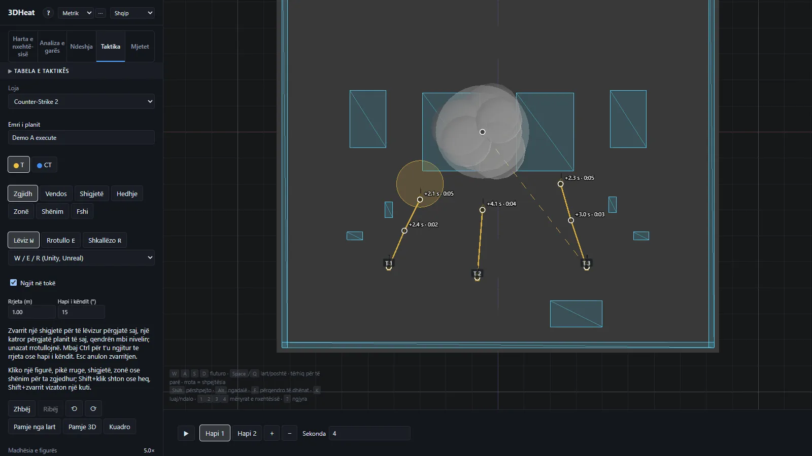

# Tabela e taktikave

Skeda **Taktika** është një tabelë vizatimi për një plan ekipi: vendos figura të vogla mbi një hartë, vizato shigjeta për ku shkojnë, dhe shtyp luaj për ta parë të ndodhë. Përdore për të planifikuar një raund ose një sulm para se të luash. Ndan me skedat e tjera vizën, kamerën dhe [nivelin](levels.md) dhe asgjë tjetër; një plan nuk është e dhënë dhe nuk vizaton nxehtësi.

## Plani yt i parë {#your-first-plan}

1. Hap skedën **Taktika**. Zgjidh **Lojë** (për shembull Counter-Strike 2) dhe, për Valorant, shtyp **Ngarko hartat e Valorant** dhe zgjidh një **Hartë**. Ose ngarko fillimisht një [nivel](levels.md).
2. Zgjidh një **Pala** (cakton ngjyrën) dhe shtyp **Pamje nga lart**.
3. Zgjidh **Vendi**, zgjidh një figurë te **Figurat** (përdor **Kërko figura** për ta gjetur) dhe kliko mbi hartë. Vendos dy ose tre.
4. Zgjidh **Shigjetë**, kliko mbi një figurë, kliko përgjatë rrugës që duhet të ndjekë, dhe shtyp **Enter** për të mbaruar shigjetën.
5. Shtyp **+** nën pamje për të shtuar hapin 2. Çdo figurë fillon aty ku mbaroi shigjeta e saj. Vizato më shumë shigjeta atje.
6. Shtyp **▶** (ose `K`) për të luajtur planin nga hapi i shfaqur deri në fund.
7. Emërto planin te **Emri i planit** dhe shtyp **Ruaj**.

## Fillimi i një plani {#starting-a-plan}

| Kontrolli | Çfarë bën |
|---|---|
| **Lojë** | Zgjedh palët dhe figurat që ofron paleta: Counter-Strike 2 (T, CT; lojtarë dhe pajisje ndihmëse), Valorant (Sulm, Mbrojtje; lojtarë dhe aftësi të përgjithshme), Battlefield, Squad, Arma (këmbësori, mjete tokësore, avionë, varka), DCS / War Thunder / IL-2 (reaktivë, avionë helikë, helikopterë, mbrojtje ajrore, tokë, anije, armë), dhe Tjetër. Një plan që ka tashmë figura i mban palët e tij kur ndryshon loja. |
| **Emri i planit** | Emri me të cilin ruhet plani. |
| **Hartë**, **Ngarko hartat e Valorant** | Me Valorant të zgjedhur: **Ngarko hartat e Valorant** merr listën e hartave nga [valorant-api.com](https://valorant-api.com); **Hartë** pastaj vendos minihartën e hartës së zgjedhur si nivel, e kornizuar nga lart. Imazhi shkarkohet kur zgjidhet dhe nuk dërgohet kurrë me programin. Njoftimi i Riot shfaqet ndërsa është në ekran (shih më poshtë). |
| **Pala** | Pala së cilës i përket figura, shigjeta ose zona e radhës; merr ngjyrën e palës. |

Pa nivel, tabela është rrafshi i tokës. Ngarko një nivel te **Niveli** për të planifikuar mbi një hartë të vërtetë: një hartë CS2 e eksportuar me veglën CS2, një nivel nga biblioteka, ose një imazh harte.

## Mjetet {#tools}

| Mjeti | Klikimi | Shënime |
|---|---|---|
| **Zgjidh** | Një figurë, pikë udhëtimi, shigjetë, zonë ose shënim e zgjedh. | Shift+klikim shton ose heq; Shift+tërheqja vizaton një kuti rreth asaj që do të shtohet. Përzgjedhja merr një gizmo transformimi (shih më poshtë); `Delete` ose `Backspace` e heq. `M` e zhvendos figurën e zgjedhur te klikimi i radhës. |
| **Vendi** | Vendos figurën e zgjedhur. | Figura zgjidhet nga paleta **Figurat** (me **Kërko figura**). Pa asgjë të zgjedhur, `R` e rrotullon figurën e radhës për 15° para se të vendoset (`Shift+R` në drejtim tjetër). |
| **Shigjetë** | Çdo klikim shton një pikë; Enter, dy klikime ose një klikim me të djathtën e mbyllin, Esc e heq. | **Zhvendos**, **Sulm** (kokë më e gjerë) ose **Vëzhgim** (një vijë e hollë në lartësinë e syve). Një shigjetë e nisur mbi një figurë është rruga e asaj figure në këtë hap: kur luhet, figura e ndjek, dhe hapi tjetër nis aty ku mbaroi. |
| **Hedhje** | Hedhësi, pastaj ku bie. | Një hark me viza nga njëra te tjetra, dhe pajisja e zgjedhur (tym, ndriçim, molotov, ...) shfaqet aty ku bie dhe mbetet nga ky hap e tutje. |
| **Zonë** | Mesi, pastaj skaji. | Një disk me ngjyrën e palës. |
| **Shënim** | Ku shkon shënimi; kërkon tekstin e tij. | Shfaqet si një pin, dhe teksti i tij mbi të. |
| **Fshi** | Një figurë, shigjetë, zonë ose shënim. | E heq nga ky hap e tutje; në hapin e vet të parë, e heq plotësisht. |

**Zhbëj** dhe **Ribëj** (`Ctrl+Z`; `Ctrl+Y` ose `Ctrl+Shift+Z`) kalojnë çdo ndryshim. Një vijë nën plan tregon sa figura, shigjeta dhe hapa ka. **Pamje nga lart** shikon drejt poshtë (ortografike), **Pamje 3D** kthehet te perspektiva, **Kuadri** e përshtat planin, ose nivelin kur plani është bosh.

**Madhësia e figurës** e shkallëzon çdo figurë në tabelë; 1× është madhësia reale, që nga lart larg është disa piksele për një person.

## Zhvendosja, rrotullimi dhe shkallëzimi {#moving-turning-and-scaling}

Çdo gjë në tabelë mund të zhvendoset si në një redaktues 3D: figura, pajisje ndihmëse, shenja, pika të vetme udhëtimi dhe shigjeta të plota, zona dhe shënime. Ajo që është e zgjedhur merr një gizmo në mes:

| Mënyra | Tastet | Dorezat |
|---|---|---|
| **Zhvendos** | W (ose G) | Një shigjetë për çdo bosht (X e kuqe, Y e gjelbër dhe lart, Z blu) zhvendos përgjatë tij; një katror zhvendoset në rrafshin e vet; qendra zhvendoset mbi nivelin nën tregues. |
| **Rrotullo** | E (ose R) | Një unazë për çdo bosht rrotullohet rreth tij. Unazat e një figure të vetme janë rrotullimi i vet (yaw, pitch, roll); një grup rrotullohet rreth boshteve të botës, rreth mesit të vet. |
| **Shkallëzo** | R (ose S) | Hap ose mbledh zgjedhjen nga mesi përgjatë një boshti ose në të gjitha drejtimet; rrezja e një zone rritet me të. |

**Tastet** ndërron mes W / E / R (Unity, Unreal) dhe G / R / S (Blender); tastet zgjedhin mënyrën vetëm kur diçka është e zgjedhur, dhe e fluturojnë kamerën përndryshe. Kështu `R` do të thotë **Shkallëzo** me tastet W / E / R dhe **Rrotullo** me tastet G / R / S kur diçka është e zgjedhur, dhe rrotullon figurën e radhës për ta vendosur kur s'ka asgjë. Të gjitha tastet e tabelës listohen te [referenca e tastierës](keyboard-reference.md#tactics-board). Mbaj **Ctrl** ndërsa tërheq për ta ngjitur zhvendosjen te **Rrjeta** (metra) ose rrotullimin te **Hapi i këndit**. **Ngjit në tokë** (parazgjedhur i ndezur) vendos njerëzit, mjetet, shenjat, pikat e udhëtimit dhe zonat e zhvendosura mbi sipërfaqen e nivelit; avionët dhe helikopterët e mbajnë lartësinë e tyre, dhe një tërheqje përgjatë shigjetës Y nuk ngjitet kurrë. Tërheqja e një dorezë nuk e zhvendos kurrë kamerën. **Esc** anulon një tërheqje, dhe çdo ndryshim është një hap i Zhbërjes.

Pikat e udhëtimit shfaqen si pika mbi shigjetat e hapit të shfaqur: kliko një për ta zgjedhur, tërhiqe për ta zhvendosur, Delete për ta hequr. Seksioni **Të zgjedhura** tregon vendin e zgjedhjes në metra, rrotullimin (yaw, pitch, roll) të një figure në shkallë, dhe rrezen e një zone, secila për t'u shkruar.

## Koha {#timing}

Rruga e një figure ka kohë: çdo segment zgjat gjatësinë e vet mbi nivel - e mostruar mbi sipërfaqe çdo disa metra, kështu që një kodër ose shkallët mes dy pikave llogariten - me shpejtësinë e **mënyrës** së lëvizjes së asaj figure në atë lojë, plus çdo **pritje** te një pikë udhëtimi. Këmbësoria zvarritet, ulet, ecën (pa zhurmë), vrapon ose sprinton; mjetet dhe varkat zvarriten, shkojnë me kujdes, normalisht ose me nxitim; avionët dhe helikopterët fluturojnë ngadalë, me shpejtësi kruizimi, me shpejtësi lufte ose maksimale. Një mënyrë që loja nuk e ka (CS2 nuk ka sprint) merr më të afërtën që ka. Si një pjerrësi ngadalëson varet nga loja: në CS2 dhe Valorant numrohet vetëm distanca horizontale, si në lojëra; simulimet ushtarake ngadalësojnë këmbësorinë lart (funksioni i ecjes së Tobler) dhe mjetet sipas pjerrësisë.

Shpejtësitë vijnë nga tabela për çdo lojë me burimet e tyre (shih [Shpejtësitë e lëvizjes](tactics-speeds.md)): CS2 sipas armës së mbajtur, nga përkufizimet e armëve të lojës; Valorant sipas armës; Battlefield, Squad, Arma dhe lojërat ajrore sipas tipit dhe klasës së mjetit. **Lëviz si** zgjedh profilin e një figure (një armë, një tip mjeti); **E vetja (m/s)** e anashkalon çdo mënyrë për atë figurë. Mënyrat emërtohen si i shfaq tabela: *Zvarritje*, *Ulje*, *Ecje (pa zhurmë)*, *Vrapim*, *Sprint*; *Me kujdes*, *Normale*, *Nxitim*; *Ngadalë*, *Kruizim*, *Luftë*, *Maksimale*.

Çdo pikë udhëtimi tregon kohën nga e fundit dhe kohën që nga fillimi i planit ("+3.9 s · 0:12"). Rruga e figurës së zgjedhur liston çdo segment me mënyrën, gjatësinë dhe kohën e vet, pritjen dhe mbërritjen. **Mbërritjet** nën **Koha** vendos çdo figurë me rrugë në një vijë kohore të vetme, mbërritja e parë në krye. Me **Luaj në kohë reale** (parazgjedhur i ndezur) një hap zgjat deri sa mbërrin rruga më e ngadaltë dhe çdo figurë lëviz me shpejtësinë e vet; **Sekonda** është atëherë gjatësia më e shkurtër e hapit. **Njësi niveli për metër** thotë në çfarë është niveli: 39.37 për hartat CS2 (njësi lojë), 1 për harta në metra.

## Krahasimi me të dhënat e ndeshjeve {#compare-with-match-data}

**Ngarko skedarët e ndeshjeve…** lexon tabelat e ndeshjeve CS2 të hartës (skedarët Parquet të veglës CS2, sa të duash; vetëm kolonat e nevojshme, në sfond); **Përdor të dhënat e ngarkuara** merr të dhënat e ngarkuara në shikues. Pastaj:

- **Mbërritja më e hershme në hartë** ngjyros hartën sipas kohës nga fillimi i raundit kur një lojtar mbërriti për herë të parë në çdo pikë - butoni **Më i shpejti** tregon më të shpejtin mbi të gjitha raundet, **Tipik (mediana)** raundin e mesëm - nga jeshile në fillim deri në të kuqe vonë, për një anë ose për të dyja. Tregon çfarë është e mundur, dhe kur.
- Rruga e zgjedhur krahasohet me atë që arritën lojtarët nga fillimi i saj (ose nga fillimi i raundit) deri në fund të saj, çdo fund një disk me rrezen e caktuar: "Më i shpejti i vërejtur 14.2 s, p10 15.0 s, mediana 18.3 s mbi 41 përpjekje; plani yt 15.1 s".
- Shpejtësitë me të cilat lëvizën vërtet lojtarët - vrapim, ecje, ulje, nga kolonat e ecjes dhe të uljes së tabelave - në m/s.

## Hapat {#steps}

Shiriti nën pamje mban hapat. Një plan fillon me një; **+** shton një, dhe çdo figurë fillon aty ku mbaroi rruga e saj në hapin e fundit; **−** heq atë që shfaqet. **Sekonda** është sa zgjat hapi i shfaqur kur luhet. **▶** (K) luan nga hapi i shfaqur deri në fund: figurat me rrugë e ndjekin atë, figurat e zhvendosura në një vend të ri në hapin tjetër rrëshqasin atje, të tjerat qëndrojnë. Ndërsa një hap shfaqet, vendi i çdo figure në hapin tjetër vizatohet si një fantazmë e zbehtë, dhe shigjetat e hapit të fundit zbehtë nën atë të këtij hapi.

## Ruajtja {#saving}

Seksioni **Skedari** mban **Ruaj**, **Hapje** dhe **Pastro**. **Ruaj** e shkruan planin si `<emri>.h3dplan.json` (JSON i thjeshtë: palët, hapat, figurat me një vend për hap, shigjetat, zonat, shënimet); **Hapje** e lexon përsëri. Një skedar i një versioni tjetër, ose një që nuk është plan, refuzohet me arsyen. **Pastro** boshatis planin; Zhbëj e kthen.

## Figurat {#figures}

Çdo figurë ndërtohet nga vetë shikuesi: forma të thjeshta sipas përmasës së publikuar të një tipi, me veçoritë që e dallojnë nga fqinjët - rrotat rrugore dhe kulla e tankut, topat, raketat dhe radarët e një mjeti mbrojtjeje ajrore, plani i krahëve, bishti dhe motorët e një avioni, rotorët dhe krahët e shkurtër të një helikopteri. Asgjë nuk merret nga një lojë. Një dizajn që e shpiku një lojë shfaqet si figura e përgjithshme e klasës së vet. Shih [Figurat](figures.md#which-figure-a-unit-gets) për mënyrën si të dhënat gjejnë figurën e tyre.

## Njoftimi i Riot {#riots-notice}

Hartat e Valorant shfaqen sipas politikës "Legal Jibber Jabber" të Riot Games, e cila lejon projektet falas të komunitetit t'i përdorin dhe kërkon këtë njoftim kudo që shfaqen: *3DHeat u krijua sipas politikës "Legal Jibber Jabber" të Riot Games, duke përdorur asete që zotëron Riot Games. Riot Games nuk e mbështet dhe nuk e sponsorizon këtë projekt.* Aftësitë në tabelë janë forma të përgjithshme, jo arti i Riot.
