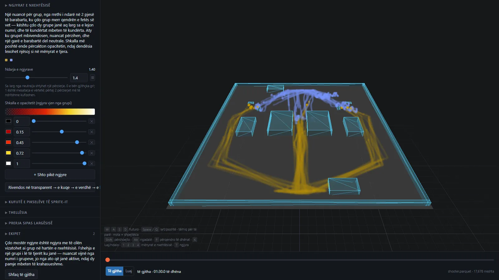

# Nxehtësi ekipi

Nxehtësia e ekipit tregon ku ishte çdo ekip, çdo ekip me ngjyrën e vet. Aty ku ekipet mbivendosen, ngjyrat përzihen.

**Nxehtësia e ekipit** (tasti 3) është fusha e dendësisë së [Nxehtësisë](heat.md) me çdo [grup](glossary.md) që i jepet nuancë e vet. Aty ku grupet mbivendosen, nuancat përzihen; një garë e barabartë del neutrale. Opaciteti ende mban dendësinë saktësisht si në modalitetet e tjera, kështu që figura përgjigjet *sa* dhe *kujt* në të njëjtën kohë. Kërkon një kolonë grupi.

Nuk është [mbivendosja e figurave](box-replay.md): ajo vizaton një figurë për person; kjo është një fushë nxehtësie e ngjyrosur nga e njëjta kolonë.

## Si ta përdorësh {#how-to-use-it}

1. Shtyp `3` (ose zgjidh **Nxehtësi ekipi** në shiritin e modaliteteve).
2. Hap **Ngjyrat e nxehtësisë**. Mostrat tregojnë ngjyrën e çdo grupi; kalo miun mbi një mostër për emrin e ekipit.
3. Nëse gjithçka duket gri, ngri **Ndarjen e ngjyrave**.
4. Hiq shenjën e një grupi te [Lista e skuadrave](teams-list.md) për ta nxjerrë; ngjyrat e tjera mbeten aty ku ishin.

## Kontrollet {#controls}

Në seksionin **Ngjyrat e nxehtësisë**:

| Kontrolli | Parazgjedhja | Kuptimi |
|---|---|---|
| Mostrat | | Ngjyra e çdo grupi, për 12 grupet e para, pastaj *+N të tjerë*. Kalo miun për emrin e grupit dhe ngjyrën. |
| **Ndarja e ngjyrave** | 1.4 | Sa larg shtyhet një përzierje nga neutrali, 0-4. 0 e bën gjithçka gri; 1 është mesatarja e vërtetë; mbi rreth 2 përzierjet më të ndritshme dalin jashtë gamës së shfaqshme dhe kufizohen për kanal, gjë që e zhvendos nuancën e tyre. |
| **Shkalla e opacitetit (ngjyra vjen nga grupi)** | shkalla e parazgjedhur e nxehtësisë | Këtu përdoret vetëm **alfa** e shkallës: transparente aty ku nuk ka asgjë, e errët në majë. Ngjyrat e saj shpërfillen. |

Një grup me etiketën do të thotë "pa grup" (`0`, bosh, `none`, `unknown`, `null` ose `-1`) vizatohet gri.

Të gjitha kontrollet e tjera të nxehtësisë - forma, ngopja, përgjigjja, nxehtësia minimale, thellësia, prerja - funksionojnë si te [Nxehtësia](heat.md).

[Lista e skuadrave](teams-list.md) tregon ngjyrën e nxehtësisë së ekipit të çdo grupi si mostrën e tij në këtë modalitet. Fshehja e një grupi e lë ngjyrën e çdo grupi tjetër aty ku ishte: nuancat vijnë nga numri total i grupeve, jo nga ato që janë të ndezura, kështu që dy figura mbeten të krahasueshme.

## Për zhvilluesit {#for-developers}

### Paleta {#the-palette}

Nga [`colors.ts`](https://github.com/Holdi601/3DHeat/blob/main/src/render/colors.ts):

- Ngjyrat jetojnë në planin e ngjyrave **Oklab** me ndriçim të fiksuar (0.7) dhe kromë (0.115), kështu që çdo grup është po aq i ndritshëm, dhe një grup i kuq nuk duket më i nxehtë se një grup blu.
- Me *n* grupe, rrethi i nuancave ndahet në *n* pjesë të barabarta, dhe grupi *i* merr **qendrën** e pjesës së vet, `(i + 0.5) / n` e një rrotullimi. Çdo dy grupe janë sa më larg njëri-tjetrit që lejon numri, dhe të kundërtat mbeten të kundërta, sado që të jetë numri.
- Përdoren më së shumti **16** nuanca të ndryshme. Me më shumë grupe, ID-të vendosen me përgjysmim të përsëritur (ID-të me bitet e kthyera: 0, ½, ¼, ¾, ⅛, …), që ID-të fqinje të mos ndajnë një nuancë; grupet pas 16-ës domosdoshmërisht ndajnë.
- Një grup me etiketën do të thotë "pa grup" - `0`, bosh, `none`, `unknown`, `null` ose `-1`, pa dallim shkronjash - vizatohet **gri neutral** në vend që të marrë një pjesë të rrethit. Vetëm etiketa e parë e tillë në listën e grupeve trajtohet kështu.

Ndarja e parazgjedhur është 1.4 e jo 1, sepse me 1, një përzierje e pesë nuancave të shpërndara njëtrajtshëm *është* gri: e saktë dhe e palexueshme. Pak mbi 1 i mban lidhjet të ndershme dhe e bën të dukshme ndarjen 60/40.

### Si funksionon {#how-it-works}

Objektivi i nxehtësisë ka katër kanale në këtë modalitet. Çdo sprite shton dendësinë e vet *v* te kanali i parë dhe *v* × koordinatat Oklab *a* dhe *b* të grupit te kanalet e dytë dhe të tretë. Në kohën e përbërjes, përzierja e pikselit është mesatarja e peshuar me dendësinë: *a* = G / R, *b* = B / R, e shkallëzuar me ndarjen e ngjyrave dhe e kthyer në sRGB me ndriçimin e paletës. Pjestimi me dendësinë e grumbulluar e mban nuancën të pavarur nga sa të dhëna ka, dhe kjo është arsyeja pse çdo kontroll dendësie vazhdon të veprojë vetëm mbi opacitetin.

Objektivi me katër kanale kushton katër herë memorien e GPU-së të objektivit të nxehtësisë me një kanal, në të njëjtën rezolucion.
