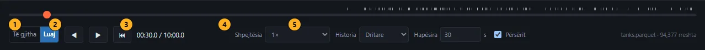

# Kronologjia dhe riluajtja

Shiriti nën figurë është si një lojtar videoje: mund ta luash grupin e të dhënave si film, ta ndalosh, të kërcesh nëpër të dhe të ndryshosh shpejtësinë.

Shiriti nën pamje është kronologjia ([`Timeline.tsx`](https://github.com/Holdi601/3DHeat/blob/main/src/ui/Timeline.tsx)). Ai vendos cilët rreshta janë të dukshëm në çdo çast. Nevojitet një kolonë kohe; pa të e gjithë shiriti çaktivizohet, pamja mbetet në **Të gjitha**, dhe shiriti anësor thotë *Nuk ka kolonë kohe në këto të dhëna - kronologjia është çaktivizuar dhe çdo pikë shfaqet menjëherë.*

## Të gjitha dhe Luaj {#all-and-play}

Dy mënyra të nivelit të lartë, sepse u përgjigjen pyetjeve të ndryshme.

- **Të gjitha** (parazgjedhja në çdo ngarkim) e injoron plotësisht kokën e luajtjes dhe shfaq çdo rresht që kalon filtrat. Është pamja "ku ndodh kjo", dhe nuk është e njëjtë me kalimin te fundi. Rrëshqitësi çaktivizohet dhe ora shkruan `gjithë ·  të dhënash`.
- **Luaj** e luan grupin si timelapse. Shfaqen rrëshqitësi, lëvizjet dhe cilësimet e historisë.

Zgjedhja e **Të gjitha** ndalon edhe riluajtjen.

## Kontrollet {#the-controls}

| Kontrolli | Parazgjedhja | Kuptimi |
|---|---|---|
| Rrëshqitësi | fillimi | Koka e luajtjes. Tërhiq për të kërkuar; 20,000 hapa përgjatë intervalit. |
| **Të gjitha** / **Luaj** | Të gjitha | Shih më lart. |
| ▶ / ❚❚ | e ndalur | Luaj ose pauzo; gjithashtu `K`. |
| ◀ **Luaj prapa (J)** | | Luan të dhënat në të kundërt. Shfaqet vetëm në modalitetin **Mbivendosje figurash**; tasti `J` funksionon edhe atje (shih [Tastet](#keyboard)). |
| ⏮ | | Kthehu te fillimi i intervalit. |
| Ora | | `e kaluar / gjithsej` si `mm:ss.s` (ose `h:mm:ss`), dhe, kur kolona e kohës është një vulë absolute, ora e saktë e kokës së luajtjes si `HH:MM:SSZ` (UTC). |
| **Shpejtësia** | 1× | Sekonda të grupit për çdo sekondë reale. Menuja ka 17 hapa nga 0.01× deri në 1800× (0.01, 0.02, 0.05, 0.1, 0.25, 0.5, 1, 2, 4, 8, 16, 32, 64, 128, 256, 600, 1800), plus **E personalizuar…**: shkruaj çdo shpejtësi nga 0.001× deri në 3600× (për shembull 0.3 ose 12) dhe shtyp Enter; Esc e mban shpejtësinë aktuale. Shpejtësia e fundit kujtohet për vizitën e ardhshme (shih [Cilësimet e ruajtura](ref-settings-storage.md)). |
| **Historia** | Kumulative | Çfarë numërohet si e dukshme te koka e luajtjes: *Kumulative*, *Dritare* ose *Jetëgjatësi* (më poshtë). |
| **Hapësira** (Dritare; në modalitetin Vija edhe Jetëgjatësi) | 30 s | Gjatësia e dritares që mbaron te koka e luajtjes; të paktën 0.01 s. Te [Nxehtësia e vijave](line-heat.md#playback) është gjatësia e bishtit. |
| **Jetë rezervë** (vetëm Jetëgjatësi, jo në modalitetin Vija) | 10 s | Sa gjatë mbetet e dukshme një pikë që s'ka mostrën e radhës të personit të vet. |
| **Zbehje** (vetëm Jetëgjatësi, jo në modalitetin Vija) | 0.4 | Pjesa e jetës së çdo pike që kalon duke u zbehur, 0-1. |
| **Përsërit** | po | Në fund, fillon sërish; joaktiv ndalon në fund. |
| Ana e djathtë | | Emri i grupit të të dhënave. |

**Intervali** është hapësira kohore e grupit - ose, te [mbivendosja e figurave](box-replay.md) me një seancë të zgjedhur, hapësira e asaj seance.

## Historia {#history}

Në modalitetin Luaj:

- **Kumulative** - gjithçka nga fillimi i intervalit deri te koka e luajtjes. Nxehtësia grumbullohet ndërsa luhet.
- **Dritare** - një hapësirë fikse historie që mbaron te koka e luajtjes (*Hapësira*).
- **Jetëgjatësi** - çdo pikë jeton deri te **mostra e radhës e të njëjtit person** (në të njëjtën seancë), kështu që saktësisht një pozicion për person është aktual në çdo çast. Një pikë, personi i së cilës nuk shfaqet më - një vdekje, një shkëputje, fundi i regjistrit - nuk ka mostër të radhës, dhe jeton për *Jetë rezervë* në vend që të zhduket menjëherë ose të mbetet përgjithmonë. Pikat **zbehen** gjatë pjesës së fundit *Zbehje* të jetës së tyre në vend që të shfaqen befas: me një mostër të gjallë për person, një pikë që zhduket midis dy kornizave e bën gjithë fushën të pulsojë me shpejtësinë e mostrimit. *Zbehje* 0 e kthen prerjen e prerë.

Jetëgjatësi kërkon një kolonë personi përveç kolonës së kohës; pa të, historia kthehet në Kumulative gjatë ngarkimit. Te [Nxehtësia e vijave](line-heat.md#playback) historia cakton sa gjatë mbetet i dukshëm bishti i një rruge; te [mbivendosja e figurave](box-replay.md) *Jetë rezervë* është sa gjatë mbahet një person që s'ka mostra të mëtejshme.

## Sjellja e riluajtjes {#playback-behaviour}

Nga cikli i kornizave ([`engine.ts`](https://github.com/Holdi601/3DHeat/blob/main/src/render/engine.ts)):

- Koka e luajtjes përparon me *kohën e kornizës × shpejtësinë*. Koha e kornizës kufizohet në 0.1 s, kështu që ndërrimi i skedave nuk e teleporton kokën.
- Shtypja e luajtjes në fund të intervalit fillon nga fillimi, si në një lojtar mediash. Në çdo ngarkim koka parkohet në fillim, kështu që shtypja e parë e luajtjes luan.
- Në fund të intervalit koka kthehet te fillimi (Përsërit aktiv) ose ndalet atje dhe riluajtja mbaron (Përsërit joaktiv).
- Rrëshqitësi lexon drejtpërdrejt kokën e motorit çdo kornizë; gjendja e aplikacionit përditësohet në kërkime, nisje, ndalime dhe përsëritje.
- Zgjedhja e një seance te zgjedhësi i seancës kërkon fillimin e asaj seance.

## Pse luajtja është e qetë dhe e lirë {#why-playback-is-smooth-and-cheap}

Rreshtat ruhen të renditur sipas kohës, kështu që një dritare kohore janë dy kërkime binare mbi kolonën e kohës: përparimi i kokës lëviz dy numra të plotë dhe nuk prek asnjë rresht, dhe kostoja e luajtjes ndjek numrin e rreshtave në dritare, jo madhësinë e grupit të të dhënave.

Si mbahet nxehtësia e qetë ndërsa dritarja lëviz varet nga historia ([Grumbullimi](accumulation.md)):

- **Kumulative** vetëm rritet, kështu që çdo kornizë shton vetëm rreshtat që u bënë të dukshëm që nga e fundit, me peshë të plotë. Fusha ndërtohet monotonisht dhe pauza nuk ndryshon asgjë, sepse nuk ka më çfarë të mbërrijë. (Rivlerësimi do ta bënte çdo kornizë të ndriçonte një nëngrup tjetër të rastësishëm dhe pastaj ta zbehte, gjë që duket si shpërthime që përplasen dhe zhduken.)
- **Dritare** dhe **Jetëgjatësi** ndryshojnë vërtet çdo kornizë dhe rivlerësohen, të përzier si mesatare e lëvizshme eksponenciale (pesha 0.34 për kornizën e re), që është e paanshme në gjendje të qëndrueshme dhe shumë më e qetë se të nisësh nga e para.
- Në modalitetin Jetëgjatësi rreshtat kandidatë janë ata nga *koka e luajtjes - max(boshllëku më i gjatë në të dhëna, Jetë rezervë)* deri te koka e luajtjes; shader-i pastaj heq çdo rresht, jeta e të cilit ka mbaruar dhe zbaton zbehjen.

Kalimi midis Të gjitha dhe Luaj, ose ndryshimi i historisë, e rinis grumbullimin.

## Tastet {#keyboard}

| Tasti | Efekti |
|---|---|
| `K` | Luaj / pauzo |
| `J` | Luaj prapa; shtypja përsëri pauzon (vetëm Mbivendosje figurash) |
| `L` | Luaj përpara; shtypja përsëri pauzon (vetëm Mbivendosje figurash) |

`J` dhe `L` e kalojnë gjithashtu kronologjinë në **Luaj**. Tastet injorohen kur një kuti teksti ose menu ka fokusin. Në skedën Analiza e garës, `K` drejton riluajtjen e vet të skedës.
