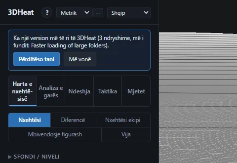

# Përditësimet

Shikuesi ju tregon kur ekziston një version më i ri, dhe përditësohet vetë vetëm kur thoni po. Asgjë nuk ndryshohet në kompjuterin tuaj pa përgjigjen tuaj.

## Përditësoni shikuesin {#update-the-viewer}

1. **Në faqe.** Kur ekziston një version më i ri, një kuti shfaqet nën emrin lart në shiritin anësor: "Ka një version më të ri të 3DHeat". Klikoni **Përditëso tani**. Faqja ringarkohet vetvetiu kur mbaron. **Më vonë** e fsheh kutinë deri sa të ringarkoni faqen.
2. **Nëse thotë të ekzekutoni restart.bat**, mbyllni dritaren e serverit (dritarja e zezë që hapi `start.bat`) dhe klikoni dy herë `restart.bat`.
3. **Kur nisni shikuesin.** `start.bat` kontrollon gjithashtu. Nëse ekziston një version më i ri, pyet **Të përditësohet tani? [Y/N]**. Shtypni `Y` për të përditësuar. Shtypni `N`, ose prisni 60 sekonda pa u përgjigjur, për të nisur versionin që keni.



Një kopje me ndryshime të juajat nuk përditësohet kurrë për ju; kutia thotë vetëm që ka një përditësim në pritje, dhe thotë të ruani ose të fshehni ndryshimet tuaja dhe të ekzekutoni `git pull`. Një kopje që nuk u instalua me git (p.sh. një skedar zip) nuk shfaq asgjë.

Si funksionon kontrolli, hap pas hapi:

```
faqja ---(pas 4 s, pastaj çdo 6 orë)---> serveri i zhvillimit ---> git fetch
   prapa?  jo  -> nuk shfaqet asgjë
           po  -> ndryshime ose commit-e të tua?  po  -> të thotë vetëm
                                                  jo -> [Përditëso tani] -> git pull
                                                        -> ringarkim, ose "ekzekuto restart.bat"
```

## Rregullat e sigurisë {#the-safety-rules}

- **Vetëm përpara (fast-forward)** (`git pull --ff-only`): një përditësim nuk bashkon,
  nuk rebazon dhe nuk rishkruan asgjë.
- **Pa ndryshime lokale**: një kopje me ndryshime të pa-commit-uara te skedarët e ndjekur
  (`git status --porcelain --untracked-files=no` jo bosh) nuk përditësohet kurrë automatikisht -
  puna e dikujt nuk është e një përditësimi për ta mbishkruar. I thuhet vetëm se ka një
  përditësim në pritje. Skedarët e pandjekur (të dhënat, eksportet) nuk numërohen si ndryshime.
- **Pa commit-e lokale**: një kopje me commit-e që upstream nuk i ka ("divergjuar") nuk
  përditësohet - një përpara-lëvizje nuk mund ta sjellë atë lart, dhe bashkimi është për
  `git pull` me dorë. Faqja dhe `start.bat` e thonë këtë me të njëjtat fjalë, dhe `start.bat`
  nis versionin që ekziston atje.
- **Vetëm nga vetë faqja**: kërkesa e përditësimit të serverit të zhvillimit duhet të mbajë një
  header të personalizuar dhe, kur shfletuesi dërgon një `Origin`, të vijë nga vetë hosti i serverit
  (më poshtë).
- Vetëm një kopje git me një degë upstream përditësohet ndonjëherë; çdo gjë tjetër (një kopje pa
  `.git`, pa git të instaluar, një ndërtim statik) lihet rehat dhe nuk thotë asgjë.

## Çfarë bën start.bat {#what-startbat-does}

`start.bat` (klikoni dy herë; dritarja është serveri) bën, me radhë:

1. Gjen Node.js - te `PATH`, përndryshe te `%ProgramFiles%\nodejs`,
   `%ProgramFiles(x86)%\nodejs` ose `%LOCALAPPDATA%\Programs\nodejs` - dhe ofron ta instalojë me
   `winget install -e --id OpenJS.NodeJS.LTS` kur mungon (pyetet, Y/N; më pas dritarja duhet
   hapur sërish që Windows ta marrë `PATH`-in e ri).
2. **Përditësimet**, kur git është i instaluar dhe dosja ka `.git`:
   - `git fetch --quiet` (pa rrjet ose pa upstream: kapërcehet pa zë);
   - numëron `git rev-list --count HEAD..@{u}`; nuk ka prapambetje: nuk thotë asgjë;
   - ndryshime lokale: "Ka një version më të ri të 3DHeat (N ndryshime), por kjo kopje ka
     ndryshime lokale, prandaj nuk përditësohet. Ruajini ose fshihini, pastaj ekzekutoni git pull."
     - dhe nis versionin që ekziston;
   - commit-e të veta (`git rev-list --count @{u}..HEAD` jo 0): "Ka një version më të ri të
     3DHeat (N ndryshime), por kjo kopje ka commit-e të veta që versioni më i ri nuk i ka, prandaj
     nuk përditësohet. Përditësojeni me git pull." - dhe nis versionin që ekziston;
   - përndryshe "Ka një version më të ri të 3DHeat (N ndryshime)." dhe pyetja **Të përditësohet tani? [Y/N]**.
     `N`, ose pa përgjigje për 60 sekonda, shkruan "Nuk u përditësua; nis versionin që keni." dhe
     nis versionin që ekziston. Me `Y`: "Duke përditësuar...", thotë nëse ndryshojnë `package.json` ose
     `package-lock.json`, ekzekuton `git pull --ff-only` (nëse ende dështon - p.sh. rrjeti:
     "Përditësimi nuk u krye; nis versionin që keni."), pastaj `git submodule update --init`
     (veglat e fiksuara, shih [Mirëmbajtja e dokumentacionit](maintaining.md#the-tools-under-exporters)),
     pastaj `npm install` kur kanë ndryshuar skedarët e paketës dhe ekziston `node_modules`, dhe
     "U përditësua."
3. Refuzon të nisë një server të dytë: kur diçka dëgjon tashmë portën **5273**, e thotë këtë dhe
   drejton te `restart.bat` / `stop.bat`.
4. Në nisjen e parë (pa `node_modules`), pyet para se të shkarkojë varësitë (rreth 300 MB te
   `node_modules\`, asgjë në nivel sistemi).
5. Nis serverin e zhvillimit te `127.0.0.1:5273` (`--strictPort`) dhe hap shfletuesin kur është gati.

`restart.bat` ndalon serverin (sipas portës) dhe ekzekuton sërish `start.bat`, kështu që pyet të njëjtën
gjë. `stop.bat` vetëm e ndalon.

## Për zhvilluesit {#for-developers}

### Gjatë punës: rruga e përditësimit {#while-it-runs-the-update-route}

Serveri i zhvillimit (shtojca Vite `heat3d-self-update` te `vite.config.ts`) shërben
`/__heat3d/update`. Ekziston vetëm te serveri i zhvillimit - jo në një ndërtim statik dhe jo në
`vite preview`.

**`GET /__heat3d/update`** përgjigjet nëse kopja është prapa:

```json
{ "checkout": true, "upstream": "origin/main", "behind": 3, "ahead": 0, "dirty": false, "latest": "titulli i commit-it më të ri" }
```

- `checkout: false` kur dosja nuk është një kopje git;
- ekzekuton `git fetch --quiet` **të paktën çdo 30 minuta** (kërkesat në mes marrin përgjigje nga ajo që u mor për herë të fundit);
- `behind` / `ahead` nga `git rev-list --count HEAD..@{u}` / `@{u}..HEAD`, `dirty` nga
  `git status --porcelain --untracked-files=no`, `latest` titulli i commit-it më të ri të upstream-it;
- pa degë upstream, `upstream: null` dhe `behind: 0`.

**`POST /__heat3d/update/apply`** e sjell kopjen lart:

1. Refuzohet me `403 { ok: false, reason: "forbidden" }` përveç nëse kërkesa mban header-in
   `X-Heat3d-Update: 1` dhe, kur mban një `Origin`, host-i i asaj origjine është `Host`-i i kërkesës.
   Një formular ndër-sajt nuk mund të dërgojë një header të personalizuar pa një preflight CORS, që
   ky server nuk e jep kurrë.
2. Asgjë për të bërë (jo kopje, pa upstream, nuk është prapa): `{ ok: true, updated: false }`.
3. Ndryshime lokale: `{ ok: false, reason: "dirty" }`; commit-e lokale: `{ ok: false, reason: "diverged" }`.
4. Ndryshe: shënon skedarët që ndryshojnë (`git diff --name-only HEAD @{u}`), `git pull --ff-only`
   (2 min afat), `git submodule update --init` (dështimi injorohet), `npm install` kur kanë ndryshuar
   `package.json` ose `package-lock.json` (15 min afat), dhe përgjigjet
   `{ ok: true, updated: true, restart }` - `restart` thotë pse serveri që po punon nuk mund ta marrë
   përditësimin: `"dependencies"` kur u rinstaluan, `"config"` kur ndryshoi vetëm një skedar `vite.config`,
   `false` kur nuk duhet rinisje.
5. Një komandë git ose npm që dështon përgjigjet `{ ok: false, reason: "<gabimi, deri në 300 karaktere>" }`.

Përgjigjet janë JSON me `Cache-Control: no-store`. Serveri dëgjon vetëm te `127.0.0.1`, kështu që
rruga nuk arrihet nga rrjeti.

### Njoftimi në faqe {#the-notice-in-the-page}

`UpdateBanner`, nën emrin lart në shiritin anësor:

- Pyet rrugën **4 sekonda** pasi ngarkohet faqja (jo në sekondat e para: faqja ka një grup të dhënash
  për të ngarkuar dhe një GPU për të nisur) dhe përsëri **çdo 6 orë** ndërsa faqja mbetet e hapur.
- Nuk shfaq **asgjë** kur s'ka rrugë të tillë (një ndërtim statik), dosja nuk është kopje, ose asgjë
  nuk është më e re - një njoftim në çdo nisje është diçka që njerëzit mësojnë ta shpërfillin.
- Prapa, pa ndryshime lokale: "Ka një version më të ri të 3DHeat (N ndryshime, më i riu: <titulli>)."
  me **Përditëso tani** dhe **Më vonë** (*Më vonë* e fsheh deri sa të ringarkohet faqja).
- Prapa, me ndryshime lokale: e njëjta fjali dhe "Kjo kopje ka ndryshime lokale, prandaj nuk
  përditësohet automatikisht; ruajini ose fshihini, pastaj ekzekutoni git pull." - pa buton.
- **Përditëso tani** dërgon te `/apply` ("Duke përditësuar..."). Pastaj:
  - "U përditësua. Faqja ringarkohet." - dhe ringarkohet 1.5 s më vonë (serveri i shërben tashmë
    skedarët e rinj);
  - kur u rinstaluan varësitë: "U përditësua. Varësitë e saj ndryshuan: mbyllni dritaren e serverit
    dhe ekzekutoni **restart.bat** për ta përfunduar."
  - kur ndryshuan vetëm cilësimet e serverit: "U përditësua. Cilësimet e serverit ndryshuan: mbyllni
    dritaren e serverit dhe ekzekutoni **restart.bat** për ta përfunduar."
  - nuk ka asgjë për të sjellë në fund (`updated: false` - kopja u sollë lart ndërkohë, p.sh. nga
    `start.bat`): "Asgjë për të përditësuar: kjo kopje është tashmë versioni më i ri." - dhe nuk ringarkohet;
  - refuzuar: fjalia për *dirty*, ose "Kjo kopje ka commit-e të veta që versioni më i ri nuk i ka;
    përditësojeni me git pull.", ose "Përditësimi nuk u krye: <arsyeja>".
