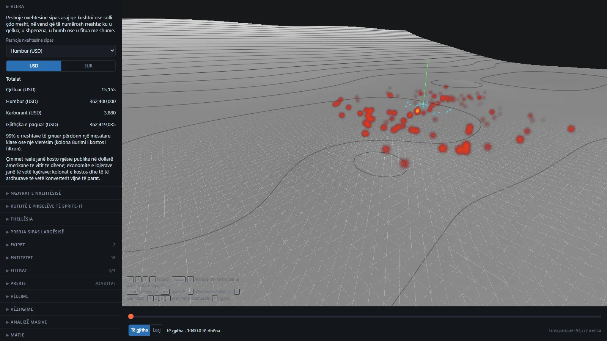

# Peshimi i vlerave

Çdo qëllim, municion, mjet i humbur dhe litër karburanti ka një çmim. Shikuesi llogarit sa kushtoi ose fitoi çdo rresht dhe mund ta peshojë nxehtësinë me të, kështu që harta tregon **ku shkoi paraja** në vend që ku janë rreshtat.

## Si ta përdorësh {#how-to-use-it}

1. Ngarko të dhëna me ngjarje (qëllime, vrasje, vdekje) dhe emra mjetesh ose armësh.
2. Hap **Vlera** në shiritin anësor të Nxehtësisë.
3. Zgjidh **Peshoje nxehtësinë sipas**, për shembull *Humbur (USD)*. Nxehtësia tani shton çmimin e çdo rreshti në vend të 1.
4. Lexo **Totalet**: shuma e çdo kolone vlere për atë që shfaqet (filtrat dhe dritarja kohore zbatohen).
5. Aty ku çmimet janë para reale, shfaqet një çelës **USD / EUR**.

Zgjidh hyrjen e parë bosh të menusë për të numëruar rreshtat përsëri.

## Çfarë mund të peshohet {#what-can-be-weighed}

Kolonat e vlerës shtohen gjatë ngarkimit, një për lloj dhe monedhë:

| Lloji | Rreshtat ku bie | Si çmohet |
|---|---|---|
| **Qëlluar** | qëllime dhe lëshime | arma, përndryshe një mesatare për llojin e municionit |
| **Shpenzuar** | blerje, lindje | kolonat e parave të lojës (për shembull menuja e blerjes e një lojë shooter) |
| **Humbur** | vdekje, shkatërrime | mjeti vetjak, përndryshe mesatarja e klasës së tij |
| **Shkatërruar** | vrasje | mjeti i synuar |
| **Dëmi i shkaktuar** | goditje | një pjesë e vlerës së synuar |
| **Karburanti** | pozicione | karburanti i përdorur, nga një kolonë karburanti ose i vlerësuar nga klasa dhe koha |
| **Gjithçka e paguar** | | qëlluar + shpenzuar + humbur + karburant |
| **Fituar** | shpërblime | kolonat e vetë shpërblimeve të lojës (`earn_…`) |
| **Neto** | | fituar minus paguar; vizatohet si nxehtësi me shenjë (shkallë pozitive aty ku u fitua më shumë, negative aty ku u paguan më shumë) |

Emrat e kolonave janë `cost_<lloji>_<monedha>`, `earn_<monedha>` dhe `net_<monedha>`. Një konvertues që e njeh monedhën e vetë lojës (për shembull një konvertues riprodhimi që shkruan kredite të lojës) mbizotëron mbi tabelat e çmimeve të integruara.

## Tabelat e çmimeve {#the-price-tables}

| Tabela | Monedha |
|---|---|
| Ushtria reale: raketa, bomba, predha, kundërmasa, avionë, helikopterë, mjete tokësore, anije, karburant | USD (EUR = USD × 0,92, `EUR_PER_USD` i fiksuar te [`cost.ts`](https://github.com/Holdi601/3DHeat/blob/main/src/data/cost.ts); nuk është kurs i drejtpërdrejtë) |
| Menutë e blerjes së lojërave shooter dhe shpërblimet e vrasjeve | kreditet e lojës |
| Lojëra me tanke dhe anije | kreditet e lojës |
| Lojëra strategjie (disa burime) | një kolonë për burim plus një e kombinuar |
| Lojëra lufte | pikë |

Loja njihet nga emrat në të dhëna. Çmimet reale vijnë nga burime publike (dokumente buxheti, enciklopedi) ose shënohen si vlerësime; nuk rregullohen për inflacionin. Lista e gjeneruar e tabelave është te [Tabelat e vlerave](ref-value-tables.md).

## Vlerësimet {#estimates}

Kolona shtesë e kategorisë **Burimi i kostos** thotë si u çmua çdo rresht: `table`, `class average`, `estimate` ose `none`. Seksioni Vlera tregon cila pjesë e rreshtave të çmuar janë mesatare ose vlerësime. Për të mbajtur vetëm rreshtat e çmuar saktësisht, hiq shenjën te *estimate* dhe *class average* te **Burimi i kostos** në [Filtrat](filters.md).

## Ku tjetër shfaqet vlera {#where-else-value-shows}

- [Njohuritë](insights.md): gjetjet *Toka e kushtueshme* dhe *Toka fituese*.
- [Ndarja](breakdown.md): Fituar, Humbur dhe Neto para për ekip, lojtar ose armë.
- [Vëllimet](volumes.md): kolonat e vlerës në statistika dhe krahasim.
