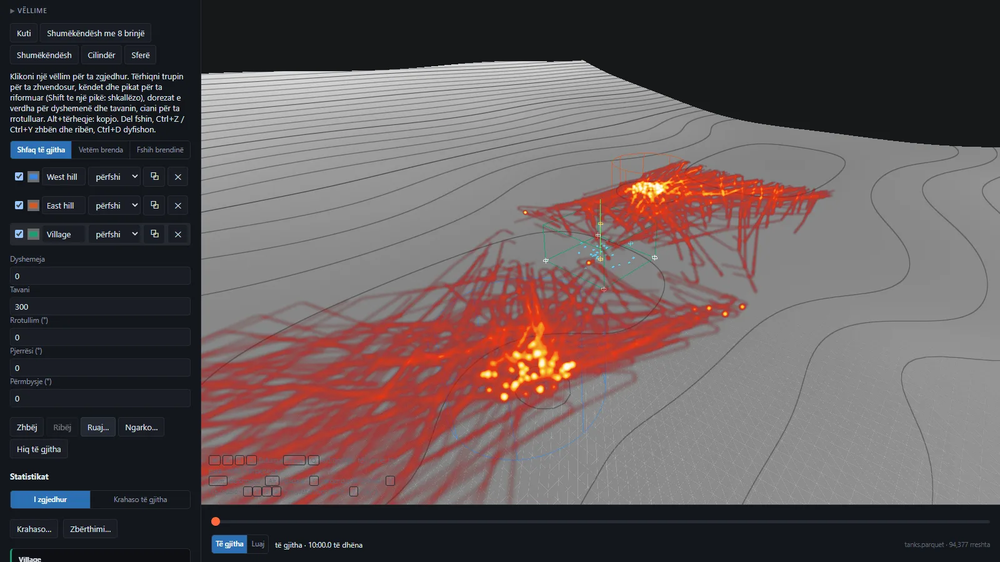
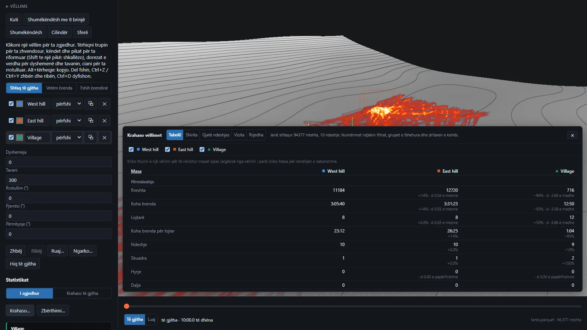
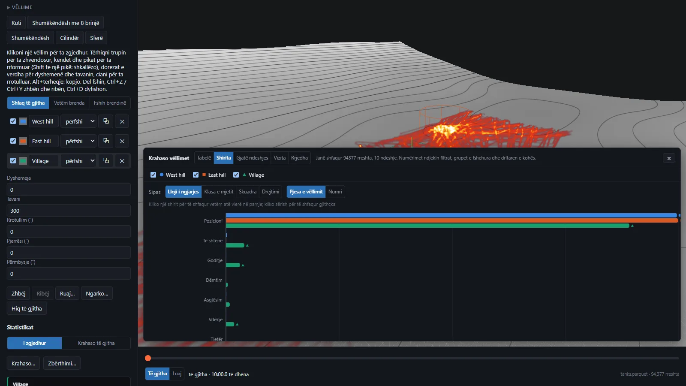

# Vëllime dhe krahasimi

Një **vëllim** është një kuti e padukshme (ose cilindër, ose sferë) që vizaton rreth një vendi, për të pyetur: çfarë ndodhi brenda? Përdore për të numëruar vrasjet te një urë, për të krahasuar dy kodra, ose për të shfaqur vetëm aktivitetin në një zonë.

```
 pamje nga lart           Vizaton një formë ->  shikuesi numëron
 +------------+           çfarë është brenda:
 |   ( A )    |            rreshta, lojtarë, vrasje, kohë ...
 |        [B] |           Krahaso A me B, njëra pranë tjetrës.
 +------------+
```



Vëllimet matin çfarë ndodh brenda tyre, filtrojnë pamjen sipas tyre, eksportojnë rreshtat e tyre, dhe mund të krahasohen njëra pranë tjetrës. Shih edhe [fjalorin](glossary.md) për rresht, person dhe ndeshje.

## Vizato një vëllim {#draw-a-volume}

1. Hap **Vëllime** në shiritin anësor.
2. Zgjidh një mjet dhe vizato në pamjen 3D ose në hartën 2D. Dyshemeja dhe tavani fillojnë nga të dhënat poshtë. Esc anulon.
3. Kliko vëllimin për ta zgjedhur; **Statistikat** e tij shfaqen.

| Mjeti | Si vizatohet |
|---|---|
| **Kuti** | Tërhiq një drejtkëndësh (Shift: një katror). Një klikim vendos një kuti të parazgjedhur. |
| **n-kënddrejtësh** | Tërhiq nga qendra (Shift e mban të rregullt). *Këndet* cakton n, nga 3 deri në 64 (parazgjedhja 8, prandaj butoni shkruan **8-kënddrejtësh**). |
| **Shumëkëndësh** | Kliko këndet; mbylle me dy klikime, Enter ose një klikim mbi këndin e parë. Backspace heq këndin e fundit. |
| **Cilindër** | Tërhiq rrezen. |
| **Sferë** | Tërhiq rrezen; ajo prehet mbi tokë. |

## Redakto {#edit}

- Kliko një vëllim për ta zgjedhur. Tërhiq trupin për ta lëvizur, këndet për ta riformësuar (Shift mbi një kënd shkallëzon).
- Dorezat **të verdha** caktojnë dyshemenë dhe tavanin, dorezës **cian** e rrotullon.
- Alt+tërhiqja kopjon, Del heq, Ctrl+Z / Ctrl+Y zhbën dhe ribën, Ctrl+D dyfishon. **Hiq të gjitha** fshin çdo vëllim.
- Vlera të sakta: Dyshemeja, Tavani, Rrotullimi / Lartësia / Animi (kutitë), Rrezja (sferat, cilindrat).

Çdo rresht vëllimi ka një kuti shfaqjeje, një ngjyrë, një emër, **përfshi** ose **përjashto**, kopjim dhe fshirje. Vëllimet ruhen në shfletues për çdo grup të dhënash, dhe **Ruaj...** / **Ngarko...** shkruajnë dhe lexojnë një skedar `volumes.json`.

## Filtro pamjen {#filter-the-view}

| Filtri | Efekti |
|---|---|
| **Shfaq të gjitha** (parazgjedhja) | Vëllimet vetëm matin. |
| **Vetëm brenda** | Nxehtësia, riluajtja dhe [analiza e goditjeve](hit-analysis.md) vizatojnë vetëm atë që është brenda vëllimeve të përfshira dhe jashtë atyre të përjashtuara. |
| **Fshih brendinë** | E kundërta. |

Filtri i GPU merr deri në 8 vëllime me 64 pika konturi gjithsej; një "!" shënon një vëllim mbi atë kufi. Statistikat dhe eksportimi e numërojnë ende.

## Statistikat {#statistics}

Zona **Statistikat** ndjek filtrat, dritaren kohore dhe grupet e fshehura. *Të zgjedhurat* tregon vëllimin e zgjedhur, *Krahaso të gjitha* vendos çdo vëllim njëra pranë tjetrës. Ajo tregon:

- **Rreshta brenda (të shfaqur)** dhe **Rreshta brenda (të gjitha të dhënat)**, **Lojtarë**, **Skuadra**, **Ndeshje**, **Koha brenda**, **Hyrje / dalje**, **Pika e nxehtësisë**, **Nxehtësia mesatare**, **Vëllimi / gjurma** dhe një histogram **Kur**;
- **Shkalla e fitoreve**, ku të dhënat tregojnë kush fitoi ([kolonat e rezultatit](data-formats.md#outcome-columns)): nga raundet me një lojtar brenda, me raundin e çdo lojtari të numëruar një herë, pjesa që fitoi pala e tij - e tërhequr drejt shkallës në gjithçka që shfaqet me 4 raunde, siç bën [zbërthimi](breakdown.md) - me raundet e fituara dhe të luajtura dhe atë shkallë të përgjithshme;
- për çdo kolonë: kategoritë me **Lift** (pjesa brenda pjesëtuar me pjesën në të gjitha të dhënat e shfaqura), dhe numrat me intervalin, medianën dhe përqindjet e 5-të deri në 95-tën.

**Statistikat si CSV / JSON** i ruan. **Eksporto të dhënat brenda** shkruan rreshtat brenda si CSV ose Parquet (*Vetëm rreshtat e shfaqur* e ndezur si parazgjedhje), një vëllim ose të gjitha, me një kolonë që tregon cili vëllim e mban secilin rresht.

## Krahaso vëllimet {#compare-volumes}

Me dy ose më shumë vëllime të dukshme, shtyp **Krahaso...**.

1. Vizato tre vëllime, për shembull Kodra Perëndim, Kodra Lindje dhe Fshati.
2. Shtyp **Krahaso...** nën Statistikat.
3. Te **Tabelë**, lexo ndryshimin e çdo vlere nga vëllimi i parë.
4. Kalo te **Shirita** për të parë pjesët si shirita.



| Pamja | Shfaq |
|---|---|
| **Tabelë** | Rreshta, koha brenda, lojtarë, ndeshje, skuadra, hyrje, dalje, vizita, gjatësia e vizitave, vrasje, vdekje, vrasje për vdekje, vrasje në minutë, koha për lojtar, kolonat e vlerave; të grupuara sipas ngjarjeve, klasës së mjetit, lojtarit ose IA-së, ekipit dhe drejtimit. Çdo vlerë shfaq ndryshimin e vet nga vëllimi i parë dhe një madhësi efekti (e papërfillshme, e vogël, e mesme, e madhe). Kliko kokën e një vëllimi për të renditur sipas largësisë nga i pari. |
| **Shirita** | Numra ose pjesë sipas ngjarjes, klasës, aktorit, ekipit ose drejtimit. Kliko një shirit për të filtruar pamjen sipas tij. |
| **Gjatë ndeshjes** | Një grafik për çdo vëllim mbi minutat e ndeshjes: prania, rreshtat ose vrasjet. Kliko për të kërcyer atje. |
| **Vizita** | Grafikë kutie dhe violinë për sa zgjasin vizitat (shkallë logaritmike). |
| **Rrjedha** | Ku shkojnë gjurmët pasi largohen nga çdo vëllim: një matricë kalimesh ose shirita rrjedhe. |



## Këshilla {#tips}

- Fillo nga një gjetje: te [Vëzhgime](insights.md), **Vëllim këtu** shton një cilindër rreth vendit të gjetjes.
- **Zbërthimi...** hap [Zbërthimin](breakdown.md) për vëllimin e zgjedhur: kush dhe çfarë del më mirë brenda tij.
- [Nxehtësia sipas drejtimit](directional-heat.md) mund të grafikojë drejtimet brenda vëllimit të zgjedhur.
- [Skeda Mjetet](hit-analysis.md#restrict-to-an-area) përdor të njëjtët vëllime si filtër zone.
