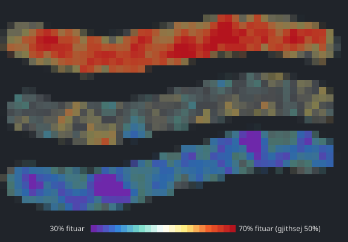

# Shkalla e fitoreve: sa shpesh fiton një vend, një rrugë ose një lëvizje

Ku qëndron një lojtar, nga shkon, nga i hedh granatat - dhe sa shpesh pala e tij e fiton pastaj raundin. **Harta e shkallës së fitoreve** ngjyros çdo vend sipas pjesës së rreshtave atje që u përkasin raundeve që i fitoi pala e rreshtit, krahasuar me pjesën në gjithçka që shfaqet: e ngrohtë ku është më e lartë, e ftohtë ku është më e ulët, asgjë ku është njësoj.

*Fotografia ka të dhëna të sajuara: tri rrugë në një nivel bosh, me 68%, 50% dhe 33% të rreshtave të tyre në raunde të fituara.*

Duhen të dhëna që tregojnë kush fitoi: [kolonat e rezultatit](data-formats.md#outcome-columns) (`won`, `matchWon`, `roundEndReason`). Konvertuesit e CS2 dhe War Thunder i shkruajnë, kurse konvertuesi Tacview për fushatat e një serveri DCS ([Serverët DCS](tacview-acmi.md#dcs-servers-who-won-and-how-each-sortie-ended)); çdo skedar mund t'i ketë.

## Provojeni {#try-it}

1. Ngarkoni ndeshje me një kolonë rezultati dhe shtypni `2` (**Diferencë**).
2. Te **Ndarja e diferencës**, shtypni **Shkalla e fitoreve për raund** (ose **Shkalla e fitoreve për ndeshje**). Kjo i vendos raundet e fituara te **+** dhe ato të humbura te **−** dhe e kalon panelin te **Pjesa e +**.
3. Lexoni ngjyrat. Paneli tregon pjesën e përgjithshme: *Gjithsej 52,0% e 1 200 000 rreshtave janë në +.*
4. Ngushtojeni me [filtrat](filters.md): një palë (T ose CT), një lloj ngjarjeje (*Pozicioni* për ku qëndruan njerëzit, *Të shtënë* ose *Lëshim (raketë, predhë, bombë)* për nga qëlluan ose hodhën), një blerje, një hartë.

Një vend i ngrohtë me rreshta *Pozicioni* është një vend ku ata që e mbanin e fitonin më shpesh raundin. Me rreshta *Asgjësim* është një vend ku asgjësimet e bëra çuan në raunde të fituara.

## Cilësimet {#the-settings}

| Cilësimi | Çfarë bën | Parazgjedhja |
|---|---|---|
| **Diferencë** / **Pjesa e +** | vetë diferenca, ose pjesa e palës + nga rreshtat e të dy palëve | Diferencë |
| **Ngjyrë e plotë te** | sa mbi ose nën pjesën e përgjithshme një vend shfaqet me ngjyrë të plotë, në pikë | ± 20 pikë |
| **Më pak rreshta për të ngjyrosur një vend** | një vend me më pak rreshta nuk ngjyroset; ngjyra shfaqet gradualisht nga gjysma e këtij numri | 12 |
| **Tërheqje drejt pjesës së përgjithshme (rreshta)** | çdo vend nis me kaq rreshta në pjesën e përgjithshme, që një vend me 3 rreshta, të gjithë të fituar, të mos shfaqet si 100% | 12 |

Të tria veprojnë mbi pamjen e përfunduar: zvarritja e tyre nuk e rinis kurrë grumbullimin.

Pjesa mund të jetë e çdo ndarjeje, jo vetëm e fitoreve: *Pjesa e +* me një ndarje sipas palëve tregon ku T-të ishin pjesa më e madhe e pranisë, dhe me një ndarje sipas skedarëve të dy hartave, ku rreshtat e një skedari i tejkalojnë ato të tjetrit.

## Rreshta, jo raunde {#rows-not-rounds}

Harta numëron rreshta. Një lojtar që qëndron në një vend për njëzet sekonda shton një rresht në çdo mostër, të gjithë nga i njëjti raund. Kështu prova në një vend janë rreshtat pranë tij, jo raundet. Prandaj minimumi dhe tërheqja janë në rreshta, dhe prandaj janë më të mëdha se sa një raund.

Për vetë raundet:

- **[Zbërthimi](breakdown.md)** në një pikë, në pamje ose në një vëllim: *Fitore %* numëron raundin e çdo lojtari një herë, të tërhequr drejt shkallës së përgjithshme të vendit në të njëjtën mënyrë (4 raunde).
- Statistikat e **[Vëllimeve](volumes.md)**: *Shkalla e fitoreve* - raundet me një lojtar brenda vëllimit, secili një herë, të tërhequra drejt shkallës në gjithçka që shfaqet, me numrat.

## Filtrat e rezultatit {#outcome-filters}

Paneli [Filtrat](filters.md) i rendit kolonat e rezultatit menjëherë pas kolonave të vetë shikuesit: **Rezultati i raundit** dhe **Rezultati i ndeshjes** (*Çdo*, *Fituar*, *Humbur*) dhe **Si mbaroi raundi** (eliminim, bomba shpërtheu, bomba u çaktivizua, koha mbaroi, dorëzim, barazim, objektiv, zona të mbajtura, bileta të humbura, të gjitha mjetet e humbura), në gjuhën e shikuesit.

## Për zhvilluesit {#for-developers}

Kalimi i nxehtësisë shkruan tri shuma në objektivin me katër kanale që përdor nxehtësia e ekipeve: nxehtësinë `R = Σ|v|`, nxehtësinë e palës + `P` dhe `S = Σ v²/w`, ku `w` është pesha e kalimit (pesha e mostrimit herë fitimin e kuadrit). Përbërja lexon pjesën `P/R` (një mesatare e peshuar me bërthamën) dhe rreshtat mbi të cilët mbështetet, `n = R²/S` (madhësia efektive e mostrës sipas Kish), e tërheq pjesën drejt asaj të përgjithshme, `p = (n·P/R + m·r0)/(n + m)`, dhe ngjyros `p - r0` mbi intervalin me shkallët e diferencës.

`n` thjeshton çdo faktor të përbashkët për rreshtat në një piksel - fitimin e kuadrit, peshën e mostrimit, peshën e sipërfaqes së një sprite-i të kufizuar - kështu që pamja është e njëjtë në çdo zmadhim dhe dendësi mostrimi, dhe kuadrot me çdo rresht të k-të bashkohen në të tërën pa kërcime ngjyrash. Pjesa e përgjithshme vjen nga numërimet e palëve në CPU, me saktësi të dhjetës së përqindjes; asgjë nuk lexohet mbrapsht nga GPU. Aritmetika dhe kontrollet e saj: [`render/rateMap.ts`](https://github.com/Holdi601/3DHeat/blob/main/src/render/rateMap.ts) dhe testi i tij.

Kushton sa nxehtësia e ekipeve: objektivi me katër kanale katërfishon gjerësinë e brezit të përzierjes së kalimit të nxehtësisë, vetëm sa kohë *Pjesa e +* është aktive.
