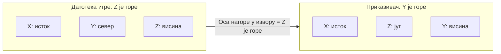

# Осе, јединице и време

Игре и мапе се не слажу у томе која је страна горе, колико је дуга једна јединица или како се пише време. Ова страница приказује три подешавања која чине да ваши подаци стоје, имају праву величину и иду како треба.

Ако ваша мапа стоји као зид уместо да лежи као под, пребаците **Оса нагоре у извору**.

Са погрешном **Осом нагоре у извору** мапа стоји као зид; са исправном лежи као под.

## Свет у коме приказивач црта {#the-world-the-viewer-draws-in}

Свет приказивача је **Y горе**: X и Z су раван тла, Y је висина. Већина енџина за игре је **Z горе**: за њих су X и Y тло, а Z је висина. Неки енџини су и огледални (леворуки). Пресликавање каже како да окренете осе датотеке у осе приказивача. (Технички, приказивач је десноруки, по three.js конвенцији.)

### Оса нагоре {#up-axis}

**Оса нагоре у извору** у [Мапирању колона](column-mapping.md):

| Подешавање | Датотека (x, y, z) постаје свет (X, Y, Z) |
|---|---|
| *Z је горе (већина енџина за игре)* - подразумевано | (x, **z**, **y**): Z из датотеке постаје висина, а Y из датотеке постаје Z света |
| *Y је горе (графичка конвенција)* | (x, y, z) непромењено |

За податке Z-горе три низа се прераспоређују уместо да се копирају ([`remapAxesInPlace`](https://github.com/Holdi601/3DHeat/blob/main/src/data/ingest.ts)), што уштеди стотине мегабајта при великим учитавањима. Погађа се из узорка: која год од колона Y и Z има мањи размах, та је горе.

### Окретања {#flips}

**Окрени X**, **Окрени Y**, **Окрени Z** мењају знак *осе датотеке* тог имена, пре прераспоређивања - па кад је Z-горе, *Окрени Y* мења знак онога што на крају постаје Z света. Окретање мења учитане податке: координате које показују [лењир](measure.md), пресек и положај камере су окренуте.

Да нацртате огледални свет на исправан начин **без** мењања података, користите уместо тога **Камера и сцена → Обрни осу света** ([Камера](camera.md#invert-world-axis)). То је бољи избор за игре чији је свет леворук, јер свака координата коју алати показују остаје игрина сопствена.

### Размера јединица {#unit-scale}

**Размера јединица** множи сваки положај. *1 (m)* поставља 1, *0,01 (cm→m)* поставља 0,01 (јединице Unreal Engine-а су центиметри, па користите 0,01; јединице Source енџина су инчи, па користите 0,0254; ниједне нису метри), а поље прихвата било коју вредност. Уписана 0 или вредност која није број замењује се са 1.

Приказивач означава растојања у метрима (полупречник спрајта, границе одсецања, лењир, брзина летења), што је тачно само кад је скалирана јединица света метар. Ништа не пуца кад није; ознаке само гласе „m” за коју год јединицу се ради.

## Време {#time}

### Јединице времена {#time-units}

Правило палца: вредности као 17000000000 (десет или више цифара) су Unix временски жиг; вредности као 0, 0,25, 0,5 су секунде од почетка.

| Јединица времена (ознака у менију) | Чита се као | Приказује се стварно време |
|---|---|---|
| *Секунде (релативно)* | вредност × 1 s | не |
| *Милисекунде (релативно)* | вредност × 0,001 s | не |
| *Микросекунде (релативно)* | вредност × 10^-6 s | не |
| *Наносекунде (релативно)* | вредност × 10^-9 s | не |
| *Unix временски жиг (s)* | секунде од 1970-01-01 UTC | да |
| *Unix временски жиг (ms)* | милисекунде од 1970-01-01 UTC | да |
| *ISO-8601 низ датума* | текст као `2026-03-14T18:02:11.250Z`, рашчлањен `Date.parse` прегледача | да |

Са апсолутном јединицом (последње три) скуп података задржава тренутак стварног времена свог најранијег реда, а временска линија показује текуће UTC време дана (`HH:MM:SSZ`) поред главе за репродукцију.

**Колоне `TIMESTAMP` и `DATE` у Parquet-у** се декодирају у праве тренутке, па се њихово подешавање јединице занемарује, а панел то каже. Колона `DATE` је цео дан: сваки ред једног дана дели исти тренутак, а репродукција скаче по дан, што панел упозорава.

**ISO-8601 низови раде у CSV-у и Parquet-у подједнако.** Текстуална колона времена с ISO јединицом рашчлањује се једном за сваки различит низ; ако ниједан не може да се рашчлани, учитавање пада уз *Нема рашчлањивих ISO-8601 временских жигова у мапираној колони времена.* - а мапирање се већ одбија да почне кад ниједна узорковна вредност не може да се рашчлани. Колона `TIMESTAMP` у Parquet-у се чита као временски жиг, која год јединица да је постављена, а бројчана колона у Parquet-у са ISO јединицом чита се као Unix милисекунде. Текстуална колона времена с бројчаном јединицом одбија се пре учитавања: свака вредност би се прочитала као NaN.

### Како се време чува {#how-time-is-stored}

Док се датотеке спајају, времена су 64-битне секунде, па апсолутна епоха задржава своје деле секунде. Кад су све датотеке унутра, најраније време целог избора постаје 0 и сваки ред чува 32-битне секунде од њега. 32-битни покретни зарез има 24 бита мантисе: распони до око једног и по дана разлажу се на боље од 1/100 s, распони од пола године на око једну секунду. Ред чије је време недостајуће или није број ставља се на 0, на почетак.

Редови се затим сортирају по времену, што чини временску линију јефтином: прозор времена налази се са два бинарна претраживања (видите [Узорковање и буџети](sampling-and-budgets.md)).

### Протекло време наспрам зидног сата {#elapsed-time-versus-wall-clock}

Колона времена као `match_time` или `round_time` броји од почетка сваког меча. Њено бирање ставља сваки меч на једну заједничку осу - добро за поређење онога што се дешава у трећем минуту сваког меча - а панел на то указује. Колона зидног сата приказује мечеве оним редом којим су се стварно одиграли, преклапајући се где су се преклапали.

## Смер погледа {#look-direction}

Смер погледа користи само [реприза кутије](box-replay.md) (зраци из сваке кутије). Чува се као два угла, скретање и нагиб, у радијанима.

- **Колоне скретања / нагиба** читају се онако како јесу, претворене из степени кад је изабрано *Степени*. Не прилагођавају се оси нагоре или окретањима.
- **Колоне вектора смера** пролазе кроз исто прераспоређивање и окретања као положаји, па постају скретање = atan2(x, -z) и нагиб = atan2(y, √(x² + z²)) у осама света, тако да зрак показује куда кутија гледа и у огледалном свету извора.

Ако колоне скретања / нагиба након окретања, вектора смера или прилагођених углова показују у погрешном смеру, то је оно што треба поправити.
