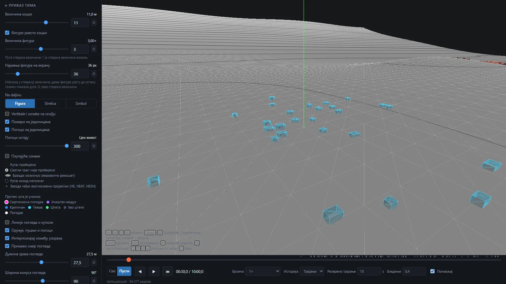

# Преклапање фигура (реприза кутија)

Мали филм: по једна фигура за сваку особу, која се креће док време тече, с трагом иза себе.

Режим се у траци режима зове **Преклапање фигура**. Ова страница се некада звала „реприза кутија”, јер је пре фигура свака особа била кутија; „реприза фигура” и „реприза кутија” значе исто. **Преклапање фигура** нема тастер са бројем: изаберите га у траци режима. Црта по једну фигуру (или кутију) за сваку [особу](glossary.md), која се креће дуж [временске линије](timeline.md), са по жељи зрацима погледа и трговима. То је репродукција, а не густина: *ко је где, када*. Потребна је колона особе; без колоне времена сваки узорак се црта одједном.

## Како се користи {#how-to-use-it}

1. Учитајте податке с колоном особе и колоном времена.
2. Изаберите **Преклапање фигура** у траци режима.
3. Пребаците временску линију на **Пусти** и притисните пуштање (`K`).
4. Отворите **Приказ тима** да промените **Дужину трага**, величину фигура или зраке погледа.

У овом режиму се не црта топлота, а прилагодљиви буџет спрајтова мирује.

Подразумевано се свака особа црта као фигура онога што јесте, а не као кутија - видите [Фигуре](figures.md) за то коју фигуру добија која јединица, и [Реприза меча](match-replay.md) за ознаке, камеру праћења, мерење између две јединице и листу догађаја.

## Панел Приказ тима {#the-team-viewer-panel}

Приказује се уместо панела топлоте у овом режиму.

| Контрола | Подразумевано | Опсег (клизач) | Значење |
|---|---|---|---|
| **Фигуре уместо коцки** | укључено | | Свака особа као фигура онога што јесте: војник пешке, тенк или авион који наводе подаци. Оно о чему подаци ништа не говоре остаје кутија. |
| **Величина фигура** | 1× | | 1× је стварна величина. |
| **Најмања фигура на екрану** | 36 px | 0 = увек стварна величина | Стварна величина изблизи; даље фигуре расту да остану толико пиксела дуге. |
| **Оружје, пуцњи и погоци** | укључено | | Оружје у лету са димом, трасери, удари, погоци и убиства. Трасери закључени из поготка су испрекидани. |
| **Величина коцке** | величина ентитета, или обухват / 500, при учитавању | 0,05-200 m, логаритамски (5000) | Дужина ивице сваке кутије. Видите [величину ентитета](sessions-persons-groups.md#entity-size). |
| **Интерполирај између узорака** | укључено | | Између два узорка исте особе у истој сесији поставља кутију сразмерно између њих. Никад преко границе сесије. |
| **Прикажи смер погледа** | укључено | | Зрак из сваке кутије у смеру погледа особе (треба [колоне погледа](axes-units-and-time.md#look-direction)). |
| **Дужина зрака погледа** | величина ентитета × 4, или обухват / 200, при учитавању | 0,5-500 m, логаритамски (20.000) | Приказује се док је смер погледа укључен. |
| **Дужина трага** | 8 s | 0-300 s (86.400); 0 = искључено | Секунде историје нацртане иза сваке особе. |
| **Цртај сваки сирови узорак** | искључено | | Кутија по сачуваном узорку у прозору, а не једна интерполирана кутија по особи. Проредено да остане интерактивно. |

Савети у панелу објашњавају да интерполација и трагови спајају узорке само унутар једне сесије и, кад учитавање има [дељена имена](sessions-persons-groups.md#names-worn-by-several-things-at-once), колико имена је нацртано као појединачни узорци.

## Сесија која се пушта {#the-session-being-played}

Кад постоји колона сесије, избор **Сесија** на врху бочне траке ([Сесије](sessions-persons-groups.md#the-session-picker)) одлучује који се меч пушта. При учитавању се бира најзаузетија. Само редови те сесије постају кутије и трагови, а временска линија иде преко распона те сесије, а не целог скупа података. *Све сесије* пушта све сесије истовремено, и даље никад не спаја узорке преко граница сесија.

## Шта се црта и кад {#what-is-drawn-when}

Из [`TrackCursor`](https://github.com/Holdi601/3DHeat/blob/main/src/data/tracks.ts):

**Живе кутије** (режим Пусти, сирови узорци искључени). За сваку видљиву особу, њен последњи узорак на или пре главе за репродукцију:

- Ако особа има следећи узорак, он је у истој сесији и име није дељено, кутија се поставља између та два узорка сразмерно времену, са скретањем интерполираним краћим путем и нагибом линеарно (кад је *Интерполирај* укључено).
- Иначе кутија остаје на последњем узорку за **Резервно трајање** временске линије (подразумевано 10 s), па се скида, да елиминисани играчи не остају.

**Режим Све** занемарује главу за репродукцију и црта сваки узорак у опсегу као кутију.

**Сирови узорци** црта кутију по сачуваном узорку у прозору: *Распон* с историјом *Прозор*, иначе све до главе за репродукцију. Највише 65.536 кутија; кад има више узорака, црта се сваки *k*-ти.

**Трагови** (кад је дужина трага већа од 0 и сирови узорци нису нацртани): линија између сваког пара узастопних узорака једне особе у последњих *дужина трага* секунди до главе за репродукцију, која бледи од 80% непрозирности до провидног са старошћу. Траг се прекида при промени сесије и не црта се за дељена имена. Највише 131.072 темена; кад их има више, редови се равномерно прескачу.

**Ко је видљив:** особа је скривена кад је њена група искључена у [списку тимова](teams-list.md) (група је она првог њеног реда), кад филтер групе је искључује, или кад панел [Ентитети](entities.md) има избор који је не укључује. [Филтери](filters.md) колона се не примењују на кутије.

## Боје {#colours}

Једна породица нијанси по групи и једна сенка по члану, па по једном погледу видите на којој је страни неко ([`teamMemberColor`](https://github.com/Holdi601/3DHeat/blob/main/src/render/colors.ts)). Тонови група се смењују кроз фиксни списак од десет - плава, црвена, зелена, ћилибарна, љубичаста, цијан, магента, лимун, наранџаста, индиго - а чланови једне групе раштркани су по светлини 42-76% и засићењу 90-65%.

## Напомене {#notes}

- Преклапање фигура поново гради своје фигуре само кад се нешто промени; мирни кадар поново црта последње.
- Ред *Кутије* у [приказу статистике](performance-and-stats.md) броји кутије на екрану.
- Преклапање фигура црта у истој сцени као и ниво, па [дубина поља](camera.md#depth-of-field) замућује кутије, али никад топлоту.
