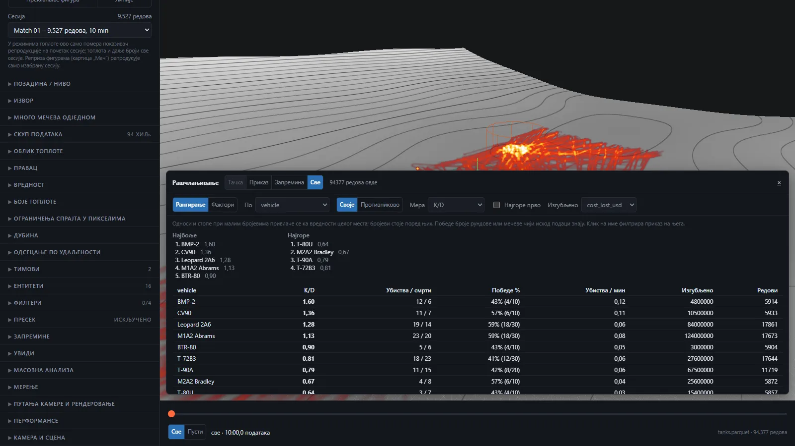
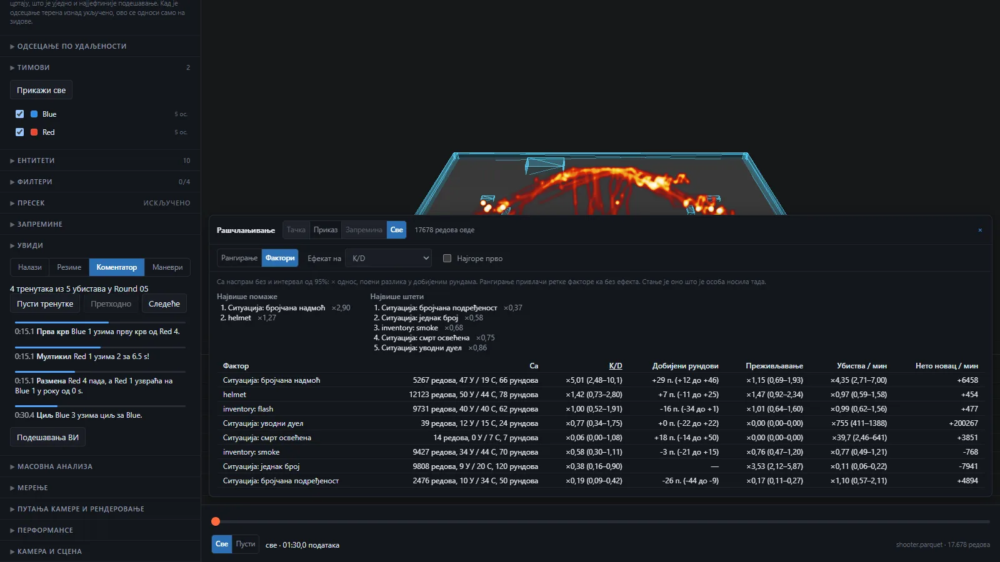

# Рашчлањивање: ко и шта најбоље ради где

**Рашчлањивање** одговара на једно питање: на овом месту, које возило, играч или оружје ради најбоље? Користите га да нађете тенк који побеђује на мосту, или да видите да ли ношење кациге заиста помаже.

Рангира оно што се дешава на једном месту (изабрана тачка, приказ, запремина или све што је приказано) по било ком категорији, и мери сваки фактор стања са и без.

## Пробајте {#try-it}

1. Учитајте меч с убиствима и смрћу, и отворите **Запремине**.
2. Нацртајте запремину око места које вас занима и изаберите је.
3. Притисните **Рашчлањивање...** испод Статистике.
4. У **По** изаберите *Возило*, и изаберите меру *K/D* (убиства по смрти).
5. Прочитајте списак, најбољи први. Притисните **Најгоре прво** да га окренете. Кликните на име да филтрирате приказ на њега; кликните поново да га пустите.

## Отворите га {#open-it}

| Одакле | Област с којом почиње |
| --- | --- |
| **Рашчлањивање...** у [Запреминама](volumes.md) (Статистика) | изабрана запремина |
| **Рашчлањивање овде** на картици избора, после клика на тачку | сфера око те тачке (**Полупречник**, подразумевано 3% величине података) |
| панел поделе **Разлика** | приказ |

Заглавље мења област: **Тачка**, **Приказ** (шта је камера видела при последњем бројању; **Пребројај поново** после померања), **Запремина** (изаберите једну) или **Све**. Броји у позадини; ред статуса каже колико редова има у области.

## Рангирање {#ranking}

Изаберите по чему се рангира и меру:

| Мера | Шта је то |
| --- | --- |
| A, B | редови са сваке стране мапе разлике, подељени као што их топлота дели |
| A / B, A - B, A / (A + B) | два слоја једно према другом |
| K/D | убистава према смрти |
| Проценат победа | рунде (или мечеви) освојене, где подаци кажу ко је победио |
| Убиства / мин | присутна убиства у минуту (празнине у узорцима кретања) |
| Зарађено, Изгубљено, Нето новац | збирови колона `earn_*` и `cost_*`; бирач бира валуту |

Убиства, смрти, присуство, победе и новац броје сваки ред који приказ показује на месту, на било којој страни поделе или ниједној.

Односи и стопе вуку се ка вредности целог места кад су бројеви мали, па 2 убиства у 1 животу не врхује списак. Бројеви се показују поред њих.

Можете рангирати по групама, играчима и мечевима, било којој категоријској колони (возило, оружје, страна, врста набавке, агент или опрема), било којој бројчаној колони у опсезима (оклоп, вредност опреме), **класи** колоне оружја (пушка, снајпер, SMG, пиштољ...) и колико комада **помоћне опреме** садржи списак колона као `inventory`.

**Своје** рангира по сопственој вредности реда. **Противниково** рангира по вредности друге стране: оружје жртве при убиству, оружје убице при смрти (треба колона `other` / `victim` која их именује).

## Стање у том тренутку {#state-at-the-time}

Вредност реда је његова сопствена, осим кад ред ништа не бележи (ред догађаја без опреме) или је смрт (чија колона оружја може именовати оружје убице); тада је то оно што је иста особа последњи пут носила раније у мечу.

## Фактори: са наспрам без {#factors-with-against-without}

Пређите са **Рангирања** на **Факторе**, изаберите **Ефекат на**, и прочитајте *Највише помаже* и *Највише штети*:

Ефекат сваког фактора на K/D, освојене рунде, преживљавање (минута по смрти), убиства у минуту и нето новац у минуту, с интервалом поверења од 95%: односи као x, освојене рунде као разлика у поенима. Рангирање вуче сваку процену ка одсуству ефекта сразмерно њеној сопственој несигурности, па редак фактор треба јасан ефекат да би високо рангирао; приказани интервал је неповучен.

Подаци с рундама додају **ситуације** блиских борби ([Блиска борба и рунде](close-quarters.md)), израчунате једном по скупу података: *заслепљен* (`state_flashed` реда, или непријатељски блесак у 15 m у последње 3 s), *смрт размењена*, *уводни дуел*, и *људска предност*, *једнако* или *људски мањак* (живи играчи на страни реда према непријатељу). Смрт се броји у ситуацији у којој је жртва била непосредно пре ње.

У једном проласку мери се највише 256 фактора.

## За програмере {#for-developers}

### Вучење малих узорака {#pulling-small-samples}

Вредност рангирања је `(n + m*r0) / (d + m)`: `n` и `d` су бројеви, `r0` однос целог места, а `m` тежина те претходне вредности.

### За писце конвертора: именовање колона фактора {#for-converter-authors-naming-factor-columns}

Конвертор додаје фактор тако што именује његову колону:

| Колона | Фактор |
| --- | --- |
| `state_<name>` број | укључено док није нула (`state_scoped`, `state_suppressor`) |
| `state_<name>` категорија | по један фактор за сваку вредност (`state_ammo` = AP, HE...) |
| `active_<name>` | исто, за нешто укључено или недавно коришћено: способност, ултимејт, направу, побољшање (`active_ult`, `active_stim`) |
| колона списка (`inventory`, `loadout`, `perks`, `abilities`, `attachments`, `modules`, `buffs`, `debuffs`, `upgrades`, или име `state_`/`active_` које се завршава на `s`) | по један фактор за сваку ставку вредности `a\|b\|c` |
| заставице опреме које су већ уобичајене (`helmet`, `defuser`, `armor`, `scoped`, `airborne`, `duck`, `flashed`...) | укључено док није нула |
| `ammoType`, `shellType`, `ammoName` | метак испаљен последњи пут |

Резултати: колона `won` са 0/1 (страна реда је освојила рунду или меч) и колона `round` - [колоне исхода](data-formats.md#outcome-columns); где датотека има и `won` и `matchWon`, *Победе %* броји рунде. Новац: `earn_<valuta>` и `cost_<врста>_<valuta>`; приход по самој врсти (`earn_round_cs2`, тачне награде за рунду конвертора) замењује само приход модела трошкова те врсте (`round` обухвата и постављања и деактивирања), а модел и даље цени остало.

Пресликавање учитава ове колоне само, поред сопствених списака датотеке: сваку `state_*`, `active_*`, `won`, `round` и колону списка, осим оних које статистика Parquet датотеке показује да држе једну вредност кроз цео опсег (свака учитана колона је 4 бајта по реду).
