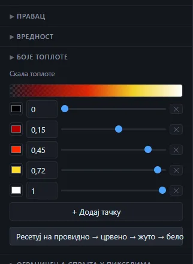

# Боја и експозиција

Ове контроле одређују која количина топлоте добија коју боју. **Тачка засићења** је количина топлоте при којој се боја пење до усијано беле.

## Брза решења {#quick-fixes}

- Све је бело: подигните **Тачку засићења** или притисните **Аутоматска експозиција према пољу**.
- Ништа се не види: спустите **Тачку засићења** или притисните **Аутоматска експозиција према пољу**.
- Виде се само понеке појединачне тачке: појачајте **Најмању топлоту**.

Свака контрола на овој страници делује кад се топлота претвара у боју, па превлачење било које од њих одмах поново црта слику и **никад не покреће акумулацију испочетка**.

## Тачка засићења {#saturation-point}

**Тачка засићења** (одељак Облик топлоте): акумулирана топлота која се пресликава на врх скале боја (уз *Линеарно* одзив; за остале погледајте испод). Логаритамски клизач 0,1-4000, ручица се може повући до 10.000.000, јер акумулирана топлота расте с бројем редова. Подразумевано 24; при сваком учитавању прво се добије **аналитичка процена**, па се затим **мери** са слике.

Погрешна вредност је разлика између топлотне мапе и празног (или белог) екрана, а не може се поуздано израчунати: телеметрија се толико згушњава - спаун, врата, уско грло - да се однос врхунске и просечне густине разликује за ред величине између скупова података и између углова камере.

## Аутоматска експозиција {#auto-exposure}

**Аутоматска експозиција према пољу** мери поље које је шејдер заиста направио. Занемарује празне пикселе, узима 98. перцентил осветљених и ставља га на 85% пута до тачке засићења, тако да врх скале остаје резерван за стварне врхове.

Панел тада исписује *измерено X% кадра; 98. перцентил R постављен близу врха скале*. Уз одзив *Засићујући*, вредност на 85% тачке засићења пада на око 57% скале, а не на 85%.

Ово се ради и **аутоматски**:

- 8 исцртаних кадрова након учитавања скупа података;
- 8 кадрова након промене [филтера](filters.md) (филтрирање сваке позиције на стотину догађаја мења густину за редове величине);
- 8 кадрова након преласка између тачкасте топлоте и [топлоте линија](line-heat.md), или промене путања које топлота линија црта, јер линија оставља далеко мање топлоте по узорку него спрајт.

Кад ништа није осветљено, аутоматски проход оставља засићење на миру; дугме се враћа на аналитичку процену и исписује *нема ничег осветљеног за мерење - коришћена је аналитичка процена*.

### Прати приказ {#follow-the-view}

**Прати приказ** (одељак Облик топлоте, подразумевано укључено) поново мери сваки пут кад камера стане, тако да област у коју улетите користи целу скалу боја, а не скалу измерену за целу мапу. Мале промене се занемарују, а скала клизне уместо да скочи. Ради у четири режима топлоте, а не у приказу фигура.

Искључите га да закључате скалу и упоредите места на истој скали. Ручно превлачење **Тачке засићења** га такође закључава.

## Одзив на густину {#density-response}

**Одзив на густину** - како се *k* (топлота / засићење) пресликава на скалу:

| Одзив | Формула | Употреба |
|---|---|---|
| **Засићујући** (подразумевано) | t = 1 - e^(-k) | Асимптотски се приближава врху скале, као што то раде наслагани провидни спрајтови. Ништа не пада на равно бело, што га чини безбедним подразумеваним избором за непознате податке. |
| **Линеарно** | t = k | Једино пресликавање у којем једнака боја значи једнак број. Користите га за поређење два скупа података или два временска прозора. |
| **Логаритамски** | t = log₂(1 + 7k) / 3 | Сажима дуги реп, па један екстремни жариште престаје да спљоштава све остало на дно скале. Подиже ретка подручја. |

## Најмања топлота {#minimum-heat}

**Најмања топлота** (подразумевано искључено, 0-100%): сваки пиксел који носи било какву топлоту подиже се бар на овај део скале. Појачајте је, а полупречник спрајта смањите, да видите *где се икад нешто десило* - појединачне тачке постају јасно видљиве уместо да седе тек изнад провидног. Оставите искључено кад процењујете густину, јер она по замисли спљоштава дно скале. Праг (k > 0,0001) држи стварно празне пикселе празним.

## Уређивач скале {#the-ramp-editor}

У одељку **Боје топлоте**. Његова ознака каже чему скала служи: *Скала топлоте* у Топлоти и Линијама, *Позитивна (тимови који додају)* у Разлици, *Скала непрозирности (боја долази од групе)* у [Топлоти тимова](team-heat.md), где се користи само његова алфа вредност.



Трака на врху приказује скалу. Испод ње је по један ред за сваку тачку:

| Део | Значење |
|---|---|
| Узорак боје | Боја тачке (бирач боја прегледача). |
| Број | Положај тачке на скали, од 0 до 1 (0 = без топлоте). |
| Клизач | Непрозирност тачке, 0-100%. |
| ✕ | Уклања тачку; онемогућено кад остану само две. |

**+ Додај тачку** додаје тачку на пола пута између две последње, с бојом и непрозирношћу последње тачке. **Ресетуј на провидно → црвено → жуто → бело** враћа подразумевано.

Тачке могу бити наведене било којим редом; сортирају се кад се скала направи. **Алфа** је оно што меша топлоту са сценом, зато је нулти крај подразумеване скале потпуно провидан.

### Подразумеване скале {#the-default-ramps}

| Положај | Позитивна (Топлота, Линије, Разлика +) | Негативна (Разлика −) |
|---|---|---|
| 0,00 | црна, алфа 0 | црна, алфа 0 |
| 0,15 | rgb(180, 0, 0), алфа 0,55 | rgb(0, 170, 60), алфа 0,55 |
| 0,45 | rgb(255, 40, 0), алфа 0,85 | rgb(0, 190, 200), алфа 0,85 |
| 0,72 | rgb(255, 220, 40), алфа 0,95 | rgb(40, 80, 255), алфа 0,95 |
| 1,00 | бела, алфа 1 | rgb(170, 60, 255), алфа 1 |

## Док се камера креће {#while-the-camera-moves}

Кад се камера креће, акумулација се поново покреће сваки кадар. Уз **Цртај сваки ред у сваком кадру** (подразумевано укључено) сваки покретни кадар је и даље тачан; кад је искључено, покретни кадар приказује један узорковани процену - светлије, грудасте мрље с тежинским скалирањем - која се стапа у глатку праву слику кад станете. То је очекивано; видите [Акумулација](accumulation.md).

## За програмере {#for-developers}

### Композитни пролаз {#the-composite-pass}

Кад је топлота акумулирана, вредност сваког пиксела претвара се у боју у једном композитном пролазу ([`COMPOSITE_FS`](https://github.com/Holdi601/3DHeat/blob/main/src/render/webgl2/shaders.ts)). Кораци су:

```
k = |топлота| / тачка засићења
t = одзив(k)                            ограничено на 0..1
ако је најмања топлота > 0 и k > 0.0001:  t = најмања + (1 - најмања) × t
боја, алфа = скала(t)                   (негативна скала кад је топлота < 0, само Разлика)
пиксел = mix(сцена, боја, алфа)
```

### Аналитичка процена {#the-analytic-estimate}

**Аналитичка процена** ([`estimateSaturation`](https://github.com/Holdi601/3DHeat/blob/main/src/data/calibrate.ts)) претпоставља да су редови распоређени по X-Z отиску података: средња топлота = редови × (π r² / површина отиска) × 1/3 × интензитет у центру (1/3 је просек диска линеарног прелаза), помножено претпостављеним односом врха и просека од 25, ограничено на 0,1-1.000.000. Довољно је да буде у реду величине тачна.

### Мерење {#metering}

[`exposure.ts`](https://github.com/Holdi601/3DHeat/blob/main/src/render/exposure.ts):

1. циљна површина топлоте чита се назад из GPU-а, узоркована на највише 40.000 вредности;
2. празни пиксели (топлота ≤ 0,0001) се одбацују - већина поља топлоте је празна, па би их усредњавање потамнило све, као мерач експозиције уперен у црну позадину;
3. 98. перцентил осветљених пиксела је референца;
4. тачка засићења постаје референца / 0,85, тако да референца стоји на 85% пута до тачке засићења, а врх скале остаје резерван за стварне врхове.

### Табела боја {#the-colour-table}

Скала се пече у табелу 256 × 2 RGBA (позитивна скала у првом реду, негативна у другом) ([`buildColorLut`](https://github.com/Holdi601/3DHeat/blob/main/src/render/colors.ts)). Боје се интерполирају у линеарном светлу и чувају као sRGB; непрозирност се интерполира линеарно.
