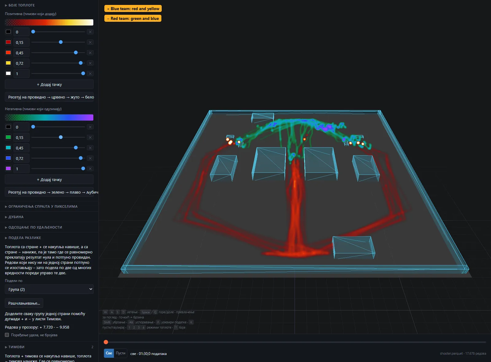

# Разлика

Црвено тамо где је тим А био више, зелено-плаво тамо где је био тим Б, ништа тамо где су били једнаки.

**Разлика** (тастер 2) је топлота с предзнаком. Редови једне популације додају топлоту; редови друге је
одузимају. Тамо где се два преклапају подједнако, резултат је нула и потпуно провидан; тамо где једна
превладава, приказује се у бојама те стране - по подразумевању топло (провидно → црвено → жуто → бело)
за страну **+** и хладно (провидно → зелено → плаво → љубичасто) за страну **−**.

## Како се користи {#how-to-use-it}

1. Притисните `2` (или изаберите **Разлика** у траци режима).
2. Отворите **Подела разлике** у бочној траци.
3. Изаберите шта да **Подели по**: обично *Групе*.
4. Ставите једну групу (или вредност) на **+**, а другу на **−**.
5. Прочитајте боје: топло значи страну +, хладно страну −. Панел упозорава ако једна страна нема редова
   (видите [Поруке које можете видети](#messages-you-may-see)).

*Које* две популације су цело питање, па подела може бити било која задржана колона, не само групе. Редови
који падну ни на једну страну се **изостављају**, не броје се као нула: то чини да подела над две од многих
вредности пореди баш те две, а слаже се с [филтрима](filters.md) - филтрирајте до једне мапе, па поделите
то по верзији.

Режим треба две стране: колону групе с бар две групе, или поделу по колони задржаној за филтрирање. Над
подацима с мање од две групе, учитавање почиње поделом по колони - прво колона *Source file* при учитавању
више датотека, иначе прва колона категорије с две вредности, иначе прва бројчана колона с распоном - па
*упореди два учитавања* ради и над подацима без иједне групе. Само подаци без једног ни другог остављају режим
недоступним; тако и подела по колони која на једној страни нема ништа.

## Панел Подела разлике {#the-difference-split-panel}

Приказује се у режиму Разлика, испод панела топлоте.

**Подели по** нуди:

| Опција | Приказано као | Правило поделе |
|---|---|---|
| Групе | *Група (N)* (кад постоји колона групе) | Свака група на +, − или ни на једну, постављено у [Списку тимова](teams-list.md) |
| Колона категорије | *колона (N вредности)* | Вредности на +, − или ни на једној |
| Бројчана колона | *колона (бројчана)* | Опсег вредности за сваку страну |
| Датотека порекла | *Source file - упореди два учитавања* (кад је учитано више датотека) | Датотеке на +, − или ни на једној |

Нуде се само колоне које су у учитавању штиклиране под *Задржи за филтрирање*.

### Поређење удела, не бројева {#compare-shares-not-counts}

**Поређење удела, не бројева** (подразумевано искључено) тежи сваку страну једним преко њеног сопственог
броја редова, па страна са пет пута више редова не побеђује само бројем. Боја тада показује где је свака
страна сразмерно чешћа од друге. Користите то кад две стране имају веома различите количине података, на
пример две сесије различите дужине.

### Поруке које можете видети {#messages-you-may-see}

Панел упозорава кад слика није права разлика:

| Порука | Значење |
|---|---|
| *N + / M −* (или *N + / M − / K неискоришћених*) | Колико вредности је на свакој страни (и на ниједној). |
| Ниједан ред у прозору није на страни **+** | Црта се само страна **−**. Померите прозор временске линије или промените поделу. |
| Ниједан ред у прозору није на страни **−** | Црта се само страна **+**. |
| Ниједна вредност није ни на једној страни | Разлика ништа не црта. Ставите бар једну вредност на **+** или **−**. |
| *колона* не може да се дели на овај начин | Изабрана колона не одговара подели. Поново је изаберите. |
| Колона поделе није стала у меморију GPU-а за N од M делова | Ти редови се не цртају. Повећајте буџет GPU-а под Перформансе → Буџети ресурса, или учитајте мање редова. |

### По групи {#by-group}

Панел само упућује на [Списак тимова](teams-list.md), где свака група има дугмад **+** и **−**. При сваком
учитавању прва половина група (заокружено нагоре) иде на +, остале на −; **Подели равномерно** у Списку
тимова ради исто поново. Група на ниједној страни, или сакривена својим квадратићем, не доприноси ништа.

### По вредностима категорије {#by-category-values}

| Део | Значење |
|---|---|
| `a + / b − / c неискоришћених` | Колико вредности је на свакој страни и на ниједној. |
| **Очисти** | Ставља сваку вредност на ниједну страну. |
| Списак вредности | Свака вредност с дугмадима **+** и **−** (кликните активно дугме поново да га скинете с те стране). Празна вредност се наводи као *(недостаје)*. |
| Напомена о ограничењу | Наводи се само првих 200 вредности: *Приказано првих 200 од N вредности. Колону ове ширине боље је прво сузити филтером, или делити по опсегу ако су вредности уређене.* |

Бирање колоне ставља њену прву вредност на +, а другу на −. Кад ниједна страна нема ниједну вредност, подела
се враћа на групе, а не приказује празан оквир. *Source file* ради исто, по једна вредност по датотеци - тако се
упоређују два извоза, два пробна покретања или две верзије.

### По опсегу {#by-range}

| Део | Значење |
|---|---|
| Наговештај | Најмања и највећа вредност колоне. |
| **Позитиван опсег (+)**, **од** / **до** | Редови с вредношћу у овом опсегу, укључујући обе границе, додају се. |
| **Негативан опсег (−)**, **од** / **до** | Редови у овом опсегу одузимају. |
| **Подели на средини** | Поставља + на [најмања, средина] и − на [средина, највећа] - то се дешава и кад изаберете колону. |

Вредност у оба опсега рачуна се као +. Опсези не морају да покривају колону; вредности ни у једном се
изостављају. *Прва два минута против последња два* је подела по опсегу над колоном сличном времену.

## Удео +: мапа процента победа {#share-of--the-win-rate-map}

**Разлика** / **Удео +** на врху панела бира шта се црта. *Удео +* боји свако место према уделу стране + међу редовима обе стране на њему, у односу на тај удео у свему приказаном: топло изнад њега, хладно испод, ништа где је исти и ништа где место има премало редова. Са освојеним рундама на + и изгубљеним на − то је мапа процента победа; **Проценат победа по рунди** и **Проценат победа по мечу** то постављају једним притиском када подаци имају [колоне исхода](data-formats.md#outcome-columns). Погледајте [Проценат победа](win-rate.md).

## Боје {#colours}

Одељак **Боје топлоте** у овом режиму приказује два уређивача скале: **Позитивна (тимови који додају)** и
**Негативна (тимови који одузимају)**, сваки са својим дугметом за враћање (*Врати на провидно → црвено → жуто →
бело*, *Врати на провидно → зелено → плаво → љубичасто*). Сложени приказ узима апсолутну вредност нето топлоте
кроз [тачку засићења и одзив](colour-and-exposure.md), и бира негативну скалу тамо где је нето испод нуле.
Видите [Боја и експозиција](colour-and-exposure.md#the-ramp-editor).

Користите одзив густине *Линеарно* кад је величина разлике битна: то је једини одзив у коме једнака боја значи
једнак број.

## За програмере {#for-developers}

Сваки ред добија предзнак +1, -1 или 0 у шејдеру темена ([`POINT_HEAT_VS`](https://github.com/Holdi601/3DHeat/blob/main/src/render/webgl2/shaders.ts)); 0 одбија ред пре него што се нацрта иједан фрагмент.

- По групи, предзнак долази из табеле група од 4.096 уноса индексиране идом групе реда (ид групе иде у четвртом каналу
  положајног текела реда).
- По категорији, предзнак долази из друге табеле од 4.096 уноса, попуњене по вредности категорије, а вредност реда се
  чита из текстуре филтера колоне; вредност иза краја табеле се одбија на обе позадине.
- По опсегу, вредност реда се пореди с два опсега.

Промена поделе поново покреће акумулацију.

**Сакривене групе остају сакривене уз сваку поделу.** Под поделом по колони табела група више не носи предзнаке;
држи 1 за приказану групу и 0 за сакривену ([`frameSignTables`](https://github.com/Holdi601/3DHeat/blob/main/src/render/filterTables.ts)), а обе табеле стижу до
шејдера заједно - два реда једне текстуре предзнака на WebGL2, две половине једног складишног бафера на WebGPU. Ред се
црта само кад је његова група приказана *и* његова вредност колоне је на некој страни. Зато група искључена у
[Списку тимова](teams-list.md), или изостављена фокусом стране на картици Меч, не доприноси ништа, ма како да је разлика
подељена.
