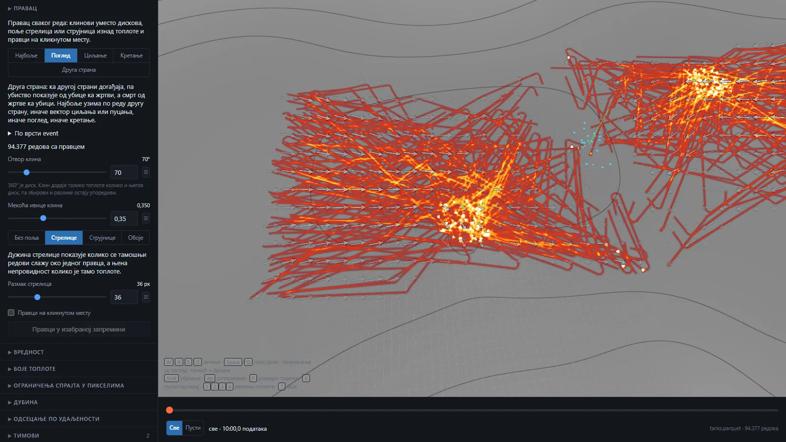

# Усмерена топлота

Обична топлота каже **где** се ствари дешавају. Усмерена топлота каже и **у којем правцу**: у ком смеру су људи гледали, нишанили, кретали се, или где је била друга страна борбе.

Обичан спрајт је пун диск (360 степени). Са **Отвором клина** од 70 степени исти спрајт постаје уски клин који показује смер у коме је ред био окренут, и додаје исту укупну топлоту.

## Како се користи {#how-to-use-it}

1. Учитајте податке у којима постоји смер (видите [Шта даје реду смер](#what-gives-a-row-a-direction)).
2. Изаберите **Топлота**, **Разлика** или **Топлота тимова** у траци режима.
3. Отворите одељак **Правац** у бочној траци.
4. Изаберите **извор** (који смер да се користи), па укључите цртање:
   - спустите **Отвор клина** испод 360° да сваки ред нацрта као клин који показује његов смер, уместо диска;
   - изаберите **Поље** да нацртате стрелице или струјнице преко топлоте;
   - означите **Правци на кликнутом месту** и кликните на топлоту да добијете поларни график тог места.

Ред статуса каже колико редова има смер из изабраног извора.

## Подешавања {#settings}

| Подешавање | Подразумевано | Шта ради |
|---|---|---|
| Извор: **Најбоље**, **Приказ**, **Циљање**, **Кретање**, **Друга страна** | Најбоље | Који смер добија сваки ред. *Најбоље* узима, по реду, другу страну, па циљање, па приказ, па кретање. |
| **По врсти догађаја** | као горе | Други извор за сваку врсту догађаја, на пример *Друга страна* за убиства и *Приказ* за положаје. Приказано кад подаци имају колону догађаја с највише 40 вредности. |
| **Отвор клина** | 360° | 360° је обичан диск (искључено). Мање је уži клин. Клин додаје онолико топлоте колико његов диск, па укупни збирови и разлике остају упоредиви. |
| **Мекоћа ивице клина** | 0,35 | 0 је оштро ивичен клин, 1 мекан ветар. |
| **Поље**: Без поља, Стрелице, Струјнице, Обоје | Без поља | Стрелице: дужина стрелице је колико се редови ту слажу у једном смеру, а непрозирност колико топлоте има. Стрелице се показују само где има топлоте. |
| **Размак стрелица** | 28 px | Растојање између стрелица на екрану. |
| **Анимирај струјнице** | укључено | Струјнице теку док је укључено. |
| **Правци на кликнутом месту** | искључено | Кликните на топлоту да видите правце тамо (испод). |
| **Правци у изабраној запремини** | | Исти график за све унутар изабране [запремине](volumes.md). |

## Поларни график на месту {#the-polar-chart-at-a-spot}

Кад је **Правци на кликнутом месту** укључено, кликните на топлоту. Редови близу те тачке (у року од 1,5 полупречника спрајта) скупљају се у ружу од 24 исечка по 15°:

- **наранџасте** латице: одлазни правци (у које редови показују);
- **плаве** латице: долазни правци (одакле су дошли);
- **површина** латице расте са њеним бројем; стрелица показује главни правац;
- линије испод графика дају главни азимут, колико се редови снажно слажу (R, од 0 до 1), разбацаност у степенима и број редова.

0° је горе на графику, што је свет −Z (север за Tacview снимке). Место је такође означено у 3D приказу стрелицом и прстеном.

## Шта даје реду смер {#what-gives-a-row-a-direction}

| Извор | Треба у подацима |
|---|---|
| Приказ | колона скретања (пресликана као смер погледа): `yaw`, `heading`, `azimuth`, `view_yaw`, `rot_z` |
| Циљање | парови бројева као `aim_x`/`aim_y`, `shot_x`/`shot_y`, `fire_x`/`fire_y`, `hit_dir_x`/`hit_dir_y` (необавезно `…_z`) |
| Кретање | ништа посебно: корак од претходног узорка исте особе (највише 10 s раније, иста сесија) |
| Друга страна | колона која именује другу страну догађаја (`other`, `victim`, `target`, `killer`, `attacker`, `shooter`, `other_player` ...) чије су вредности имена особа; убиство показује од убице ка жртви, смрт од жртве ка убици |

## Савети {#tips}

- Клинови треба неку величину на екрану; испод неколико пиксела поново се цртају као дискови.
- Користите *Друга страна* на редовима убистава да видите **одакле** су борбе добијене, а *Приказ* на редовима положаја да видите **где људи гледају**.
- Уз **Разлику**, клинови две стране показују у своје правце, па се спорне линије ватре истичу.
