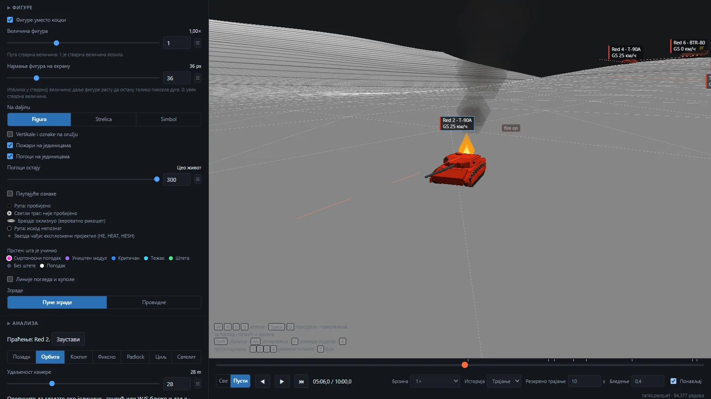

# Фигуре

**Фигура** је мали 3D модел онога што јединица заиста јесте: тенк, млазњак, брод, војник. [Реприза](match-replay.md) црта сваку јединицу као њену фигуру у правој величини, а не као обичну кутију.

Има око 2.000 именованих возила, летелица, бродова, оружја и војника, а све их је направио сам приказивач.

## Шта је у каталогу {#what-is-in-the-catalogue}

| Област | Примери |
|---|---|
| Људи | војник који стоји, чучи или лежи; снајперист, противоклопни, санитетлија, посада |
| Копно | тенкови, оклопна возила за пешадију, противваздушна одбрана, артиљерија, камиони и аутомобили, возови и трамваји |
| Ваздух | борци, јуришни авиони, бомбардери, транспортни авиони, хеликоптери, од двокрилаца до савремених млазњака |
| Море | ратни бродови по класи, носачи авиона, подморнице, чамци, трговачки бродови |
| Оружје | пројектили, ракете, бомбе, торпеда, светлећи мамци и дипол |
| Ознаке | димна, блицна и запаљива граната, постављене бомбе, заставе, места појављивања, тачке пута |

## Како се фигуре праве {#how-the-figures-are-made}

- **Праве се од објављених димензија.** Већину фигура прави сопствени градитељ фигура приказивача од јавних података: дужина, ширина, висина, точкови пута, торањ и топ, крила и реп. Њихов облик се затим подешава према јавним фотографијама, цртежима и објављеним димензијама. Ниједан модел из игре није коришћен.
- **Слободни модели.** Неколико фигура користи слободне 3D моделе (CC0 или CC BY) где су верније, понекад спојене с направљеним трупом. Аутори CC BY радова наведени су у [Заслугама за фигуре](figure-credits.md). CC0 радови не траже заслугу и нису наведени тамо.
- Свака фигура има пун, груби и далеки приказ (нивои детаља, LOD), па се хиљаде могу нацртати одједном.

## Која фигура припада јединици {#which-figure-a-unit-gets}

Приказивач гледа сопствене колоне података:

1. **Имена**: колоне које се зову *Name*, *Vehicle*, *Unit*, *Unit type*, *Model*, *Aircraft*, *Plane*, *Tank*, *Ship*, *Craft*, *Loadout*, *Kit* или *Figure* упоређују се са каталогом: тачно, преко око 4.000 алијаса (ид-ови јединица из неколико игара), по најдужем познатом почетку (`F-16C_50` је F-16C), или по најкраћем имену фигуре које почиње тим.
2. Име чија фигура не одговара **типу** јединице се не користи (камион под именом *Typhoon* није борац).
3. **Типови**: колоне које се зову *Type*, *Class*, *Kind*, *Category*, *Icon*, *Role* или *Domain* дају фигуру класе: Tacview ознаке (`Air+FixedWing`, `Ground+Heavy+Armor+Vehicle+Tank`, `Sea+Watercraft+Warship`, `Weapon+Missile`), иконе мапе, или обичне речи (tank, helicopter, infantry).
4. Подаци ни са једним од ова два су подаци о људима: сви су војници.

Зато је најлакши начин да добијете праве фигуре колона `vehicle` са правим именима, или колона `type` са Tacview ознакама.

**Моја јединица се види као кутија или војник.** Додајте колону `vehicle` са правим именом, или колону `type` са Tacview ознаком. Задржите миш на јединици да видите које је име пронађено. Подаци који имају такве колоне, а ништа не говоре о јединици, остављају је као кутију; подаци без обе се цртају као војници.

## Подешавања {#settings}

Одељак **Фигуре** у бочној траци репризе подешава величину, најмању величину на екрану, у шта се претварају далеке јединице (фигура, стрелица, симбол) и ефекте који се на њих цртају. Видите [Реприза меча](match-replay.md#figures). Дим, ватра и други ефекти са временским трајањем: [Фигуре у преклапању фигура](figure-replay.md).

## Опциони локални пакет фигура {#an-optional-local-figure-pack}

На свом рачунару можете чувати опционални пакет сопствених фигура. Његове фигуре заузимају место фигура из каталога истих имена. Никад није део репозиторијума или објављене верзије; без њега се ништа не мења.
