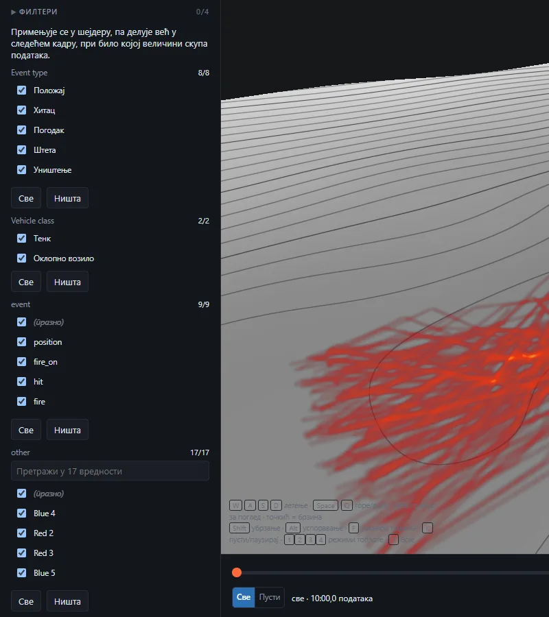
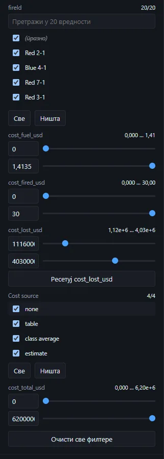

# Филтери

**Филтери** сакривају редове које не занимају, као једну класу возила или једну врсту догађаја, и слика се одмах мења. Панел наводи колоне задржане при учитавању под *Задржи за филтрирање* ([Мапирање колона](column-mapping.md)), плус *Изворна датотека* када је учитано више датотека.

## Пробајте {#try-it}

1. Учитајте скуп података и отворите **Филтери** у бочној траци.
2. Под **Класа возила** искључите *Tank*. Слика се одмах мења.
3. Притисните **Очисти све филтере** да поништите.

Први редови су колоне самог приказивача (испод). Редови иза њих долазе из ваше датотеке.

## Колоне које приказивач додаје {#columns-the-viewer-adds}

При учитавању приказивач сам израђује четири колоне и наводи их **прве**, са називима и вредностима на вашем језику, па исти филтер ради за сваку игру и сваки извор података:

| Колона | Вредности | Израчунато из |
|---|---|---|
| **Врста догађаја** | 23 врсте: Позиција, Испаљен пуцањ, Лансирање (ракета, пројектил, бомба), Погодак, Промашај (оружје завршило далеко од мете), Експлозија, Оштећење, Убиство, Смрт, Уништено, Пад, Катапултирање / искакање, Појављивање, Нестанак, Полетање, Слетање, Додир са тлом, Заустављање на тлу, Поновно наоружавање / гориво, Заузимање / циљ, Мамац, Порука, Остало | колона зване `event`, `events`, `event_type` или `event_name`; речи сваке игре (`shot`, `burst`, `fired`, `struck`, `flare`, `plant` ...) пресликавају се на ове врсте. Пун преглед: [Врсте и класе догађаја](ref-event-types.md). |
| **Играч или ВИ** | Играч, ВИ | колона `ai`, `is_ai`, `bot` или `actor`; иначе `is_player` / `human`; иначе идентификатор налога (`user_id`, `steam_id`; празно или 0 је ВИ); за Tacview снимке, да ли објекат има пилота |
| **Класа возила** | 17 класа: Ловац, Јуришни авион, Бомбардер, Остали авиони, Хеликоптер, Тенк, Оклопно возило, Противваздушна одбрана, Артиљерија, Камион / аутомобил, Брод, Подморница, Пешадија, Оружје, Мамац, Грађевина, Остало | назив возила или јединице (упоређен са [каталогом фигура](figures.md)) и колоне типа |
| **Класа циља** | исте класе | возило друге стране (`other_vehicle`, `target_vehicle`, `victim_type` ...) |

Наведене су само врсте које се јављају. Колоне вредности (`cost_*`, `earn_*`, `net_*` и *Извор трошка*, видети [Тежинање вредности](value-weighting.md)) могу се филтрирати као било која бројевна колона: на пример, искључите *estimate* под *Извор трошка* да задржите само редове са ценом.

Списак категорије са више од 12 вредности добија поље за претрагу (*Претражи n вредности*) и дугме **Само ови**, које дозвољава тачно оне вредности које се подударају.

Које колоне се могу филтрирати одлучује се у време учитавања, јер се тада морају прочитати. Без задржане колоне панел то каже и упућује на *Задржи за филтрирање*.

## Бројевне колоне (опсег) {#numeric-columns-range}

| Део | Значење |
|---|---|
| Назив, и `min ... max` | Колона и тренутни опсег (пун опсег колоне док није постављен филтер). |
| Први ред: поље за број и клизач | Доња граница. Превлачење клизача изнад горње границе помера горњу границу са собом. |
| Други ред: поље за број и клизач | Горња граница. Превлачење испод доње границе помера и њу. |
| **Ресетуј *колону*** | Уклања овај филтер. |

Клизачи покривају најмању до највећу вредност колоне у 1.000 корака; поља за број прихватају било коју вредност. Ред пролази када је његова вредност у опсегу, укључујући оба краја. Велике вредности се приказују у експоненцијалном облику (`1.23e6`).

## Колоне категорија {#category-columns}

| Део | Значење |
|---|---|
| Назив, и `allowed/total` | Колона и колико њених вредности је дозвољено. |
| Списак вредности | Поље за потврду уз сваку вредност; празна вредност се приказује као *(празно)*. |
| **Све** / **Ништа** | Дозволи сваку вредност / ниједну. |

Дозвољавање свих вредности уклања филтер.

## Правила {#rules}

- **Четири филтера истовремено.** Заглавље показује `active/4`. Пети филтер се не примењује, а панел то каже. Избор у [Ентитетима](entities.md) (или фокус на играча у картици Меч) користи један од та четири. Филтер који обухвата целу колону не користи ниједан.
- **Колона категорије има највише 4.096 вредности**; шира се не задржава при учитавању.
- **Филтери се комбинују са И**, и са видљивошћу тимова, поделом разлике, временским прозором, одсецањем по даљини и [пресеком](slice.md).
- **Промена филтера покреће акумулацију изнова и поново мери експозицију** неколико кадрова касније, јер филтрирање може јако променити густину ([Боја и експозиција](colour-and-exposure.md#auto-exposure)).
- **Очисти све филтере** уклања сваки филтер колоне. Видљивост тимова и избори играча постављени на другом месту се задржавају.
- Филтери колона мењају режиме топлоте. Не мењају фигуре [реприза фигура](box-replay.md), које прате видљивост тимова и избор у Ентитетима. Избор у Ентитетима мења обоје.
- У [линијској топлоти](line-heat.md) филтер се проверава на реду у ком се сваки сегмент *завршава*.
- При сваком новом скупу података сви филтери се чисте.

## За програмере {#for-developers}

**Слотови.** Сваки активан филтер заузима један од четири GPU слота ([`MAX_FILTER_SLOTS`](https://github.com/Holdi601/3DHeat/blob/main/src/render/types.ts)), текстуру од 4 бајта по реду. Слотови се додељују филтерима оним редом којим су последњи пут мењани ([`filterSlots`](https://github.com/Holdi601/3DHeat/blob/main/src/render/filterTables.ts), дели их шејдер и оба панела). Преко четири, порука гласи *Only the first 4 filters are applied. Clear one - the rest are being ignored, not silently combined*, а имена додатних филтера гласе *column (not applied)*. Филтери се извршавају по реду у vertex shader-у, па промена прага не захтева поновно парсирање ни поновно отпремање.

**Филтери које панел не приказује.** У стању апликације постоје још две врсте ([`FilterSpec`](https://github.com/Holdi601/3DHeat/blob/main/src/state/types.ts)):

- филтер **група**, који поставља картица Меч када фокусира једну страну. Сакрива остале групе у сваком режиму, укључујући [разлику](difference.md) подељену по колони.
- филтер **особа**, који поставља панел [Ентитети](entities.md) и картица Меч када фокусира једног играча. Ограничава репризу фигура и режиме топлоте. У топлоти је то филтер категорије над идентификаторима особа и заузима један од четири слота. Његова маска држи 65.536 идентификатора ([`FILTER_MASK_CAPACITY`](https://github.com/Holdi601/3DHeat/blob/main/src/render/types.ts)); особа иза те границе се не црта у топлоти док је филтер активан, чак ни када је изабрана. Реприза фигура их и даље приказује.
