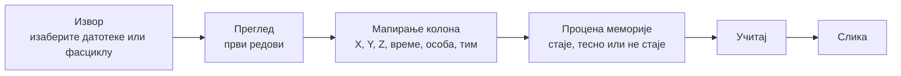

# Унос података

Пре него што 3DHeat може нешто да нацрта, треба му табела: сваки ред каже где је нешто било и, ако то знате, када и ко је то био. Овај одељак показује како датотека постаје слика. Још немате податке? Пробајте [демо податке](demo-data.md).

**Урадите ово одмах:**

1. У бочној траци Топлотне мапе отворите **Извор** и притисните **Датотеке…** (или превуците датотеку или фасциклу на зону за отпуштање).
2. Погледајте **Мапирање колона**: поља су обично већ попуњена.
3. Проверите да **Процена меморије** каже *стаје*.
4. Притисните **Учитај**.

Све што картица Топлотна мапа приказује долази из једног **скупа података**: табеле редова, где сваки има позицију и, по жељи, време, особу, групу, сесију, правац гледања и било који број додатних колона задржаних за филтрирање. Овај одељак објашњава како се скуп података прави.

## Пут од датотека до слике {#the-path-from-files-to-picture}

1. **Изаберите датотеке** у панелу **Извор** - једну, неколико, стабло фасцикли, или превлачењем. Прихватају се Parquet, CSV, Tacview, GPS трагови и још више; једна потпуна листа је у [Формати података](data-formats.md#files). Видети [Учитавање датотека](loading-files.md).
2. **Преглед.** Отвара се прва датотека из избора: њени називи колона, њих првих 50 редова, које колоне изгледају као бројеви и (за Parquet) логички тип сваке колоне и сопствена упутства за читање датотеке, ставка у подножју `heat3d`.
3. **Аутоматско мапирање.** Колоне се додељују улогама - X, Y, Z, време, особа, сесија, група, правац гледања - а неколико се задржава за филтрирање. Свака претпоставка се види у панелу **Мапирање колона** и може да се промени. Видети [Мапирање колона](column-mapping.md) и [Осе, јединице и време](axes-units-and-time.md).
4. **Бројање.** Број редова сваке датотеке се чита (тачно из Parquet подножја, процењено за CSV), па панел може да каже пре учитавања колико меморије треба и да ли стаје. Ако не стаје, предлаже учитавање сваког *N*-тог реда. Видети [Меморија и буџети](memory-and-budgets.md).
5. **Учитавање.** Позадински радник обрађује само мапиране колоне сваке датотеке - више датотека истовремено, до буџета [нити за парсирање](memory-and-budgets.md#parser-threads) - и спаја их, редом из избора, у један скуп података: један заједнички речник особа, група и сесија преко свих датотека, једно заједничко време почетка, сви редови сортирани по времену. Видети [Сесије, особе и групе](sessions-persons-groups.md).
6. **Отпремање.** Главна нит објављује „Отпремам N редова на GPU” за један кадар, па пакује редове у меморију GPU-а у оквиру GPU буџета. Видети [Задржавање у меморији GPU-а](gpu-memory.md).
7. **Прва слика.** Камера уоквирује податке, полупречник спрајта и засићење се постављају према обиму података и броју редова, а после 8 исцртаних кадрова засићење се мери из саме слике ([Боја и експозиција](colour-and-exposure.md)).

## Захтеви који се проверавају пре учитавања {#requirements-checked-before-a-load}

| Потреба | Шта се дешава без ње |
|---|---|
| **Најмање два од X / Y / Z** | Учитавање се одбија. Са тачно два, трећа оса је 0 и подаци се цртају као раван у 3D сцени - што жели мапа топлоте одозго. |
| Колона времена | Опционо. Без ње је временска линија искључена, приказ остаје у режиму **Све**, а бочна трака то каже. |
| Колона особе | Опционо. Потребна је за [преклапање фигура](box-replay.md) (фигура за сваку особу), [линијску топлоту](line-heat.md) (путању сваке особе), интерполацију, трагове и историју **Трајање**. |
| Колона групе | Опционо. Потребна је за [топлоту тимова](team-heat.md) и за режим [разлике](difference.md) (најмање две групе). |

Режим који учитани подаци не могу да подрже је засивљен у траци режима; када се задржи показивач, каже зашто.

## Без ваших података {#without-your-own-data}

Панел **Скуп података** (испод **Извор**) има [синтетички генератор](synthetic-generator.md) који прави скуп података облика „битке до последњег” било које величине, корисно за пробу приказивача и за проверу шта једна машина може да поднесе.

## Странице у овом одељку {#pages-in-this-section}

- [Учитавање датотека](loading-files.md) - бирачи, фасцикле, превлачење и отпуштање, спајање више датотека, правило датотеке кретања, напредак и прекид
- [Мапирање колона](column-mapping.md) - свако поље панела за мапирање, како аутоматско мапирање претпоставља, подсказе `heat3d`
- [Осе, јединице и време](axes-units-and-time.md) - вертикална оса, окретања, размера јединица, јединице времена, правац гледања
- [Сесије, особе и групе](sessions-persons-groups.md) - шта свака ради, ограничења, заједничка имена, величина ентитета, панел Скуп података
- [Синтетички генератор](synthetic-generator.md)
- [Меморија и буџети](memory-and-budgets.md) - модел отиска, провера стајања, прореживање, граница сортирања, буџети ресурса
