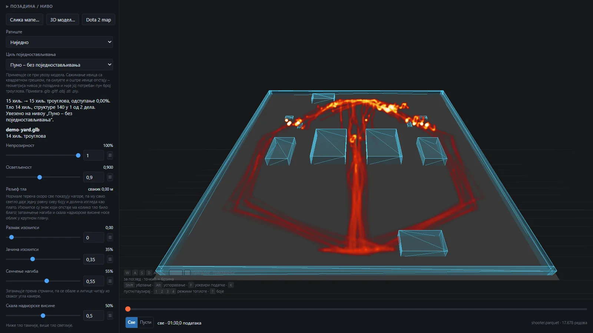
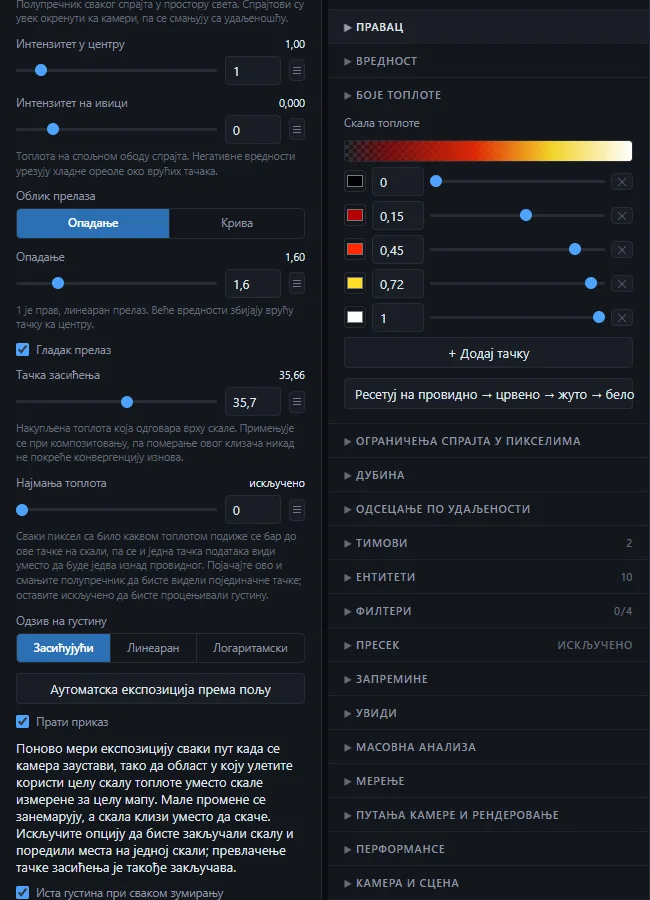

# Топлота

Топлота приказује места на којима се десило много ствари: црвено тамо где се десило помало, бело-усијано тамо где се десило много. Одговара на питање „где се ово дешава и колико често?”.

**Топлота** (тастер 1) је подразумевани режим. Сваки видљиви [ред](glossary.md) доприноси округли [спрајт](glossary.md) окренут према камери; преклапајући спрајтови се сабирају у бафер са покретним зарезом; збир се пресликава кроз скалу боја - подразумевано провидно → црвено → жуто → бело - и црта се преко сцене.

Слика приказује топлоту једне рунде шутера на нивоу са зградама: вруће тачке су у собама и на степеницама, а не само на тлу.

## Како се користи {#how-to-use-it}

1. Учитајте податке и притисните `1` (или изаберите **Топлота** у траци режима).
2. Ако је све бело или празно, притисните **Аутоматска експозиција према пољу** у одељку **Облик топлоте**.
3. Промените **Полупречник спрајта** док се суседне тачке не споје у појасеве: мањи приказује појединачне мрље, већи области.
4. Отворите **Боје топлоте** да промените боје, или **Дубина** да брда и зидови сакривају топлоту иза себе.

Исти панели обликују [Разлику](difference.md), [Топлоту тимова](team-heat.md) и [Топлоту линија](line-heat.md); разликују се по томе шта се додаје (са знаком, у боји или дуж линија), а не по начину.

## Панели и њихове подразумеване вредности {#the-panels-and-their-defaults}

Свака контрола је објашњена на својој страници; колона Детаљи води до ње. Клизачи имају поље за упис поред себе и ручицу за превлачење (мала ручица с десне стране: превуците горе или доле, даље је брже, Shift за фино подешавање); где траг клизача стане пре стварне границе, ручица може да гурне преко њега до *горње границе клизача* наведене овде. Вредности означене *при учитавању* поново се рачунају за сваки нови скуп података.

### Облик топлоте (отворено) {#heat-shape-open}

| Контрола | Подразумевано | Опсег (горња граница клизача) | Детаљи |
|---|---|---|---|
| **Полупречник спрајта** | 6 m; при учитавању обухват / 120 | 0,05-2000 m, логаритамски (50.000) | [Облик спрајта](sprite-shape.md#sprite-radius) |
| **Интензитет у центру** | 1 | 0-10 (1000) | [Облик спрајта](sprite-shape.md#centre-and-edge-intensity) |
| **Интензитет на ивици** | 0 | -2-10 (1000) | [Облик спрајта](sprite-shape.md#centre-and-edge-intensity) |
| **Облик прелаза** | *Опадање* | *Опадање* / *Крива* | [Облик спрајта](sprite-shape.md#ramp-shape-falloff-or-curve) |
| **Опадање** (само за Опадање) | 1,6 | 0,1-8 (64) | [Облик спрајта](sprite-shape.md#falloff) |
| **Гладак прелаз** (само за Опадање) | укључено | | [Облик спрајта](sprite-shape.md#falloff) |
| Уређивач криве (само за Криву) | претподешавање *Глатко* | | [Облик спрајта](sprite-shape.md#the-curve-editor) |
| **Тачка засићења** | 24; при учитавању процена, па мерење | 0,1-4000, логаритамски (10.000.000) | [Боја и експозиција](colour-and-exposure.md#saturation-point) |
| **Најмања топлота** | искључено (0) | 0-100% | [Боја и експозиција](colour-and-exposure.md#minimum-heat) |
| **Одзив на густину** | *Засићујући* | *Засићујући* / *Линеарно* / *Логаритамски* | [Боја и експозиција](colour-and-exposure.md#density-response) |
| **Аутоматска експозиција према пољу** | | дугме | [Боја и експозиција](colour-and-exposure.md#auto-exposure) |
| **Прати приказ** | укључено | | Поново мери експозицију сваки пут кад камера стане, па област у коју улетите користи целу скалу боја. Мале промене се занемарују, а скала клизне. Искључите га, или превуците **Тачку засићења**, да закључате скалу и упоредите места на једној скали. [Боја и експозиција](colour-and-exposure.md#follow-the-view) |
| **Иста густина при сваком зумирању** | укључено | | Боја значи исти број редова по површини тла, колико год сте близу. Спрајт који ограничења у пикселима увећају (далеко) или смање (изблизи) задржава топлоту коју би додао његов стварни размер, па се слика експонирана издалека не гаси кад улетите у њу. Искључено, ограничен спрајт додаје пуну тежину при свом ограниченом размеру. [Облик спрајта](sprite-shape.md#pixel-clamps) |
| **Спљошти на раван тла** | искључено | | [Облик спрајта](sprite-shape.md#flatten-onto-ground-plane) |

### Боје топлоте (затворено) {#heat-colours-closed}

| Контрола | Подразумевано | Детаљи |
|---|---|---|
| Узорци група и **Раздвајање боја** (само Топлота тимова) | 1,4 | [Топлота тимова](team-heat.md) |
| Уређивач **Скале топлоте** (*Позитивна (тимови који додају)* у Разлици, *Скала непрозирности* у Топлоти тимова) | провидно → црвено → жуто → бело | [Боја и експозиција](colour-and-exposure.md#the-ramp-editor) |
| **Ресетуј на провидно → црвено → жуто → бело** | | |
| **Негативна (тимови који одузимају)** скала (само Разлика) | провидно → зелено → плаво → љубичасто | [Разлика](difference.md#colours) |

### Ограничења спрајта у пикселима (затворено) {#sprite-pixel-clamps-closed}

| Контрола | Подразумевано | Опсег (горња граница клизача) | Детаљи |
|---|---|---|---|
| **Најмањи полупречник у пикселима** | 1 px | 0-16 (512) | [Облик спрајта](sprite-shape.md#pixel-clamps) |
| **Највећи полупречник у пикселима** | 96 px | 2-1024, логаритамски (8192) | [Облик спрајта](sprite-shape.md#pixel-clamps) |

### Дубина (отворено) {#depth-open}

| Контрола | Подразумевано | Детаљи |
|---|---|---|
| **Сакриј иза терена** | укључено | [Дубина и одсецање](depth-and-culling.md#hide-behind-terrain) |
| **Скривено иза геометрије** | 0,8 (*80% тамније*) | [Дубина и одсецање](depth-and-culling.md#hidden-behind-geometry) |

### Одсецање по удаљености (затворено) {#distance-culling-closed}

| Контрола | Подразумевано | Опсег (горња граница клизача) | Детаљи |
|---|---|---|---|
| **Близу** | искључено (0) | 0,5-5000 m, логаритамски, доњи крај стазе = искључено (200.000) | [Дубина и одсецање](depth-and-culling.md#distance-culling) |
| **Далеко** | искључено (0) | 1-200.000 m, логаритамски, дно = искључено (10.000.000) | [Дубина и одсецање](depth-and-culling.md#distance-culling) |
| **Сеци у равни** | укључено | | [Дубина и одсецање](depth-and-culling.md#distance-culling) |
| **Сеци и ниво** | укључено | | [Дубина и одсецање](depth-and-culling.md#distance-culling) |

Тастери: `[` и `]` гурају далеку границу унутра и напоље, `\` је укључује и искључује ([Дубина и одсецање](depth-and-culling.md#keyboard)).

### Правац и Вредност {#direction-and-value}

Два одељка још стоје испод Облика топлоте. **Правац** црта сваки ред као клин и додаје стрелице: видите [Усмерена топлота](directional-heat.md). **Вредност** мери топлоту према ономе што је сваки ред коштао или донео: видите [Тежинска вредност](value-weighting.md).

## Шта се чува {#what-is-saved}

Горња подешавања топлоте не чувају се између сесија: поновно учитавање странице враћа подразумеване вредности. У прегледачу се чувају две ствари: последња брзина репродукције (`heat3d.speed`, видите [Временска линија](timeline.md)) и подешавања фигура удаљених од фигура [преклапања фигура](box-replay.md) (стил симбола, величина, ознаке погодака и тако даље). Тако су језик, [обрнуте осе света](camera.md#invert-world-axis), запамћена имена аутомобила у картици трке и [библиотека нивоа](level-library.md). Цела листа је на [Сачувана подешавања](ref-settings-storage.md).
