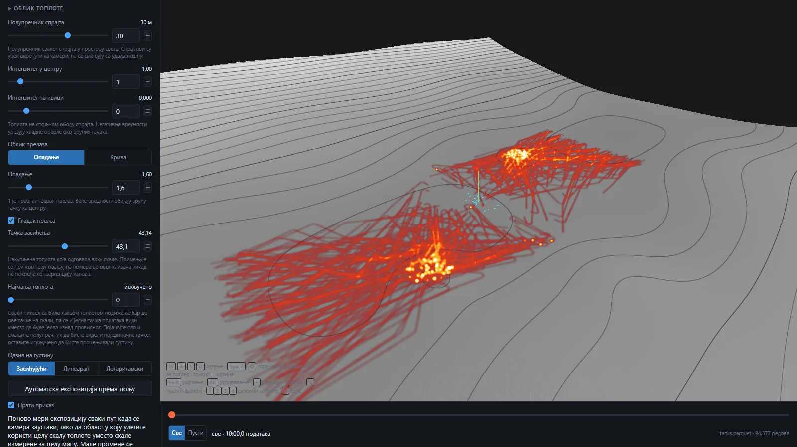
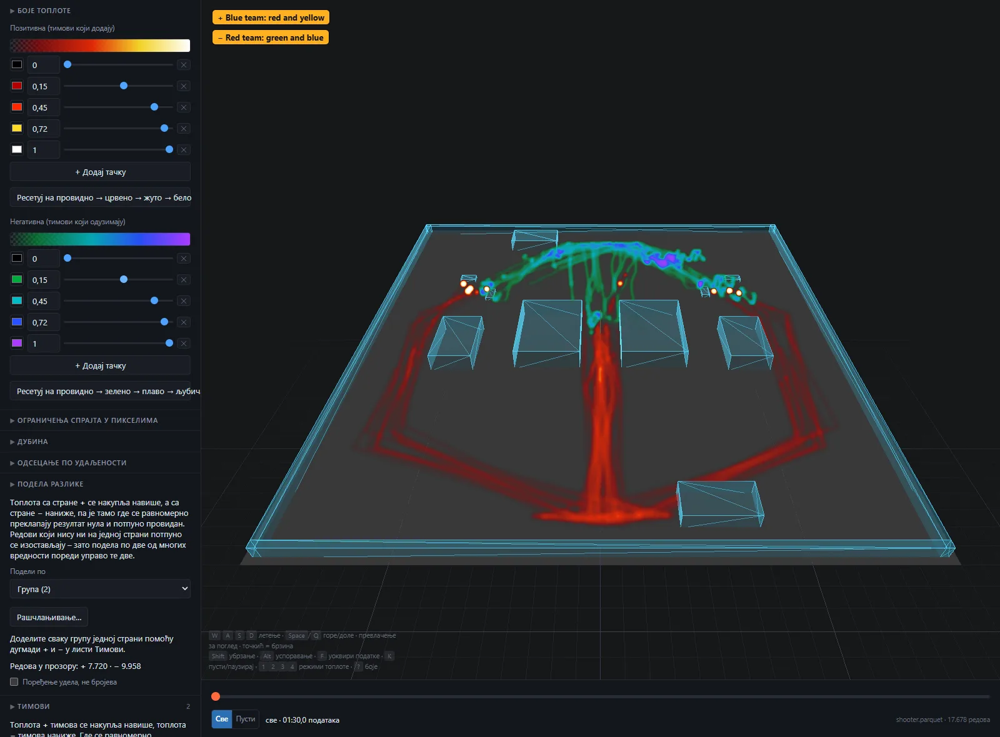
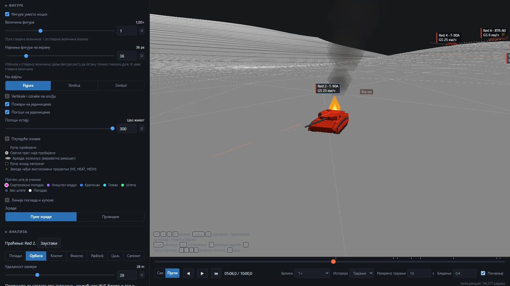
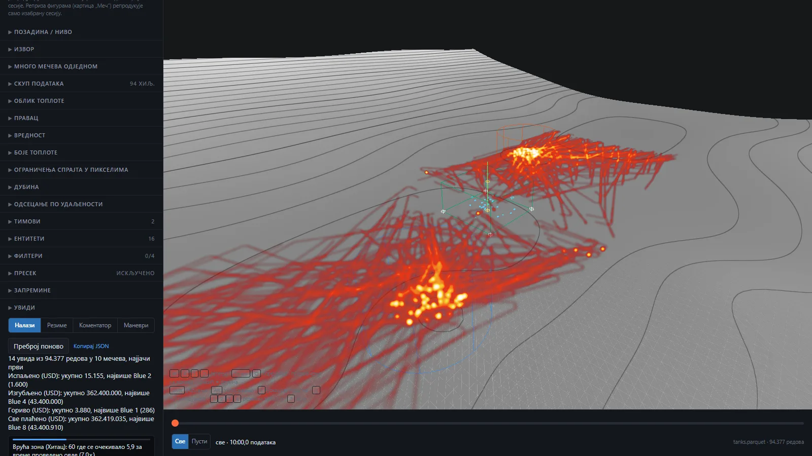
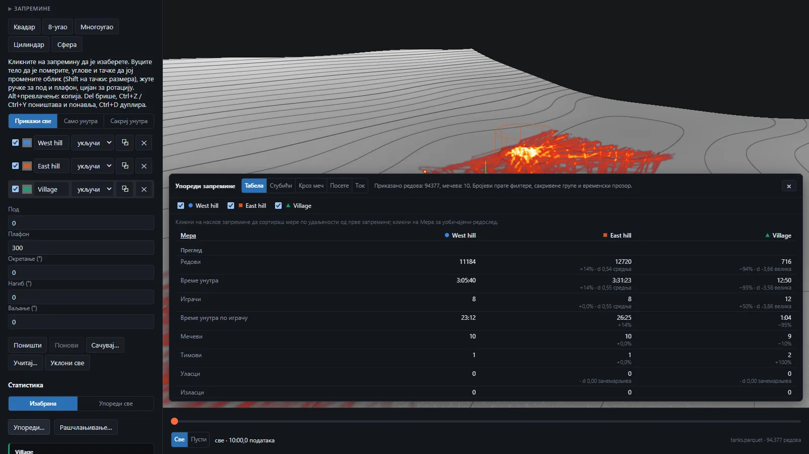
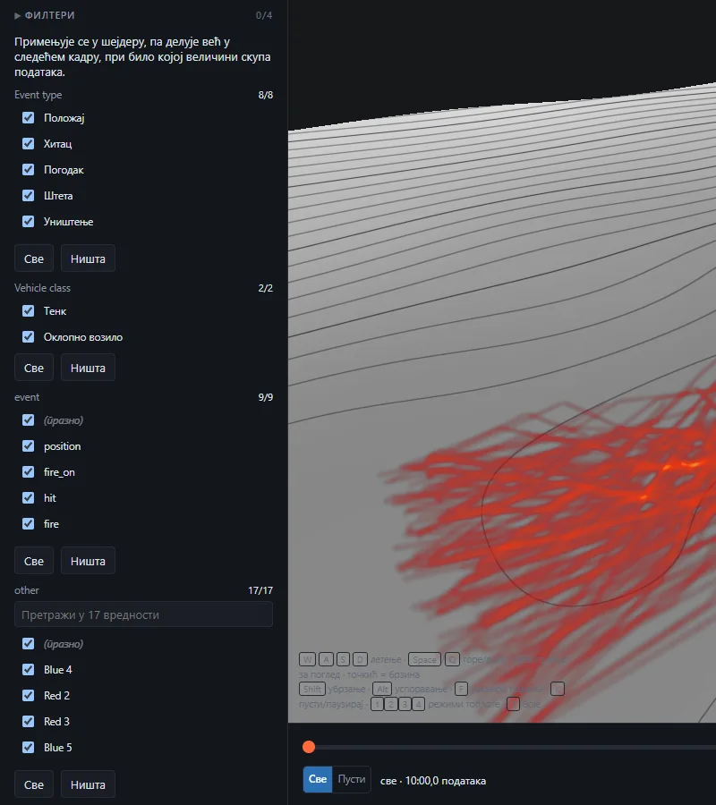
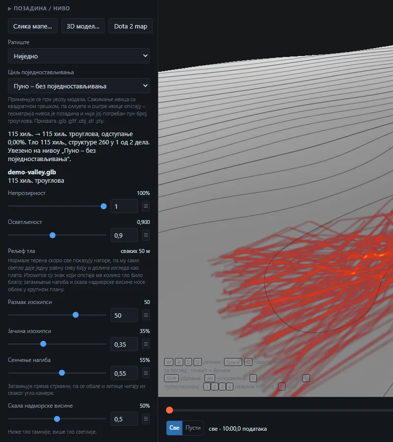

# 3DHeat

3DHeat приказује где су се ствари догодиле у игри - где су играчи ишли, борили се и падали - као светлуцаве боје кроз које можете да летите, или као мале 3D фигуре које понављају меч.

Учитајте позиције - CSV, Parquet, Tacview снимке, претворене репризе, једну датотеку, фасциклу или хиљаде мечева - и погледајте их као **топлотну мапу кроз коју можете да летите**, као **фигуре које понављају меч**, као линије дуж рута којима су људи ишли, или као једну популацију наспрам друге. Сам проналази оно што се истиче и ради у потпуности у вашем прегледачу: ништа се нигде не отпрема.



**Први пут овде?** Направите [демо податке](demo-data.md) и пратите њених седам корака. Свака слика на овом сајту снимљена је помоћу њих.

## Шта ради {#what-it-does}

| | |
|---|---|
|  | **[Режими топлоте](heat-modes.md)** - топлота, [разлика](difference.md) (црвено тамо где је једна страна била више, зелено-плаво тамо где је била друга), [топлота тимова](team-heat.md), [линијска топлота](line-heat.md); [усмерена топлота](directional-heat.md) са клиновима, пољима стрелица и поларним дијаграмима; топлота [одмерена вредношћу](value-weighting.md): колико коштају оружје, возила и гориво. |
|  | **[Реприза меча](match-replay.md)** - свака јединица као [фигура](figures.md) онога што јесте, НАТО или руски симболи на даљину, ракете и трагови, ознаке погодака, олупине, пожари, куполе, циљеви, камере у стилу Tacview-а и тактички приказ; [више мечева одједном](many-matches.md). |
|  | **[Увиди](insights.md)** - јаке позиције, смртоносно тло, замке код спаунова, уска грла и истакнути играчи, пронађени и рангирани са доказима; писани резиме, по избору уз помоћ ВИ по вашем избору; коментатор за један меч; [сочиво знања](knowledge.md). |
|  | **[Запремине](volumes.md)** - цртајте квадре, призме, цилиндре и сфере, филтрирајте на њих, бројите шта се дешава унутра, извезите то и упоређујте места једно уз друго; [рашчлањивање](breakdown.md) ко и шта најбоље ради на неком месту. |
|  | **[Филтери](filters.md)** - по врсти догађаја, играчу или ВИ, класи возила, вредности, било којој колони, на графичкој картици при било којој величини података. |
|  | **[Нивои](levels.md)** - слике мапа, 3D нивои направљени [алатима за податке](#related-repositories), поједностављивање, [позадина света](world-backdrop.md) са стварним тереном за податке о лету. |

Такође: картица [Анализа трке](race-analysis.md) за кругове тркачких игара, картица [Меч](match-analysis.md) за резимеа Counter-Strike 2 мечева, [тактичка табла](tactics-board.md) за планове на нивоу, [анализа погодака](hit-analysis.md) по возилу, [масовна анализа](mass-analysis.md) хиљада мечева, [путање камере и видео](camera-path-and-video.md), [40 језика](languages.md), [метричке или империјалне јединице](settings.md).

## Картице {#the-tabs}

Картице се налазе при врху бочне траке, испод имена, јединица и менија за језик.

| Картица | Чему служи |
|---|---|
| **Топлотна мапа** | Било која табела позиција: режими топлоте, преклапање фигура, филтери, запремине, увиди, нивои, мерење и видео. |
| **Анализа трке** | Два или више кругова једне стазе: где се губи време, зашто и шта променити. |
| **Меч** | Реприза меча у фигурама и резимеа Counter-Strike 2 мечева. |
| **Тактика** | Планови на нивоу: фигуре, путање, бачено оружје, области и белешке у корацима који се пуштају. |
| **Возила** | Где је свака јединица погођена, ко ју је погодио и чиме. |

## Инсталација и покретање {#install-and-run}

### Windows, на лакши начин {#windows-the-easy-way}

Корен репозиторијума садржи три batch датотеке.

| Датотека | Шта ради |
|---|---|
| `start.bat` | Покреће приказивач. Проналази Node.js чак и када није у `PATH`-у (тражи у `%ProgramFiles%\nodejs`, `%ProgramFiles(x86)%\nodejs` и `%LOCALAPPDATA%\Programs\nodejs`), а када Node.js недостаје, нуди да инсталира LTS издање командом `winget install -e --id OpenJS.NodeJS.LTS`. При првом покретању пита пре преузимања зависности (око 300 MB у `node_modules\` унутар фасцикле, ништа на нивоу система). Одбија да се покрене када нешто већ слуша порт 5273 и упућује на `restart.bat`. Када је фасцикла git копија без локалних измена и постоји новија верзија, пита да ли да ажурира (Y/N; без одговора за 60 s задржава ову верзију; видети [Ажурирања](updates.md)). Затим покреће развојни сервер на `http://127.0.0.1:5273/` и отвара прегледач. **Прозор је сервер**: оставите га отвореним; затворите га или притисните Ctrl+C да бисте зауставили. |
| `restart.bat` | Покреће `stop.bat quiet`, па `start.bat`. Потребан је само после измене `vite.config.ts`, додавања зависности или када се сервер заглави - измене изворног кода се учитавају одмах. |
| `stop.bat` | Зауставља оно што слуша порт 5273, по идентификатору процеса пронађеном преко `netstat`-а, никада по имену слике, па остали Node.js процеси на рачунару остају нетакнути. Чека око две секунде да се утичница ослободи. Уз аргумент `quiet` не чека на крају. |

### Ручно (било који ОС) {#by-hand-any-os}

```bash
git clone --recursive https://github.com/Holdi601/3DHeat.git
cd 3DHeat
npm install
npm run dev      # http://127.0.0.1:5273
```

Фасцикла `exporters/` садржи засебне алате за податке као git подмодуле, сваки свој репозиторијум; после обичног клонирања покрените `git submodule update --init`. Сам приказивач их не треба да би радио. Фасцикла `exporters/ext/` садржи опционе конверторе (War Thunder, World of Tanks, World of Warships, Squad репризе; DCS и IL-2 мапе), држане одвојено да проблем са једним од њих не утиче ни на један други.

Ни један податак из игара не долази уз ово: нивои, мапе и снимци се праве на вашем рачунару алатима, из игара које поседујете.

### npm скрипте {#npm-scripts}

| Скрипта | Шта покреће |
|---|---|
| `npm run dev` | Vite развојни сервер на порту 5273, везан за `127.0.0.1`. |
| `npm run build` | Провера типова (`tsc --noEmit`) и продукцијски пакет у `dist/`. |
| `npm run preview` | Служи продукцијски пакет. |
| `npm run typecheck` | Сама провера типова. |
| `npm test` / `npm run test:watch` | Јединични и интеграциони тестови (vitest). |
| `npm run smoke` | Покреће праву апликацију у headless Chromium-у и проверава да платно има обојене пикселе; снимци екрана иду у `tools/.smoke/`. Очекује да ради развојни сервер. |
| `npm run smoke:f16` | Исти скуп са `?heat=f16`, што приморава пут half-float акумулације (видети [Акумулација у half-float формату](half-float-accumulation.md)). |
| `npm run bench` | Мерење брзине уноса, пише `tools/.smoke/ingest-bench.json`. |
| `npm run test:heavy` | Тестови којима требају велике праве датотеке са подацима; сами се прескачу када датотеке нема. |
| `npm run inspect -- <file.parquet>` | Исписује шему Parquet датотеке и неколико редова (`tools/inspect-parquet.mjs`). |

### Шта додаје развојни сервер {#what-the-dev-server-adds}

Приказивач је статичка веб страница, али развојни сервер (видети `vite.config.ts`) додаје две локалне руте које статичко објављивање `dist/` нема:

- `/__host/memory` јавља инсталирану и слободну RAM меморију рачунара и, где може да је прочита, меморију графичке картице (из `nvidia-smi`, или на Windows-у из регистра display адаптера). Зато [буџети меморије](memory-and-budgets.md) користе праве бројке уместо ограничених процена прегледача.
- `/__heat3d/update` проверава да ли је копија иза и може да је унапред ажурира ([Ажурирања](updates.md)).

Сервер је везан само за `127.0.0.1`, па ниједна од ових рута није доступна са мреже. Отворите га као `http://127.0.0.1:5273`: `localhost` може да се разреши на IPv6 loopback `::1`, где ништа не слуша. Не шаље COOP/COEP заглавља изолације; ништа у приказивачу не користи `SharedArrayBuffer`, а радници предају податке преносом, што не тражи ништа више.

## Захтеви за прегледач и GPU {#browser-and-gpu-requirements}

- **Прегледач са WebGPU или WebGL2.** WebGPU се проба први (Chrome и Edge га имају); без њега користи се WebGL2 бекенд. WebGL2 мора да нуди `EXT_color_buffer_float` (цртање у float текстуре), иначе приказивач показује „Cannot initialise the renderer.” Видети [Два бекенда](backends.md). Приказивач се развија и тестира у Chromium-у; остали прегледачи нису проверени.
- **Укључено хардверско убрзање.** Када прегледач црта на CPU-у (SwiftShader, llvmpipe, Microsoft Basic Render Driver и слични), црвени банер при врху бочне траке то каже и објашњава како да се поправи. Видети [Откривање софтверског рендеровања](software-rendering.md).
- **Наменски GPU помаже, али није обавезан.** Оба бекенда траже адаптер високих перформанси. Количина података која може да стане на GPU јесте буџет који можете да видите и промените ([Меморија и буџети](memory-and-budgets.md)).
- **Опционе функције** користе додатне API-је прегледача: приказ видеа тражи WebCodecs `VideoEncoder` са VP9 или VP8 ([Путања камере и видео](camera-path-and-video.md)); поједностављивање мреже нивоа тражи WebAssembly; убацивање фасцикли користи File and Directory Entries API; библиотека нивоа користи IndexedDB; геймпадови користе Gamepad API.

## Мапа документације {#documentation-map}

**Почетак**: [Демо подаци](demo-data.md) · [Унос података](getting-data-in.md) ([учитавање датотека](loading-files.md), [мапирање колона](column-mapping.md), [осе, јединице и време](axes-units-and-time.md), [сесије, особе и групе](sessions-persons-groups.md), [Tacview](tacview-acmi.md), [конвертори](converters.md), [.3dheat](container.md), [меморија и буџети](memory-and-budgets.md))

**Погледајте**: [Режими топлоте](heat-modes.md) ([топлота](heat.md), [облик спрајта](sprite-shape.md), [боја и експозиција](colour-and-exposure.md), [дубина и одсецање](depth-and-culling.md), [разлика](difference.md), [топлота тимова](team-heat.md), [линијска топлота](line-heat.md), [реприза квадром](box-replay.md), [усмерена топлота](directional-heat.md), [тежинање вредности](value-weighting.md)) · [Временска линија](timeline.md) · [Нивои](levels.md) ([слике мапа](map-images.md), [3D нивои](model-levels.md), [изглед](level-appearance.md), [библиотека](level-library.md), [позадина света](world-backdrop.md), [њени извори](world-backdrop-sources.md)) · [Камера](camera.md) ([геймпад](gamepad.md), [тастери](keyboard-reference.md)) · [Путања камере и видео](camera-path-and-video.md)

**Анализирајте**: [Филтери и алатке](filters-and-tools.md) ([филтери](filters.md), [списак тимова](teams-list.md), [ентитети](entities.md), [пресек](slice.md), [мерење](measure.md), [запремине](volumes.md), [рашчлањивање](breakdown.md)) · [Увиди](insights.md) ([сочиво знања](knowledge.md)) · [Масовна анализа](mass-analysis.md)

**Реприза**: [Реприза меча](match-replay.md) · [Више мечева одједном](many-matches.md) · [Фигуре](figures.md) ([у преклапању фигура](figure-replay.md), [заслуге](figure-credits.md)) · [Паритет са Tacview-ом](tacview-parity.md) · [Анализа погодака](hit-analysis.md)

**Остале картице**: [Анализа трке](race-analysis.md) ([метода](race-analytics.md), [остале игре](other-games.md)) · [Анализа меча](match-analysis.md) · [Тактичка табла](tactics-board.md) ([брзине](tactics-speeds.md))

**Приказивач**: [Речник појмова](glossary.md) · [Подешавања, јединице и тастери](settings.md) · [Језици](languages.md) · [Ажурирања](updates.md) · [Унутрашњост рендеровања](rendering-internals.md) ([бекенди](backends.md), [акумулација](accumulation.md), [узорковање и буџети](sampling-and-budgets.md), [half-float](half-float-accumulation.md), [меморија GPU-а](gpu-memory.md), [софтверско рендеровање](software-rendering.md), [панел перформанси и статистика](performance-and-stats.md)) · [Формати података](data-formats.md) · [Референца](reference.md) · [Одржавање документације](maintaining.md)

## Повезани репозиторијуми {#related-repositories}

Приказивач чита податке; ови алати их праве. Сваки је сопствени јавни репозиторијум (MIT) са сопственом документацијом. Ни један не испоручује податке из игара: нивои, мапе и снимци се праве на вашем рачунару, из игара које поседујете.

| Репозиторијум | Шта ради | Корисно за |
|---|---|---|
| [3DHeat-GameFiles](https://github.com/Holdi601/3DHeat-GameFiles) | Чита стазе и нивое из архива које игре испоручују (Forza Horizon, BeamNG, Assetto Corsa Rally; читачи за Unreal, Unity, Frostbite и Source 2) у glTF | 3D ниво испод ваше топлоте или репризе |
| [3DHeat-GameCapture](https://github.com/Holdi601/3DHeat-GameCapture) | Снима телеметрију кругова из интерфејса које тркачке игре објављују, и обнавља нивое из видеа игре | кругови за Анализу трке; ниво тамо где се датотеке не могу читати |
| [3DHeat-UnrealExporter](https://github.com/Holdi601/3DHeat-UnrealExporter) | Додатак за Unreal Editor који извози ниво као једну glTF датотеку | нивои ваших Unreal пројеката |
| [3DHeat-CS2](https://github.com/Holdi601/3DHeat-CS2) | Counter-Strike 2 демои у табеле топлоте и резимеа мечева, CS2 мапе у геометрију | CS2 топлота, репризе и картица Меч |
| [3DHeat-Watcher](https://github.com/Holdi601/3DHeat-Watcher) | Бележи вашу игру у позадини из онога што игре објављују: телеметрија, game-state интеграције, дневници, репризе | ваша сопствена статистика без ручног рада |
| [3DHeat-Ext-WarThunder](https://github.com/Holdi601/3DHeat-Ext-WarThunder) | War Thunder репризе (`.wrpl`) у табеле: ваздушне и копнене путање, пуцњи, погоци, убиства, куполе, циљеви | War Thunder репризе, ознаке погодака и увиди |
| [3DHeat-Ext-WoT](https://github.com/Holdi601/3DHeat-Ext-WoT) | World of Tanks репризе у табеле: положај сваког возила, смрти и убиства | World of Tanks топлота и репризе |
| [3DHeat-Ext-WoWs](https://github.com/Holdi601/3DHeat-Ext-WoWs) | World of Warships репризе у табеле: положај сваког брода и потапања | World of Warships топлота и репризе |
| [3DHeat-Ext-Squad](https://github.com/Holdi601/3DHeat-Ext-Squad) | Squad серверски демои у табеле: положај, тим и одељење сваког играча | Squad топлота и репризе |
| [3DHeat-Ext-DCS](https://github.com/Holdi601/3DHeat-Ext-DCS) | DCS World терени из ваше сопствене инсталације у нивое: тло, путеви, градови, аеродроми, поља, вода | DCS и Tacview снимци на њиховом правом терену |
| [3DHeat-Ext-IL2](https://github.com/Holdi601/3DHeat-Ext-IL2) | IL-2 Great Battles мапе у нивое | IL-2 снимци на њиховој мапи |

## Укратко о изворном коду {#source-layout-briefly}

| Фасцикла | Садржај |
|---|---|
| [`src/data/`](https://github.com/Holdi601/3DHeat/tree/main/src/data) | Избор датотека, унос CSV и Parquet, аутоматско мапирање, провера, модел меморије, градитељ скупа података, парсирање модела, класификација, поједностављивање, библиотека нивоа |
| [`src/render/`](https://github.com/Holdi601/3DHeat/tree/main/src/render) | Петља кадрова (`engine.ts`), узорковање, оба бекенда, камера, геймпад, мерење, путања камере, снимање видеа |
| [`src/state/`](https://github.com/Holdi601/3DHeat/tree/main/src/state) | Стање апликације (`store.ts`) са свим подразумеваним вредностима, типови домена (`types.ts`), крива спрајта |
| [`src/ui/`](https://github.com/Holdi601/3DHeat/tree/main/src/ui) | Панели бочне траке, временска линија, преклапања |
| [`src/race/`](https://github.com/Holdi601/3DHeat/tree/main/src/race), [`src/match/`](https://github.com/Holdi601/3DHeat/tree/main/src/match) | Картице Анализа трке и Меч |
| [`src/i18n/`](https://github.com/Holdi601/3DHeat/tree/main/src/i18n) | Преводи |
| [`src/insights/`](https://github.com/Holdi601/3DHeat/tree/main/src/insights) | Увиди: детектори, резиме, коментатор, ВИ провајдери, сочиво знања |
| [`src/mass/`](https://github.com/Holdi601/3DHeat/tree/main/src/mass) | Масовна анализа преко много мечева |
| [`src/volumes/`](https://github.com/Holdi601/3DHeat/tree/main/src/volumes) | Запремине, њихова статистика, извоз и поређење |
| [`src/breakdown/`](https://github.com/Holdi601/3DHeat/tree/main/src/breakdown) | Рашчлањивање и фактори |
| [`src/overlay/`](https://github.com/Holdi601/3DHeat/tree/main/src/overlay) | Преклапање за много мечева |
| [`src/figures/`](https://github.com/Holdi601/3DHeat/tree/main/src/figures) | Каталог фигура и његов градитељ |
| [`src/vehicle/`](https://github.com/Holdi601/3DHeat/tree/main/src/vehicle) | Анализа погодака (картица Возила) |
| [`src/tactics/`](https://github.com/Holdi601/3DHeat/tree/main/src/tactics) | Тактичка табла |
| [`src/world/`](https://github.com/Holdi601/3DHeat/tree/main/src/world) | Позадина света |
| [`src/units/`](https://github.com/Holdi601/3DHeat/tree/main/src/units) | Мерне јединице |
