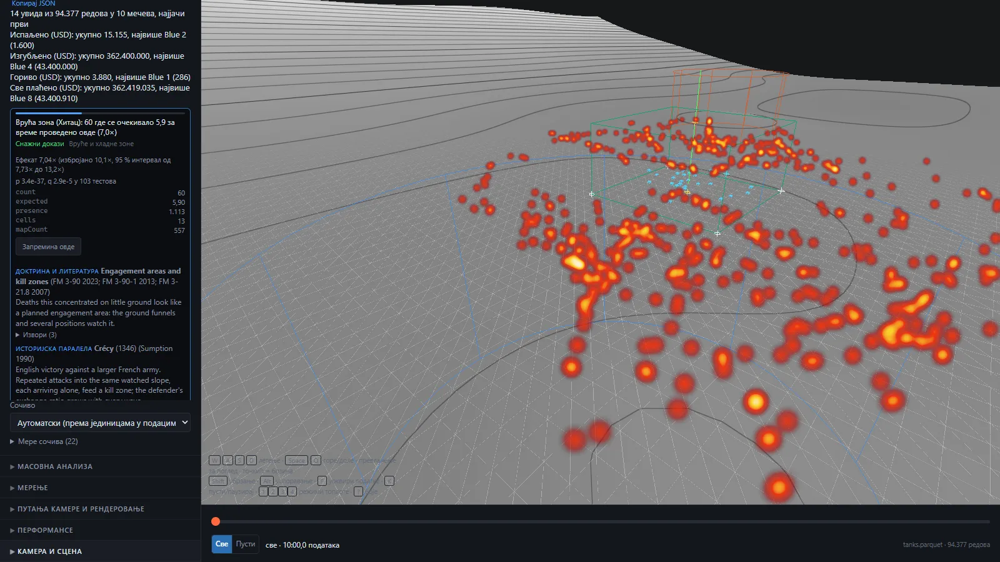

# Сочиво знања

Кад [Увиди](insights.md) нешто нађе, овај део то објашњава идејама из војне историје, дизајна игара и
анализе спорта, и наводи књигу или рад из којег потичу. Користите га да научите *зашто* образац значи
нешто, а не само да постоји.

## Пробајте {#try-it}

1. Учитајте податке и отворите **Увиде**, па притисните **Пронађи увиде**.
2. Кликните налаз да га отворите.
3. Прочитајте **Доктрина и литература** и **Историјска паралела**; пуне референце су склопљене испод.
4. Промените **Сочиво** (на пример на *Војна доктрина*) да прочитате исти налаз кроз другу књижевност.

## Како ради {#how-it-works}

Панел Увиди оцењује своје налазе онако како би то радио стручни аналитичар: кроз војну доктрину и
истраживање операција, историјске окршаје, и литературу о дизајну игара, дизајну нивоа и аналитици.
Ради ван мреже, из куриране базе знања у приказу, и исти материјал даје спољњем моделу кад он написе
резиме.

## Шта панел приказује {#what-the-panel-shows}

- **Сочиво** бира књижевност кроз коју се налази читају: *Аутоматски* (бира се по врстама јединица у
  подацима: ваздухоплови, бродови, копнена возила, пешадија), *Војна доктрина*, *Ваздушна борба*,
  *Поморски*, *Урбана борба*, *Дизајн игре и баланс*, *Е-спорт*. Уноси ван изабраног сочива се изостављају.
- Сваки отворени налаз приказује свој најближи унос **доктрине и литературе** и своју најближу **историјску
  паралелу**, с пуним референцама склопљеним испод.
- **Мере сочива** наводе мере анализе операција израчунате над истим редовима (испод), сваку с њеним значењем
  и литературом.
- **Резиме** додаје редове за водеће налазе и мере сочива: „Доктрина и литература: ..." и „Историјска паралела:
  ...", сваки с ауторско-годишњим цитатима и референцама склопљеним испод.
- **Напиши уз ВИ** шаље најрелевантније уносе (сажетак, поуку, налазе уз које се везују, пуне референце) уз
  извештај, и тражи од модела да их цитира по иду - `{concept.lanchester-square}` - и да не користи друге
  изворе.

Ознаке су преведене; знање само је на енглеском.

## Мере сочива {#lens-metrics}

Израчунава се у раднику за увиде, у истом проласку кроз редове као детектори (`src/insights/lensMetrics.ts`).
Свака се изоставља кад је подаци не могу носити.

| Мера | Шта мери | Треба |
|---|---|---|
| Ланчестерово уклапање | Губици сваке стране по 20 s, регресовани на снаге живих на обе стране (Поасон, грешке квази-вероватноће); експоненти на снази непријатеља и своју, тестирани према квадратном закону (циљана ватра) и линеарном закону (ватра по површини) | време, тимови, убиства и смрти |
| Однос размене | Убиства по смрти по страни и месту; удео смрти на најсмртоноснијем терену који држи 5% времена проведеног, према уделу који сама срећа даје за толико смрти; Џинијев коефицијент смрти кроз време; Моранов I стопа смрти | убиства и смрти |
| Локални однос снага | Пријатељске и непријатељске јединице живе у домету ангажовања сваког убиства (домет постављен из података: два пута медијана растојања до најближег непријатеља); удео убистава стране локално надмоћне, и њен вишак изнад онога што саме бројке предвиђају | време, тимови, особе |
| Поља ватре | Видна поља најзаузетијих места убистава на површини 2,5D препрека (геометрија нивоа до висине зида, или тло по којем се ходало) према просечном месту, и ранг-корелација видљивости и удела убистава | положаји; учитан ниво га оштри; није за ваздух |
| Енергетско стање | Специфична енергија (висина плус висина коју брзина може да купи) ваздушних убица и ваздушних жртава, поређена Ман-Витниевом статистиком | класе ваздухоплова, време, висина |
| Кључни терен | Колико често је свако место међу три најзаузетија места убистава меча | више мечева |
| Узајамна подршка (размене) | Смрти на које је одговорено убиство саиграча у домету ангажовања и за 5 s | време, тимови |
| Први удар | Ангажмани - убиства груписана по мечу, по 20 s тишине и по три домета ангажовања - које добија страна која је први постигла погодак | време, тимови |
| Модел салве | Хјузова једначина салве уклопљена у периоде од 20 s бродова у додиру: бродови ван строја по нападачком броду, и спасени по браниоцу; Ланчестерово уклапање само над бродовима | класе бродова, време, тимови |
| Борбена ефикасност | Убиства по јединичном часу у акцији сваке стране и однос двеју највећих (вредност борбене ефикасности у Диповом смислу) с интервалом од 95%, и удео сваке стране у убиствима при једнаким локалним бројевима | време, тимови |
| Домети ангажовања | Растојање до најближег непријатеља при убиствима, при лансирањима и при првом хицу сваког живота (откривање до ангажовања), по врсти јединице | време, тимови; лансирања где их подаци имају |
| Ланац убистава | Секунде од последњег лансирања убице до убиства, и од његовог првог хица у борби до убиства | време; лансирања или догађаји пуцања |
| Концентрација или растурање | У сваком периоду од 20 s, распон две највеће стране и удео убистава који узима тежња ужа од њих | време, тимови |
| Излети | По страни: излети (полетања, или појаве ваздухоплова), слетања, изгубљени ваздухоплови и убиства ваздухопловима; стопа губитка и убиства по излету | класе ваздухоплова; полетања или појаве |

Подаци с рундама додају мере борбе из близине и е-спорта - вероватноћа добитка рунде, вредност акција,
отварајући двобоји, размене, гурач против држача, циљање, унакрсна ватра, помагала, предност човека, клачеви,
постављања, после постављања, фаталне лијевке и утицај играча: видите [Борба из близине и рунде](close-quarters.md).

Стазе и тимови додају мере колективног понашања из науке о гомилама, колективног кретања, понашања у
економији и војне психологије - поравнање и кружење, усмеравање руте, траке и трагови, гужва, вође и пратиоци,
заостали, тачка прелома, ризик после губитака, низови, договор о куповини и сузбијање, сваки уз свој нулти
модел: видите [Колективно понашање](collective-behaviour.md).

Оружје, мамци и зграде се не броје као јединице. Кад редови оружја именују своју јединицу лансирања (колона
`Shooter` или `Launcher`, као у подацима изведеним из Tacview-а), лансирање се приписује тој јединици, усклађено
по њеном имену или ид-у објекта.

## Како налази срећу литературу {#how-findings-meet-the-literature}

Уноси и налази се срећу кроз **таксономију образаца** (`src/insights/knowledge/patterns.ts`): концентрација, локална
надмоћ, циљана и ватра по површини, уска грла, зоне убијања, поља ватре, обрнута падина, обухват, узајамна подршка,
енергетска предност, притисак на појављивање, баланс, и тако даље. Свака врста детектора и свака мера сочива
каже које обрасце њени бројеви показују (`src/insights/lens.ts`); сваки унос знања каже којим обрасцима се бави,
с тежином. Релевантност уноса за налаз је пондерисано преклапање, размерено колико домен уноса (копно, ваздух,
море, урбано) одговара подацима и самом јачином налаза. Приказани разлог је бројка налаза у једној реченици,
праћена поуком уноса.

## Каталог {#catalogue}

Сваки образац, појам, метод, историјски случај, принцип дизајна и студија, с библиографијом: видите
[Каталог знања](knowledge-catalogue.md).

## За програмере {#for-developers}

### Додавање уноса {#adding-entries}

1. Изаберите датотеку по врсти: `concepts.ts` и `concepts-more.ts`, `methods.ts`, `cases.ts`, `cases-land.ts`,
   `cases-air-sea.ts`, `cases-esports.ts`, `design.ts` (принципи дизајна) или `studies.ts` у `src/insights/knowledge/`.
2. Дајте му нови ид `<type>.<slug>` (никад не користите поново један), његова сочива, домене, и обрасце којима се
   бави с тежинама 0..1. Додајте образац у `patterns.ts` само кад налаз може да га покаже, и повежите га с налазом или
   мером у `lens.ts`.
3. Напишите сажетак и поуку **својим речима**. Цитати само из дела у јавном добру (`pd: true` у референци), и кратки.
4. Цитирајте: додајте свако ново дело у `refs.ts` с ауторима, годином, насловом и издавачем (часопис с volume и
   страницама); URL или DOI где постоји јавни запис.
5. Покрените `npx vitest run src/insights/lens.test.ts` (јединствени ид-ови, познати обрасци, референце које се
   разрешавају, цитати из јавног добра, случајеви с датумом и исходом) и `node tools/knowledge-doc.mjs` да освежите
   [каталог](knowledge-catalogue.md).
