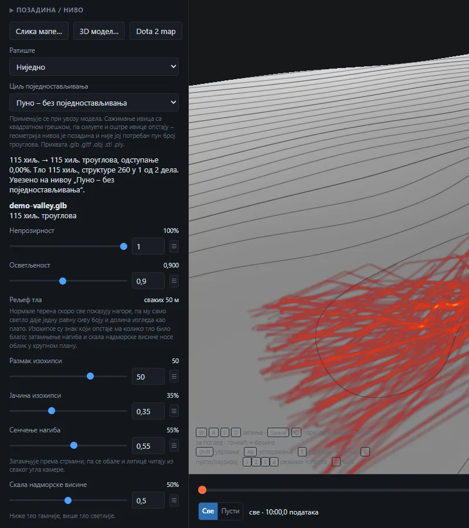

# Нивои и геометрија позадине

Ниво је 3D место где се игра одиграла - мапа, град, стаза. Ставите га иза својих података и видите *где* је топлота. Панел **Позадина / ниво** (видите [Речник](glossary.md) за „ниво”) даје три врсте контекста:

- **слику мапе**, georeferenciranu помоћу два сидра - видите [Слике мапа](map-images.md);
- **3D ниво** - `.glb`, `.gltf`, `.obj`, `.stl` или `.ply` - раздељен на тло, структуре и воду и поједностављен при увозу - видите [3D нивои](model-levels.md) и [Изглед нивоа](level-appearance.md).
- **позадину света** - за снимак који каже где је на земљи (датотека Tacview ACMI), стварни терен, путеве, воду, аеродроме и зграде, преузете из отворених података - видите [Позадина света](world-backdrop.md).

Кад ништа није учитано, сцена је тамна с решетком и обојеним осама (**Решетка** и **Осе** у [Камера и сцена](camera.md)), а панел каже *Ништа није учитано - сцена приказује решетку и осе. Додајте слику мапе или мрежу нивоа да топлота добије контекст.*

Ниво деле све три картице: курс учитан у картици Анализа трке је исти ниво који приказује топлотна мапа.

## Ставите ниво иза својих података {#put-a-level-behind-your-data}

1. Прво учитајте податке ([Унос података](getting-data-in.md)), да се ниво уклопи у њих.
2. Отворите **Позадина / ниво** у бочној траци.
3. Притисните **Слика мапе…** за слику или **3D модел…** за 3D ниво, и изаберите датотеку. За снимак стварног света, користите уместо тога **Позадина света** или **Ратиште**.
4. Сачекајте да ред напретка заврши. Велики модел се прво поједностављује (видите **Циљ поједностављивања** испод).
5. Притисните **F** у приказу да уклопите све. Користите **Непрозирност** и **Осветљеност** док топлота не истакне из нивоа.
6. Притисните **Сачувај у библиотеку** ако ћете ниво поново користити ([Библиотека нивоа](level-library.md)).

## Шта ниво чини за топлоту {#what-a-level-does-for-the-heat}

- **Заклања**: тачке података иза њега се утамњују по површини, а тачке иза терена су скривене ([Дубина и одсецање](depth-and-culling.md)). Без нивоа нема заклањања.
- [Пресек](slice.md) га **сече** и, уз *Сеци и ниво*, [одсецање по удаљености](depth-and-culling.md#distance-culling), заједно с топлотом.
- То је једино што [дубина поља](camera.md#depth-of-field) замућује, осим решетке и кутија.
- 3D ниво **проширује далеку раван камере** кад је већи од података: близу и далеко се калибришу из скупа података, а извезена мапа широка неколико километара иначе би потпуно лежала иза далеке равни и оставила празан приказ. Далека раван постаје 3 × хоризонтални обухват нивоа кад је то веће, близу се помера с њом (најмање далеко / 100.000) да би се одржала тачност дубине од које зависи заклањање, а брзина летења се подиже на најмање обухват / 12. Ово се само проширује, никад сужава.

## Панел, одозго надоле {#the-panel-top-to-bottom}

| Део | Детаљи |
|---|---|
| **Слика мапе…**, **3D модел…** | Учитава један; замењује текући ниво. |
| **Позадина света**, **Заборави плочице мапе** | Само за скуп података с географском референцом: прави стварно место испод као ниво, или брише преузете плочице. [Позадина света](world-backdrop.md) |
| **Циљ поједностављивања** | Буџет троуглова за следећи увоз модела: *Пуно - без поједностављивања* (подразумевано), *Високо - 8M*, *Средње - 3M*, *Ниско - 800k*, *Силуета - 100k*. [3D нивои](model-levels.md#simplification) |
| Напредак и **Откажи** | Док се декодира или увози. |
| Напомена о увозу | Троуглови пре и после, подела на тло / структуре / воду, употребљени ниво детаља. |
| Име и величина | `ширина×висина px · x × z m/px` за слику, `N троуглова (од M)` за модел. |
| **Непрозирност**, **Осветљеност** | Обе врсте. |
| Контроле слике | **Смањи засићење**, **Окрени север/југ**, **Постављање** (два сидра), **Уклопи у границе података**, **Висина**. [Слике мапа](map-images.md) |
| Контроле модела | Рељеф тла, вода, троуглови тла, жичани модел, текстура, снимљена боја, структуре, класификација делова. [Изглед нивоа](level-appearance.md) |
| **Сачувај у библиотеку**, **Уклони** | [Библиотека нивоа](level-library.md); Уклони искључује ниво. |
| **Библиотека** | Нивои сачувани у овом прегледачу. [Библиотека нивоа](level-library.md) |

## Странице у овом одељку {#pages-in-this-section}

- [Слике мапа](map-images.md)
- [3D нивои](model-levels.md) - формати, делови, класификација, поједностављивање, текстуре
- [Изглед нивоа](level-appearance.md) - свака контрола за 3D ниво
- [Библиотека нивоа](level-library.md)
- [Позадина света](world-backdrop.md) - стварни свет испод снимка, из отворених података

Како се нивои извлаче из игара и енджина је посао засебних алата за извоз (видите [README](https://github.com/Holdi601/3DHeat/blob/main/README.md) репозиторијума); уговор у који они пишу сажет је у [3D нивои](model-levels.md#the-exporter-contract).
