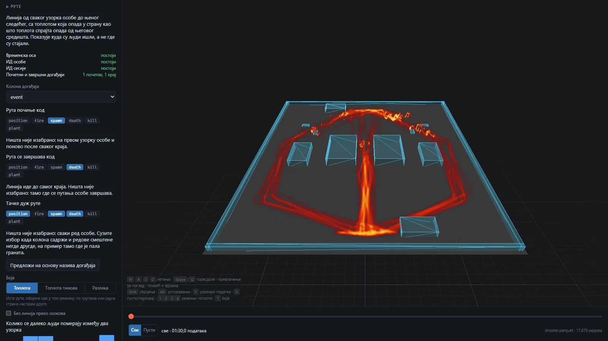

# Линијска топлота

Топлота показује где су људи стајали. Линије показују путање којима су ходали.

**Линије** (тастер 4) је линијска топлота: линија од сваког узорка [особе](glossary.md) до
њеног следећег, размазана истим опадањем које има [спрајт](glossary.md) - попреко линије, а не око
тачке. Показује где су људи *ишли*, а не где су стајали: ходник прегажен једном видљив је колико и
соба у којој су се логоровали, а ретки узорци брзог играча спајају се у непрекидну руту, а не у
испрекидану стазу. Потребне су колона особе и колона времена.

## Како се користи {#how-to-use-it}

1. Притисните `4` (или изаберите **Линије** у траци режима).
2. Отворите **Руте** и проверите зелени списак: мора постојати временска оса и ИД особе.
3. Притисните **Предложи на основу назива догађаја** да попуните где руте почињу и где се завршавају.
4. Прочитајте ред статистике: „N рута, M од њих стиже до краја".
5. Ако линије скачу преко мапе, подесите **Најдужи корак** (видите [Граница скока](#the-jump-limit)).

Линија има смисла само између почетка и краја, па панел **Руте** каже шта ограничава руту.
Све од [Правила руте](#the-rules-of-a-route) надаље је детаљ који можете прескочити.

## Панел Руте {#the-routes-panel}

Приказује се изнад панела топлоте у режиму Линије.

### Шта подаци имају {#what-the-data-has}

Списак за штиклирање, зелено кад је нешто присутно, жуто кад није:

| Ред | Стања |
|---|---|
| **Временска оса** | *присутна* / *недостаје - потребна* |
| **ИД особе** | *присутан* / *недостаје - потребан* |
| **ИД сесије** | *присутан* / *нема - сви редови су једна сесија* |
| **Почетни и завршни догађаји** | *N почетака, M завршетака* / *ниједан није изабран - целе стазе* (зелено само с колоном догађаја и бар једним почетком и једним завршетком) |

### Контроле {#controls}

| Контрола | Значење |
|---|---|
| **Колона догађаја** | Колона категорије чије вредности су догађаји (појава, смрт, положај, ...). *Нема - целе стазе*: свака стаза особе у свакој сесији је једна рута, прекинута кад стаза има празнину. Нуде се само колоне задржане за филтрирање при учитавању. |
| **Рута почиње код** | Вредности догађаја које започињу руту (појава, поновна појава, спуштање). Ништа није изабрано: рута почиње на првом узорку особе, и опет после сваког краја. |
| **Рута се завршава код** | Вредности догађаја које завршавају руту (смрт, извлачење, телепортовање). Линија иде до самог реда завршетка. Ништа није изабрано: рута се завршава где се стаза особе завршава. |
| **Тачке дуж руте** | Вредности догађаја чији редови леже дуж руте. Ништа није изабрано: сваки ред особе. Сузите га кад колона садржи и редове постављене на другом месту, као где је бачена граната. |
| **Предложи на основу назива догађаја** | Попуњава три списка по називима вредности (испод). |
| **Боја** | *Топлота*, *Топлота тимова* или *Разлика*. Исте руте у бојењу тог режима: свака група у својој нијанси, или једна страна према другој, са списком група, поделом и скалама које раде као у тим режимима. Подразумевано *Топлота*. Топлота тимова и разлика траже колону групе. |
| **Без линија преко скокова** / **Најдужи корак** | Следећи узорак особе удаљен више од овога је поновна појава, телепортовање или пад, а не место где је ишла, па се две тачке не спајају линијом. Попуњава се при учитавању кад подаци показују јасну празнину (испод), а искључено је кад је не показују. Ради са или без колоне догађаја. |
| Ред статистике | `N рута, M од њих стиже до краја, K делова`, освежава се неколико пута у секунди. |

Сваки списак је ред чипова за укључивање, по један за сваку вредност, најчешћа први; прелазак мишем
преко чипа показује број његових редова. Нуди се највише 120 вредности (*још N вредности није
приказано*).

Изабрана друга колона догађаја примењује предлог кад предлог изабере ту исту колону, а иначе почиње
с празним списковима.

### Предлог {#the-suggestion}

При сваком учитавању, и на **Предложи на основу назива догађаја** ([`suggestLineSettings`](https://github.com/Holdi601/3DHeat/blob/main/src/data/lines.ts)):

- **Колона догађаја:** прва задржана колона категорије која се зове `event`, `eventname` или
  `eventtype`; иначе `kind`, `type` или `action`; иначе било која која садржи *event*, *kind*,
  *action* или *type*.
- **Почеци:** вредности које садрже *spawn, deploy, join, enter, start, begin, respawn, revive,
  land/landed/landing, drop* - осим ако се поклапају и с речју за крај.
- **Крајеви:** вредности које садрже *death, died, dead, kill/killed, eliminat…, extract, evac,
  teleport, leave, left, disconnect, quit, exit, end, finish, downed* - осим вредности `kill` и
  `kills` (убиство је оно што убица ради, а не крај његове руте).
- **Тачке:** вредности које су тачно *position, location, player location, move, movement, tick,
  sample* или *pos*; кад се неке нађу, почеци и крајеви се додају и тачкама. Кад се ниједна не нађе,
  тачке остају празне (сваки ред).

### Граница скока {#the-jump-limit}

Кад људи скачу, дужине корака падају у две групе између којих скоро нема ничега: колико особа пређе
између два узорка, и ширина мапе. При учитавању ([`suggestMaxJump`](https://github.com/Holdi601/3DHeat/blob/main/src/data/lines.ts))
кораци се броје по удвајању њихове квадриране дужине, до 16 милиона њих, а граница иде у средину
првог опсега изнад медијане који је широк бар једно удвајање дужине, држи испод 0,02% корака по
појасу, и има корака изнад себе. Без таквог опсега ништа се не сече, јер не би било начина да се скок
разликује од брзог аутомобила; укључивање границе ручно тада почиње на десетини дијагонале података.

График изнад границе показује колико су кораци заиста дуги, с линијом на граници: стубићи десно од ње
се не цртају. Обе осе су логаритамске, јер скокови могу бити стотинка корака и хиљаду пута дужи. Прелаз
мишем преко стубића даје његов опсег и удео; клик на график ставља границу тамо. Испод њега је удео
корака изнад границе.

## Правила руте {#the-rules-of-a-route}

Редови се обилазе по редоследу времена, по особи ([`buildLines`](https://github.com/Holdi601/3DHeat/blob/main/src/data/lines.ts)):

1. Редови [дељеног имена](sessions-persons-groups.md#names-worn-by-several-things-at-once) се потпуно прескачу.
2. Кад су тачке изабране, ред који није ни почетак, ни крај, ни тачка се прескаче.
3. Редови се прате по особи и по сесији, па особа чије се сесије преплићу по времену има по једну руту
   у свакој. Рута се затвара кад претходни ред нема наследника (његово [трајање](sessions-persons-groups.md#person)
   је „нема") - рута никад не прелази границу сесије или празнину за коју је учитавање одлучило да нема
   следећи узорак. Којој рути ред припада одређује се једном и чува се, 4 бајта по реду, па промена
   најдужег корака не понавља тај део.
4. **Почетни** ред затвара сваку отворену руту и отвара нову тамо.
5. Кад су почеци изабрани, ред ван руте се занемарује. Без почетака, сваки неки ред који није крај, а
   ван руте, отвара једну.
6. Сваки други ред унутар руте додаје **део** од претходног реда руте до овог.
7. **Крајњи** ред који продужава руту затвара је после свог дела; та рута се броји као *стигла до краја*.
8. Корак дужи од **Најдужи корак** затвара руту где је била, а нова почиње на удаљеном крају, осим ако тај
   ред није крај. Преко њега се не црта линија, а ред статистике га броји.

Сваки део се чува на свом *крајњем* реду, па делови остају у временском редоследу, а [временска линија](timeline.md)
прозор, узорковач, [филтри](filters.md), видљивост група и знак разлике раде над њима као над тачкама.
Филтер се стога примењује на ред у којем део завршава.

## Репродукција {#playback}

У режиму **Све** свака рута се црта цела. У режиму **Пусти** свака особа је тачка која се креће између
својих узорака и за собом црта руту:

- део који почиње иза главе за репродукцију се не црта;
- део у којем је особа усред њега црта се до њеног интерполисаног положаја, с крајњом капом на глави;
- топлота бледи преко **репа**: с историјом *Збирно* реп је неограничен и цела досадашња рута остаје; са
  *Прозор* бледи до нуле преко *Распона* (подразумевано 30 s). Са *Трајање* је реп такође *Распон*, а у
  режиму Линије временска линија за ту историју приказује кутију *Распон* (уместо *Резервног трајања* и
  *Гашења*, које линијска топлота не користи).

Док се репродукује, сваки кадар се црта цео, а не сабира, јер се главе померају сваки кадар, а покретни
просек би сваку растегао у траг.

## За програмере {#for-developers}

### Меморија {#memory}

Руте се граде на главној нити кад се уђе у режим Линије (или кад се промене подешавања руте), а
ослобађају кад се изађе: 5 бајтова по реду у меморији и 8 бајтова по реду на GPU-у (почетна позиција
сваког дела, квантована на 16 бита по оси унутар оквира података, и његове заставице).

### Како се линија црта {#how-a-line-is-drawn}

Обе позадине цртају сваки део из свог крајњег реда као **18 темена** ([`lineHeatVs`](https://github.com/Holdi601/3DHeat/blob/main/src/render/webgl2/shaders.ts)
и његов WGSL близанац):

- Полуширина на сваком крају је [полупречник спрајта](sprite-shape.md#sprite-radius) на тој удаљености краја,
  с примењеним границама у пикселима. Линија ужа од 2,5 px црта се широка 2,5 px, а топлота јој се
  смањује у складу с тим, па танке линије ни не нестају ни не светлуцају.
- Топлота опада **попреко** линије истом скалом као спрајт - опадањем или кривом, интензитетом у средини
  и на ивици.
- Округле капе се цртају **само** тамо где рута почиње или се завршава, па се спојеви узастопних делова не
  збијају у низ бисера.
- Геометрија се прави у простору екрана и тамо се линеарно интерполира, па опадање остаје центрирано на
  линији, ма како она улазила у дубину. Део који прелази блиску раван се сече тамо, а не одбацује.

Тачке и линијска топлота уносе веома различите количине топлоте по реду, па се засићење поново мери кад
се пребацујете између њих ([Боја и експозиција](colour-and-exposure.md#auto-exposure)).
