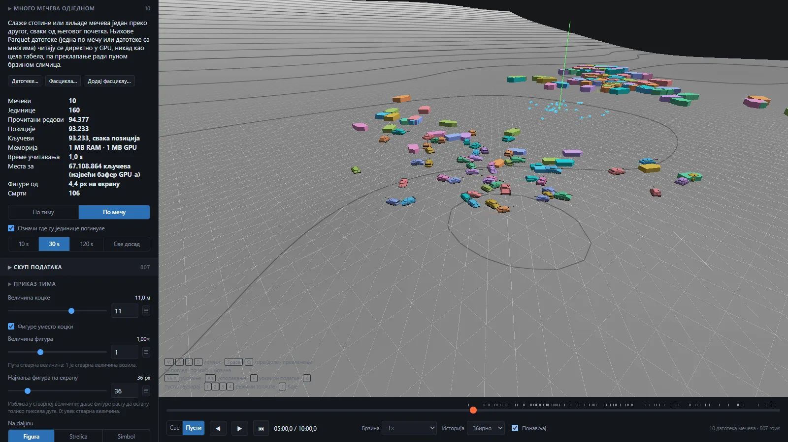

# Много мечева одједном

**Много мечева одједном** пушта много мечева један преко другог, па видите где играчи сваког меча обично иду. Користите га да упоредите стотине или хиљаде мечева на једној слици.

Сваки меч почиње од свог почетка, а његове јединице се крећу као фигуре. Датотеке иду право у графичку картицу и не прави се ниједна пуна табела, па се пушта глатко тамо где би обично учитавање остало без меморије.

## Како се користи {#how-to-use-it}

1. Отворите **Много мечева одједном** у бочној траци Топлотне мапе.
2. Притисните **Датотеке…** (изаберите много датотека), **Фасцикла…** (фасцикла и њене подфасцикле) или **Додај фасциклу…** (додаје у оно што је учитано).
3. Приказивач прелази на преклапање фигура и почиње од почетка. Притисните **Пусти**.

Свака датотека је један меч (или их садржи више). Parquet датотеке и [`.3dheat`](container.md) контејнери раде. Датотека мора имати колону положаја, времена и јединице; колоне имена, типа и стране се задржавају. Остале датотеке и помоћне датотеке конвертора (лет, поруке, догађаји, ћаскање, циљеви) се прескачу. За обичну табелу видите [Унос података](getting-data-in.md).

## Подешавања {#settings}

| Подешавање | Шта ради |
|---|---|
| **По тиму** / **По мечу** | Боја по страни, или боја по мечу. |
| **Означи где су јединице погинуле** | Ознака где је свака јединица погинула, на 10 s, 30 s, 120 s, или све до сада. |

Панел показује колико је мечева, јединица, редова и положаја прочитано, коришћену меморију и време учитавања. *Простора за* је колико још положаја графичка картица може да прими. *Фигуре од* је величина на екрану испод које се јединица црта као мала стрелица уместо своје фигуре.

Изглед фигура користи исте контроле као [реприза меча](match-replay.md#figures): **Величина фигура**, **Најмања фигура на екрану** и **На даљину**.

## Савети {#tips}

- Кад би све стало у меморију, положаји се проређују (задржава се само положај на сваких неколико метара) и панел то каже.
- Режими топлоте раде и над подацима преклапања.
- За статистику над хиљадама мечева без њиховог цртања видите [Масовну анализу](mass-analysis.md).
