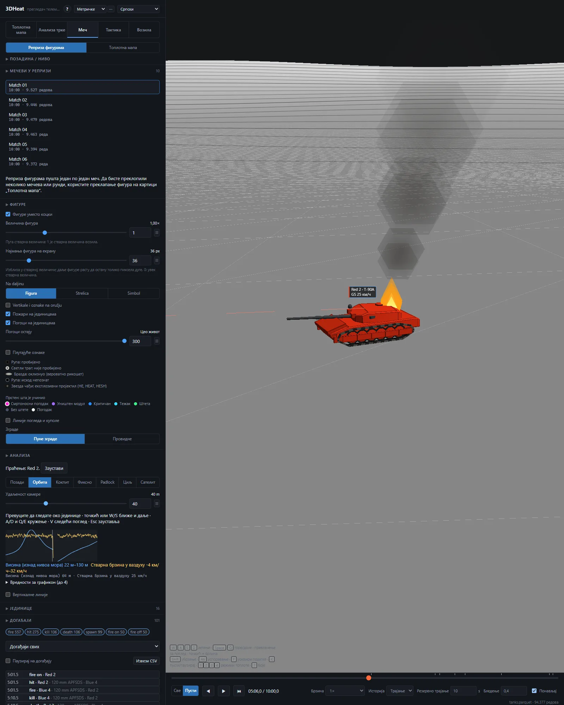
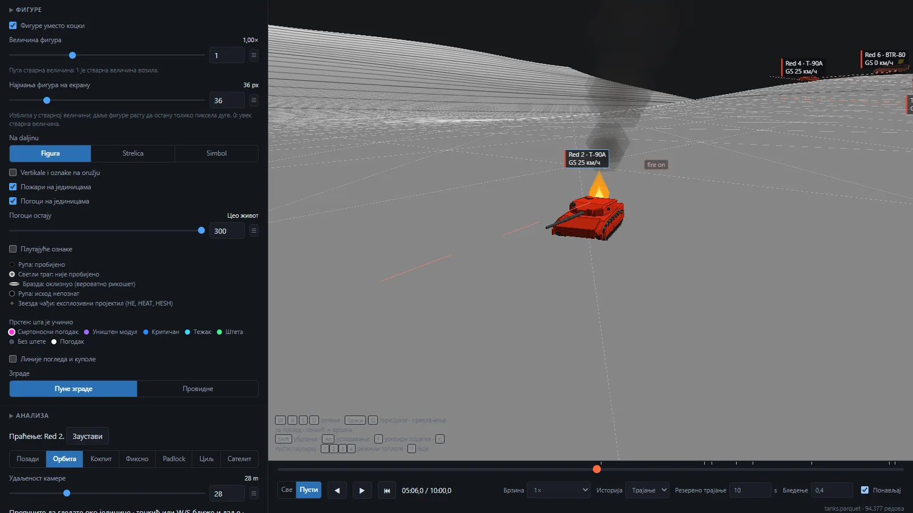
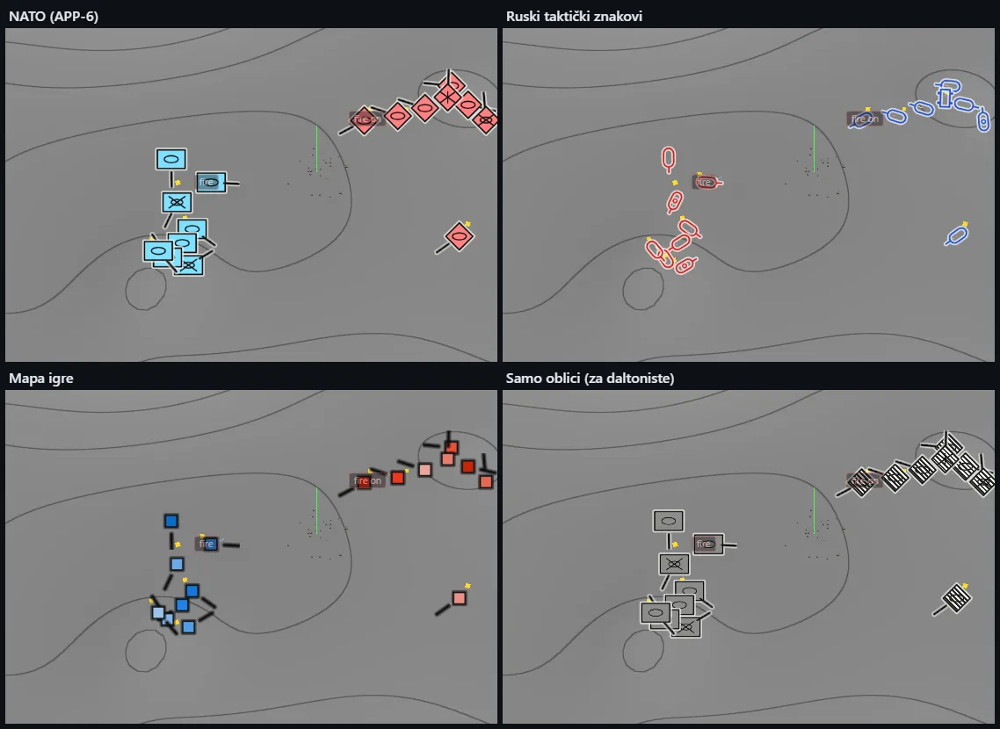
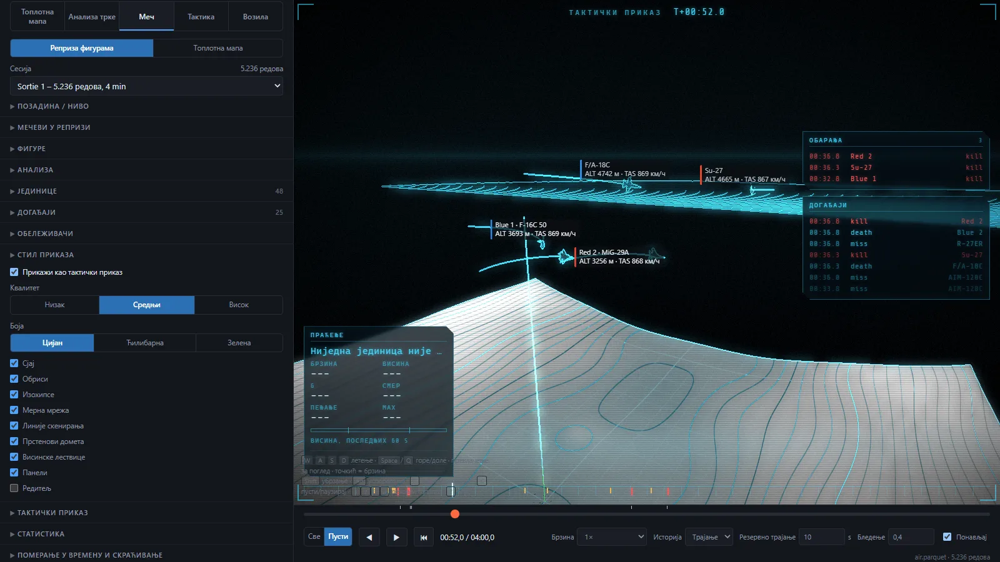

# Реприза меча

Реприза је филм меча у којем је сваки играч приказан као оно што је возио. Користите је да поново погледате борбу, пратите једну јединицу и видите ко је кога погодио.

Пуцњи, погоци, пожари и олупине цртају се на јединицама и циљевима на нивоу. Камере, ознаке и тактички приказ помажу да се борба чита. Знате ли за Tacview? [Паритет са Tacview-ом](tacview-parity.md) показује где је свака његова алатка.

## Покрените репризу {#start-a-replay}

1. Учитајте снимак помоћу **Извор → Датотеке…** или превлачењем на панел Извор (било која табела са колоном **особе** и **времена**, Tacview датотека, претворена реприза, [`.3dheat`](container.md) меч). Видети [Унос података](getting-data-in.md).
2. Отворите картицу **Меч** и изаберите **Реприза фигурама**, или изаберите **Преклапање фигура** у траци режима картице Топлотна мапа.
3. Под **Мечеви у репризи** изаберите један меч, сви одједном, или више њих.
4. Притисните **Пусти** на временској линији (или `K`). Превуците временску линију да скочите.

Фигуре замењују квадре за сваку јединицу чији су назив или тип познати (видети [Фигуре](figures.md)). Подаци без колоне назива или типа приказују се као војници.

## Фигуре {#figures}

| Подешавање (одељак **Фигуре**) | Подразумевано | Шта ради |
|---|---|---|
| **Фигуре уместо коцки** | укључено | Искључено црта обичне квадре. |
| **Величина фигура** (пута права величина) | 1 | 1 је права величина; од 0.25 до 20 пута (логаритамска скала). Веће помаже издалека. |
| **Најмања фигура на екрану** | 36 px | Удаљене фигуре расту да остану ове величине, од 0 до 200 px; 0 задржава праву величину. |
| **Na daljinu**: Figura, Strelica, Simbol | Figura | У шта се удаљена јединица претвара. |
| **Simboli** | NATO (APP-6) | NATO (APP-6), руски тактички знакови, иконе **Mapa igre**, или **Samo oblici (za daltoniste)**. |
| **Veličina simbola**, **Moja strana**, **Neprijateljski / Neutralni**, **Oznake kursa** | 28 px (од 12 до 64), аутоматски, непријатељски, укључено | Како симболи изгледају и која страна је пријатељска. |
| **Вертикалне линије** | укључено | Линија од сваке јединице право до тла, па се висине читају у 3D. |
| **Vertikale i oznake na oružju** | искључено | Линије до тла и ознаке на ракетама и бомбама. |
| **Пожари на јединицама** | укључено | Пламен од тренутка када јединица запали до гашења. |
| **Погоци на јединицама** | укључено | Ознаке где су пуцњи погодили (испод). **Погоци остају**: од 1 до 300 секунди, или **Цео живот**. **Плутајуће ознаке**: ознаке нацртане изнад површине. |
| **Линије погледа и куполе** | искључено | Испрекидано: где играч гледа; пуно: где топ показује. |
| **Зграде** | пуно | Пуне или провидне зграде, када их ниво тако приказује. |

### Симболи на даљину {#symbols-at-a-distance}

Када би јединица била мања од **Најмања фигура на екрану**, може да постане симбол који остаје читљив. Облик говори врсту (на пример заобљен квадар са трагом гусеница за оклоп); боја говори страну. Отворите мени **Simboli** да промените стил.

### Ознаке погодака, олупине и пожари {#hit-marks-wrecks-and-fires}

- **Ознаке погодака** стоје на површини коју је пуцањ дотакао, у размери фигуре. Њихов изглед говори шта се десило: рупа (прошао је), светла прскотина (није прошао), бразда (одбио се), звездица од чађи (експлозивни пројектил). Обојени прстен каже шта је урадио: фатални погодак, модул уништен, критичан, тежак, оштећење, без оштећења, погодак. Задржите показивач на ознаци да видите назив рунде.
- Уништена јединица се црта **угљенисана** као олупина од своје смрти док се не поново појави или уклони; њен симбол је прецртан.
- **Пожари** горе на јединици од тренутка када се запали до гашења.
- **Куполе** се окрећу ка месту где подаци кажу да топ циља (или, без тога, где играч гледа).

### Оружје, мамци и трасери {#weapons-decoys-and-tracers}

Са укљученим **Оружје, пуцњи и погоци** (одељак Приказ тима): ракете, пројектили, бомбе и торпеда лете као сопствене фигуре са димним трагом; меци и гранате су трасери; удари и експлозије бљескају. Трасер нацртан **испрекидано** израчунат је из поготка, јер подаци нису имали пуцањ. Светлећи меци и ресе приказују се као мамци; скривени су са списка јединица осим ако је означено *Мамци и гранате*.

## Камере {#cameras}

Кликните на јединицу или њену ознаку да је **пратите**; одељак **Анализа** нуди **Позади**, **Орбита**, **Кокпит** (са приказом на стакло, `H`), **Фиксно**, **Padlock**, **Циљ** и **Сателит**. `V` их обилази, а **Удаљеност камере** подешава колико далеко. Esc зауставља.

- **Приказ два возила**: изаберите **Циљ** (или Ctrl/Alt-клик на јединицу) да га гледате из пратиоца; **Замени** их мења места.
- **Мера**: Shift-клик на две јединице даје правац, растојање и разлику висине између њих.
- **2D мапа** (`M`): угаони или цели приказ, са траговима и називима.
- **Обележивачи** (`B`): чувају тренутак и камеру; наводе се и сопствени убице, смрти и ознаке снимка.
- **Догађаји**: сваки догађај по времену; клик скаче до њега. `Page Up` / `Page Down` скачу између догађаја; **Паузирај на догађају** застаје на сваком.

## Тактички приказ {#tactical-display}

Одељак **Тактички приказ** црта, за ниједну јединицу, изабране, све, или једну врсту (авиони, копно, бродови, оружје): векторе брзине и путању испред, линије носа и узгона, радарске конусе, закључавања, везе података, зоне и линије ангажовања, линије вида, где играчи гледају (конуси погледа), нишан куполе и снимљену камеру.

### Стил приказа {#display-style}

`T` (или прекидач **Прикажи као тактички приказ**) мења изглед у стил радарског екрана: сјај, обрисе, линије висина, мрежу мерења, линије скенирања, прстенове домета, лествице висина, панеле са убиствима и догађајима и **Редитељ** који сам помера камеру до догађаја.

## Циљеви {#objectives}

Када меч долази са својим циљевима, одељак **Циљеви** црта их на нивоу: зоне заузимања (са власником и напретком заузимања), спаунове, аеродроме, области и циљеве за бомбардовање, сваки слој се може укључити и искључити, са ознакама. Виде се кроз тло. Са више режима игре учитаних, **Режим** филтрира мечеве по режиму. Циљеви долазе из датотеке меча конвертора поред снимка или унутар [`.3dheat`](container.md) контејнера.

## Ознаке и статистика {#labels-and-statistics}

- **Ознаке**: правила по врсти (**Изабране**, **Авиони**, **Копно**, **Бродови**, **Оружје**, **ВИ**): приказане или не, које вредности, и **Приоритет** за то ко добија простор када се ознаке преклапају. **Раздвој ознаке** премешта ознаку поред њене јединице када би прекрила другу, а где нема места је изоставља. **Величина ознака** је од 60 до 250 %. **Назад на име, возило, висину и брзину** враћа правила на почетак.
  - Јединице на копну почињу са именом, возилом и брзином.
  - Авиони почињу са именом, возилом, висином и брзином.
  - Бродови почињу са именом, возилом, брзином и курсом.
  - Задржите показивач на јединици да видите сваку вредност коју има.
- **Статистика**: по тиму и јединици: убиства, смрти, пуцњи, погоци, однос погодака, полетања, слетања, време у ваздуху, највећа брзина, висина и G, растојање. Извоз у CSV.
- **Графикони**: вредности јединице кроз време, две јединице упоређене, или једна вредност наспрам друге.

## Много мечева одједном {#many-matches-at-once}

За постављање стотина или хиљада мечева једно преко другог видети [Више мечева одједном](many-matches.md). Детаљи о фигурама (дим, пожар, други ефекти са временским трајањем): [Фигуре у преклапању фигура](figure-replay.md). Списак Tacview функција: [Паритет са Tacview-ом](tacview-parity.md), подстраница ове.
