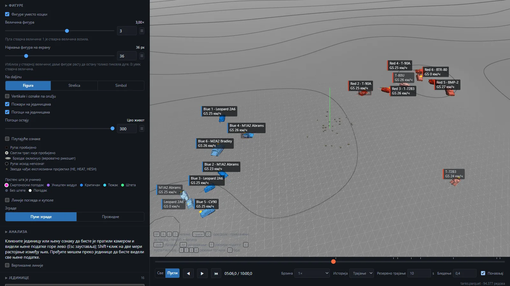
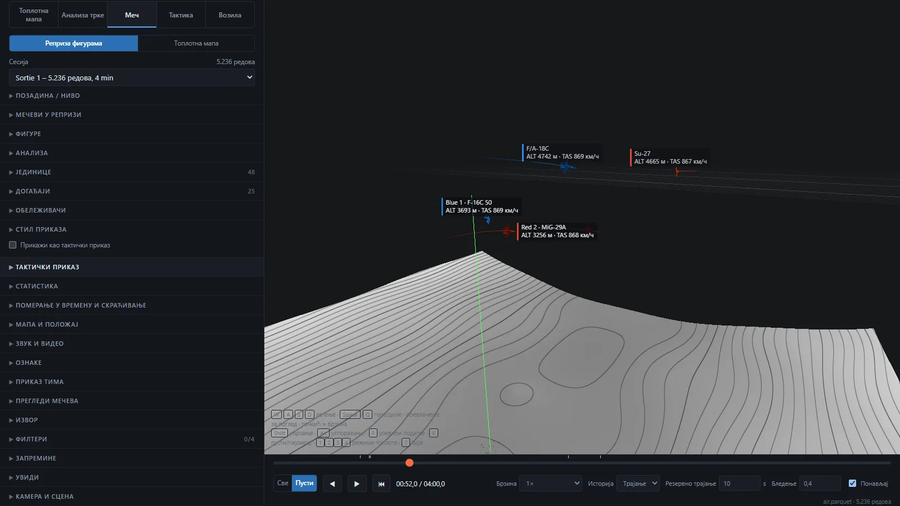

# Реприза меча

Реприза је филм меча у којем је сваки играч приказан као оно што је возио. Користите је да поново погледате борбу, пратите једну јединицу и видите ко је кога погодио.

Пуцњи, погоци, пожари и олупине цртају се на јединицама и циљевима на нивоу. Камере, ознаке и тактички приказ помажу да се борба чита. Знате ли за Tacview? [Паритет са Tacview-ом](tacview-parity.md) показује где је свака његова алатка.

## Покрените репризу {#start-a-replay}

1. Учитајте снимак с **Source → Files…** или тако што га превучете на панел Source (било која табела с колоном **особа** и колоном **време**, датотека Tacview, конвертована реприза, [`.3dheat`](container.md) меч). Видите [Унос података](getting-data-in.md).
2. Отворите картицу **Меч** и изаберите **Реприза фигурама**, или изаберите **Преклапање фигура** у траци режима картице Топлотна мапа.
3. Под **Мечеви у репризи** изаберите један меч, све одједном, или неколико.
4. Притисните **Пусти** на временској линији (или `K`). Превуците временску линију да скочите.

Фигуре замењују кутије за сваку јединицу чије је име или врста позната (видите [Фигуре](figures.md)). Подаци без колоне имена или врсте цртају се као војници.

## Фигуре {#figures}

| Подешавање (одељак **Фигуре**) | Подразумевано | Шта ради |
|---|---|---|
| **Фигуре уместо коцки** | укључено | Искључено црта обичне кутије. |
| **Величина фигура** (пута стварна величина) | 1 | 1 је стварна величина; од 0,25 до 20 пута (логаритамска скала). Веће помаже издалека. |
| **Најмања фигура на екрану** | 36 px | Далеке фигуре расту да остану толико дуге, од 0 до 200 px; 0 задржава стварну величину. |
| **На даљину**: Фигура, Стрелица, Симбол | Фигура | Чиме постаје удаљена јединица. |
| **Симболи** | NATO (APP-6) | NATO (APP-6), руски тактички знаци, иконе **Мапе игре**, или **Само облици (за далтонисте)**. |
| **Величина симбола**, **Моја страна**, **Непријатељ / Неутрално**, **Ознаке курса** | 28 px (од 12 до 64), аутоматски, непријатељ, укључено | Како симболи изгледају и која страна је пријатељска. |
| **Вертикалне линије** | укључено | Линија од сваке јединице право доле до тла, да се висине читају у 3D. |
| **Вертикале и ознаке на оружју** | искључено | Линије до тла и ознаке на пројектилима и бомбама. |
| **Пожари на јединицама** | укључено | Пламен од тренутка кад јединица запламти док се не угаси. |
| **Погоци на јединицама** | укључено | Ознаке где су пуцњи ударили (испод). **Погоци остају**: од 1 до 300 секунди, или **Цео живот**. **Плутајуће ознаке**: ознаке нацртане изнад површине. |
| **Линије погледа и куполе** | искључено | Испрекидано: где играч гледа; пуно: где цев показује. |
| **Зграде** | пуно | Пуне или провидне зграде, кад ниво их тако слика. |

### Симболи на даљину {#symbols-at-a-distance}

Кад би јединица била мања од **Најмања фигура на екрану**, може постати симбол који остаје читљив. Облик говори врсту (на пример заобљена кутија с ознаком гусенице за оклоп); боја говори страну. Отворите мени **Симболи** да промените стил.

### Ознаке погодака, олупине и пожари {#hit-marks-wrecks-and-fires}

- **Ознаке погодака** стоје на површини коју је пуцањ срео, у размери фигуре. Њихов изглед каже шта се десило: рупа (прошао је кроз), светла прскотина (није прошао), траг (одбио се), звездаста чађ (експлозивни метак). Обојени прстен каже шта је урадио: смртоносни погодак, модул уништен, критичан, тежак, штета, без штете, погодак. Задржите миш на ознаци за назив метка.
- Уништена јединица се црта **обуглена** као олупина од своје смрти до повратка у игру или уклањања; њен симбол је прецртан.
- **Пожари** горе на јединици од тренутка кад се запали до гашења.
- **Куполе** се окрећу ка месту на које подаци кажу да цев показује (или, без тога, ка месту где играч гледа).

### Оружје, мамци и трасери {#weapons-decoys-and-tracers}

Уз **Оружје, пуцњи и погоци** укључено (одељак Приказ тима): пројектили, ракете, бомбе и торпеда лете као сопствене фигуре с трагом дима; меци и гранате су трасери; удари и експлозије блесну. Трасер нацртан **испрекидано** израчунат је из погодка, јер подаци нису имали пуцањ. Бакље и плеве се црте као мамци; скривени су на списку јединица осим ако је означено *Мамци и гранате*.

## Камере {#cameras}

Кликните на јединицу или њену ознаку да је **пратите**; одељак **Анализа** нуди **Позади**, **Орбита**, **Кокпит** (са приказом на стакленом екрану, `H`), **Фиксно**, **Padlock**, **Циљ** и **Сателит**. `V` их мења редом, а **Удаљеност камере** поставља колико су далеко. Esc зауставља.

- **Приказ две јединице**: изаберите **Циљ** (или Ctrl/Alt-клик на јединицу) да је гледате из праћене; **Замени** их мења местима.
- **Мера**: Shift-клик на две јединице за азимут, растојање и разлику у висини између њих.
- **2D мапа** (`M`): угао или цео приказ, с траговима и именима.
- **Обележивачи** (`B`): чувају тренутак и камеру; убиства, смрти и ознаке из самог снимка такође су наведени.
- **Догађаји**: сваки догађај по времену; клик скаче до њега. `Page Up` / `Page Down` скачу између догађаја; **Паузирај на догађају** застаје на сваком.

## Тактички приказ {#tactical-display}

Одељак **Тактички приказ** црта, ни за једну јединицу, изабране, све, или једну врсту (авиони, копно, бродови, оружје): вектори брзине и путања испред, линије носа и узгона, конуси радара, закључавања, везе података, зоне и линије ангажовања, линије вида, где играчи гледају (конуси погледа), наношење куполе и снимљену камеру.

### Стил приказа {#display-style}

`T` (или прекидач **Прикажи као тактички приказ**) пребацује изглед на стил радарског екрана: сјај, ивице, линије висине, мрежа мерења, линије скенирања, прстенови домета, лествице висине, панели с убиствима и догађајима, и **Редитељ** који сам помера камеру до догађаја.

## Циљеви {#objectives}

Кад меч стигне са својим циљевима, одељак **Циљеви** црта их на нивоу: зоне заузимања (с власником и напретком заузимања), спаунови, аеродроми, области и мете за бомбардовање, сваки слој се може укључити и искључити, с ознакама. Виде се кроз тло. Кад су учитани више режима игре, **Режим** филтрира мечеве по режиму. Циљеви долазе из датотеке меча конвертора уз снимак или унутар контејнера [`.3dheat`](container.md).

## Ознаке и статистика {#labels-and-statistics}

- **Ознаке**: правила по врсти (**Изабране**, **Авиони**, **Копно**, **Бродови**, **Оружје**, **ВИ**): приказане или не, које вредности, и **Приоритет** за то ко добија простор кад се ознаке преклапају. **Раздвој ознаке** премешта ознаку поред њене јединице кад би прекрила другу, и изоставља је тамо где нема места. **Величина ознака** је од 60 до 250%. **Назад на име, возило, висину и брзину** враћа правила.
  - Копнене јединице почињу с именом, возилом и брзином.
  - Авиони почињу с именом, возилом, висином и брзином.
  - Бродови почињу с именом, возилом, брзином и курсом.
  - Задржите миш на јединици да видите сваку вредност коју има.
- **Статистика**: по тиму и јединици: убиства, смрти, пуцњи, погоци, однос погодака, полетања, слетања, време у ваздуху, највећа брзина, висина и G, растојање. Извоз у CSV.
- **Графикони**: вредности јединице кроз време, две јединице упоређене, или једна вредност према другој.

## Много мечева одједном {#many-matches-at-once}

Да поставите стотине или хиљаде мечева један преко другог, видите [Много мечева одједном](many-matches.md). Детаљи фигура (дим, пожар, други временски ефекти): [Фигуре у преклапању фигура](figure-replay.md). Списак функција Tacview-а: [Паритет са Tacview-ом](tacview-parity.md), подстраница ове.
