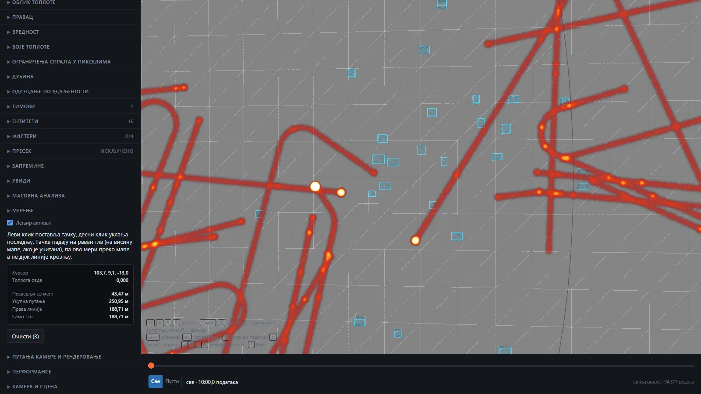

# Мера

**Мера** претвара миш у лењир и каже колико је заузето место под курсором. Користите је да сазнате колико су два места удаљена или колики је промет на једном месту.

## Пробајте {#try-it}

1. Отворите **Мера** у бочној траци и означите **Лењир активан**.
2. Левим кликом кликните три места на мапи. Сваки клик поставља тачку.
3. Прочитајте **Укупна путања** (дужина целе путање) и **Последњи сегмент** (последњи део).
4. Десним кликом уклоните последњу тачку, или притисните **Обриши (3)** да уклоните све.

| Радња | Ефекат |
|---|---|
| Леви клик | Поставља тачку где курсор додирује раван тла. Клик који је између притиска и отпуштања померио курсор више од 4 пиксела је превлачење камере, а не тачка. |
| Десни клик | Уклања последњу тачку. |
| Померање | Положај курсора и топлота испод њега се освежавају уживо. |

Камера ради и кад је лењир укључен: превлачење и даље гледа около, тастери и даље лете. Док је лењир укључен, он прима сваки клик, па [избор кликом](camera.md#click-to-pick) чека док се искључи.

**Раван тла** је висина [слике мапе](map-images.md) кад је слика мапе учитана, а иначе најнижи Y скупа података (0 без ње). Тачке се на њу постављају, па лењир мери преко мапе, а не дуж линије кроз њу. Са 3D нивоом раван је и даље најнижи Y скупа података, а не површина нивоа. За тачку на правој површини искључите лењир и кликните на њу ([избор кликом](camera.md#click-to-pick)), што очитава координате из троуглова самог нивоа.

## Очитавци {#readouts}

| Ред | Значење |
|---|---|
| **Cursor** | Светски X, Y, Z тачке под курсором, на равни. |
| **Heat here** | Колика је топлота на пикселу курсора. Већи број значи више промета на том месту. То је вредност која иде у рампу боја пре него што је подели тачка засићења, па је можете упоредити с [Тачком засићења](colour-and-exposure.md#saturation-point). |
| **Last segment** | Растојање од последње тачке до курсора (или између последње две тачке). |
| **Path total** | Дужина изломљене линије кроз сваку тачку и курсор. |
| **Straight line** | 3D растојање од прве тачке до курсора (или последње тачке). |
| **Ground only** | Исто, само по X и Z. |
| **Clear (N)** | Уклања све тачке. |

Растојања се приказују у центиметрима испод 1 јединице, у метрима испод 1.000, а у километрима изнад, под претпоставком да је једна светска јединица метар ([Осе, јединице и време](axes-units-and-time.md#unit-scale)). Координате су светске, укључујући и кад је нека оса [обрнута за приказ](camera.md#invert-world-axis).

Тачке и линија између њих се цртају као преклоп у приказу, величине засноване на размаку мреже. Тачке лењира се не чувају у приказима; остају кад учитате друге податке.

## За програмере {#for-developers}

**Heat here** се чита са GPU-а највише на сваких 120 ms, јер читање једног пиксела зауставља цевовод. Користи исти пут као `engine.readHeatProbe()`: дели се појачањем с којим је кадар записан, па је на half-float путу акумулације (`?heat=f16`) у истим јединицама као на 32-битној мети ([Акумулација у half-float формату](half-float-accumulation.md)).
