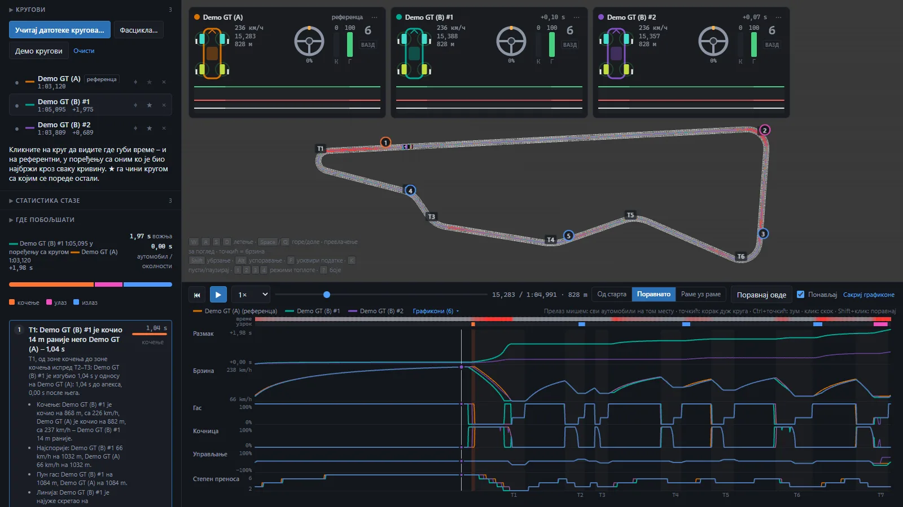

# Анализа трке

Возили сте исту стазу два пута. Картица **Анализа трке** пушта обе вожње заједно у 3D, показује где је један круг био спорији и каже вам зашто. Још нема кругова? Притисните **Демо кругови**.

Картица упоређује два или више кругова једне стазе. Дели платно, камеру и учитани модел стазе (**Позадина / ниво**) са топлотном мапом; све остало је њено: сопствена бочна трака и сопствена трака испод приказа. Речи као *круг*, *референца* и *врх кривине* објашњене су у [речнику појмова](glossary.md).

Ова страница је мапа картице. Сваки део има сопствену страницу:

| Страница | Шта покрива |
|---|---|
| [Учитавање кругова](race-loading-laps.md) | сваки формат датотеке, фасцикле и стазе, називи аутомобила, демо кругови, списак кругова, референца и фокус |
| [Реприза и 3D сцена](race-replay-and-scene.md) | трака за управљање, три режима репризе, поравнавање аутомобила, камера праћења, линије, мапе, аутомобили, ознаке, огледални светови |
| [Графикони и HUD](race-charts-and-hud.md) | графикони по растојању, бирач графикона, превлачење и зумирање, картице аутомобила, табела канала |
| [Догађаји контроле аутомобила](race-control-events.md) | блокирања, клизање точкова, подуправљање и надуправљање, окрета, удари, судари, ABS/TC, ручна кочница, ваздух - како се сваки открива, са сваким прагом |
| [Анализа кривина једну по једну](race-corner-analysis.md) | поравнање по растојању, кривине и делови, временски рачун кривине, сваки узрок и редослед у ком се испробавају, облик линије и савет |
| [Профили аутомобила и поређење](race-car-profiles.md) | шта сваки аутомобил може, мерено из његових кругова; *Поређење аутомобила*; шта аутомобил одлучује на свакој кривини |
| [Статистика стазе](race-course-statistics.md) | много кругова једне стазе: грешке по кривини и по врсти, мапа грешака, извоз топлотне мапе, границе перформанси |
| [Анализа трке: метода](race-analytics.md) | истраживање иза правила, са изворима |
| [Остале тркачке игре](other-games.md) | шта приказивач ради са круговима из сваке игре: клизање и дрифт израчунати тамо где игра их не шаље, огледални светови, додатни канали |

## Екран {#the-screen}

**Бочна трака**, одозго надоле (одељци се могу склопити):

1. **Кругови** - учитавање, списак, приказ/сакривање, референца, фокус, праћење.
   Видети [Учитавање кругова](race-loading-laps.md).
2. **Статистика стазе** - само од три учитана круга.
   Видети [Статистика стазе](race-course-statistics.md).
3. **Где побољшати** - налази фокусираног круга, кривина по кривину.
   Видети [Анализа кривина једну по једну](race-corner-analysis.md).
4. **Кривина по кривина** (или *Кривина по кривина - класа X* са више класа) - најбржи круг кроз сваку кривину и његова линија. Приказује се са два или више кругова.
5. **Контрола аутомобила** - блокирања, клизања, потискивања и удари фокусираног круга.
   Видети [Догађаји контроле аутомобила](race-control-events.md).
6. **Поређење аутомобила** (или **Аутомобил** са једним аутомобилом) - видети
   [Профили аутомобила и поређење](race-car-profiles.md).
7. **Приказ** - која мапа је нацртана на стази и шта се црта.
   Видети [Реприза и 3D сцена](race-replay-and-scene.md).
8. Заједничке панели **Ниво** и **Камера и сцена** (модел стазе, обртање осе, камера) - документовани са топлотном мапом и [Камером](camera.md).

**Приказ** показује стазу, нацртане линије вожње, мапу, аутомобиле, ознаке закачене за стазу и до шест картица аутомобила горе лево (видети [Графикони и HUD](race-charts-and-hud.md)). Без учитаних кругова пише „Нема учитаних кругова - превуците овде једну или више датотека кругова, или учитајте демо кругове из бочне траке.”

**Трака испод приказа** садржи управљање репризом и, ако није сакривен, графиконе по растојању.

## Брзи почетак {#quick-start}

1. Отворите картицу **Анализа трке** (поред **Топлотна мапа** при врху
   бочне траке).
2. Унесите кругове. Притисните **Демо кругови** да видите шта картица ради са три измишљена круга. За своје кругове прво их снимите
   ([формати датотека и снимачи](race-loading-laps.md#file-formats)), па притисните
   **Учитај датотеке кругова…** или **Фасцикла…**, или превуците датотеке или фасцикле на приказ.
3. Најбржи потпуни круг постаје референца; најспорији други круг је фокусиран. Кликните на било који круг у списку да га фокусирате; ★ чини круг референцом.
4. Прочитајте **Где побољшати**. Кликните на налаз: аутомобили се поравнају 40 m пре њега, камера га уоквирује, реприза пролази кроз њега и отварају се мерења.
5. Задржите показивач на графиконима да сваки аутомобил помери на тај метар; Shift+клик да их поравнате тамо.

## Тастатура {#keyboard}

Док је картица Трка отворена:

| Тастер | Ради |
|---|---|
| **K** | пусти / паузирај репризу |
| **Home** | назад на почетак репризе |
| тастери са цифрама | ништа (у топлотној мапи мењају режиме) |

Тастери укуцани у поље за текст или падајућу листу се занемарују. Тастери камере раде као у топлотној мапи (**W A S D**, **Размак** горе, **Q** доле, **Shift** брже, **Alt** спорије, миш за гледање; све у [Камера](camera.md)); **F** уоквирује учитане кругове (као што то ради учитавање кругова).

## Много кругова {#many-laps}

- Сви учитани кругови се анализирају и броје; десетак траје секунду или две.
- Преко **8** кругова (`SHOW_ALL_UP_TO`), додани кругови се цртају само када су референца, фокусирани круг или најбољи круг класе фокусираног круга. *Прикажи све* / *Само они које гледате* мењају то.
- Преко **10** видљивих аутомобила (`PLAIN_PAST`), кругови које не гледате (не фокус, не праћени аутомобил или референца) се цртају са линијама проређеним на тачку на сваких 6 m уместо 1.5 m, и као обични аутомобили.
- Графикони цртају највише **8** кругова; HUD приказује највише **6** картица.
- Статистика стазе се појављује од **3** круга.

Детаљи: [Статистика стазе](race-course-statistics.md#performance-with-many-laps).

## Подразумеване вредности приказа {#default-view-settings}

| Подешавање | Подразумевано |
|---|---|
| Мапа | Временска мапа |
| Линије вожње, Аутомобили, Гуме и овјес, Ознаке, Стаза из кругова | укључено |
| Све вредности на картицама | искључено |
| Величина аутомобила | 1× |
| Графикони | приказани |
| Режим репризе | Од линије |
| Брзина репризе | 1× |
| Понављај | укључено |

Ништа од овога се не чува; поновно учитавање почиње од подразумеваних вредности. Оно што се памти у прегледачу: језик, и називи аутомобила научени из датотека кругова (видети [Учитавање кругова](race-loading-laps.md#car-names)).

## За програмере {#for-developers}

### Шта се дешава при учитавању кругова {#what-happens-when-laps-are-loaded}

Сваки пут када се скуп кругова, референца или језик промени, цела анализа се поново ради (`analyse` у [`src/race/analysis.ts`](https://github.com/Holdi601/3DHeat/blob/main/src/race/analysis.ts)):

1. Изведени канали се додају сваком кругу тамо где игра их не шаље: угао дрифта, клизање точкова из брзина точкова, у ваздуху, растресито тло, брзина скретања ([`derive.ts`](https://github.com/Holdi601/3DHeat/blob/main/src/race/derive.ts)).
2. Референца се бира и сваки круг се пројектује на њену путању и поново узорковује на сваких 2 m ([`align.ts`](https://github.com/Holdi601/3DHeat/blob/main/src/race/align.ts)).
3. Из кругова се израчунава да ли је игра огледално приказана ([`handedness.ts`](https://github.com/Holdi601/3DHeat/blob/main/src/race/handedness.ts)).
4. Кривине се налазе на референци и групишу у делове од једне зоне кочења до следеће ([`segments.ts`](https://github.com/Holdi601/3DHeat/blob/main/src/race/segments.ts)).
5. По аутомобилу: његова омотач (држање, кочење, вуча по брзини), његов профил, његове криве гума ([`envelope.ts`](https://github.com/Holdi601/3DHeat/blob/main/src/race/envelope.ts), [`profile.ts`](https://github.com/Holdi601/3DHeat/blob/main/src/race/profile.ts), [`control.ts`](https://github.com/Holdi601/3DHeat/blob/main/src/race/control.ts)).
6. По кругу и делу: шта је урадио (тачка кочења, најспорија тачка, пун гас, ...) и линија којом је возио ([`line.ts`](https://github.com/Holdi601/3DHeat/blob/main/src/race/line.ts)).
7. По кругу: његови догађаји контроле аутомобила, сваки постављен наспрам круга с којим се упоређује на том месту.
8. По кругу и делу: временски рачун у односу на круг поређења и налаз речима.
9. Мапа времена и мапа узрока по кругу.

Текстови се праве на тренутном језику; промена језика поново покреће анализу (и преименује демо кругове). Грешка у анализи се приказује испод дугмади **Кругови** као грешка, а кругови остају учитани.

### Изворне датотеке {#source-files}

| Датотека | Улога |
|---|---|
| `src/race/adapters.ts`, `ibt.ts` | читање датотека кругова |
| `src/race/lap.ts`, `carNames.ts`, `synthetic.ts` | тип круга, називање, демо кругови |
| `src/race/derive.ts`, `handedness.ts` | изведени канали, огледални светови |
| `src/race/align.ts`, `segments.ts`, `line.ts` | оса растојања, кривине, линије |
| `src/race/analysis.ts` | упоређене кривине, узроци, налази |
| `src/race/envelope.ts`, `profile.ts` | шта аутомобил може |
| `src/race/control.ts`, `impacts.ts` | контрола аутомобила, удари и судари |
| `src/race/stats.ts` | много кругова |
| `src/race/replay.ts`, `scene.ts`, `glyph.ts`, `geometry.ts` | реприза и цртање |
| `src/race/schema.ts`, `graphs.ts` | табела канала, редови графикона |
| `src/ui/race/*` | бочна трака, графикони, HUD, ознаке |
| `src/state/raceStore.ts` | стање картице и сат репризе |
