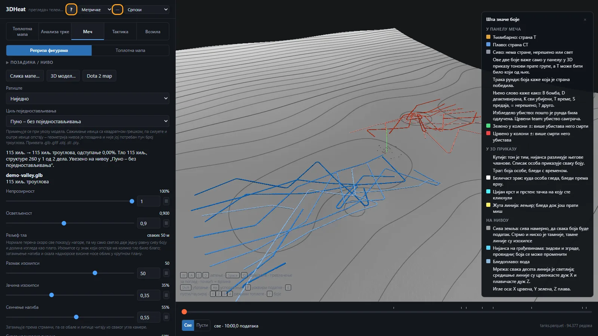

# Подешавања, јединице и тастери

Мале контроле при врху бочне траке мењају начин на који вам приказивач говори: језик, јединице (метри или стопе, км/х или чворови) и режим помоћи који објашњава боје. Ваш избор се памти у прегледачу.

## Заглавље {#the-header}

При врху бочне траке:

| Контрола | Шта ради |
|---|---|
| **?** | Режим помоћи: шта значи свака боја (такође `?` или `F1`) |
| Мени **Јединице** | Метрички, Империјални, Авијација или Наутички |
| Дугме **...** поред **Јединица** | Отвара „Изаберите јединицу за сваку величину”: једну падајућу листу по величини |
| Мени **Језик** | Језик приказивача: [40 језика](languages.md), или језик прегледача |

Бројеви које укуцате у поље могу имати тачку или зарез (`0.35` или `0,35`). Приказивач чита оба и приказује бројеве онако како их пише језик приказивача.

## Јединице {#units}

1. Изаберите унапред подешен пресет у менију **Јединице**. Све величине се мењају заједно.
2. Да промените само једну величину, кликните на дугме **...** поред ње и изаберите јединицу за њу. Мени тада приказује `*` иза пресета.
3. Величина коју нисте подесили прати пресет. Изаберите „Као у пресету” да се вратите.

| Величина | Метрички (подразумевано) | Империјални | Авијација | Наутички |
|---|---|---|---|---|
| Растојање | km | mi | NM | NM |
| Висина, дужина | m | ft | ft | m |
| Брзина | km/h | mph | kt | kt |
| Вертикална брзина | m/s | ft/min | ft/min | m/s |
| Температура | °C | °F | °C | °C |
| Притисак | hPa | inHg | hPa | hPa |
| Маса, гориво | kg, l | lb, gal | lb, gal | t, m³ |
| Угао | степени | степени | степени | степени |

Остале јединице које можете изабрати за једну величину: растојање km, mi, NM; брзина km/h, m/s, kt, mph; вертикална брзина m/s, ft/min, m/min; температура °C, °F, K; притисак hPa, inHg, mmHg, psi; маса kg, lb, t; угао степени или NATO mil (6400 у кругу). Јединице су исте свуда у приказивачу: натписи, картице, графикони, статистика.

## Режим помоћи {#help-mode}

Притисните `?` или `F1`, или кликните дугме **?**. Приказује *Шта значе боје*: легенде за 3D приказ, скале топлоте, боје тимова, боје нивоа, статусне боје панела, панел меча и приказ трке. Остаје укључен док га не искључите. У картици Меч објашњава и боје панела меча.

## Шта прегледач памти {#what-the-browser-remembers}

Ова подешавања се чувају у вашем прегледачу између посета (ништа се нигде не шаље):

- језик, јединице и режим помоћи;
- подешавања фигура, симбола, ознака, камере и тактичког приказа репризе;
- брзину репродукције и огледање;
- обележиваче по снимку, запремине по скупу података, слојеве циљева;
- подешавања спољног ВИ (кључ само ако означите *Запамти*).

Подешавања топлоте, филтери и режим се при сваком учитавању враћају на почетак. Пун, генерисани списак: [Сачувана подешавања](ref-settings-storage.md).

## Тастери које приказивач задржава из прегледача {#keys-the-viewer-keeps-from-the-browser}

Сесија са великим подацима дуго се учитава, па приказивач спречава прегледач да је случајно одбаци:

- `Ctrl`/`Cmd` + слова која би штампала, чувала, отворила, поново учитала, затворила или отварала нове прозоре не раде ван поља за текст; `F1`, `F3`, `F5`, `F6` и `F7` не раде ништа.
- Затварање или поновно учитавање картице са учитаним подацима или нивоом најпре пита.
- У целом екрану приказивач закључава тастере које користи (W, T, N, S, R, P, Q, Esc), па их прегледач не преузима.

Тачан списак: [Тастери прегледача](ref-browser-keys.md). Сви сопствени тастери приказивача: [Референца тастатуре и миша](keyboard-reference.md).
