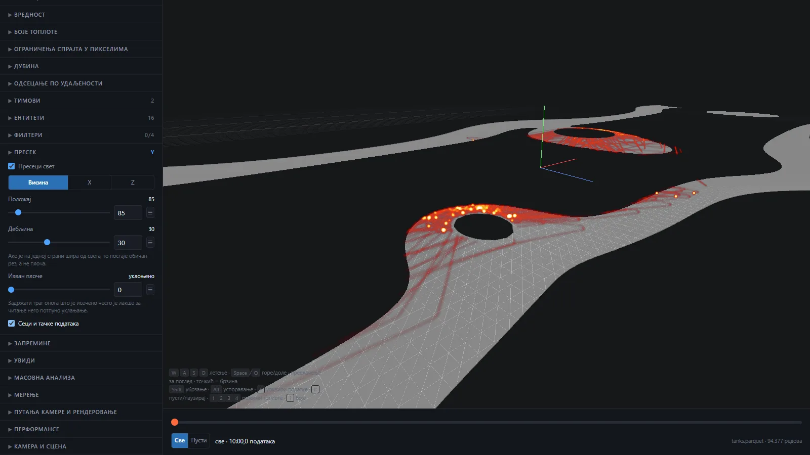

# Пресек

**Пресек** сече свет као парче торте, па можете да гледате унутар зграда. Користите га кад зидови скривају занимљиву топлоту, на пример да видите један спрат зграде.

## Пробајте {#try-it}

1. Учитајте ниво и неке податке, па отворите **Пресек**.
2. Означите **Пресеци свет**. Оса је **Висина**.
3. Превуците **Положај** горе и доле: плоча се креће кроз ниво.
4. Направите **Дебљину** танку за план спрата, или широку за „све испод овога”.
5. Оставите **Изван плоче** на 0 да уклоните остало, или га подигните да задржите слабашан траг.



Плоча сече **геометрију нивоа и тачке података заједно**. Сечење само нивоа оставило би топлоту да лебди тамо где је била зграда. То је пандан [дубинској окклузији](depth-and-culling.md): кад ниво тачно сакрива оно што је иза њега, сакрива се и унутрашњост зграде. Панел се приказује кад има шта да се пресече (скуп података или 3D ниво). Његово заглавље показује осу док је укључен, а *искључено* иначе.

```
side view         Position = where the slab is
 ----------       Thickness = how tall the slab is
 | floor 3 |
 |=========|  <--- slab (kept)
 | floor 2 |  <--- outside: removed (or faint)
 | floor 1 |
 ----------
```

## Контроле {#controls}

| Контрола | Подразумевано | Значење |
|---|---|---|
| **Пресеци свет** | искључено | Укључује плочу. Док је положај још на почетној 0 а дебљина на почетних 500, укључивање их помера на средину осе и на 15% њеног распона. |
| Оса | **Висина** | *Висина* (Y), *X* или *Z*. Промена осе помера плочу на средину нове осе. |
| **Положај** | средина | Центар плоче, у светским јединицама, преко распона осе (500 корака). |
| **Дебљина** | 15% распона | Од 1/500 распона до двоструког распона, у логаритамским корацима. Чита се *преко света* кад је широка као распон: једна страна тада досеже преко света, па је то обично сечење, а не плоча. |
| **Изван плоче** | 0, *уклоњено* | Колико онога што је изван остаје видљиво, 0-100%. Слабашан траг онога што је одсечено често је лакше читати од потпуног уклањања. |
| **Сеци и тачке података** | укључено | Искључено оставља топлоту целом, па она кроз пресек и даље показује, што је корисно за виђење онога што је изнад и испод плоче. |

Распон осе је распон 3D нивоа кад је учитан, а иначе распон скупа података.

Пресек је независан од [одсецања по даљини](depth-and-culling.md#distance-culling), које сече дуж правца погледа, а не дуж осе света; њих двоје се комбинују. Промена било које поставке пресека поново покреће акумулацију топлоте.

## За програмере {#for-developers}

Плоча се проверава над положајем у свету сваког реда у vertex shader-у: ред ван ње има допринос помножен вредношћу *Изван*, па се при 0 одбацује пре него што се нацрта иједан фрагмент. Shader-и нивоа примењују исту проверу на сваки фрагмент тла, конструкција и воде.
