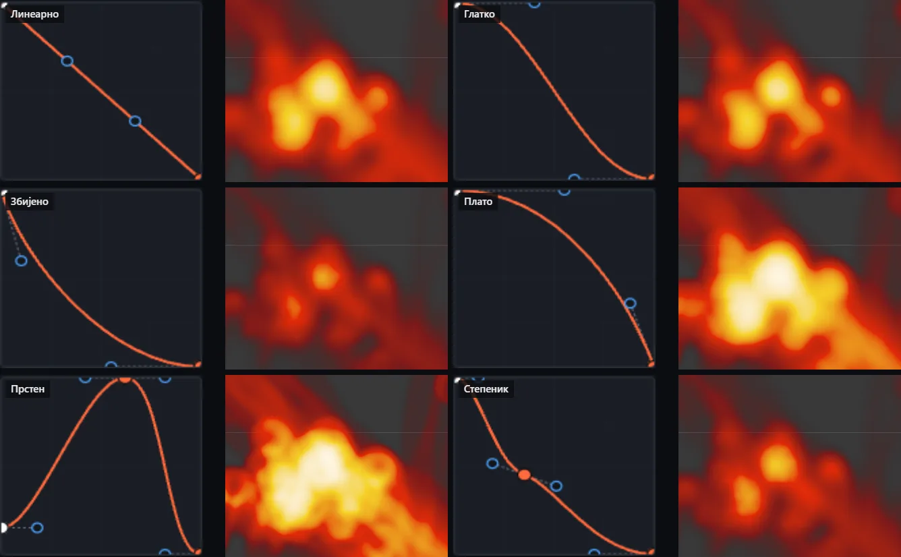

# Облик спрајта

Сваки ред се црта као округли спрајт који се увек окреће ка камери. Његова величина и профил од центра до ивице - **прелаз** - одлучују да ли жариште изгледа као збијена тачка, мек облак, диск или прстен. Ове контроле су у одељцима **Облик топлоте** и **Ограничења спрајта у пикселима** бочне траке, и важе за [Топлоту](heat.md), [Разлику](difference.md), [Топлоту тимова](team-heat.md) и, као пола ширине линије, за [Топлоту линија](line-heat.md).

Промена било које од њих поново покреће акумулацију (поље се мора поново нацртати новим обликом).

Замислите сваку тачку као мекану мрљу светла. Мала мрља показује појединачне тачке; велика мрља спаја суседе у облак. Облик одлучује колико је ивица мека.



## Полупречник спрајта {#sprite-radius}

Полупречник спрајта у **јединицама света** (означен као метри). Подразумевано 6, а при сваком учитавању хоризонтални обухват података / 120 - довољно велико да се суседни узорци дуж путање споје у појас, а не да се читају као танка линија. Логаритамски клизач 0,05-2000, ручица до 50.000.


Ствари које су далеко изгледају мање, па се спрајт на екрану смањује с удаљеношћу. У паралелној пројекцији он је свуда исти, што је део разлога зашто је паралелни приказ прави за поређење жаришта ([Камера](camera.md#projection)).

## Ограничења у пикселима {#pixel-clamps}

**Ограничења спрајта у пикселима** (подразумевано затворено) ограничавају полупречник на екрану после горње претворбе.

| Контрола | Подразумевано | Опсег (клизач) | Зашто |
|---|---|---|---|
| **Најмањи полупречник у пикселима** | 1 px | 0-16 (512) | Не даје далеким подацима да нестану испод једног пиксела. |
| **Највећи полупречник у пикселима** | 96 px | 2-1024, логаритамски (8192) | Чувар од превеликог исцртавања. Спрајт који покрива N пиксела кошта N операција мешања, па је неограничен полупречник близу камере оно што брз кадар претвара у спор. Преко висине приказа више ништа не ограничава. |

**Иста густина при сваком зумирању** (у одељку Облик топлоте, подразумевано укључено) ради уз ограничења. Спрајт који ограничење учини већим (далеко) или мањим (изблизи) задржава топлоту коју би додао његов стварни размер, па боја значи исти број редова по површини тла при сваком зумирању. Кад је искључено, ограничен спрајт додаје пуну тежину при свом ограниченом размеру, па се слика мења како летите ка њему.

## Интензитет у центру и на ивици {#centre-and-edge-intensity}

Топлота коју спрајт додаје у свом тачном центру (**Интензитет у центру**, подразумевано 1, 0-10, клизач 1000) и на ободу (**Интензитет на ивици**, подразумевано 0, -2-10, клизач 1000). Вредност прелаза *t* (1 у центру, 0 на ободу, обликована опадањем или кривом испод) меша их (формула је у [За програмере](#for-developers)).

**Негативан интензитет на ивици** чини да обод одузима, што урезује хладан ореол око сваког жаришта и оштри групе једну према другој. Видљивост укључује [окулузију](depth-and-culling.md) и [пресек](slice.md); нестајање је [нестајање животног века](timeline.md#history); знак је ±1 у [Разлици](difference.md).

## Облик прелаза: Опадање или Крива {#ramp-shape-falloff-or-curve}

**Облик прелаза** прелази између два начина обликовања *t* преко спрајта. Са *d* као растојањем од центра (0) до ивице (1):

### Опадање {#falloff}

Приказано кад је изабрано *Опадање* (подразумевано).

- **Опадање** (подразумевано 1,6, 0,1-8, клизач 64): `t = (1 - d) ^ опадање`. 1 је права линеарна скала; више вуче топлоту ка центру и збија жариште; испод 1 спљоштава га у диск.
- **Гладак прелаз** (подразумевано укључено): примењује S-криву smoothstep на *t*, па спрајт нестаје на ивици уместо да се завршава на видљивој ивици.

### Уређивач криве {#the-curve-editor}

Приказано кад је изабрано *Крива*. Буквални пресек спрајта: растојање од центра преко (*центар* лево, *обод* десно), топлота горе. Крива је комадни кубни Безијеов спој кроз контролне тачке, свака с две ручице.

| Радња | Дејство |
|---|---|
| Дупли клик на график | Додаје тачку на том растојању (задржава се између 0,02 и 0,98), на кривој и с нагибом криве тамо, па додавање ништа не мења док је не превучете. |
| Превлачење тачке | Помера је. Висине се задржавају између 0 и 1. |
| Превлачење малог круга | Савија сегмент уз њега (помера ту ручицу). |
| Alt-клик или десни клик на тачку | Уклања је. Две крајње тачке се не могу уклонити. |
| Дугме претподешавања | Замењује криву претподешавањем. |

Крајње тачке су фиксиране у центру и на ободу; њихову висину и даље одређујете ви.

**Претподешавања** ([`curve.ts`](https://github.com/Holdi601/3DHeat/blob/main/src/state/curve.ts)):

| Претподешавање | Облик | Употреба |
|---|---|---|
| **Линеарно** | Право од 1 до 0 | Исто као *Опадање* 1 с искљученим *Глатким прелазом*. |
| **Глатко** | S-крива | Подразумевана крива; оно што *Гладак прелаз* даје при опадању 1. |
| **Збијено** | Стрма језгра, дуга бледа сукња | Ретки подаци. |
| **Плато** | Равно, па брз пад | Чита се као диск, а не као мрља. |
| **Прстен** | 0,15 у центру, 1 на 62% полупречника, 0 на ободу | Шупљи спрајт: показује где путање пролазе, а не где стају. |
| **Степеник** | Пад у два степена, 0,45 на 35% | Раздваја густо језгро од околине. |

## Спљошти на раван тла {#flatten-onto-ground-plane}

**Спљошти на раван тла** (подразумевано искључено) занемарује висину сваког реда и црта сву топлоту на једној висини - најнижем Y скупа података - класична 2D топлотна мапа. Кад је укључено, дубинска окулузија и *Сакриј иза терена* су искључени (свака тачка би седела тачно на површини на којој се испитује), а одељак Дубина то каже.

## За програмере {#for-developers}

### Формуле {#formulas}

Полупречник на екрану у пикселима: `полупречник × P[1][1] / w × висина приказа / 2`, где је `P` матрица пројекције, а `w` дубина погледа тачке.

Топлота коју спрајт додаје:

```
додана топлота = mix(ивица, центар, t) × тежина узорка × знак × нестајање × видљивост
```

### Крива {#the-curve}

Ручице су хоризонтално ограничене на свој сегмент, па је крива увек функција растојања: превлачење ручице далеко преко следеће тачке спљоштава је уз њу, а не савија криву назад, што би учинило резултат зависним од тога који корен решавач случајно нађе.

### Како се крива црта {#how-the-curve-is-drawn}

Крива се пече у табелу од 256 уноса кад год се промени, отпрема се као текстура од 16-битних покретних зареза и узорковала се по фрагменту с линеарним филтрирањем и полупикселским увлачењем, тако да оба краја остану тачна. Решавање Безијеа по x захтева итерацију, која нема места у најзахтевнијем шејдеру програма, а читање из табеле је и јефтиније од `pow()` којим се користи опадање. 16-битни, а не 8-битни, јер 8 бита даје прелазе у траке кад се зброје хиљаде спрајтова; 16-битни покретни зарез се може филтрирати у основном WebGL2 где 32-битни треба проширење.
