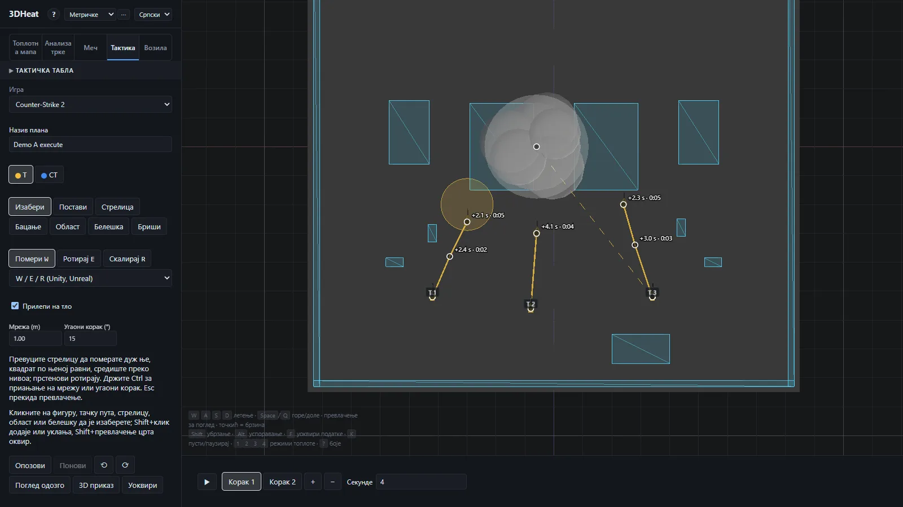

# Тактичка табла

Картица **Тактика** је табла за цртање тимског плана: на мапу стављате мале фигуре,
цртате стрелице куда иду и притиснете пусти да видите како то изгледа. Користите
је да испланирате рунду или напад пре игре. Дели платно, камеру и [ниво](levels.md)
са осталим картицама и ништа друго; план није податак и не црта топлоту.

## Ваш први план {#your-first-plan}

1. Отворите картицу **Тактика**. Изаберите **Игру** (на пример Counter-Strike 2) и,
   за Valorant, притисните **Учитај Valorant мапе** и изаберите **Мапу**. Или прво
   учитајте [ниво](levels.md).
2. Изаберите **Страну** (она одређује боју) и притисните **Поглед одозго**.
3. Изаберите **Постави**, изаберите фигуру у **Фигуре** (користите **Претражи фигуре**
   да је нађете) и кликните на мапу. Поставите две или три.
4. Изаберите **Стрелица**, кликните на фигуру, кликните дуж пута којим треба да иде,
   и притисните **Enter** да завршите стрелицу.
5. Притисните **+** испод приказа да додате корак 2. Свака фигура почиње тамо где се
   завршила њена стрелица. Нацртајте ту још стрелица.
6. Притисните **▶** (или `K`) да пустите план од приказаног корака до краја.
7. Назовите план у **Назив плана** и притисните **Сачувај**.

## Почетак плана {#starting-a-plan}

| Контрола | Шта ради |
|---|---|
| **Игра** | Бира стране и фигуре које палета нуди: Counter-Strike 2 (T, CT; играчи и помагала), Valorant (Attack, Defense; играчи и опште способности), Battlefield, Squad, Arma (пешадија, копнена возила, ваздухоплови, чамци), DCS / War Thunder / IL-2 (млазњаци, авиони са пропелером, хеликоптери, ПВО, копно, бродови, оружје) и Други. План који већ има фигуре задржава своје стране кад се игра промени. |
| **Назив плана** | Име под којим се план чува. |
| **Мапа**, **Учитај Valorant мапе** | Кад је изабран Valorant: **Учитај Valorant мапе** узима списак мапа са [valorant-api.com](https://valorant-api.com); **Мапа** затим поставља мини-мапу изабране мапе као ниво, уоквирену одозго. Слика се преузима кад се изабере и никад се не испоручује. Ријотова напомена се приказује док је на екрану (видите доле). |
| **Страна** | Страна којој припада следећа фигура, стрелица или подручје; добија боју стране. |

Без нивоа, табла је раван под. Учитајте ниво под **Ниво** да планирате на правој мапи:
CS2 мапу извезену CS2 алатом, ниво из библиотеке или слику мапе.

## Алати {#tools}

| Алат | Клик | Напомене |
|---|---|---|
| **Изабери** | Фигура, тачка на путу, стрелица, подручје или белешка се бира. | Shift+клик додаје или уклања; Shift+превлачење црта оквир око онога што се додаје. Изабрано добија гизмо за трансформацију (видите доле); `Delete` или `Backspace` га уклања. `M` помера изабрану фигуру до следећег клика. |
| **Постави** | Ставља изабрану фигуру. | Фигура се бира у палети **Фигуре** (са **Претражи фигуре**). Кад ништа није изабрано, `R` окреће следећу фигуру за 15° пре постављања (`Shift+R` у другом смеру). |
| **Стрелица** | Сваки клик додаје тачку; Enter, дупли клик или десни клик је завршава, Esc је одбацује. | **Кретање**, **Напад** (шира глава) или **Посматрање** (танка линија на висини очију). Стрелица започета на фигури је њен пут у овом кораку: при пуштању фигура га прелази, а следећи корак почиње тамо где се завршио. |
| **Бацање** | Оно што баца, па место где слеће. | Испрекидан лук од једног до другог, а изабрано помагало (дим, блиц, молотов, ...) се појављује где слети и остаје од овог корака надаље. |
| **Подручје** | Средина, па ивица. | Диск у боји стране. |
| **Белешка** | Место белешке; тражи њен текст. | Приказује се као чиода, а њен текст преко ње. |
| **Бриши** | Фигура, стрелица, подручје или белешка. | Уклања је од овог корака надаље; на њеном првом кораку, уклања је сасвим. |

**Опозови** и **Понови** (`Ctrl+Z`; `Ctrl+Y` или `Ctrl+Shift+Z`) иду корак по корак кроз
сваку промену. Линија испод плана показује колико има фигура, стрелица и корака.
**Поглед одозго** гледа право доле (ортографски), **3D приказ** се враћа на
перспективу, **Уоквири** уоквирује план, или ниво кад је план празан.

**Величина фигура** скалира сваку фигуру на табли; 1× је стварна величина, што је
одозго само неколико пиксела за човека.

## Померање, окретање и скалирање {#moving-turning-and-scaling}

Све на табли може да се помера као у 3D уређивачу: фигуре, помагала, ознаке,
појединачне тачке на путу и целе стрелице, подручја и белешке. Изабрано добија
гизмо на својој средини:

| Режим | Тастери | Ручке |
|---|---|---|
| **Помери** | W (или G) | Стрелица по оси (X црвено, Y зелено и нагоре, Z плаво) помера дуж ње; квадрат помера у својој равни; средина се помера по нивоу испод показивача. |
| **Ротирај** | E (или R) | Прстен по оси окреће око ње. Прстенови једне фигуре су њен сопствени скретање, нагиб и ваљање; група се окреће око осе света око своје средине. |
| **Скалирај** | R (или S) | Шири или скупља изабрано из своје средине дуж осе или на све стране; полупречник подручја расте с тим. |

**Тастери** пребацују између W / E / R (Unity, Unreal) и G / R / S (Blender); тастери
бирају режим само кад је нешто изабрано, а иначе лете камером. Значи `R` је
**Скалирај** са тастерима W / E / R и **Ротирај** са тастерима G / R / S кад је нешто
изабрано, а окреће следећу фигуру за постављање кад ништа није. Сви тастери табле
наведени су у [референци тастатуре](keyboard-reference.md#tactics-board). Држите
**Ctrl** док превлачите да би се померај прилепио на **Решетку** (метри) или окрет на
**Корак угла**. **Прилепи на тло** (подразумевано укључено) ставља померене људе,
возила, ознаке, тачке на путу и подручја на површину нивоа; ваздухоплови и
хеликоптери задржавају висину, а превлачење по стрелици Y се никад не прилепљује.
Превлачење ручке никад не помера камеру. **Esc** прекида превлачење, а свака промена
је један корак Опозива.

Тачке на путу се виде као тачке на стрелицама приказаног корака: кликните на једну да
је изаберете, превуците да је померите, Delete да је уклоните. Одељак **Изабране**
приказује место изабраног у метрима, скретање, нагиб и ваљање фигуре у степенима и
полупречник подручја, сваки за унос.

## Време {#timing}

Пут фигуре има време: сваки део траје колико је дугачак преко нивоа - узоркован на
површини на сваких пар метара, па се брдо или степениште између две тачке рачуна - при
брзини **режима кретања** те фигуре у тој игри, плус свако **чекање** на тачки на путу.
Пешадија пузи, чучи, хода (нечујно), трчи или јури; возила и чамци иду опрезно,
нормално или јуре; ваздухоплови и хеликоптери лете споро, крстарећи, борбеном брзином
или највећом. Режим који игра нема (CS2 нема јурење) узима најближи који има. Како
нагиб успорава зависи од игре: у CS2 и Valorant рачуна се само водоравна даљина, као у
самим играма; војне симулације успоравају пешадију узбрдо (Toblerova функција пешачења), а
возила по нагибу.

Брзине долазе из табела по игри с њиховим изворима (видите [Брзине кретања](tactics-speeds.md)):
CS2 по оружју у руци, из дефиниција оружја игре; Valorant по оружју; Battlefield, Squad,
Arma и ваздушне игре по врсти и класи возила. **Креће се као** бира профил фигуре (оружје,
врсту возила); **Сопствена (m/s)** преписује било који режим за ту фигуру. Режими се зову
како их табла приказује: *Пузање*, *Чучање*, *Ход (нечујно)*, *Трчање*, *Јурење*;
*Опрезно*, *Нормално*, *Брзо*; *Споро*, *Крстарење*, *Борба*, *Максимално*.

Свака тачка на путу показује време од претходне и време од почетка плана („+3.9 s ·
0:12"). Пут изабране фигуре наводи сваки део с његовим режимом, дужином и временом,
чекањем и доласком. **Доласци** испод **Време** ставља сваку фигуру с путем на једну
временску линију, први долазак на врху. Са **Репродукуј у реалном времену** (подразумевано
укључено) корак траје док не стигне најспорија рута, а свака фигура се креће својом
брзином; **Секунде** су тада најкраћа дужина корака. **Јединица нивоа по метру** каже у
чему је ниво: 39,37 за CS2 мапе (јединице игре), 1 за мапе у метрима.

## Поређење са подацима мечева {#compare-with-match-data}

**Учитај датотеке мечева…** чита табеле CS2 мечева за мапу (Parquet датотеке CS2
алата, колико год хоћете; само потребне колоне, у позадини); **Користи учитане податке**
узима податке учитане у приказу. Затим:

- **Најранији долазак на мапи** боји мапу по времену од почетка рунде када је играч први
  стигао до сваког места - дугме **Најбржи** приказује најбрже преко свих рунди, **Типично
  (медијана)** средњу рунду - од зеленог раније до црвеног касније, за једну страну или
  за обе. Показује шта је могуће и када.
- Изабрани пут се пореди с оним што су играчи постигли од његовог почетка (или од почетка
  рунде) до краја, сваки крај као диск задатог полупречника: „Најбржи примећен 14,2 s, p10
  15,0 s, медијана 18,3 s на 41 пролаза; ваш план 15,1 s".
- Брзине којима су играчи стварно ишли - трчање, ходање, чучање, из колона табела за ход и
  чучање - у m/s.

## Кораци {#steps}

Трака испод приказа држи кораке. План почиње с једним; **+** додаје један, а свака фигура га
започиње тамо где се завршио њен пут у последњем кораку; **−** уклања приказани. **Секунде**
су колико траје приказани корак кад се пушта. **▶** (K) пушта од приказаног корака до краја:
фигуре с путем га прелазе, фигуре премештене на ново место у следећем кораку клизе тамо, а
остале стоје. Док је корак приказан, место сваке фигуре у следећем кораку црта се као бледи
дух, а стрелице последњег корака бледо испод овог.

## Чување {#saving}

Одељак **Датотека** садржи **Сачувај**, **Отв.** и **Очисти**. **Сачувај** уписује план као
`<name>.h3dplan.json` (обичан JSON: стране, кораци, фигуре с местом по кораку, стрелице,
подручја, белешке); **Отв.** га чита назад. Датотека друге верзије, или она која није план,
одбија се с разлогом. **Очисти** празни план; Опозови га враћа.

## Фигуре {#figures}

Сваку фигуру прави сам приказ: једноставни облици у објављеној величини типа, с обележјима
која је разликују од суседа - гусенице и торањ тенка, топови, ракете и радари возила ПВО,
облик крила авиона, реп и мотори, лопатице хеликоптера и кратка крила. Ништа није узето из
игре. Дизајн који је игра смислила приказује се као општа фигура своје класе. Видите
[Фигуре](figures.md#which-figure-a-unit-gets) за то како подаци налазе своју фигуру.

## Ријотова напомена {#riots-notice}

Valorant мапе се приказују по политици Riot Games-а „Legal Jibber Jabber", која дозвољава
бесплатним пројектима заједнице да их користе и тражи ову напомену где год се појаве:
*3DHeat је направљен по политици Riot Games-а „Legal Jibber Jabber" коришћењем средстава која
поседује Riot Games. Riot Games не подржава нити спонзорише овај пројекат.* Способности на
табли су општи облици, а не Riot-ова уметност.
