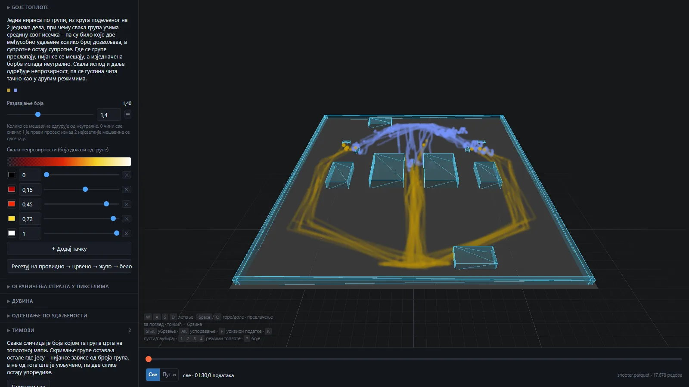

# Топлота тимова

Топлота тимова приказује где је био сваки тим, сваки у својој боји. Тамо где се тимови преклапају, боје се мешају.

**Топлота тимова** (тастер 3) је поље густине из [Топлоте](heat.md) са додељеном сопственом нијансом за сваку [групу](glossary.md). Тамо где се групе преклапају, њихове нијансе се мешају; раван једнак сукоб испада неутралан. Непрозирност и даље носи густину као и у другим режимима, па слика одговара на *колико* и *чије* истовремено. Потребна је колона групе.

Није то [преклапање фигура](box-replay.md): оно црта једну фигуру по особи; ово је поље топлоте обојено истом колоном.

## Како се користи {#how-to-use-it}

1. Притисните `3` (или изаберите **Топлота тимова** у траци режима).
2. Отворите **Боје топлоте**. Узорци приказују боју сваке групе; задржите показивач на узорку да видите назив тима.
3. Ако је све сиво, подигните **Раздвајање боја**.
4. Искључите групу у [Списку тимова](teams-list.md) да је уклоните; остале боје остају где су биле.

## Контроле {#controls}

У одељку **Боје топлоте**:

| Контрола | Подразумевано | Значење |
|---|---|---|
| Узорци | | Боја сваке групе, за првих 12 група, па *+N још*. Задржите показивач за назив групе и боју. |
| **Раздвајање боја** | 1.4 | Колико се мешавина одгурава од неутралне, 0-4. 0 чини све сивим; 1 је прави просек; преко око 2 најсветлије мешавине излазе из опсега за приказ и обрезују се по каналу, што помера њихову нијансу. |
| **Скала непрозирности (боја долази од групе)** | подразумевана скала топлоте | Овде се користи само **алфа** вредност скале: провидно тамо где нема ничега, непрозирно на врху. Њене боје се занемарују. |

Све остале контроле топлоте - облик, засићење, одзив, најмања топлота, дубина, одсецање - раде као у [Топлоти](heat.md).

[Списак тимова](teams-list.md) у овом режиму приказује боју топлоте тима као свој узорак. Скривање групе оставља боју сваке друге групе на месту: нијансе долазе из укупног броја група, а не из онога што је укључено, па две слике остају упоредиве.

## Палета {#the-palette}

Из [`colors.ts`](https://github.com/Holdi601/3DHeat/blob/main/src/render/colors.ts):

- Боје живе на **Oklab** равни боја на фиксној светлини (0.7) и хроми (0.115), па је свака група подједнако светла и црвена група не делује топлије од плаве.
- Са *n* група, круг нијанси дели се на *n* једнаких делова, а група *i* узима **средину** свог дела, `(i + 0.5) / n` окрета. Било које две групе су онолико удаљене колико број дозвољава, а супротности остају супротне, ма колики број био.
- Користи се највише **16** различитих нијанси. Са више група, идентификатори се постављају поновљеним половљењем (идентификатори са обрнутим битовима: 0, ½, ¼, ¾, ⅛, …) да суседни идентификатори не деле нијансу; групе преко 16 нужно деле.
- Група чија ознака значи „нема групе” - `0`, празно, `none`, `unknown`, `null` или `-1`, без обзира на велика и мала слова - црта се као **неутрално сива**, уместо да узме део круга. Само прва таква ознака на списку група се тако третира.

Подразумевано раздвајање је 1.4, а не 1, јер је при 1 мешавина пет равномерно распоређених нијанси *јесте* сива: тачно и нечитљиво. Мало изнад 1 задржава изједначене случајеве поштеним, а истовремено чини раздео 60/40 видљивим.

## Како ради {#how-it-works}

Топлотна мета у овом режиму има четири канала. Сваки спрајт додаје своју густину *v* првом каналу, а *v* × Oklab координате групе *a* и *b* другом и трећем. У време композита мешавина пиксела је средња вредност пондерисана густином: *a* = G / R, *b* = B / R, скалирано раздвајањем боја и претворено у sRGB на светлини палете. Дељење са акумулисаном густином чини нијансу независном од тога колико има података, и зато свака контрола густине и даље делује само на непрозирност.

Четвороканална мета кошта четири пута више GPU меморије од једноканалне топлотне мете при истој резолуцији.
