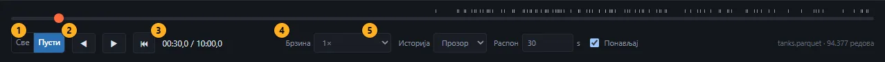

# Временска линија и репродукција

Трака испод слике је као видео плејер: податке можете да пустите као филм, паузирате, скачете по њима и мењате брзину.

Трака испод приказа је временска линија ([`Timeline.tsx`](https://github.com/Holdi601/3DHeat/blob/main/src/ui/Timeline.tsx)). Она одлучује које редове је видљиво у сваком тренутку. Потребна је колона времена; без ње је цела трака искључена, приказ остаје у режиму **Све**, а бочна трака каже *Нема колоне времена у овим подацима - временска линија је искључена и свака тачка података се приказује одједном.*

## Све и Пусти {#all-and-play}

Два режима на врху, јер одговарају на различита питања.

- **Све** (подразумевано при сваком учитавању) потпуно занемарује главу за пуштање и приказује сваки ред који прође филтере. То је приказ „где се ово дешава”, и није исто што и премотавање до краја. Клизач је искључен, а сат гласи `све ·  података`.
- **Пусти** пушта податке као временску прогресију. Појављују се клизач, управљање и подешавања историје.

Избор **Све** такође зауставља репродукцију.

## Контроле {#the-controls}

| Контрола | Подразумевано | Значење |
|---|---|---|
| Клизач | почетак | Глава за пуштање. Превуците да се поставите; 20.000 корака преко опсега. |
| **Све** / **Пусти** | Све | Видети горе. |
| ▶ / ❚❚ | паузирано | Пусти или паузирај; такође `K`. |
| ◀ **Пусти уназад (J)** | | Пушта податке уназад. Приказује се само у режиму **Преклапање фигура**; исти тастер `J` ради и тамо (видети [Тастатура](#keyboard)). |
| ⏮ | | Назад на почетак опсега. |
| Сат | | `протекло / укупно` као `mm:ss.s` (или `h:mm:ss`), и, када је колона времена апсолутни временски жиг, стварно доба дана главе за пуштање као `HH:MM:SSZ` (UTC). |
| **Брзина** | 1× | Секунде скупа података по стварној секунди. Мени има 17 корака од 0.01× до 1800× (0.01, 0.02, 0.05, 0.1, 0.25, 0.5, 1, 2, 4, 8, 16, 32, 64, 128, 256, 600, 1800), плус **Прилагођено…**: унесите било коју брзину од 0.001× до 3600× (на пример 0.3 или 12) и притисните Enter; Esc задржава тренутну брзину. Последња брзина се памти за следећу посету (видети [Сачувана подешавања](ref-settings-storage.md)). |
| **Историја** | Збирно | Шта се сматра видљивим при глави за пуштање: *Збирно*, *Прозор* или *Трајање* (испод). |
| **Распон** (Прозор; у режиму Линије и Трајање) | 30 s | Дужина прозора који се завршава на глави за пуштање; најмање 0.01 s. У [линијској топлоти](line-heat.md#playback) то је дужина репа. |
| **Резервно трајање** (само Трајање, не у режиму Линије) | 10 s | Колико дуго тачка података без следећег узорка своје особе остаје видљива. |
| **Бледење** (само Трајање, не у режиму Линије) | 0.4 | Део живота сваке тачке података утрошен на бледење, 0-1. |
| **Понављај** | укључено | На крају почиње из почетка; искључено зауставља на крају. |
| Десна страна | | Назив скупа података. |

**Опсег** је распон времена скупа података - или, у [преклапању фигура](box-replay.md) са изабраном сесијом, распон те сесије.

## Историја {#history}

У режиму Пусти:

- **Збирно** - све од почетка опсега до главе за пуштање. Топлота се гради док се пушта.
- **Прозор** - фиксни распон историје који се завршава на глави за пуштање (*Распон*).
- **Трајање** - свака тачка података живи до **следећег узорка исте особе** (у истој сесији), па је тачно једна позиција по особи тренутна у сваком тренутку. Тачка података чија се особа никад више не појави - смрт, прекид везе, крај записа - нема следећи узорак и живи *Резервно трајање* уместо да нестане одмах или да траје заувек. Тачке податка **бледе** током последњег дела *Бледење* њиховог живота, уместо да нагло нестану: са једним живим узорком по особи, тачка која нестане између једног и следећег кадра учини да цело поље трепери брзином узорковања. *Бледење* 0 враћа оштар прекид.

Трајање треба колону особе као и колону времена; без ње се историја при учитавању враћа на Збирно. У [линијској топлоти](line-heat.md#playback) историја одређује колико дуго реп путање остаје видљив; у [преклапању фигура](box-replay.md) *Резервно трајање* је колико се држи особа без даљих узорака.

## Понашање репродукције {#playback-behaviour}

Из петље кадрова ([`engine.ts`](https://github.com/Holdi601/3DHeat/blob/main/src/render/engine.ts)):

- Глава за пуштање напредује за *време кадра × брзина*. Време кадра је ограничено на 0.1 s, па промена картице не телепортује главу за пуштање.
- Притиском на пуштање на самом крају опсега почиње се са почетка, као у медијском плејеру. При сваком учитавању глава за пуштање се паркира на почетку, па први притисак на пуштање пушта.
- На крају опсега глава за пуштање скаче назад на почетак (Понављај укључено) или се ту зауставља и репродукција се завршава (Понављај искључено).
- Клизач чита главу за пуштање мотора директно сваки кадар; стање апликације се ажурира при премотавању, покретању, заустављању и понављању.
- Избор сесије у бирачу сесија премотава на почетак те сесије.

## Зашто је репродукција глатка и јефтина {#why-playback-is-smooth-and-cheap}

Редови се чувају сортирани по времену, па је временски прозор два бинарна претраживања над колоном времена: померање главе за пуштање помера два цела броја и не дира ниједан ред, а трошак репродукције прати број редова у прозору, а не величину скупа података.

Како се топлота одржава стабилном док се прозор помера зависи од историје ([Акумулација](accumulation.md)):

- **Збирно** само расте, па сваки кадар додаје само редове који су постали видљиви од претходног, пуном тежином. Поље се гради монотоно и пауза ништа не мења, јер више нема шта да стигне. (Поновно процењивање би учинило да сваки кадар осветли другачији насумични подскуп, па га затим избледи, што изгледа као рафали који букте и нестају.)
- **Прозор** и **Трајање** стварно се мењају сваки кадар и поново се процењују, мешани као експоненцијални покретни просек (тежина 0.34 за нови кадар), што је непристрасно у стабилном стању и много тише него кад се почне испочетка.
- У режиму Трајање кандидати су редови од *глава за пуштање - max(најдужи размак у подацима, Резервно трајање)* до главе за пуштање; шејдер затим одбацује сваки ред чији је сопствени живот истекао и примењује бледење.

Прелазак између Све и Пусти, или промена историје, покреће акумулацију изнова.

## Тастатура {#keyboard}

| Тастер | Дејство |
|---|---|
| `K` | Пусти / паузирај |
| `J` | Пусти уназад; поновни притисак паузира (само Преклапање фигура) |
| `L` | Пусти унапред; поновни притисак паузира (само Преклапање фигура) |

`J` и `L` такође пребацују временску линију на **Пусти**. Тастери се занемарују док текстуално поље или мени има фокус. У картици Анализа трке `K` покреће сопствену репродукцију те картице.
