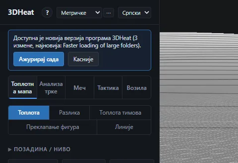

# Ажурирања

Приказ вам каже кад постоји новија верзија, а ажурира се сам само кад кажете да. Ништа се не
мења на вашем рачунару без вашег одговора.

## Ажурирање приказа {#update-the-viewer}

1. **На страници.** Кад постоји новија верзија, поље се појављује испод имена на врху бочне траке:
   „Доступна је новија верзија програма 3DHeat". Кликните **Ажурирај сада**. Страница се сама поново
   учитава кад заврши. **Касније** сакрива поље док не поново учитате страницу.
2. **Ако каже да покренете restart.bat**, затворите прозор сервера (црни прозор који је отворио `start.bat`)
   и двапут кликните `restart.bat`.
3. **Кад покренете приказ.** `start.bat` такође проверава. Ако постоји новија верзија, пита
   **Update now? [Y/N]**. Притисните `Y` да ажурирате. Притисните `N`, или сачекајте 60 секунди без
   одговора, да покренете верзију коју имате.



Копија с вашим сопственим изменама никад се не ажурира уместо вас; поље само каже да ажурирање чека,
и тражи да урадите commit или stash својих измена и покренете `git pull`. Копија која није инсталирана
помоћу git-а (на пример ZIP датотека) не приказује ништа.

Провера ради корак по корак:

```
page ---(after 4 s, then every 6 h)---> dev server ---> git fetch
   behind?  no  -> nothing is shown
            yes -> your own changes or commits?  yes -> tell you only
                                                 no  -> [Update now] -> git pull
                                                        -> reload, or "run restart.bat"
```

## Правила безбедности {#the-safety-rules}

- **Само брзо напред** (`git pull --ff-only`): ажурирање никад не спаја,
  не премешта базу нити било шта преписује.
- **Без локалних измена**: копија с незаписаним изменама у праћеним датотекама
  (`git status --porcelain --untracked-files=no` није празно) се никад не ажурира
  аутоматски - туђи рад не сме да преписује ажурирање. Само се каже да ажурирање
  чека. Непраћене датотеке (подаци, извоз) не броје се као измене.
- **Без локалних commit-ова**: копија с commit-овима којих узводна грана нема („diverged")
  се не ажурира - брзо напред то не може да поправи, а спајање је за `git pull` ручно. Страница и
  `start.bat` то кажу истим речима, а `start.bat` покреће верзију која је ту.
- **Само са саме странице**: захтев за ажурирање дев сервера мора носити прилагођено заглавље и, кад
  прегледач пошаље `Origin`, долазити са домаћина самог сервера (испод).
- Ажурира се само git копија с узводном граном; све остало (копија без `.git`, без инсталираног git-а,
  статички build) се оставља на миру и ништа не каже.

## Шта ради start.bat {#what-startbat-does}

`start.bat` (двоструки клик; прозор је сервер) ради, по реду:

1. Налази Node.js - на `PATH`-у, иначе у `%ProgramFiles%\nodejs`,
   `%ProgramFiles(x86)%\nodejs` или `%LOCALAPPDATA%\Programs\nodejs` - и нуди да га инсталира
   помоћу `winget install -e --id OpenJS.NodeJS.LTS` кад недостаје (пита се, Y/N; после тога прозор
   мора да се поново отвори да Windows преузме нови `PATH`).
2. **Ажурирања**, кад је git инсталиран и фасцикла има `.git`:
   - `git fetch --quiet` (нема мреже или нема узводне гране: прескаче се без поруке);
   - броји `git rev-list --count HEAD..@{u}`; ништа иза: ништа се не каже;
   - локалне измене: "A newer version of 3DHeat is available (N changes), but this copy has local
     changes, so it is not updated. Commit or stash them, then run git pull." - и покреће верзију која је ту;
   - сопствени commit-ови (`git rev-list --count @{u}..HEAD` није 0): "A newer version of 3DHeat is
     available (N changes), but this copy has commits of its own that the newest version does not, so it
     is not updated. Update it with git pull." - и покреће верзију која је ту;
   - иначе "A newer version of 3DHeat is available (N changes)." и питање **Update now? [Y/N]**. `N`, или
     нема одговора 60 секунди, исписује "Not updated; starting the version you have." и покреће верзију
     која је ту. На `Y`: "Updating...", бележи да ли се `package.json` или `package-lock.json` мењају,
     покреће `git pull --ff-only` (ако и то не успе - мрежа, на пример:
     "The update did not go through; starting the version you have."), затим `git submodule update --init`
     (фиксирани алати, видите [Одржавање документације](maintaining.md#the-tools-under-exporters)), затим
     `npm install` кад су се датотеке пакета промениле и `node_modules` постоји, и "Updated.".
3. Одбија да покрене други сервер: кад нешто већ слуша порт **5273**, то каже и упућује на `restart.bat` /
   `stop.bat`.
4. При првом покретању (нема `node_modules`), пита пре преузимања зависности (око 300 MB у `node_modules\`,
   ништа на нивоу система).
5. Покреће дев сервер на `127.0.0.1:5273` (`--strictPort`) и отвара прегледач кад је спреман.

`restart.bat` зауставља сервер (по порту) и поново покреће `start.bat`, па поставља исто питање. `stop.bat`
само зауставља.

## За програмере {#for-developers}

### Док ради: рута за ажурирање {#while-it-runs-the-update-route}

Дев сервер (Vite додатак `heat3d-self-update` у `vite.config.ts`) служи
`/__heat3d/update`. Постоји само на дев серверу - не у статичком build-у и не у `vite preview`.

**`GET /__heat3d/update`** одговара да ли је копија иза:

```json
{ "checkout": true, "upstream": "origin/main", "behind": 3, "ahead": 0, "dirty": false, "latest": "the newest commit's subject" }
```

- `checkout: false` кад фасцикла није git копија;
- покреће `git fetch --quiet` **највише сваких 30 минута** (захтеви између одговарају из последњег
  донетог);
- `behind` / `ahead` из `git rev-list --count HEAD..@{u}` / `@{u}..HEAD`, `dirty` из
  `git status --porcelain --untracked-files=no`, `latest` наслов најновијег commit-а узводне гране;
- без узводне гране, `upstream: null` и `behind: 0`.

**`POST /__heat3d/update/apply`** доводи копију у ред:

1. Одбија се са `403 { ok: false, reason: "forbidden" }` осим ако захтев има заглавље
   `X-Heat3d-Update: 1` и, кад носи `Origin`, домаћин тог origin-а је `Host` захтева. Формулар са друге
   странице не може послати прилагођено заглавље без CORS preflight-а, а овај сервер га никад не даје.
2. Нема шта да се уради (није копија, нема узводне гране, није иза):
   `{ ok: true, updated: false }`.
3. Локалне измене: `{ ok: false, reason: "dirty" }`; локални commit-ови: `{ ok: false, reason: "diverged" }`.
4. Иначе: бележи датотеке које се мењају (`git diff --name-only HEAD @{u}`), `git pull --ff-only` (тајмаут
   2 min), `git submodule update --init` (грешка се занемарује), `npm install` кад се `package.json` или
   `package-lock.json` промене (тајмаут 15 min), и одговара
   `{ ok: true, updated: true, restart }` - `restart` каже зашто покренути сервер не може да преузме
   ажурирање: `"dependencies"` кад су поново инсталиране, `"config"` кад се промени само `vite.config`
   датотека, `false` кад ништа не треба поновно покретање.
5. Неуспела git или npm команда одговара `{ ok: false, reason: "<грешка, до 300 знакова>" }`.

Одговори су JSON са `Cache-Control: no-store`. Сервер слуша само на `127.0.0.1`, па рута није
доступна са мреже.

### Обавештење на страници {#the-notice-in-the-page}

`UpdateBanner`, испод имена на врху бочне траке:

- Пита руту **4 секунде** после учитавања странице (не у првим секундама: страница има скуп података за
  учитавање и GPU за покретање) и поново **сваких 6 сати** док је страница отворена.
- **Ништа не приказује** кад нема такве руте (статички build), фасцикла није копија, или ништа није
  новије - обавештење при сваком покретању је оно на шта људи научите да не обраћају пажњу.
- Иза, без локалних измена: "Доступна је новија верзија програма 3DHeat (N измена, најновија: <наслов>)."
  с **Ажурирај сада** и **Касније** (*Касније* сакрива док се страница не учита поново).
- Иза, с локалним изменама: иста реченица и „Ова копија има локалне измене, па се не ажурира аутоматски;
  урадите commit или stash, па покрените git pull." - без дугмета.
- **Ажурирај сада** шаље на `/apply` („Ажурирање…"). Затим:
  - „Ажурирано. Страница се поново учитава." - и учитава се поново 1,5 s касније (сервер већ служи нове
    датотеке);
  - кад су зависности поново инсталиране: „Ажурирано. Промениле су се зависности: затворите прозор сервера
    и покрените **restart.bat** да бисте завршили.";
  - кад су се промениле само поставке сервера: „Ажурирано. Промениле су се поставке сервера: затворите
    прозор сервера и покрените **restart.bat** да бисте завршили.";
  - ништа на крају за унети (`updated: false` - копију је у међувремену довео ред, на пример `start.bat`):
    „Нема шта да се ажурира: ова копија је већ најновија верзија." - и без поновног учитавања;
  - одбијено: реченица о локалним изменама, или „Ова копија има сопствене commit-ове којих у најновијој
    верзији нема; ажурирајте је помоћу git pull.", или „Ажурирање није успело: <разлог>".
