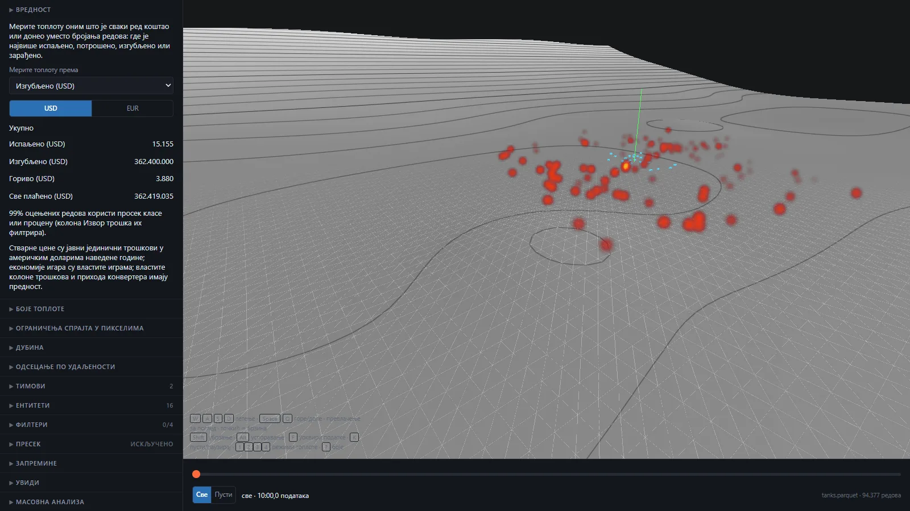

# Тежинање вредности

Сваки испаљени метак, муниција, изгубљено возило и литар горива има цену. Приказивач израчунава шта је сваки ред коштао или зарадио и може да тежи топлоту њоме, па мапа показује **где је новац отишао**, а не где су редови.

## Како се користи {#how-to-use-it}

1. Учитајте податке са догађајима (пуцњи, убиства, смрти) и именима возила или оружја.
2. Отворите **Вредност** у бочној траци Топлоте.
3. Изаберите **Мерите топлоту према**, на пример *Изгубљено (USD)*. Топлота сада додаје цену сваког реда уместо 1.
4. Прочитајте **Укупно**: збир сваке колоне вредности за оно што је приказано (важе филтри и временски прозор).
5. Где су цене стваран новац, појављује се прекидач **USD / EUR**.

Изаберите празан први унос у менију да поново бројите редове.

## Шта се може тежити {#what-can-be-weighed}

Колоне вредности се додају при учитавању, по једна за сваку врсту и валуту:

| Врста | Редови на које се односи | Како се вреднује |
|---|---|---|
| **Испаљено** | пуцњи и лансирања | оружје, а иначе просек за врсту муниције |
| **Потрошено** | куповина, појављивање | новчане колоне игре (на пример мени за куповину у шутеру) |
| **Изгубљено** | смрти, уништења | сопствено возило, а иначе просек његове класе |
| **Уништен** | убиства | возило мете |
| **Нанета штета** | погоци | удео у вредности мете |
| **Гориво** | положаји | утрошено гориво, из колоне горива или процењено из класе и времена |
| **Све плаћено** | | испаљено + потрошено + изгубљено + гориво |
| **Зарађено** | награде | сопствене колоне награда игре (`earn_…`) |
| **Нето** | | зарађено минус плаћено; црта се као топлота са знаком (позитивна рампа где је више зарађено, негативна где је више плаћено) |

Имена колона су `cost_<kind>_<currency>`, `earn_<currency>` и `net_<currency>`. Конвертор који познаје валуту саме игре (на пример конвертор реприза који пише у кредитима из игре) има предност над уграђеним табелама цена.

## Табеле цена {#the-price-tables}

| Табела | Валута |
|---|---|
| Стварна војска: ракете, бомбе, меци, мере против дејства, авиони, хеликоптери, возила на копну, бродови, гориво | USD (EUR = USD × 0,92, фиксна вредност `EUR_PER_USD` у [`cost.ts`](https://github.com/Holdi601/3DHeat/blob/main/src/data/cost.ts); није жив курс) |
| Менији за куповину у шутерима и награде за убиства | кредити игре |
| Игре са тенковима и бродовима | кредити игре |
| Стратешке игре (више ресурса) | једна колона по ресурсу и једна збирна |
| Ратне игре | поени |

Игра се препознаје по именима у подацима. Цене из стварног света долазе из јавних извора (буџетски документи, енциклопедије) или су означене као процене; нису кориговане за инфлацију. Генерисан списак табела је на [Табелама вредности](ref-value-tables.md).

## Процене {#estimates}

Додатна колона категорије **Извор цене** говори како је сваки ред вреднован: `table`, `class average`, `estimate` или `none`. Одељак Вредност показује који удео вреднованих редова су просеци или процене. Да задржите само тачно вреднована редове, искључите *estimate* и *class average* под **Извор цене** у [Филтрима](filters.md).

## Где се вредност још види {#where-else-value-shows}

- [Увиди](insights.md): налази *Скупо тло* и *Тло које доноси зараду*.
- [Раздвајање](breakdown.md): зарађени, изгубљени и нето новац по тиму, играчу или оружју.
- [Запремине](volumes.md): колоне вредности у статистици и поређењу.
