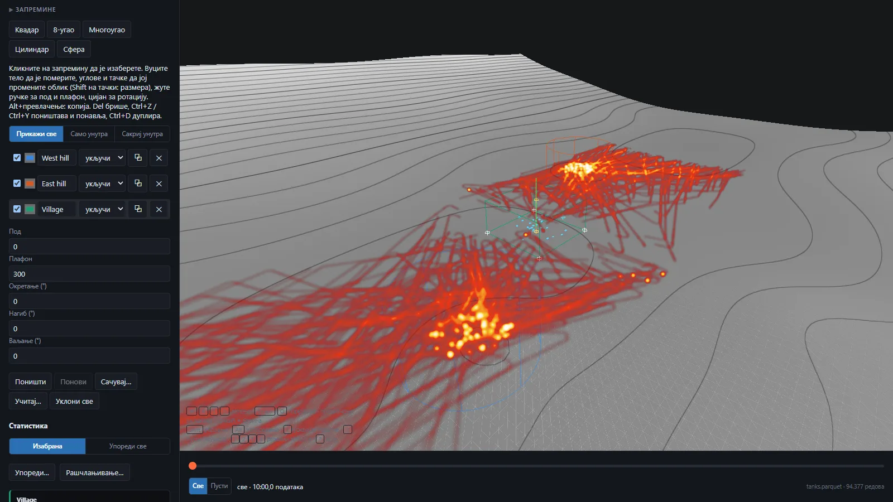
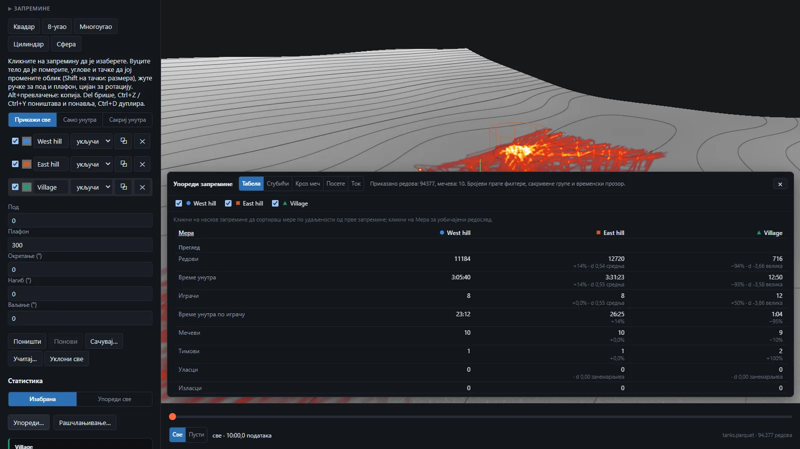
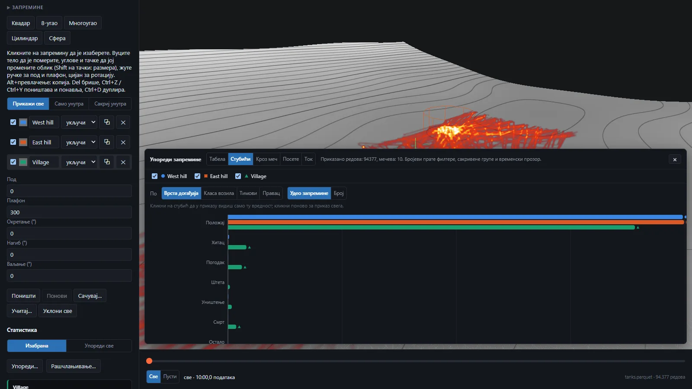

# Запремине и поређење

**Запремина** је невидљиви квадар (или цилиндар, или сфера) који цртате око неког места, да бисте питали: шта се десило унутра? Користите је да бисте избројали убиства код моста, упоредили два брда, или приказали само активност у једној области.

```
 одозго                    Ви цртате облик ->  приказивач броји
 +------------+            шта је унутра:
 |   ( A )    |             редове, играче, убиства, време ...
 |        [B] |            Упоредите A са B, једно уз друго.
 +------------+
```



Запремине мере шта се дешава унутар њих, филтрирају приказ на њих, извозе њихове редове и могу да се упореде једна уз другу. Видети и [речник појмова](glossary.md) за ред, особу и меч.

## Нацртајте запремину {#draw-a-volume}

1. Отворите **Запремине** у бочној траци.
2. Изаберите алат и цртајте у 3D приказу или на 2D мапи. Под и плафон почињу од података испод. Esc отказује.
3. Кликните на запремину да је изаберете; појављује се њена **Статистика**.

| Алат | Како се црта |
|---|---|
| **Квадар** | Превуците правоугаоник (Shift: квадрат). Клик поставља подразумевани квадар. |
| **n-угао** | Превуците од центра (Shift га држи правилним). *Углови* поставља n, од 3 до 64 (подразумевано 8, па дугме гласи **8-угао**). |
| **Многоугао** | Кликните на углове; затворите двоструким кликом, Enter или кликом на први угао. Backspace уклања последњи угао. |
| **Цилиндар** | Превуците полупречник. |
| **Сфера** | Превуците полупречник; почива на тлу. |

## Уређивање {#edit}

- Кликните на запремину да је изаберете. Превуците њено тело да је померите, углове да је преобликујете (Shift на углу скалира).
- **жуте** ручице постављају под и плафон, **циан** ручица окреће је.
- Alt+превлачење копира, Del уклања, Ctrl+Z / Ctrl+Y поништава и понавља, Ctrl+D дуплира. **Уклони све** брише сваку запремину.
- Тачне вредности: Доња граница, Горња граница, Окретање / Нагињање / Ваљање (квадри), Полупречник (сфере, цилиндри).

Сваки ред запремине има поље за потврду приказа, боју, назив, **укључи** или **искључи**, дуплирање и брисање. Запремине се чувају у прегледачу за сваки скуп података, а **Сачувај...** / **Учитај...** пишу и читају датотеку `volumes.json`.

## Филтрирајте приказ {#filter-the-view}

| Филтер | Дејство |
|---|---|
| **Прикажи све** (подразумевано) | Запремине само мере. |
| **Само унутра** | Топлота, реприза и [анализа погодака](hit-analysis.md) цртају само оно што је унутар укључених запремина и ван искључених. |
| **Сакриј унутра** | Супротно. |

GPU филтер узима до 8 запремина са 64 тачке обриса укупно; „!” означава запремину преко тога. Статистика и извоз је и даље броје.

## Статистика {#statistics}

Област **Статистика** прати филтере, временски прозор и скривене групе. *Изабрано* приказује изабрану запремину, *Упореди све* ставља сваку запремину једну уз другу. Приказује:

- **Редова унутра (приказаних)** и **Редова унутра (сви подаци)**, **Играчи**, **Тимови**, **Мечеви**, **Време унутра**, **Уласци / изласци**, **Врх топлоте**, **Просечна топлота**, **Запремина / основа** и хистограм **Када**;
- по колони: категорије са **Подигнутошћу** (удео унутра подељен уделом у свим приказаним подацима), а бројеви са опсегом, медијаном и 5. до 95. перцентилом.

**Статистика као CSV / JSON** чува их. **Извези податке унутра** записује редове унутра као CSV или Parquet (*Само приказани редови* је подразумевано укључено), једну запремину или све, са колоном која каже којој запремини припада сваки ред.

## Упоредите запремине {#compare-volumes}

Са две или више видљивих запремина, притисните **Упореди...**.

1. Нацртајте три запремине, на пример Западно брдо, Источно брдо и Село.
2. Притисните **Упореди...** испод Статистике.
3. У **Табели** прочитајте разлику сваке вредности у односу на прву запремину.
4. Пређите на **Стубиће** да видите уделе као стубиће.



| Приказ | Показује |
|---|---|
| **Табела** | Редови, време унутра, играчи, мечеви, тимови, улази, изласци, посете, дужина посете, убиства, смрти, убиства по смрти, убиства у минути, време по играчу, колоне вредности; груписано по догађајима, класи возила, играчу или ВИ, тиму и правцу. Свака вредност показује разлику у односу на прву запремину и величину ефекта (занемарљива, мала, средња, велика). Кликните на наслов запремине да сортирате по удаљености од прве. |
| **Стубићи** | Бројеви или удели по догађају, класи, учеснику, тиму или правцу. Кликните на стубић да филтрирате приказ на њега. |
| **Кроз меч** | Један графикон по запремини кроз минуте меча: присуство, редови или убиства. Кликните да скочите тамо. |
| **Посете** | Кутијасти и виолински дијаграми колико трају посете (логаритамска скала). |
| **Ток** | Куда путање иду после изласка из сваке запремине: матрица прелаза или траке тока. |



## Савети {#tips}

- Почните од налаза: у [Увидима](insights.md), **Запремина овде** додаје цилиндар око места налаза.
- **Рашчлањивање...** отвара [Рашчлањивање](breakdown.md) за изабрану запремину: ко и шта најбоље ради унутра.
- [Усмерена топлота](directional-heat.md) може да прикаже правце унутар изабране запремине на графикону.
- [Картица Возила](hit-analysis.md#restrict-to-an-area) користи исте запремине као свој филтер области.
