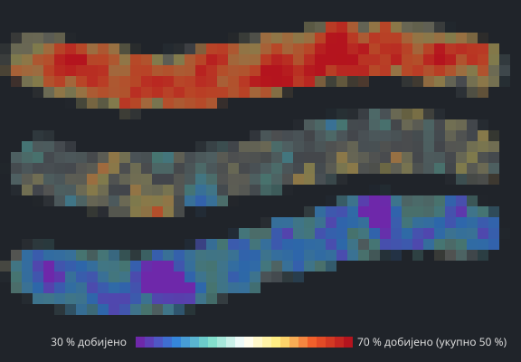

# Проценат победа: колико често место, пут или потез побеђује

Где играч стоји, којим путем иде, куда баца гранате и друга помагала - и колико често његова страна затим освоји рунду. **Мапа процента победа** боји свако место према уделу редова на њему који припадају рундама које је страна реда освојила, у односу на удео у свему приказаном: топло где је већи, хладно где је мањи, ништа где је исти.

*Слика приказује измишљене податке: три пута на празном нивоу, 68 %, 50 % и 33 % њихових редова у освојеним рундама.*

Потребни су подаци који говоре ко је победио: [колоне исхода](data-formats.md#outcome-columns) (`won`, `matchWon`, `roundEndReason`). Пишу их конвертери за CS2 и War Thunder, а конвертер за Tacview за кампање DCS сервера ([DCS сервери](tacview-acmi.md#dcs-servers-who-won-and-how-each-sortie-ended)); може их имати било која датотека.

## Испробајте {#try-it}

1. Учитајте мечеве са колоном исхода и притисните `2` (**Разлика**).
2. У **Подела разлике** притисните **Проценат победа по рунди** (или **Проценат победа по мечу**). Освојене рунде ставља на **+**, изгубљене на **−** и пребацује панел на **Удео +**.
3. Читајте боје. Панел наводи укупни удео: *Укупно је 52,0 % од 1.200.000 редова на +.*
4. Сузите помоћу [филтера](filters.md): једна страна (T или CT), једна врста догађаја (*Положај* за места где су људи стајали, *Хитац* или *Испаљивање (ракета, пројектил, бомба)* за места одакле су пуцали или бацали), једна куповина, једна мапа.

Место које је топло са редовима *Положај* је место чији су држаоци рунду углавном освојили. Са редовима *Уништење* то је место где су убиства која су се тамо догодила водила до освојених рунди.

## Подешавања {#the-settings}

| Подешавање | Шта ради | Подразумевано |
|---|---|---|
| **Разлика** / **Удео +** | сама разлика или удео стране + међу редовима обе стране | Разлика |
| **Пуна боја при** | колико изнад или испод укупног удела се место приказује пуном бојом, у процентним поенима | ± 20 поена |
| **Најмање редова за бојење места** | место са мање редова није обојено; постепено се појављује од половине те вредности | 12 |
| **Привлачење укупном уделу (редови)** | свако место почиње са оволико редова на укупном уделу, па место са 3 реда, сва освојена, није приказано као 100 % | 12 |

Сва три делују на готову слику: њихово померање никада не покреће скупљање испочетка.

Удео може бити било које поделе, не само победа: *Удео +* са поделом по страни показује где су Ts били већи део присуства, а са поделом по датотекама две мапе где редови једне датотеке надмашују редове друге.

## Редови, не рунде {#rows-not-rounds}

Мапа броји редове. Играч који двадесет секунди стоји на једном месту додаје ред при сваком узорку, све из једне рунде, па су доказ на месту редови близу њега, а не рунде. Зато су најмањи број и привлачење у редовима и зато су већи од онога што даје једна рунда.

За саме рунде:

- **[Рашчлањивање](breakdown.md)** на месту, погледу или запремини: *Победе %* броји рунду сваког играча једном, са истим привлачењем ка укупном уделу места (4 рунде).
- Статистика **[Запремина](volumes.md)**: *Проценат победа* - рунде са играчем унутар запремине, свака једном, са привлачењем ка уделу у свему приказаном, уз бројеве.

## Филтери исхода {#outcome-filters}

Панел [Филтери](filters.md) наводи колоне исхода одмах после сопствених колона приказивача: **Исход рунде** и **Исход меча** (*Било који*, *Победа*, *Пораз*) и **Како се рунда завршила** (Елиминација, Бомба је експлодирала, Бомба је деактивирана, Време је истекло, Предаја, Нерешено, Циљ, Задржане зоне, Изгубљени бодови, Изгубљена сва возила), на језику приказивача.

## За програмере {#for-developers}

Пролаз топлоте записује три збира у четвороканални циљ који користи топлота тимова: топлоту `R = Σ|v|`, топлоту стране + `P` и `S = Σ v²/w`, где је `w` тежина пролаза (тежина узорковања пута појачање оквира). Слагање чита удео `P/R` (просек пондерисан језгром) и број редова на којима почива, `n = R²/S` (Кишова ефективна величина узорка), привлачи удео ка укупном, `p = (n·P/R + m·r0)/(n + m)`, и боји `p - r0` преко распона на рампама разлике.

`n` поништава сваки фактор заједнички редовима у пикселу - појачање оквира, тежину узорковања, тежину површине одсеченог спрајта - па је слика иста при сваком зуму и густини узорковања, а оквири сваког k-тог реда спајају се у целину без скокова боја. Укупни удео долази из бројева страна на CPU-у, тачно на десетину процента; ништа се не чита назад са GPU-а. Рачунање и његове провере: [`render/rateMap.ts`](https://github.com/Holdi601/3DHeat/blob/main/src/render/rateMap.ts) и његов тест.

Кошта колико и топлота тимова: четвороканални циљ учетворостручује пропусност мешања у пролазу топлоте, само док је укључен *Удео +*.
