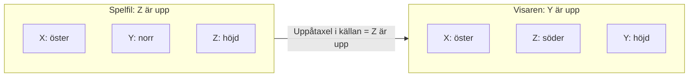

# Axlar, enheter och tid

Spel och kartor är inte överens om vilket håll som är upp, hur lång en enhet är eller hur tid skrivs. Den här sidan visar de tre inställningar som gör att dina data står, skalas och spelas upp på rätt sätt.

Om din karta står som en vägg i stället för att ligga som ett golv, byt **Uppåtaxel i källan**.

Med fel **Uppåtaxel i källan** står kartan som en vägg. Med rätt ligger den som ett golv.

## Världen som visaren ritar i {#the-world-the-viewer-draws-in}

Visarens världen är **Y-upp**: X och Z är markplanet och Y är höjd. De flesta spelmotorer är **Z-upp**: för dem är X och Y marken och Z är höjd. Vissa motorer är också speglade (vänsterhänta). Mappningen anger hur filens axlar görs om till visarens. (Tekniskt sett är visaren högerhänt, enligt three.js-konventionen.)

### Uppåtaxel {#up-axis}

**Uppåtaxel i källan** i [Kolumnmappning](column-mapping.md):

| Inställning | Fil (x, y, z) blir värld (X, Y, Z) |
|---|---|
| *Z är upp (de flesta spelmotorer)* - standard | (x, **z**, **y**): filens Z blir höjd och filens Y blir världens Z |
| *Y är upp (grafikkonvention)* | (x, y, z) oförändrat |

För Z-upp-data döps de tre fältarrayerna om i stället för att kopieras ([`remapAxesInPlace`](https://github.com/Holdi601/3DHeat/blob/main/src/data/ingest.ts)). Det sparar hundratals megabyte vid stora inläsningar. Gissningen görs utifrån provet: den av kolumnerna Y och Z som har minst spridning är upp.

### Spegling {#flips}

**Vänd X**, **Vänd Y** och **Vänd Z** negerar *filens* axel med det namnet, innan omdöpningen. Med Z-upp negerar alltså *Vänd Y* det som blir världens Z. En spegling ändrar de inlästa data: koordinater som visas av [linjalen](measure.md), skivan och kamerans läge är de speglade.

För att rita en speglad värld rätt utan att ändra data, använd i stället **Kamera och scen → Invertera världsaxel** ([Kamera](camera.md#invert-world-axis)). Det är det bättre valet för spel vars värld är vänsterhänt, eftersom varje koordinat verktygen visar förblir spelets egen.

### Enhetsskala {#unit-scale}

**Enhetsskala** multiplicerar alla positioner. *1 (m)* sätter 1, *0.01 (cm→m)* sätter 0.01 (Unreal Engine-enheter är centimeter, så använd 0.01. Source-motorns enheter är tum, så använd 0.0254. Ingen av dem är meter). Rutan godtar vilket värde som helst. Ett inskrivet 0 eller ett värde som inte är ett tal ersätts med 1.

Visaren anger avstånd i meter (spriteradie, avståndsgränser, linjalen, flygfart). Det stämmer bara när den skalade världsenheten är en meter. Inget går sönder om den inte är det. Då står bara "m" för något annat än meter.

## Tid {#time}

### Tidsenheter {#time-units}

Tumregel: värden som 17000000000 (tio siffror eller fler) är en Unix-tidsstämpel. Värden som 0, 0.25 och 0.5 är sekunder från starten.

| Tidsenhet (menyetikett) | Läses som | Visad klocka |
|---|---|---|
| *Sekunder (relativ)* | värde × 1 s | nej |
| *Millisekunder (relativ)* | värde × 0.001 s | nej |
| *Mikrosekunder (relativ)* | värde × 10^-6 s | nej |
| *Nanosekunder (relativ)* | värde × 10^-9 s | nej |
| *Unix-tidsstämpel (s)* | sekunder sedan 1970-01-01 UTC | ja |
| *Unix-tidsstämpel (ms)* | millisekunder sedan 1970-01-01 UTC | ja |
| *ISO-8601-datumsträng* | text som `2026-03-14T18:02:11.250Z`, tolkad med webbläsarens `Date.parse` | ja |

Med en absolut enhet (de tre sista) behåller datamängden det väggklockeinstant som hör till dess tidigaste rad. Tidslinjen visar den aktuella UTC-tiden på dygnet (`HH:MM:SSZ`) bredvid spelhuvudet.

**Parquet-kolumner av typen `TIMESTAMP` och `DATE`** avkodas till riktiga tidpunkter. Deras enhetsinställning ignoreras därför, och panelen säger det. En `DATE`-kolumn är en hel dag: alla rader under en dag delar en tidpunkt, och uppspelningen hoppar en dag i taget. Panelen varnar för det.

**ISO-8601-strängar fungerar lika bra i CSV och Parquet.** En textkolumn med tid och ISO-enheten tolkas en gång för varje unik sträng. Om ingen tolkas misslyckas inläsningen med *Inga tolkbara ISO-8601-tidsstämplar i den mappade tidskolumnen.* Mappningen vägrar dessutom starta redan när inget av de provade värdena kan tolkas. En Parquet-kolumn av typen `TIMESTAMP` läses som tidsstämpel oavsett vilken enhet som är vald. En numerisk Parquet-kolumn med ISO-enheten läses som Unix-millisekunder. En textkolumn med tid och en numerisk enhet avvisas före inläsningen, för varje värde skulle bli NaN.

### Hur tid lagras {#how-time-is-stored}

Medan filerna slås ihop är tiderna 64-bitars sekunder, så en absolut epok behåller sin bråkdelssekund. När alla filer är inne blir den tidigaste tiden i hela urvalet 0, och varje rad lagrar 32-bitars sekunder från den. En 32-bitars flyttal har 24 bitar mantissa. Spann på upp till ungefär ett och ett halvt dygn upplöses bättre än 1/100 s. Spann på ett halvår upplöses till ungefär en sekund. En rad vars tid saknas eller inte är ett tal placeras vid 0, alltså starten.

Raderna sorteras sedan efter tid. Det gör tidslinjen billig: ett tidsfönster hittas med två binära sökningar (se [Sampling och budgetar](sampling-and-budgets.md)).

### Förfluten tid kontra väggklocka {#elapsed-time-versus-wall-clock}

En tidskolumn som `match_time` eller `round_time` räknar från varje matchs egen start. Om du väljer den hamnar alla matcher på en gemensam axel. Det är bra för att jämföra vad som händer i minut 3 i varje match, och panelen påpekar det. En kolumn med väggklocka visar matcherna i den ordning de verkligen ägde rum, och de överlappar där de överlappade.

## Blickriktning {#look-direction}

Blickriktning används bara av [lådrepris](box-replay.md) (strålarna från varje låda). Den lagras som två vinklar, gir och nick, i radianer.

- **Gir-/nickkolumner** läses som de är, och omvandlas från grader om *Grader* är valt. De justeras inte för uppåtaxeln eller speglingarna.
- **Kolumner för riktningsvektor** går genom samma omdöpning och speglingar som positionerna och blir sedan gir = atan2(x, -z) och nick = atan2(y, √(x² + z²)) i världsaxlar. Därmed pekar strålen dit lådan är vänd även i en speglad världskälla.

Om gir- och nickkolumnerna pekar åt fel håll efter en spegling, en riktningsvektor eller justerade vinklar, är det rätt att åtgärda det där.
