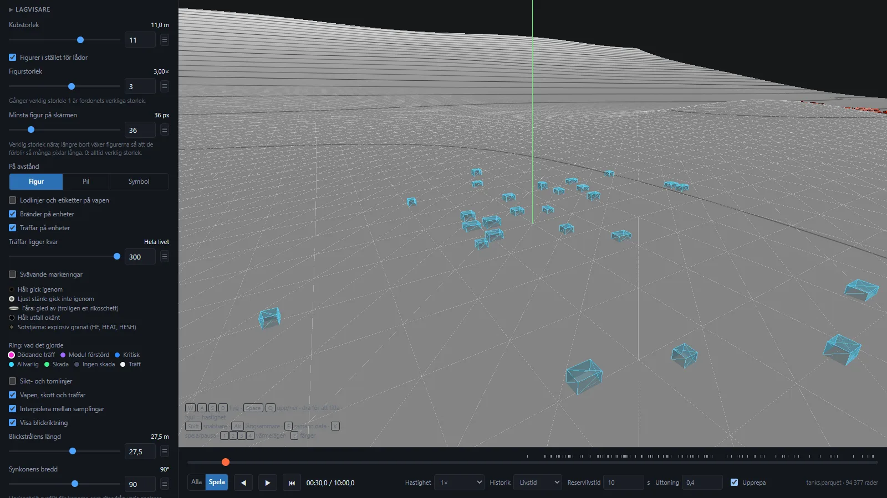

# Figuröverlägg (lådrepris)

En liten film: en figur för varje person, som rör sig när tiden går, med en svans bakom sig.

Läget heter **Figuröverlägg** i lägesfältet. Den här sidan hette tidigare "lådrepris", eftersom varje person var en låda innan figurer fanns. "Figurrepris" och "lådrepris" betyder samma sak. **Figuröverlägg** har ingen sifferknapp. Välj det i lägesfältet. Det ritar en figur (eller låda) per [person](glossary.md), som rör sig längs [tidslinjen](timeline.md), med valfria blickstrålar och svansar. Det är uppspelning snarare än täthet: *vem var var, och när*. Läget behöver en kolumn med personer. Utan tidskolumn ritas alla prover på en gång.

## Så använder du det {#how-to-use-it}

1. Läs in data med en personkolumn och en tidskolumn.
2. Välj **Figuröverlägg** i lägesfältet.
3. Ställ tidslinjen på **Spela** och tryck på play (`K`).
4. Öppna **Lagvisare** för att ändra **Svanslängd**, figurstorleken eller blickstrålarna.

Ingen värme ritas i det här läget, och den adaptiva sprite-budgeten är vilande.

Som standard ritas varje person som figuren för vad personen är, inte som en låda. Se [Figurer](figures.md) för vilken figur en enhet får. Se [Matchrepris](match-replay.md) för etiketter, följkameran, mätning mellan två enheter och händelselistan.

## Panelen Lagvisare {#the-team-viewer-panel}

Visas i stället för värmepanelerna i det här läget.

| Reglage | Standard | Intervall (jogg) | Betydelse |
|---|---|---|---|
| **Figurer i stället för lådor** | på | | Varje person som figuren för vad personen är: en soldat till fots, stridsvagnen eller flygplanet som data anger. Det data inte säger något om förblir en låda. |
| **Figurstorlek** | 1× | | 1× är verklig storlek. |
| **Minsta figur på skärmen** | 36 px | 0 = alltid verklig storlek | Verklig storlek på nära håll. Längre bort växer figurerna så att de blir så många pixlar långa. |
| **Vapen, skott och träffar** | på | | Vapen i luften med rök, spårljus, nedslag, träffar och dödanden. Spårljus som slutits sig till av en träff är streckade. |
| **Kubstorlek** | entitetens storlek, eller omfattning / 500, vid inläsning | 0,05–200 m, logaritmiskt (5000) | Kantlängden på varje låda. Se [entitetsstorlek](sessions-persons-groups.md#entity-size). |
| **Interpolera mellan samplingar** | på | | Mellan två samplingar av samma person i samma session placeras lådan proportionellt mellan dem. Aldrig över en gräns mellan sessioner. |
| **Visa blickriktning** | på | | En stråle från varje låda i personens blickriktning (kräver [blickkolumner](axes-units-and-time.md#look-direction)). |
| **Blickstrålens längd** | entitetens storlek × 4, eller omfattning / 200, vid inläsning | 0,5–500 m, logaritmiskt (20 000) | Visas medan blickriktning är på. |
| **Svanslängd** | 8 s | 0–300 s (86 400); 0 = av | Sekunder av historik som ritas bakom varje person. |
| **Rita alla råa samplingar** | av | | En låda per lagrad sampling i fönstret, i stället för en interpolerad låda per person. Glesas ut för att hålla det interaktivt. |

Hjälptexterna i panelen förklarar att interpolering och svansar bara binder ihop samplingar inom en och samma session. När inläsningen har [delade namn](sessions-persons-groups.md#names-worn-by-several-things-at-once) står det också hur många namn som ritas som enskilda samplingar.

## Sessionen som spelas upp {#the-session-being-played}

Med en sessionskolumn avgör väljaren **Session** överst i sidofältet ([Sessioner](sessions-persons-groups.md#the-session-picker)) vilken match som spelas upp. Den mest aktiva väljs vid inläsning. Bara rader från den sessionen blir lådor och svansar, och tidslinjen går över den sessionens spann i stället för hela datamängden. *Alla sessioner* spelar upp alla sessioner samtidigt. Även då binds inga samplingar ihop över sessionsgränser.

## Vad som ritas när {#what-is-drawn-when}

Från [`TrackCursor`](https://github.com/Holdi601/3DHeat/blob/main/src/data/tracks.ts):

**Levande lådor** (läget Spela, råa samplingar av). För varje synlig person deras senaste sampling vid eller före spelhuvudet:

- Om personen har en nästa sampling, den ligger i samma session, och namnet inte är delat, placeras lådan mellan de två samplingarna i proportion till tiden. Girningen interpoleras den kortaste vägen runt och nickningen linjärt (när *Interpolera* är på).
- Annars står lådan kvar vid den sista samplingen under **Reservlivstid** på tidslinjen (standard 10 s). Sedan tas den bort, så att eliminerade spelare inte blir kvar.

**Läget Alla** bryr sig inte om spelhuvudet och ritar varje sampling i intervallet som en låda.

**Råa samplingar** ritar en låda per lagrad sampling i fönstret. Det är *spannet* med *fönstret* som historik, annars allt upp till spelhuvudet. Högst 65 536 lådor. Med fler samplingar ritas var *k*:te.

**Svansar** (när svanslängden är över 0 och råa samplingar inte ritas): en linje mellan varje par av på varandra följande samplingar av en person inom de senaste *svanslängd* sekunderna fram till spelhuvudet. Linjen tonar från 80 % opacitet till genomskinlig med åldern. En svans slutar vid ett sessionsbyte och ritas inte för delade namn. Högst 131 072 hörnpunkter. Med fler hoppas rader över jämnt.

**Vem som syns:** en person döljs när deras grupp är avbockad i [Lagslistan](teams-list.md) (gruppen är den för personens första rad), när ett gruppfilter utesluter den, eller när panelen [Entiteter](entities.md) har ett urval som inte innefattar dem. [Filtren](filters.md) på kolumner gäller inte för lådor.

## Färger {#colours}

En färgfamilj per grupp och en nyans per medlem, så att man ser direkt vilken sida någon står på ([`teamMemberColor`](https://github.com/Holdi601/3DHeat/blob/main/src/render/colors.ts)). Gruppernas färgtoner går i tur och ordning genom en fast lista med tio: blå, röd, grön, bärnsten, violett, cyan, magenta, limegrön, orange och indigo. Medlemmarna i en grupp sprids över ljushet 42–76 % och mättnad 90–65 %.

## Noter {#notes}

- Figuröverlägget bygger om sina figurer bara när något ändras. En vilande bildruta ritar om de senaste.
- Raden *Kuber* i [statistiköverlägget](performance-and-stats.md) räknar lådorna på skärmen.
- Figuröverlägget ritas i samma scen som banan, så [skärpedjup](camera.md#depth-of-field) suddar ut lådorna men aldrig värmen.
