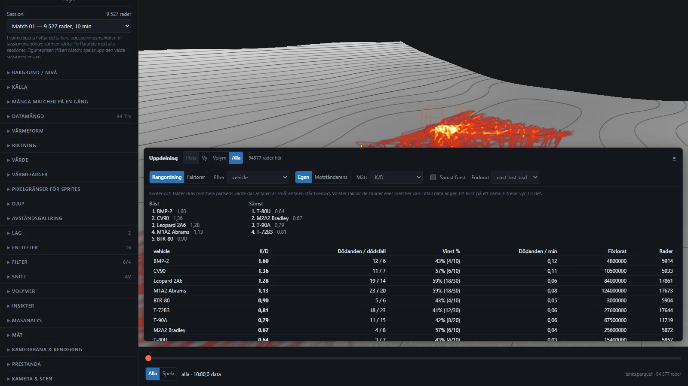
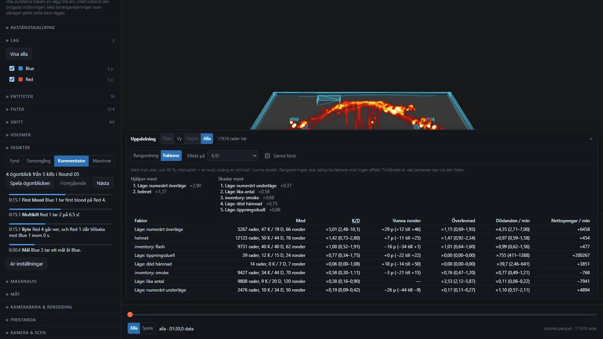

# Uppdelning: vem och vad som presterar bäst var

**Uppdelningen** svarar på en fråga: på den här platsen, vilket fordon, vilken spelare eller vilket vapen presterar bäst? Använd den för att hitta stridsvagnen som vinner vid bron, eller för att se om en hjälm verkligen hjälper.

Den rangordnar det som händer på en plats (en vald punkt, vyn, en volym eller allt som visas) efter vilken kategori som helst. Den mäter också varje tillståndsfaktor med och utan.

## Prova det {#try-it}

1. Läs in en match med dödanden och dödsfall, och öppna **Volymer**.
2. Rita en volym runt platsen du bryr dig om och välj den.
3. Tryck på **Uppdelning…** under Statistik.
4. Under **Efter** väljer du *Fordon* och måttet *K/D* (dödanden per dödsfall).
5. Läs listan, bäst först. Tryck på **Sämst först** för att vända den. Klicka på ett namn för att filtrera vyn till det. Klicka igen för att släppa.

## Öppna den {#open-it}

| Från | Område den börjar med |
| --- | --- |
| **Uppdelning…** i [Volymer](volumes.md) (Statistik) | den valda volymen |
| **Uppdelning här** på kortet för punkten, efter ett klick på en punkt | ett klot runt den punkten (**Radie**, standard 3 % av datamängdens storlek) |
| delningspanelen **Differens** | vyn |

Rubriken byter område: **Plats**, **Vy** (det kameran såg vid senaste räkningen; **Räkna om** efter att du har flyttat den), **Volym** (välj en) eller **Alla**. Den räknar i bakgrunden. Statusraden säger hur många rader som finns i området.

## Rangordning {#ranking}

Välj vad som ska rangordnas och ett mått:

| Mått | Vad det är |
| --- | --- |
| A, B | rader på varje sida av differenskartan, delade som värmen delar dem |
| A / B, A - B, A / (A + B) | de två lagren mot varandra |
| K/D | dödanden mot dödsfall |
| Vinst % | ronder (eller matcher) som vunnits, där data anger vem som vann |
| Dödanden / min | dödanden per närvarande minut (glappen mellan rörelseprover) |
| Intjänat, Förlorat, Nettopengar | summor av kolumnerna `earn_*` och `cost_*`. En väljare anger valutan |

Dödanden, dödsfall, närvaro, vinster och pengar räknar varje rad som vyn visar på platsen, på vilken sida av delningen som helst eller på ingen.

Kvoter och takter dras mot hela platsens värde där antalen är små. Därför hamnar inte 2 dödanden på ett liv överst på listan. Antalen visas bredvid.

Du kan rangordna efter grupper, spelare och matcher, vilken kategorikolumn som helst (ett fordon, ett vapen, en sida, en köptyp, en agent eller ett utrustningspaket), vilken sifferkolumn som helst i intervall (pansar, värdet på en utrustning), ett vapenkolumns **klass** (gevär, prickskytte, SMG, pistol...) och hur många delar **utility** en listkolumn som `inventory` innehåller.

**Egen** rangordnar radens eget värde. **Motståndarens** rangordnar den andra partens värde: offrets vapen vid ett dödande, dödarens vid ett dödsfall. Det kräver en kolumn `other` / `victim` som anger dem.

## Tillståndet vid den tiden {#state-at-the-time}

En rads värde är dess eget, såvida inte raden saknar något (en händelserad utan utrustning) eller det är ett dödsfall (vars vapenkolumn kan ange dödarens vapen). Då är värdet det personen senast bar tidigare i matchen.

## Faktorer: med mot utan {#factors-with-against-without}

Byt från **Rangordning** till **Faktorer**, välj **Effekt på** och läs *Hjälper mest* och *Skadar mest*:

Varje faktors effekt på K/D, vunna ronder, överlevnad (minuter per dödsfall), dödanden per minut och nettopengar per minut, med ett 95 %-intervall. Kvoter visas som ×, vunna ronder som en skillnad i poäng. Rangordningen drar varje skattning mot ingen effekt, efter dess egen osäkerhet. En sällsynt faktor behöver alltså en tydlig effekt för att hamna högt. Intervallet som visas är det odragna.

Data med ronder lägger till **lägen** i närstrid ([Närstrid och ronder](close-quarters.md)). De beräknas en gång för varje datamängd: *bländad* (radens `state_flashed`, eller en fiendes blixt inom 15 m under de senaste 3 s), *dödsfall hämnat*, *öppningsduell* samt *numerärt överläge*, *lika antal* eller *numerärt underläge* (spelare vid liv på radens sida mot fienden). Ett dödsfall räknas i det läge som offret var i precis innan.

Högst 256 faktorer mäts i en genomgång.

## För utvecklare {#for-developers}

### Dra små urval {#pulling-small-samples}

Rangordningens värde är `(n + m*r0) / (d + m)`. `n` och `d` är antalen, `r0` är hela platsens kvot och `m` är vikten på den förhandsbedömningen.

### För konverteringsskrivare: namnge faktorkolumner {#for-converter-authors-naming-factor-columns}

En konverterare lägger till en faktor genom att namnge sin kolumn:

| Kolumn | Faktor |
| --- | --- |
| `state_<name>` tal | på medan det inte är noll (`state_scoped`, `state_suppressor`) |
| `state_<name>` kategori | en faktor per värde (`state_ammo` = AP, HE...) |
| `active_<name>` | samma, för något som är påslaget eller använts nyligen: en förmåga, en ultimate, en prylsak, en buff (`active_ult`, `active_stim`) |
| listkolumn (`inventory`, `loadout`, `perks`, `abilities`, `attachments`, `modules`, `buffs`, `debuffs`, `upgrades`, eller ett `state_`/`active_`-namn som slutar på `s`) | en faktor per föremål i ett värde `a\|b\|c` |
| utrustningsflaggor som redan är vanliga (`helmet`, `defuser`, `armor`, `scoped`, `airborne`, `duck`, `flashed`...) | på medan det inte är noll |
| `ammoType`, `shellType`, `ammoName` | den senast avfyrade omgången |

Resultat: en kolumn `won` med 0/1 (radens sida vann ronden eller matchen) och en kolumn `round` - [resultatkolumnerna](data-formats.md#outcome-columns); där en fil har både `won` och `matchWon` räknar *Vinst %* ronder. Pengar: `earn_<currency>` och `cost_<kind>_<currency>`. En inkomst per slag enbart (`earn_round_cs2`, konverterarens exakta belöningar per ronde) ersätter bara kostnadsmodellens inkomst av det slaget. (`round` täcker även plantor och avmonteringar). Modellen prissätter resten.

Mappningen läser in de här kolumnerna själv, bredvid filens egna listor: varje `state_*`-, `active_*`-, `won`-, `round`- och listkolumn, utom de som en Parquet-fils statistik visar hålla ett och samma värde hela vägen (varje inläst kolumn kostar 4 byte per rad).
