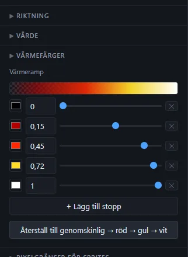

# Färg och exponering

Reglagen här avgör vilken mängd värme som får vilken färg. **Mättnadspunkt** är hur mycket värme som räknas som vitglödande.

## Snabba lösningar {#quick-fixes}

- Allt är vitt: höj **Mättnadspunkt**, eller tryck på **Autoexponera från fältet**.
- Inget syns: sänk **Mättnadspunkt**, eller tryck på **Autoexponera från fältet**.
- Bara några enstaka prickar syns: skruva upp **Minsta värme**.

Varje reglage på den här sidan verkar när värmen görs om till en färg. Om du drar i något av dem ritas bilden om direkt, och det **startar aldrig om ackumuleringen**.

## Mättnadspunkt {#saturation-point}

**Mättnadspunkt** (avsnittet Värmeform): den ackumulerade värme som motsvarar den översta delen av färgramperna (med svaret *Linjär*. Se nedan för de andra). Logaritmiskt reglage från 0,1 till 4000. Draghandtaget går upp till 10 000 000, eftersom ackumulerad värme växer med antalet rader. Standard är 24. Vid varje inläsning får man först en **analytisk uppskattning**, och sedan **mätt** från bilden.

Att ha fel här är skillnaden mellan en värmekarta och en tom (eller vit) skärm. Värdet kan inte härledas på ett tillförlitligt sätt. Telemetrin klumpar sig så hårt (en start, en dörr, en trång passage) att förhållandet mellan topp- och medeltäthet skiljer sig med en storleksordning mellan datamängder och mellan kamervinklar.

## Automatisk exponering {#auto-exposure}

**Autoexponera från fältet** mäter fältet som skuggningen faktiskt gav. Den ignorerar tomma pixlar, tar den 98:e percentilen av de upplysta och placerar den på 85 % av vägen till mättnadspunkten. Då finns den översta delen av rampen kvar för de riktiga topparna.

Panelen visar sedan *mätt X % av bildrutan; 98:e percentilen R placerad nära rampens topp*. Med svaret *Mättande* hamnar ett värde på 85 % av mättnadspunkten på ungefär 57 % av rampen i stället för 85 %.

Den körs också **automatiskt**:

- 8 renderade bildrutor efter att en datamängd lästs in.
- 8 bildrutor efter att [filtren](filters.md) ändrats. Om man filtrerar varje position ner till hundra händelser ändras tätheten med flera storleksordningar.
- 8 bildrutor efter att man byter mellan punktvärme och [linjevärme](line-heat.md), eller ändrar vilka rutter linjevärmen ritar. En linje lägger ner betydligt mindre värme per sampling än en sprite.

När ingenting är upplyst lämnar den automatiska körningen mättnaden orörd. Knappen faller då tillbaka på den analytiska uppskattningen och säger *inget upplyst att mäta - använde den analytiska uppskattningen*.

### Följ vyn {#follow-the-view}

**Följ vyn** (avsnittet Värmeform, standard på) mäter om varje gång kameran kommer till ro. Ett område du flyger in i använder då hela färgrampen i stället för skalan som mättes för hela kartan. Små ändringar ignoreras, och skalan glider i stället för att hoppa. Det gäller de fyra värmelägena, inte figuröverlägget.

Avmarkera den för att låsa skalan och jämföra platser på en och samma skala. Om du drar **Mättnadspunkt** för hand låses den också.

## Täthetsrespons {#density-response}

**Täthetsrespons**: hur *k* (värme / mättnad) avbildas på rampen:

| Svar | Formel | Användning |
|---|---|---|
| **Mättande** (standard) | t = 1 - e^(-k) | Närmar sig rampens topp asymptotiskt, på samma sätt som staplade genomskinliga sprites gör. Ingenting klipps någonsin till platt vitt, vilket gör det till det säkra standardvalet för okänd data. |
| **Linjär** | t = k | Den enda avbildningen där lika färg betyder lika antal. Använd den för att jämföra två datamängder eller två tidsfönster. |
| **Log** | t = log₂(1 + 7k) / 3 | Komprimerar en lång svans, så att en extrem hotspot slutar platta ut allt annat längst ner på rampen. Lyfter glesa områden. |

## Minsta värme {#minimum-heat}

**Minsta värme** (standard av, 0–100 %): varje pixel som bär någon värme alls lyfts till minst denna punkt på rampen. Skruva upp den, och skruva ner spriteradien, för att se *var något någonsin hände*. Enstaka datapunkter blir då tydligt synliga i stället för att ligga precis ovanför genomskinligt. Låt den vara av när du bedömer täthet, eftersom den medvetet platta ut rampens botten. Tröskeln (k > 0,0001) gör att verkligen tomma pixlar förblir tomma.

## Rampredigeraren {#the-ramp-editor}

I avsnittet **Värmefärger**. Dess etikett säger vad rampen är till för: *Värmeramp* i Värme och Linjer, *Positiv (additiva lag)* i Differens, *Opacitetsramp (färgen kommer från gruppen)* i [Lagvärme](team-heat.md), där bara dess alfa används.



Fältet överst förhandsvisar rampen. Under det finns en rad per stopp:

| Del | Betydelse |
|---|---|
| Färgprov | Stoppets färg (webbläsarens färgväljare). |
| Tal | Stoppets läge längs rampen, 0 till 1 (0 = ingen värme). |
| Reglage | Stoppets opacitet, 0–100 %. |
| ✕ | Tar bort stoppet. Inaktiv när bara två finns kvar. |

**+ Lägg till stopp** lägger till ett stopp mitt mellan de två sista stoppen, med det sista stoppets färg och opacitet. **Återställ till genomskinlig → röd → gul → vit** återställer standarden.

Stoppen kan anges i vilken ordning som helst. De sorteras när rampen byggs. **Alfa** är det som blandar värmen över scenen. Därför är nolländen av standardrampen helt genomskinlig.

### Standardramperna {#the-default-ramps}

| Läge | Positiv (Värme, Linjer, Differens +) | Negativ (Differens −) |
|---|---|---|
| 0,00 | svart, alfa 0 | svart, alfa 0 |
| 0,15 | rgb(180, 0, 0), alfa 0,55 | rgb(0, 170, 60), alfa 0,55 |
| 0,45 | rgb(255, 40, 0), alfa 0,85 | rgb(0, 190, 200), alfa 0,85 |
| 0,72 | rgb(255, 220, 40), alfa 0,95 | rgb(40, 80, 255), alfa 0,95 |
| 1,00 | vitt, alfa 1 | rgb(170, 60, 255), alfa 1 |

## Medan kameran rör sig {#while-the-camera-moves}

När kameran rör sig startar ackumuleringen om varje bildruta. Med **Rita alla rader varje bildruta** på (standard) är varje rörlig bildruta fortfarande exakt. Med den av visar en rörlig bildruta en samplad skattning, med ljusare klumpar som vägs upp. Den konvergerar mot den jämnare, sanna bilden när du stannar. Det är väntat. Se [Ackumulering](accumulation.md).

## För utvecklare {#for-developers}

### Sammansättningspassen {#the-composite-pass}

När värmen har ackumulerats görs varje pixels värde om till en färg i ett enda sammansättningspass ([`COMPOSITE_FS`](https://github.com/Holdi601/3DHeat/blob/main/src/render/webgl2/shaders.ts)). Stegen är:

```
k = |heat| / saturation point
t = response(k)                         clamped to 0..1
if minimum heat > 0 and k > 0.0001:  t = minimum + (1 - minimum) × t
colour, alpha = ramp(t)                  (the negative ramp when heat < 0, Difference only)
pixel = mix(scene, colour, alpha)
```

### Den analytiska uppskattningen {#the-analytic-estimate}

**Den analytiska uppskattningen** ([`estimateSaturation`](https://github.com/Holdi601/3DHeat/blob/main/src/data/calibrate.ts)) antar att raderna sprids över datans fotavtryck i X-Z-planet. Medelvärmen = rader × (π r² / fotavtrycksarea) × 1/3 × intensitet i mitten (1/3 är skivans medelvärde för en linjär ramp), gånger ett antaget förhållande mellan topp och medelvärde på 25, begränsat till 0,1–1 000 000. Den behöver bara ligga inom en storleksordning av rätt värde.

### Mätning {#metering}

[`exposure.ts`](https://github.com/Holdi601/3DHeat/blob/main/src/render/exposure.ts):

1. Värmemålet läses tillbaka från grafikkortet, glesas ut till högst 40 000 värden.
2. Tomma pixlar (värme ≤ 0,0001) kasseras. Det mesta av ett värmefält är tomt, och att medelvärdesbilda dem skulle exponera allt för lite, precis som en kameramätare riktad mot en svart bakgrund.
3. Den 98:e percentilen av de upplysta pixlarna är referensen.
4. Mättnadspunkten blir referens / 0,85, så att referensen sitter på 85 % av vägen till mättnadspunkten och rampens topp finns kvar för de riktiga topparna.

### Färgtabellen {#the-colour-table}

Rampen bakas in i en RGBA-tabell på 256 × 2 (den positiva rampen på första raden, den negativa på andra) ([`buildColorLut`](https://github.com/Holdi601/3DHeat/blob/main/src/render/colors.ts)). Färger interpoleras i linjärt ljus och lagras som sRGB. Opaciteten interpoleras linjärt.
